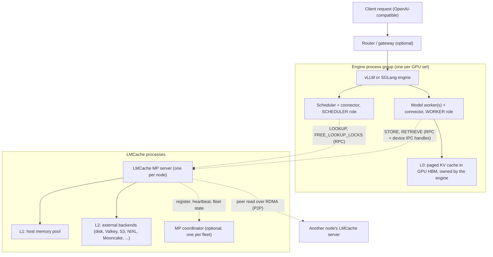

# 1. Project overview

> Code references in this document are permalinks pinned to upstream `dev`
> @ [`53bde913`](https://github.com/LMCache/LMCache/tree/53bde913de1adae2a380fe0c2de8d2b9355b4702).

This document is for someone who has never used LMCache. It covers the problem
LMCache exists to solve, where it sits in a serving stack, the one core idea the
whole codebase is built around, what LMCache deliberately is *not*, and a
**vocabulary** section that the rest of the guide leans on.

---

## 1.1 The problem: prefill is recomputed work

Serving an LLM request has two phases. **Prefill** runs the model over the whole
prompt and produces one key/value pair per token per attention layer — the *KV
cache*. **Decode** then generates tokens one at a time, reading that KV cache and
appending to it. Prefill is compute-bound and grows with prompt length; decode is
memory-bandwidth-bound and grows with output length.

Time-to-first-token (**TTFT**) is dominated by prefill. So for the workloads that
have come to matter most — multi-turn chat, agent loops that resend a long
scratchpad every step, RAG prompts that re-paste the same documents, long system
prompts shared across every user — a large fraction of every prompt is *text the
system has already run the model over*. Recomputing its KV is pure waste.

Modern engines already exploit part of this. vLLM's **automatic prefix caching**
(APC) keeps recently used KV blocks in GPU memory and reuses them when a new
prompt shares a prefix with an old one. That helps, but it is bounded in three
ways that matter in production:

1. **Capacity.** GPU HBM is the scarcest resource in the box, and KV competes
   with model weights and activations for it. The reusable working set of an
   agentic or RAG workload is routinely far larger than what fits.
2. **Lifetime.** The cache lives in the engine process's memory. Restart the
   engine, scale the deployment down, or crash a worker, and the cache is gone.
3. **Scope.** The cache belongs to *one* engine instance. A second replica that
   receives the same long document starts from zero, and a prefill worker in a
   disaggregated deployment cannot hand its KV to a decode worker without a
   transfer mechanism.

LMCache attacks all three: it moves KV *out* of GPU memory into a larger,
longer-lived, shareable hierarchy, and puts it back on demand.

---

## 1.2 What LMCache is

LMCache is a **KV cache management layer**. The upstream
[`README.md`](https://github.com/LMCache/LMCache/blob/53bde913de1adae2a380fe0c2de8d2b9355b4702/README.md#L54)
puts it as turning KV cache "from a temporary state into reusable *AI-native
knowledge*".

Concretely, in the architecture on `dev` today, LMCache is:

- **A separate daemon process** (the *MP server*) that owns a pool of host memory
  and a set of external storage backends, started with `lmcache server`
  ([`lmcache/cli/commands/server.py#L14`](https://github.com/LMCache/LMCache/blob/53bde913de1adae2a380fe0c2de8d2b9355b4702/lmcache/cli/commands/server.py#L14)).
  It does not share a process — or a fate — with the inference engine.
- **Plus a thin adapter that loads inside the engine**: for vLLM, the
  `LMCacheMPConnector`
  ([`lmcache/integration/vllm/lmcache_mp_connector.py#L590`](https://github.com/LMCache/LMCache/blob/53bde913de1adae2a380fe0c2de8d2b9355b4702/lmcache/integration/vllm/lmcache_mp_connector.py#L590)),
  which implements vLLM's `KVConnectorBase_V1` interface. The engine calls the
  connector at well-defined points in its scheduling and forward loop; the
  connector talks to the MP server over RPC.

The *engine-independent daemon* shape is the central deployment decision, and
the project states its motivation plainly in the README: "KV cache will not be
lost even if the inference engine crashes (i.e., no fate-sharing with engines)."
A second consequence matters just as much: because the cache is not inside any
one engine, several engines — even engines of different kinds — can share it.

### Where it sits relative to vLLM and SGLang

LMCache is **not** a serving engine and does not schedule or run models. It is a
layer *beneath* one. The engines are integrated through adapters under
`lmcache/integration/<engine>/`, and the repository keeps that boundary
deliberately sharp (see [§2.6](02-architecture.md#26-architectural-boundaries-and-why-they-exist)):

| Engine | Integration | Entry point |
|---|---|---|
| vLLM | `lmcache/integration/vllm/` | [`LMCacheMPConnector`](https://github.com/LMCache/LMCache/blob/53bde913de1adae2a380fe0c2de8d2b9355b4702/lmcache/integration/vllm/lmcache_mp_connector.py#L590) — a vLLM V1 KV connector |
| SGLang | `lmcache/integration/sglang/` | [`UnifiedLMCacheMPConnector`](https://github.com/LMCache/LMCache/blob/53bde913de1adae2a380fe0c2de8d2b9355b4702/lmcache/integration/sglang/unified_lmcache_mp_connector.py#L65) |
| TensorRT-LLM | `lmcache/integration/tensorrt_llm/` | `tensorrt_mp_adapter.py` |
| Atom | `lmcache/integration/atom/` | `multi_process_adapter.py` |

vLLM is by far the most developed integration (~9.7k lines versus ~1.5k for
SGLang's), and it is the one whose quirks shape the core contracts most. See
[vLLM integration](features/05-vllm-integration.md) for the detail.

In prose: a request reaches a serving engine as normal. Inside that engine
process group, the LMCache connector runs in two roles — once beside the
scheduler and once inside each model worker. The scheduler-side connector asks
the LMCache MP server whether the prompt's prefix is cached; the worker-side
connector moves the actual KV bytes between GPU memory (L0, which the engine
owns) and the MP server's host memory pool (L1), from which the server can
offload to external backends (L2). An optional coordinator tracks fleet
membership and holds fleet-wide state; it never carries KV data. With P2P
enabled, one node's server can read KV straight out of a peer's L1.

---

## 1.3 The core idea: chunked, hash-keyed reuse over a hierarchy

Almost every design decision in the repository follows from three choices.

**1. Cache at chunk granularity, not request granularity.** A prompt's tokens
are cut into fixed-size **chunks** — 256 tokens by default
([`MPServerConfig.chunk_size`](https://github.com/LMCache/LMCache/blob/53bde913de1adae2a380fe0c2de8d2b9355b4702/lmcache/v1/multiprocess/config.py#L52)).
Each chunk's KV becomes one stored object. Chunking is what makes *partial* reuse
possible: two prompts that share the first 3,000 tokens and then diverge share
the first 11 chunks. It is also what makes the storage side tractable — objects
are uniform, so pools, eviction, and transfers can be sized once.

The trade-off is granularity loss: a hit is only ever a whole number of chunks,
so a prompt that shares 2,900 tokens with a cached one reuses 2,816 of them (11
chunks) and recomputes the rest. A larger chunk means fewer, bigger objects
(cheaper bookkeeping, larger transfers) and coarser hits; a smaller chunk means
the opposite. The default of 256 is a compromise, and the connector may negotiate
it upward to satisfy a model's KV geometry.

**2. Key each chunk by a rolling hash of every token up to its end.** The key is
not a hash of the chunk's own tokens — it is a *prefix* hash, chained from the
previous chunk's hash:
[`TokenHasher.compute_packed_chunk_hashes`](https://github.com/LMCache/LMCache/blob/53bde913de1adae2a380fe0c2de8d2b9355b4702/lmcache/v1/common/token_hasher.py#L242)
walks the sequence from token 0 and feeds each chunk's packed bytes plus the
running hash into the hash function (`blake3` by default). This is the same trick
vLLM's prefix cache uses, and it buys two things: a chunk hash *identifies the
entire prefix* ending at that chunk, so equal hashes mean genuinely identical
history (not an accidental match of a repeated passage at a different position);
and a prefix match becomes a cheap linear scan over hashes rather than a
tree walk.

The cost is that reuse is positional — the same document pasted at a different
offset produces different hashes and does not hit. Recovering reuse for that case
is exactly what CacheBlend / the `blend` engine type exists for, and why it is a
separate, opt-in mode rather than the default.

**3. Make the key fully self-describing, and put everything behind it in a
tiered store.** The identity that is matched on is
[`ObjectKeyIdentity`](https://github.com/LMCache/LMCache/blob/53bde913de1adae2a380fe0c2de8d2b9355b4702/lmcache/v1/distributed/api.py#L211):
the chunk hash, the model name, the KV rank (which TP/PP shard this is), the
object group, an optional per-tenant `cache_salt`, and optional matching tags.
No ambient state is involved, which is what lets a key be written on one node,
evicted to S3, and read by a different engine process a day later and still mean
exactly the same thing. (See
[`docs/design/v1/cache-identity.md`](https://github.com/LMCache/LMCache/blob/53bde913de1adae2a380fe0c2de8d2b9355b4702/docs/design/v1/cache-identity.md)
and
[`docs/design/v1/object-key-identity.md`](https://github.com/LMCache/LMCache/blob/53bde913de1adae2a380fe0c2de8d2b9355b4702/docs/design/v1/object-key-identity.md).)

Those keyed objects then live in a hierarchy — GPU (L0) → host memory (L1) →
external backends (L2) — with the MP server deciding what sits where. The
hierarchy, and the paths between its tiers, are the subject of
[§2.3](02-architecture.md#23-the-storage-hierarchy-l0--l1--l2).

---

## 1.4 What LMCache is *not*

Being clear about the non-goals removes most of the confusion newcomers have.

- **Not a serving engine.** It does not batch, schedule, or run a model. It holds
  KV and moves it.
- **Not a replacement for the engine's own prefix cache.** L0 — the engine's
  paged KV in HBM — stays owned and managed by the engine. LMCache is the tier
  *below* it, and the connector explicitly tells the server how much of the
  prompt the engine's own prefix cache already covers so the server does not
  redundantly fetch it (the `start` argument to
  [`maybe_submit_lookup_request`](https://github.com/LMCache/LMCache/blob/53bde913de1adae2a380fe0c2de8d2b9355b4702/lmcache/integration/vllm/vllm_multi_process_adapter.py#L752)).
- **Not a database or a general object store.** It is a cache: entries are
  evictable, lookups are best-effort, and a miss is always safe because the
  engine can recompute. The whole system is built so that failure degrades to
  "recompute locally" rather than to a wrong answer — see the `BYPASS_LMCACHE`
  path in
  [`get_num_new_matched_tokens`](https://github.com/LMCache/LMCache/blob/53bde913de1adae2a380fe0c2de8d2b9355b4702/lmcache/integration/vllm/lmcache_mp_connector.py#L1377).
- **Not model- or vendor-specific by design.** Engine knowledge is confined to
  `lmcache/integration/<engine>/`, accelerator knowledge to
  `lmcache/v1/platform/`, and storage knowledge to L2 adapters. That is a written
  rule, not an aspiration: see
  [`docs/coding_standards.md` §4.6](https://github.com/LMCache/LMCache/blob/53bde913de1adae2a380fe0c2de8d2b9355b4702/docs/coding_standards.md#L123).
- **Not a lossless-by-definition transformation.** Some opt-in features
  (CacheBlend's selective recompute, quantizing serde such as TurboQuant, token
  dropping) trade exactness for size or speed. They are opt-in precisely because
  they change outputs.
- **Not what the older documentation describes.** The legacy *in-process* mode,
  where LMCache ran inside the engine process, was removed from `dev` (commits
  [`78b6b80f`](https://github.com/LMCache/LMCache/commit/78b6b80f) and
  [`5b9db86f`](https://github.com/LMCache/LMCache/commit/5b9db86f)) and now lives
  in a separate `LMCache_inprocess` package. Multiprocess (MP) mode **is** the
  architecture. Blog posts, examples, and third-party write-ups that configure
  LMCache through `LMCACHE_*` environment variables and a `lmcache` config YAML
  inside the vLLM process are describing the old mode.

---

## 1.5 Vocabulary

These definitions are load-bearing for every other document in this guide. Each
is taken from the code or design docs cited.

### Cache content

**KV cache** — the per-token key and value tensors every attention layer
produces during prefill and decode. It is what is being stored, moved, and
reused. Its physical layout is engine- and model-specific, which is why LMCache
describes it with its own typed contracts rather than passing engine objects
around.

**Chunk** — a fixed-length run of tokens (default 256, `--chunk-size`) whose KV
is stored as one object. The unit of hashing, lookup, storage, eviction, and
transfer. A prompt's trailing partial chunk is normally *not* stored; storing it
is opt-in (`lmcache.mp.save_unfull_chunk`), and the design doc for that case is
[`docs/design/v1/multiprocess/unfull_chunk.md`](https://github.com/LMCache/LMCache/blob/53bde913de1adae2a380fe0c2de8d2b9355b4702/docs/design/v1/multiprocess/unfull_chunk.md).

**Token hash / chunk hash** — the rolling prefix hash described in §1.3: the hash
of chunk *n* depends on all tokens from position 0 through the end of chunk *n*.
Computed by
[`TokenHasher`](https://github.com/LMCache/LMCache/blob/53bde913de1adae2a380fe0c2de8d2b9355b4702/lmcache/v1/common/token_hasher.py#L77);
`blake3` is the default and is self-contained, while the other algorithms are
loaded from vLLM so that LMCache's hashes agree with the engine's.

**Cache key** — the full identity an object is matched on,
[`ObjectKeyIdentity`](https://github.com/LMCache/LMCache/blob/53bde913de1adae2a380fe0c2de8d2b9355b4702/lmcache/v1/distributed/api.py#L211):
`chunk_hash`, `kv_rank`, `model_name`, `object_group_id`, `cache_salt`, and
`tags`. Wrapped by
[`ObjectKey`](https://github.com/LMCache/LMCache/blob/53bde913de1adae2a380fe0c2de8d2b9355b4702/lmcache/v1/distributed/api.py#L235),
which adds request-scoped `extra_attributes` that are *excluded* from equality
and hashing. The wire-side equivalent travelling from engine to server is
[`IPCCacheServerKey`](https://github.com/LMCache/LMCache/blob/53bde913de1adae2a380fe0c2de8d2b9355b4702/lmcache/v1/common/custom_types.py#L28),
which carries packed token bytes and a `[start, end)` range rather than hashes —
**the server hashes, not the client.**

**`cache_salt`** — a per-tenant/per-user isolation string that is part of cache
identity. Two requests with different salts can never share an entry, which is
how multi-tenant deployments avoid cross-tenant reuse. Validated to exclude
`@`, `/`, `\` and NUL and capped at 128 characters, because it is embedded in
persistent L2 object names.

**Prefix cache** — reuse keyed on an exact shared prefix. Both vLLM (in HBM, as
APC) and LMCache (across the hierarchy) do this. "Non-prefix reuse" —
reusing a chunk that appears at a *different* position — is the separate
CacheBlend feature, enabled with `--engine-type blend`.

### Grouping

**KV cache group (engine group)** — a group defined by the *serving engine*. In
vLLM it is an entry of `KVCacheConfig.kv_cache_groups`, and per
[`docs/design/integration/vllm/hybrid-kv-cache-groups.md`](https://github.com/LMCache/LMCache/blob/53bde913de1adae2a380fe0c2de8d2b9355b4702/docs/design/integration/vllm/hybrid-kv-cache-groups.md)
each one is "one distinct paged-block address space; block IDs are only
meaningful within one group." Hybrid models (sliding-window attention mixed with
full attention, or Mamba-style recurrent state alongside attention) have several.
LMCache's engine-neutral record of one is `EngineGroupInfo`.

**Object group** — LMCache's own grouping, one level up from the engine's:
["An object group contains one or more kernel groups whose KV caches will be
stored in the same memory object"](https://github.com/LMCache/LMCache/blob/53bde913de1adae2a380fe0c2de8d2b9355b4702/lmcache/v1/kv_layer_groups.py#L285),
and its purpose is stated right there — it exists "for dealing with sliding
window or mamba KV caches that need a different prefix matching logic from the
full attention KV caches." Object groups are the reason `object_group_id` is part
of the cache key: a sliding-window group only needs the last *w* chunks of the
prefix to serve a hit, while a full-attention group needs all of them, so they
cannot share one match decision. The per-group window is described by
[`AttnWindowDesc`](https://github.com/LMCache/LMCache/blob/53bde913de1adae2a380fe0c2de8d2b9355b4702/lmcache/v1/common/attn_window.py#L15),
where `-1` means full attention and `w >= 1` means a window of `w` chunks.

**Kernel group** — the finest grouping: the set of layers that are
*transfer-kernel equivalent*, identified by
[`KernelGroupIdentity`](https://github.com/LMCache/LMCache/blob/53bde913de1adae2a380fe0c2de8d2b9355b4702/lmcache/v1/kv_layer_groups.py#L61)
(`kv_size`, `num_heads`, `head_size`, `block_size`, `engine_group_idx`, `dtype`,
`engine_kv_format`, `block_stride_elems`). One kernel group is one dispatch unit
for the copy kernels. You mostly meet this term when reading the transfer path.

**`kv_rank`** — which shard of a tensor-parallel (or MLA pipeline/DCP) world a
stored object belongs to. Part of the key, because rank *i*'s KV is not
interchangeable with rank *j*'s.

### Tiers

**L0** — the engine's paged KV cache in GPU HBM. **LMCache does not own it**; the
engine allocates it and LMCache is given handles to it at registration. The term
appears in the codebase mainly in benchmarking and metrics code (e.g. the
"L0 HBM / L1 DRAM / L2 disk" ladder in
[`prefix_suffix_tuner.py`](https://github.com/LMCache/LMCache/blob/53bde913de1adae2a380fe0c2de8d2b9355b4702/lmcache/cli/commands/bench/engine_bench/workloads/prefix_suffix_tuner.py#L4)).

**L1** — the MP server's local memory pool: the tier that actually holds
LMCache-owned KV objects on this node. Normally pinned host DRAM, but the backing
medium is a closed set,
[`L1BackendType`](https://github.com/LMCache/LMCache/blob/53bde913de1adae2a380fe0c2de8d2b9355b4702/lmcache/v1/distributed/api.py#L103):
`dram`, `devdax` (CXL/persistent memory via Device-DAX), or `gds` (NVMe through
GPUDirect Storage). Managed by the L1 managers under
`lmcache/v1/distributed/l1_manager/`. See
[L1 memory and eviction](features/03-l1-memory-and-eviction.md).

**L2** — external storage behind a pluggable adapter interface: local disk,
Valkey/Redis, S3-compatible object storage, Mooncake, InfiniStore, NIXL, GDS, a
peer's memory, and more. Unlike L1's closed set, L2 is explicitly described in
the code as "an open adapter-type registry". See
[L2 adapters and storage](features/04-l2-adapters-and-storage.md).

The `l1`/`l2`/`all` distinction is a first-class enum,
[`Tier`](https://github.com/LMCache/LMCache/blob/53bde913de1adae2a380fe0c2de8d2b9355b4702/lmcache/v1/distributed/api.py#L90),
and orthogonal properties of a tier's bytes — what medium holds them and whether
they are local, remote, or leased — are carried by
[`MemoryTags`](https://github.com/LMCache/LMCache/blob/53bde913de1adae2a380fe0c2de8d2b9355b4702/lmcache/v1/distributed/api.py#L161).
Tags are what let a prefetch say "serve this from local DRAM only", so that
orchestration code never has to name a concrete backend.

### Processes

**Connector** — the adapter that runs *inside* the engine process and implements
the engine's KV-transfer interface. For vLLM, `LMCacheMPConnector`. It exists in
two roles, `SCHEDULER` and `WORKER`, created separately by vLLM, and the two do
quite different jobs: the scheduler role does lookups and decides how many tokens
to claim, the worker role moves bytes.

**MP server** — the LMCache daemon:
[`MPCacheServer`](https://github.com/LMCache/LMCache/blob/53bde913de1adae2a380fe0c2de8d2b9355b4702/lmcache/v1/multiprocess/server.py#L85),
one per node in a typical deployment. It owns L1, the L2 adapters, and the
request transport, and it is composed from pluggable modules (§2.5). "MP" =
multiprocess, as opposed to the removed in-process mode.

**Coordinator** — a standalone FastAPI service, `lmcache coordinator`, that MP
servers register with. The P2P example states its scope precisely: it "tracks
which LMCache servers are alive. It only manages membership; **it never sees KV
data**"
([`examples/p2p/README.md`](https://github.com/LMCache/LMCache/blob/53bde913de1adae2a380fe0c2de8d2b9355b4702/examples/p2p/README.md)).
It also holds fleet-wide operator state such as L2 pins and per-salt quotas. It
is optional for a single-server deployment.

### Operations

The four verbs appear throughout the codebase and are *not* interchangeable.

| Verb | Who calls it | What it does |
|---|---|---|
| **lookup** | the engine's **scheduler**, once per request (possibly polled) | Asks "how many tokens of this prompt do you have?" Hashes the range, submits a prefetch, takes a **read lock** on what it matched, and returns a token count. [`LookupModule.lookup`](https://github.com/LMCache/LMCache/blob/53bde913de1adae2a380fe0c2de8d2b9355b4702/lmcache/v1/multiprocess/modules/lookup.py#L205) |
| **prefetch** | the MP server, as a consequence of a lookup | Asynchronously pulls matching objects from L2 up into L1 so that a later retrieve is an L1→L0 copy. [`StorageManager.submit_prefetch_task`](https://github.com/LMCache/LMCache/blob/53bde913de1adae2a380fe0c2de8d2b9355b4702/lmcache/v1/distributed/storage_manager.py#L539) |
| **retrieve** | the engine's **worker**, before the forward pass | Copies KV from L1 into the engine's GPU blocks (L0). [`LMCacheDrivenTransferModule.retrieve`](https://github.com/LMCache/LMCache/blob/53bde913de1adae2a380fe0c2de8d2b9355b4702/lmcache/v1/multiprocess/modules/lmcache_driven_transfer.py#L1037) |
| **store** | the engine's **worker**, as the forward pass exits | Copies freshly computed KV from L0 into L1, from where it may be offloaded to L2. [`LMCacheDrivenTransferModule.store`](https://github.com/LMCache/LMCache/blob/53bde913de1adae2a380fe0c2de8d2b9355b4702/lmcache/v1/multiprocess/modules/lmcache_driven_transfer.py#L647) |

The split between *lookup* and *retrieve* is the single most important thing to
internalise: **lookup is a promise, retrieve is the delivery.** Lookup runs on
the scheduler's thread and must not block, so it only reserves — it takes a read
lock so the matched chunks cannot be evicted between the promise and the
delivery, and starts the L2→L1 prefetch. The worker's retrieve, one or more
scheduler steps later, is the part that actually touches GPU memory. That read
lock is released by `FREE_LOOKUP_LOCKS`
([`LookupModule.free_lookup_locks`](https://github.com/LMCache/LMCache/blob/53bde913de1adae2a380fe0c2de8d2b9355b4702/lmcache/v1/multiprocess/modules/lookup.py#L486)),
and a leaked lock is a leaked L1 slot — which is why so much of the connector's
code is bookkeeping for releasing them on every exit path, including preemption
and failure.

**Pinning** — a *different* mechanism from a read lock, and easy to confuse with
it. A pin is operator intent, set through the coordinator's `POST /cache/pins`,
that "protects keys from L2 eviction until unpinned"
([`PinRequest`](https://github.com/LMCache/LMCache/blob/53bde913de1adae2a380fe0c2de8d2b9355b4702/lmcache/v1/mp_coordinator/schemas.py#L672)).
Pins are fleet-wide per `cache_salt` and survive requests; read locks are
per-request, short-lived, and apply to L1. (Separately, "pinned memory" in the L1
code means page-locked host DRAM in the CUDA sense — a third, unrelated use of
the word.)

**TTFT** — time to first token, the latency from request arrival to the first
generated token. The metric LMCache primarily targets, since it is dominated by
prefill. Note: this guide makes no measurements and no performance claims of its
own.

---

## 1.6 Where to go next

- [§2 Architecture](02-architecture.md) — the process topology, the storage
  hierarchy, the end-to-end request flow, and the module system.
- [§3 Code map](03-code-map.md) — what lives in each directory and how to find
  the code behind a given behaviour.
- [KV cache lifecycle](features/02-kv-cache-lifecycle.md) — the four verbs in
  full detail.
- [Issue deep dives](issue-deep-dives/README.md) — five real bugs, traced from
  symptom to merged fix.
