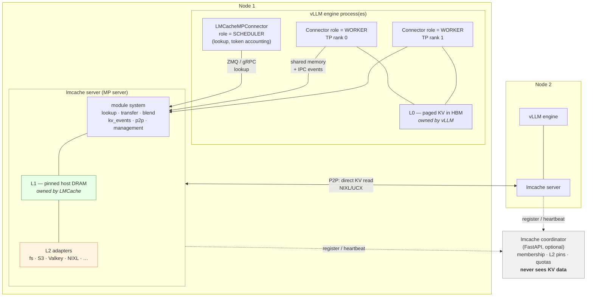
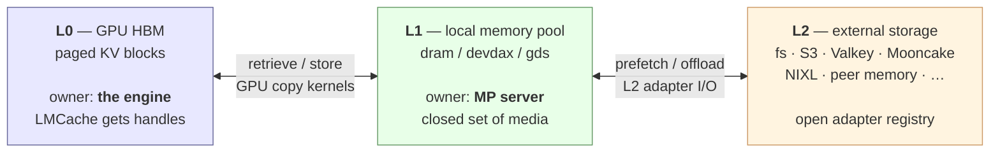
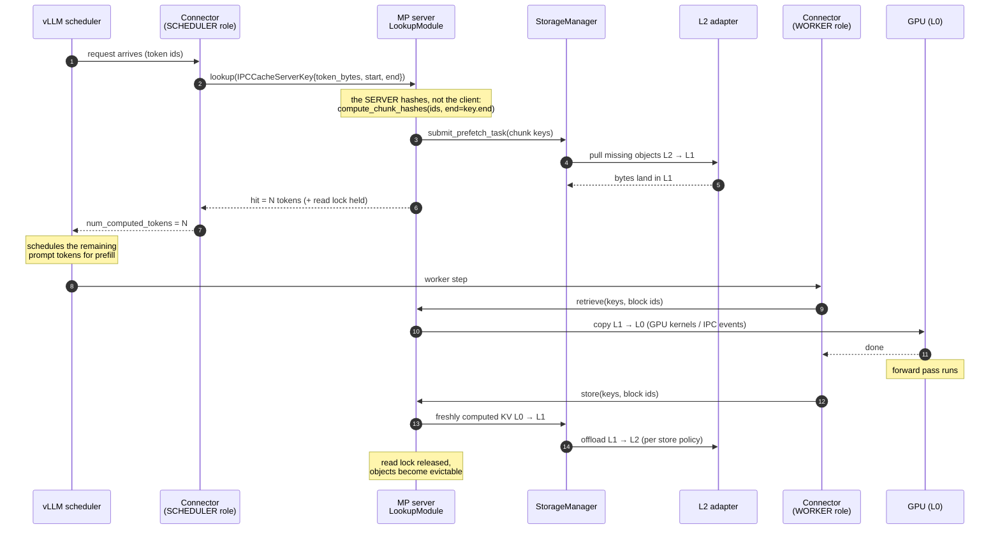
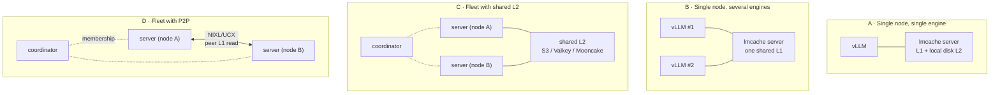

# 2. Architecture

> Code references in this document are permalinks pinned to upstream `dev`
> @ [`53bde913`](https://github.com/LMCache/LMCache/tree/53bde913de1adae2a380fe0c2de8d2b9355b4702).

This document covers the **process topology**, the **storage hierarchy**, and how one
request flows end to end. It assumes the vocabulary from
[§1.5 of the project overview](01-project-overview.md#15-vocabulary) — in particular
*chunk*, *object group*, *L0/L1/L2*, *connector*, *MP server*, and the four verbs
(*lookup*, *prefetch*, *retrieve*, *store*).

---

## 2.1 The one-sentence version

LMCache is a **daemon that owns a pool of host memory and a set of external storage
backends**, plus a **thin adapter loaded inside the inference engine** that asks the daemon
what it has and then moves bytes to and from GPU memory.

Everything else is a consequence of that split.

---

## 2.2 Process topology



Three kinds of process, and the distinctions matter:

**The engine process** runs the model and owns L0 — the paged KV cache in HBM. LMCache
lives inside it only as a connector. vLLM instantiates the connector **twice, in two
roles**, and they do different jobs:

- `SCHEDULER` role — runs in the scheduler, does **lookups** and decides how many tokens of
  each request to claim from the cache. It never touches tensors.
- `WORKER` role — runs in each TP worker, does **retrieve** and **store**. It moves bytes
  and never makes policy decisions.

This split is load-bearing: the bug in [#5151](issue-deep-dives/difficult-5151-mamba-full-hit-restoration.md)
is entirely in the scheduler role's token arithmetic, and the worker role faithfully moved
exactly the bytes it was told to.

**The MP server** (`lmcache server`,
[`MPCacheServer`](https://github.com/LMCache/LMCache/blob/53bde913de1adae2a380fe0c2de8d2b9355b4702/lmcache/v1/multiprocess/server.py#L85))
is the daemon. One per node, typically. It owns L1, all the L2 adapters, and the request
transport. "MP" means *multiprocess*, in contrast to a removed in-process mode.

**The coordinator** (`lmcache coordinator`) is a standalone FastAPI service that MP servers
register with. Its scope is deliberately tiny, and
[`examples/p2p/README.md`](https://github.com/LMCache/LMCache/blob/53bde913de1adae2a380fe0c2de8d2b9355b4702/examples/p2p/README.md)
states it exactly:

> It only manages membership; **it never sees KV data**.

It is optional for a single-server deployment.

### 2.2.1 Why the daemon is a separate process

The obvious design is a library inside the engine. The daemon buys four things a library
cannot:

| Property | Consequence |
|---|---|
| **Independent lifetime** | Restart, crash, or scale down an engine and the cache survives. A library's cache dies with its host. |
| **Shared across engines** | Several engine processes on a node use one pool. With a library, *N* replicas means *N* disjoint caches and *N*× the memory. |
| **Independent failure domain** | An OOM or a segfault in a storage backend does not take down the model server. |
| **One owner of the pool** | Pinned host memory, DMA registrations and NIXL agents are registered once, not once per engine. |

The cost is an IPC hop on the hot path, which is why §2.4's data path is shared memory
rather than a socket.

---

## 2.3 The storage hierarchy



The asymmetry between the tiers is the thing to internalise:

- **L0 is not LMCache's.** The engine allocates it. LMCache receives handles at
  registration (§2.3.1) and writes into the engine's blocks.
- **L1 is a closed set.** [`L1BackendType`](https://github.com/LMCache/LMCache/blob/53bde913de1adae2a380fe0c2de8d2b9355b4702/lmcache/v1/distributed/api.py#L103)
  admits exactly `dram`, `devdax` (CXL/persistent memory via Device-DAX) and `gds` (NVMe
  via GPUDirect Storage). You cannot add an L1 medium out of tree, because the object
  lifecycle state machine has to understand the medium.
- **L2 is open.** ~25 adapters live in
  [`l2_adapters/`](https://github.com/LMCache/LMCache/tree/53bde913de1adae2a380fe0c2de8d2b9355b4702/lmcache/v1/distributed/l2_adapters),
  all implementing one interface, and out-of-tree adapters load via a plugin mechanism.

Two abstractions keep policy code from naming concrete backends:

- [`Tier`](https://github.com/LMCache/LMCache/blob/53bde913de1adae2a380fe0c2de8d2b9355b4702/lmcache/v1/distributed/api.py#L90) — `l1` / `l2` / `all`.
- [`MemoryTags`](https://github.com/LMCache/LMCache/blob/53bde913de1adae2a380fe0c2de8d2b9355b4702/lmcache/v1/distributed/api.py#L161) — orthogonal properties of some bytes: which medium holds them, and whether they are local, remote or leased.

Tags are what let a prefetch request say *"serve this from local DRAM only"* without
mentioning an adapter class. A peer node's memory (see
[P2P sharing](features/08-p2p-sharing.md)) is modelled as **just another L2 tier** with
different tags — not as a special case in the orchestration code.

---

### 2.3.1 Registration: how the server learns about GPU memory

Before any KV can move, each engine worker tells the server what its KV cache looks like.
That is
[`register_kv_cache`](https://github.com/LMCache/LMCache/blob/53bde913de1adae2a380fe0c2de8d2b9355b4702/lmcache/v1/multiprocess/modules/lmcache_driven_transfer.py#L518):

```python
    def register_kv_cache(
        self,
        instance_id: int,
        kv_caches: KVCache,
        model_name: str,
        world_size: int,
        engine_type: EngineType,
        layout_hints: LayoutHints,
        engine_group_infos: list[EngineGroupInfo],
    ) -> None:
```

Note what crosses the boundary: the tensors' *handles*, the model name, the world size,
which engine produced them, layout hints, and **engine-neutral** group metadata
(`EngineGroupInfo`, "already msgspec-decoded by the message queue"). Not vLLM objects.
That conversion to engine-neutral types at the edge is why one server can serve vLLM,
SGLang and TensorRT-LLM.

Registration is also where the server derives the object-group structure and the per-group
attention windows, caching them in a layout registry keyed by `(model_name, world_size)` —
the registry that `LookupModule` consults on every lookup. And it is idempotent by design:

```python
        # NOOP-register: an already-registered instance (e.g. a recovering
        # worker re-registering on its first ping) refreshes its last-seen
        # time so a stale entry is not reaped right after recovery.
```

A worker that crashes and comes back re-registers, refreshing its liveness rather than
duplicating state — which matters because the server reaps instances that stop pinging
(see [MP architecture §8](features/01-mp-architecture.md)).

---

## 2.4 One request, end to end

The flow for a request that partially hits the cache:



Six things in that diagram are easy to get wrong and worth stating plainly:

1. **The server hashes, not the client.** The key that travels is
   [`IPCCacheServerKey`](https://github.com/LMCache/LMCache/blob/53bde913de1adae2a380fe0c2de8d2b9355b4702/lmcache/v1/common/custom_types.py#L28)
   carrying *packed token bytes* and a `[start, end)` range. The server computes chunk
   hashes. This centralises the hash algorithm — but it also means the server must respect
   `end`, and forgetting to was half of [#5151](issue-deep-dives/difficult-5151-mamba-full-hit-restoration.md).
2. **Lookup returns a token count, not data.** Its job is to let the scheduler decide how
   many tokens to skip. Bytes move later, in the worker role.
3. **Lookup takes a read lock.** Between the lookup and the retrieve, eviction must not
   reclaim what was matched. The lock is released after the transfer.
4. **Prefetch is a side effect of lookup.** By the time the worker asks to retrieve, the
   objects should already be in L1, so the hot path is an L1→L0 copy rather than an L2 read.
5. **Store is not synchronous to L2.** The worker's store lands in L1; whether and when it
   reaches L2 is a *policy* decision (`storage_controllers/store_policy.py`,
   `write_policy.py`). A failing L2 therefore degrades capacity silently — the mechanism
   behind [#5022](issue-deep-dives/difficult-5022-turboquant-sm80-bfloat16.md)'s invisibility.
6. **The control path and the data path are different transports.** Lookup is a small
   request/response over ZMQ or gRPC. KV bytes go through shared memory with IPC event
   signalling, because an extra copy through a socket would defeat the point. See
   [Transport layer](features/06-transport-layer.md).

---

## 2.5 Inside the MP server

The server is not a monolith; it is a **module host**. Each RPC family is a module under
[`multiprocess/modules/`](https://github.com/LMCache/LMCache/tree/53bde913de1adae2a380fe0c2de8d2b9355b4702/lmcache/v1/multiprocess/modules):

| Module | Responsibility |
|---|---|
| `lookup.py` | prefix lookup, chunk hashing, prefetch submission |
| `lmcache_driven_transfer.py` | registration, retrieve, store — LMCache drives the copy |
| `engine_driven_transfer.py` | the same, when the *engine* drives the copy instead |
| `server_transfer.py` | server-to-server transfer |
| `p2p_controller.py` | peer registration and discovery |
| `blend/` | CacheBlend — non-prefix reuse |
| `kv_events.py` | KV event stream |
| `management.py` | status, liveness, admin operations |

Modules declare whether they apply to a given configuration via a `create` classmethod
returning `None` to opt out, so a deployment only pays for what it uses. The mechanics —
the module contract, the shared `MPCacheServerContext`, sessions, dispatch, the liveness
reaper — are the subject of [MP architecture](features/01-mp-architecture.md).

Beneath the modules sits
[`StorageManager`](https://github.com/LMCache/LMCache/blob/53bde913de1adae2a380fe0c2de8d2b9355b4702/lmcache/v1/distributed/storage_manager.py)
("Distributed multi-tier storage manager for MP mode"), which is the single place that
knows about both tiers, plus a set of **storage controllers** — background threads that act
on L1. Their interface says what they are:

> Storage controllers are separate modules/threads that sees the L1 Manager and can operate
> on it.

`prefetch_controller`, `store_controller`, `eviction_controller`, `adapter_lifecycle`. The
split matters: modules handle requests, controllers do work nobody asked for synchronously.

---

## 2.6 Deployment topologies

The same binaries compose into several shapes:



- **A** is the quickstart: capacity and lifetime beyond HBM, nothing more.
- **B** is where the daemon design starts paying: two engines, one pool, one copy of every
  shared prefix.
- **C** gives cross-node reuse through a shared backend. Node B can serve a prefix node A
  computed, at the latency of the backend.
- **D** reads directly out of a peer's L1, skipping the external store. The coordinator
  supplies membership; the data path is NIXL/UCX. See
  [P2P sharing](features/08-p2p-sharing.md).

**Disaggregated prefill** is a variant of C/D: the prefill worker stores KV and the decode
worker retrieves it, with the hierarchy as the hand-off medium rather than a bespoke
transfer path.

---

## 2.7 Failure domains

Worth having a model of, because the system is designed to degrade rather than fail, and
that is a double-edged property.

| What dies | What happens |
|---|---|
| An **L2 adapter** | Stores and prefetches to that tier fail and are logged. L1 keeps serving. Capacity and durability shrink; hit rate drops slowly. **No user-visible error.** |
| The **MP server** | Engines lose the external cache and fall back to their own prefix cache plus full prefill. Slower, correct. Cached KV in L1 is gone; what reached L2 survives. |
| An **engine worker** | The server reaps the instance after it stops pinging; on restart it re-registers idempotently (§2.3.1). |
| The **coordinator** | Membership stops updating; existing peers keep working. Single-server deployments do not notice. |
| A **peer node** (P2P) | That peer's objects become unreachable; reads fall through to the next tier. |

The recurring theme: **a degraded cache looks like a smaller cache**, not like an outage.
That is the right behaviour for a cache and a genuine operational hazard — it is precisely
how [#5022](issue-deep-dives/difficult-5022-turboquant-sm80-bfloat16.md) hid a serde that
failed *every single task* for 49 days. Monitoring "is the tier healthy" matters more here
than in a system that would just break.

---

## 2.8 The boundaries that make it extensible

Four interfaces carry essentially all of the extensibility, and knowing them is most of
knowing the architecture:

| Interface | Where | Add one to get |
|---|---|---|
| `L2AdapterInterface` | `l2_adapters/base.py`, selected in `factory.py` | a new external storage backend |
| `L1ManagerInterface` | `distributed/internal_api.py` | a new local memory medium (closed set in practice) |
| `StorageControllerInterface` | `distributed/storage_controller.py` | a new background policy over L1 |
| `EngineModule` | `multiprocess/engine_module.py` | a new server-side RPC family |

Plus the **engine adapters** in `integration/`, which convert an engine's KV-transfer API
into LMCache's engine-neutral types. The conversion happens at the edge (§2.3.1), which is
why `v1/` contains almost no vLLM-specific code despite vLLM being the primary target.

---

## 2.9 Where to look next

Depending on what you are doing:

| Goal | Read |
|---|---|
| Understand the server you just launched | [MP architecture](features/01-mp-architecture.md) |
| Follow a request through hashing and transfer | [KV cache lifecycle](features/02-kv-cache-lifecycle.md) |
| Tune or debug memory pressure | [L1 memory and eviction](features/03-l1-memory-and-eviction.md) |
| Add or configure a storage backend | [L2 adapters and storage](features/04-l2-adapters-and-storage.md) |
| Work on the vLLM side | [vLLM integration](features/05-vllm-integration.md) |
| Debug a transport or a hang | [Transport layer](features/06-transport-layer.md) |
| Enable compression or encryption | [Serde and compression](features/07-serde-and-compression.md) |
| Share cache between nodes | [P2P sharing](features/08-p2p-sharing.md) |
| Find out what the server is doing | [Observability](features/09-observability.md) |
| Drive any of it from a terminal | [CLI](features/10-cli.md) |
| Find a file | [Code map](03-code-map.md) |
