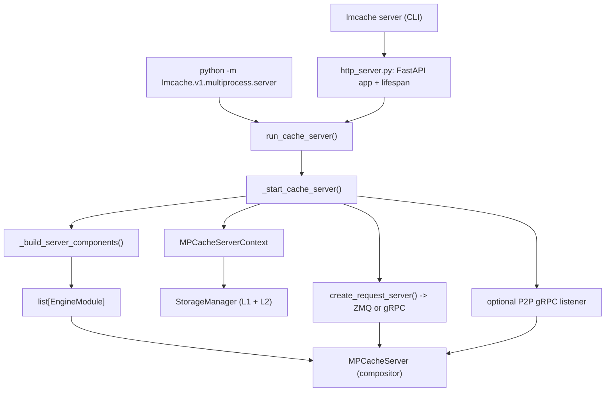
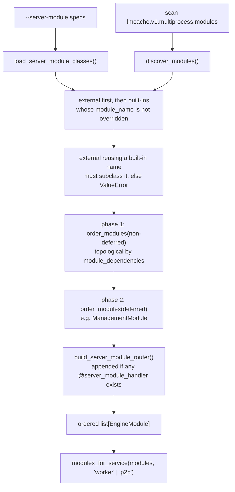
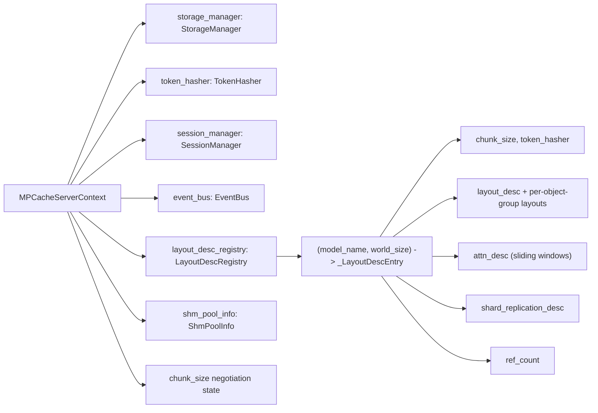
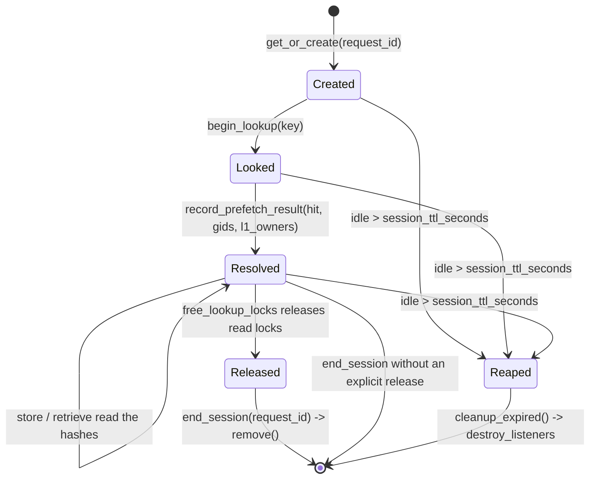
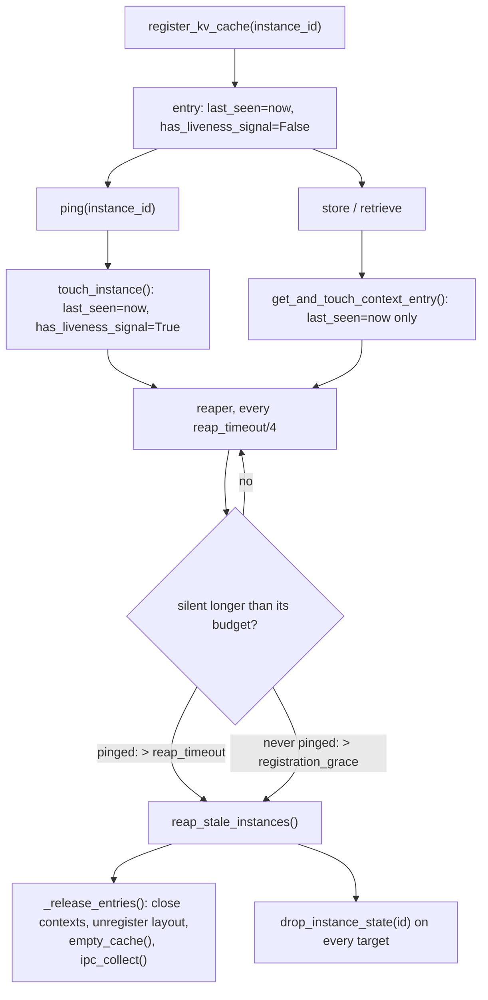
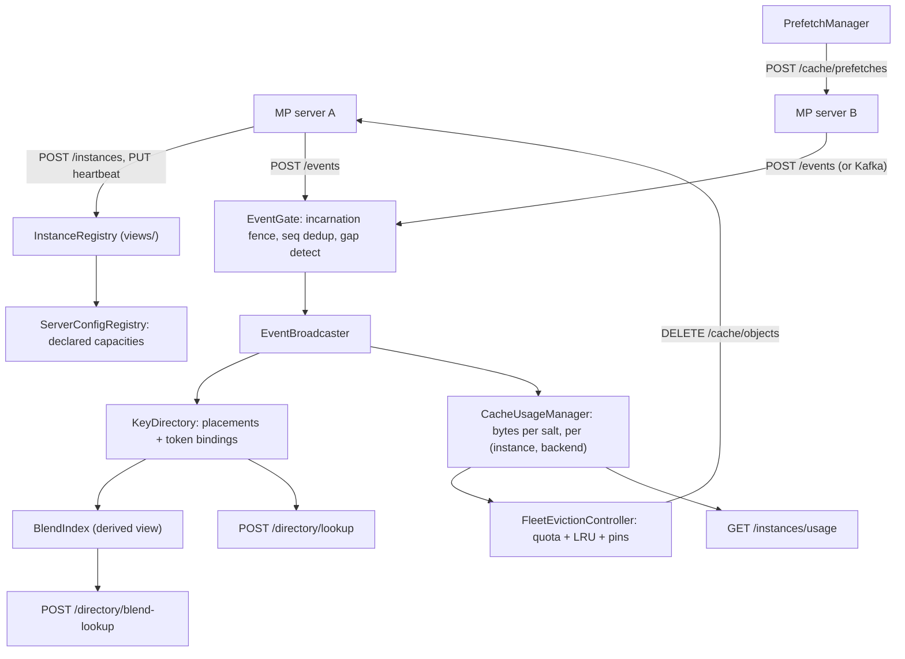

# Multiprocess (MP) architecture

> Revision: upstream `dev` @ [`53bde913`](https://github.com/LMCache/LMCache/tree/53bde913de1adae2a380fe0c2de8d2b9355b4702).
> Every permalink below is pinned to that commit.

This document covers the backbone of modern LMCache: the **MP cache server**
(`lmcache/v1/multiprocess/`, ~23k lines across 89 files) and the **MP coordinator**
(`lmcache/v1/mp_coordinator/`, ~12k lines). If you only read one subsystem
document, read this one — nearly everything else in the codebase is reached
*through* a module hosted by the MP server.

A note on history before anything else: LMCache used to support an **in-process
mode**, where the cache engine was constructed inside the inference engine's own
Python process. That mode was removed from `dev` (commits `78b6b80f`, then
`5b9db86f`). Out-of-process MP mode is now the architecture, not an option.
Anything you read elsewhere about `LMCacheEngine` living inside vLLM describes
code that no longer exists on this revision.

---

## Contents

1. [What the MP server is, and why out-of-process](#1-what-the-mp-server-is-and-why-out-of-process)
2. [The public entry points](#2-the-public-entry-points)
3. [The module system](#3-the-module-system)
4. [The shared context: `MPCacheServerContext`](#4-the-shared-context-mpcacheservercontext)
5. [Sessions](#5-sessions)
6. [Request dispatch: from RPC frame to module handler](#6-request-dispatch-from-rpc-frame-to-module-handler)
7. [Startup and shutdown](#7-startup-and-shutdown)
8. [Worker liveness and the reaper](#8-worker-liveness-and-the-reaper)
9. [The coordinator](#9-the-coordinator)
10. [Where to look next](#10-where-to-look-next)

---

## 1. What the MP server is, and why out-of-process

The MP cache server is a **standalone OS process**. One per node is the intended
deployment; several vLLM instances on that node connect to it over a request
transport (ZMQ by default, gRPC optionally).

What the process owns:

| It owns | Concretely |
|---|---|
| The **L1 memory pool** | A CPU DRAM (or Device-DAX / NVMe-slab) buffer sized by `--l1-size-gb`, held by the `StorageManager`. See [L1 memory and eviction](03-l1-memory-and-eviction.md). |
| The **L2 adapters** | fs, NIXL, Valkey, Mooncake and friends, plus the controllers that push to and prefetch from them. See [L2 adapters and storage](04-l2-adapters-and-storage.md). |
| **Key derivation** | The `TokenHasher` and the chunk-hash chain. See [KV cache lifecycle](02-kv-cache-lifecycle.md). |
| **Per-request state** | `Session` objects keyed by `request_id`, holding the token sequence and the lookup result. |
| **Imported engine KV cache handles** | CUDA-IPC (or POSIX-SHM) handles to the *engine's* paged KV tensors, so the server can DMA into and out of them itself. |
| **Observability** | The event bus, Prometheus/OTel exporters, the KV-event log. |

### Why out of the engine process

The upstream user docs state the motivation directly
([`docs/source/mp/index.rst`](https://github.com/LMCache/LMCache/blob/53bde913de1adae2a380fe0c2de8d2b9355b4702/docs/source/mp/index.rst#L20)):
process isolation, no GIL contention with inference threads, cache sharing
across pods on a node, and independent resource scaling. Reading the code, those
claims cash out as four concrete structural properties:

1. **GIL separation.** Hashing a 100k-token prompt, running an eviction scan, and
   serializing a chunk to S3 are all CPU-bound Python work. In-process, every one
   of those competed for the same interpreter lock as vLLM's scheduler loop. The
   MP server gives that work its own interpreter. (This document makes no
   performance claim — nothing was benchmarked for this guide — only the
   structural one: the work is in a different process, so it cannot hold vLLM's
   GIL.)
2. **Fault isolation.** An L2 backend that hangs, a bad serde kernel, or an
   allocator bug takes down the cache server, not the model server. The engine
   side treats every RPC as best-effort: a failed `retrieve` returns `False` and
   vLLM recomputes the prompt
   ([`lmcache_driven_transfer.py#L1100`](https://github.com/LMCache/LMCache/blob/53bde913de1adae2a380fe0c2de8d2b9355b4702/lmcache/v1/multiprocess/modules/lmcache_driven_transfer.py#L1100)).
3. **Sharing.** The L1 pool is keyed by content hash, model name and KV rank, not
   by who stored it. Two vLLM replicas of the same model on one node, registered
   with the same `model_name` and `world_size`, hit each other's entries for free.
   The `LayoutDescRegistry` is explicitly ref-counted so several worker instances
   can share one registration
   ([`engine_context.py#L87`](https://github.com/LMCache/LMCache/blob/53bde913de1adae2a380fe0c2de8d2b9355b4702/lmcache/v1/multiprocess/engine_context.py#L87)).
4. **Independent lifecycle.** The cache survives an engine restart. A worker that
   reconnects re-registers, and the registry refreshes its liveness instead of
   rebuilding state
   ([`lmcache_driven_transfer.py#L543`](https://github.com/LMCache/LMCache/blob/53bde913de1adae2a380fe0c2de8d2b9355b4702/lmcache/v1/multiprocess/modules/lmcache_driven_transfer.py#L543)).

The cost of this design is the whole reason the rest of this document is long.
Once the cache lives in another process, you need: an RPC contract, a way to
hand the engine's GPU memory across a process boundary (CUDA IPC), a way to
synchronise on device work across processes (IPC event handles), a liveness
protocol for workers that die without unregistering, and a story for what
happens when a lookup's read locks outlive the request that took them. Each of
those is a named mechanism below.

---

## 2. The public entry points

Two entry points, sharing one core:

| Command | What it runs | File |
|---|---|---|
| `lmcache server` | **Recommended.** FastAPI HTTP frontend *plus* the request server, in one process. | [`http_server.py`](https://github.com/LMCache/LMCache/blob/53bde913de1adae2a380fe0c2de8d2b9355b4702/lmcache/v1/multiprocess/http_server.py) |
| `python -m lmcache.v1.multiprocess.server` | Legacy: the request server only, no HTTP endpoints. | [`server.py#L533`](https://github.com/LMCache/LMCache/blob/53bde913de1adae2a380fe0c2de8d2b9355b4702/lmcache/v1/multiprocess/server.py#L533) |

Both funnel into
[`run_cache_server()`](https://github.com/LMCache/LMCache/blob/53bde913de1adae2a380fe0c2de8d2b9355b4702/lmcache/v1/multiprocess/server.py#L300),
which takes four config objects (`MPServerConfig`, `StorageManagerConfig`,
`ObservabilityConfig`, `CoordinatorConfig`) and either blocks forever or returns
`(RequestServer, MPCacheServer)` when `return_engine=True`. The HTTP frontend
uses the latter so its FastAPI lifespan owns the shutdown
([`http_server.py#L155`](https://github.com/LMCache/LMCache/blob/53bde913de1adae2a380fe0c2de8d2b9355b4702/lmcache/v1/multiprocess/http_server.py#L155)).

`MPCacheServer` itself is deliberately thin — its own docstring calls it a
"compositor"
([`server.py#L85`](https://github.com/LMCache/LMCache/blob/53bde913de1adae2a380fe0c2de8d2b9355b4702/lmcache/v1/multiprocess/server.py#L85)).
It holds exactly three things: the shared context, an ordered list of modules,
and an optional P2P listener. Its only real behaviour is aggregating
`report_status()` across modules and closing them in reverse build order.



In prose: both entry points reach `run_cache_server`, which calls
`_start_cache_server`. That function constructs the shared
`MPCacheServerContext` (which in turn constructs the `StorageManager` holding L1
and L2), then calls `_build_server_components` to discover and build the module
list, wraps both in an `MPCacheServer`, creates the ZMQ or gRPC request server
from the modules whose RPC service is `worker`, optionally builds a second gRPC
listener for the `p2p` service, and starts them.

---

## 3. The module system

This is the single most important structural idea in the MP server. The server
does not have a hard-coded list of features. It **discovers** them.

### The three contracts

All three live in
[`engine_module.py`](https://github.com/LMCache/LMCache/blob/53bde913de1adae2a380fe0c2de8d2b9355b4702/lmcache/v1/multiprocess/engine_module.py):

| Contract | Kind | Purpose |
|---|---|---|
| [`EngineModule`](https://github.com/LMCache/LMCache/blob/53bde913de1adae2a380fe0c2de8d2b9355b4702/lmcache/v1/multiprocess/engine_module.py#L30) | `Protocol` | What a *built* module must expose: `context`, `report_status()`, `close()`. |
| [`DiscoverableModule`](https://github.com/LMCache/LMCache/blob/53bde913de1adae2a380fe0c2de8d2b9355b4702/lmcache/v1/multiprocess/engine_module.py#L200) | `abc.ABC` | The *construction* contract: the class attributes `module_name`, `module_dependencies`, `deferred`, `rpc_service`, and a `create(build_ctx)` classmethod. |
| [`InstanceLivenessTarget`](https://github.com/LMCache/LMCache/blob/53bde913de1adae2a380fe0c2de8d2b9355b4702/lmcache/v1/multiprocess/engine_module.py#L50) | `Protocol`, all methods default to no-op | Opt-in participation in worker reaping. |

The split between `DiscoverableModule` (how to build it) and `EngineModule` (what
it is once built) is what lets `create()` return `None`. A module that does not
apply to the current configuration — the engine-driven transfer module when
`--supported-transfer-mode lmcache_driven` — simply is not built, and nothing
downstream has to check for it
([`engine_driven_transfer.py#L91`](https://github.com/LMCache/LMCache/blob/53bde913de1adae2a380fe0c2de8d2b9355b4702/lmcache/v1/multiprocess/modules/engine_driven_transfer.py#L91)).

### Discovery

[`discover_modules()`](https://github.com/LMCache/LMCache/blob/53bde913de1adae2a380fe0c2de8d2b9355b4702/lmcache/v1/multiprocess/engine_module.py#L298)
scans the package `lmcache.v1.multiprocess.modules` for concrete
`DiscoverableModule` subclasses, using the shared
`lmcache/v1/utils/subclass_discovery.py` helper. An import error inside that scan
is deliberately re-raised as a loud startup `ImportError`
([`engine_module.py#L315`](https://github.com/LMCache/LMCache/blob/53bde913de1adae2a380fe0c2de8d2b9355b4702/lmcache/v1/multiprocess/engine_module.py#L315))
rather than silently skipping the module — a silently missing module would show
up much later as an "operation not enabled" RPC error.

The built-in modules on this revision:

| `module_name` | Class / file | Role | `rpc_service` |
|---|---|---|---|
| `lookup` | [`modules/lookup.py`](https://github.com/LMCache/LMCache/blob/53bde913de1adae2a380fe0c2de8d2b9355b4702/lmcache/v1/multiprocess/modules/lookup.py#L142) | `lookup`, prefetch polling, lock release, `end_session` | `worker` |
| `lmcache_driven_transfer` | [`modules/lmcache_driven_transfer.py`](https://github.com/LMCache/LMCache/blob/53bde913de1adae2a380fe0c2de8d2b9355b4702/lmcache/v1/multiprocess/modules/lmcache_driven_transfer.py#L222) | KV registration, `store`, `retrieve` (server drives the DMA) | `worker` |
| `engine_driven_transfer` | [`modules/engine_driven_transfer.py`](https://github.com/LMCache/LMCache/blob/53bde913de1adae2a380fe0c2de8d2b9355b4702/lmcache/v1/multiprocess/modules/engine_driven_transfer.py#L74) | `prepare_store` / `commit_store` / `prepare_retrieve` / `commit_retrieve` | `worker` |
| `kv_events` | [`modules/kv_events.py`](https://github.com/LMCache/LMCache/blob/53bde913de1adae2a380fe0c2de8d2b9355b4702/lmcache/v1/multiprocess/modules/kv_events.py#L140) | Streams store/evict records to subscribers | `worker` |
| `blend` | [`modules/blend/module.py`](https://github.com/LMCache/LMCache/blob/53bde913de1adae2a380fe0c2de8d2b9355b4702/lmcache/v1/multiprocess/modules/blend/module.py#L79) | CacheBlend: non-prefix KV reuse | `worker` |
| `p2p_controller` | [`modules/p2p_controller.py`](https://github.com/LMCache/LMCache/blob/53bde913de1adae2a380fe0c2de8d2b9355b4702/lmcache/v1/multiprocess/modules/p2p_controller.py#L184) | Serves peer lookups/writes, keeps one L2 adapter per peer | **`p2p`** |
| `management` | [`modules/management.py`](https://github.com/LMCache/LMCache/blob/53bde913de1adae2a380fe0c2de8d2b9355b4702/lmcache/v1/multiprocess/modules/management.py#L30) | `ping`, chunk-size negotiation, `clear`, the reaper | `worker` |

`modules/server_transfer.py` is *not* a module — it holds the `TransferStrategy`
implementations (inline vs shared-memory) that `engine_driven_transfer` composes.

> **Doc staleness:** `docs/source/mp/index.rst` refers to
> [`modules/blend.py`](https://github.com/LMCache/LMCache/blob/53bde913de1adae2a380fe0c2de8d2b9355b4702/docs/source/mp/index.rst#L127).
> On this revision blend is a **package**, `modules/blend/` (9 files, ~3.6k lines).

### `plugin_modules/`: opt-in, never auto-built

[`lmcache/v1/multiprocess/plugin_modules/`](https://github.com/LMCache/LMCache/blob/53bde913de1adae2a380fe0c2de8d2b9355b4702/lmcache/v1/multiprocess/plugin_modules/__init__.py)
sits deliberately *outside* the discovery root. Its `__init__.py` spells out the
rule and the reason: discovery accepts re-exported classes, so a built-in that
imported this package at module scope would turn an opt-in plugin back into an
always-built built-in. Nothing under `modules/` may import `plugin_modules` at
module scope.

The one shipped plugin is `qstore` (the paged query-tensor ring buffer,
~1.3k lines). An operator loads it by name:

```bash
lmcache server --server-module '{"module_path": "lmcache.v1.multiprocess.plugin_modules.qstore"}'
```

This is the same mechanism out-of-tree modules use.
[`load_server_module_classes()`](https://github.com/LMCache/LMCache/blob/53bde913de1adae2a380fe0c2de8d2b9355b4702/lmcache/v1/multiprocess/ext_server_module.py#L287)
imports each named Python module, collects its concrete `DiscoverableModule`
subclasses (sorted by qualified name for determinism), and pairs each with the
spec's `config` dict, reachable from `create()` via
`build_ctx.config_for(cls)`.

An external class may also **replace** a built-in by reusing its `module_name`
— but only if it subclasses the built-in, which `_build_server_components`
enforces
([`server.py#L237`](https://github.com/LMCache/LMCache/blob/53bde913de1adae2a380fe0c2de8d2b9355b4702/lmcache/v1/multiprocess/server.py#L237)).
Dependency resolution then goes by `module_name`, so a module declaring
`module_dependencies = (LMCacheDrivenTransferModule,)` transparently receives the
subclass
([`ModuleBuildContext.require`](https://github.com/LMCache/LMCache/blob/53bde913de1adae2a380fe0c2de8d2b9355b4702/lmcache/v1/multiprocess/engine_module.py#L151)).
That is how `qstore` and `blend` extend the LMCache-driven transfer path without
either forking it or being special-cased in `server.py`.

### Build order



In prose, [`_build_server_components`](https://github.com/LMCache/LMCache/blob/53bde913de1adae2a380fe0c2de8d2b9355b4702/lmcache/v1/multiprocess/server.py#L214):

1. Loads the explicitly configured external classes, then the auto-discovered
   built-ins, dropping any built-in whose `module_name` an external class has
   taken over.
2. Builds in **two phases**. Non-`deferred` modules first, then `deferred` ones.
   `ManagementModule` is the only `deferred` built-in, because it consumes the
   `liveness_targets` and `experimental` lists that other modules contribute
   *during* their own construction
   ([`management.py#L55`](https://github.com/LMCache/LMCache/blob/53bde913de1adae2a380fe0c2de8d2b9355b4702/lmcache/v1/multiprocess/modules/management.py#L55)).
3. Within each phase,
   [`order_modules()`](https://github.com/LMCache/LMCache/blob/53bde913de1adae2a380fe0c2de8d2b9355b4702/lmcache/v1/multiprocess/engine_module.py#L237)
   runs `graphlib.TopologicalSorter` over the declared dependencies. Candidates
   are pre-sorted by `(module_name, __module__, __qualname__)` so the order is
   reproducible across runs; a cycle becomes `ValueError("Module dependency
   cycle")`.
4. Appends the server-module router, if any module exposes a
   `@server_module_handler`-decorated method.

**Close order is the exact reverse of build order**
([`MPCacheServer.close`](https://github.com/LMCache/LMCache/blob/53bde913de1adae2a380fe0c2de8d2b9355b4702/lmcache/v1/multiprocess/server.py#L142)).
That is why `kv_events` declares dependencies on *both* transfer modules even
though it uses neither directly: it wants to be torn down **before** them, so
event subscriptions stop before the transfer modules release the registrations
those events describe
([`kv_events.py#L141`](https://github.com/LMCache/LMCache/blob/53bde913de1adae2a380fe0c2de8d2b9355b4702/lmcache/v1/multiprocess/modules/kv_events.py#L141)).
Using the dependency graph to encode *shutdown* ordering is a neat trick worth
recognising when you read a surprising `module_dependencies` declaration.

### Two RPC services

`DiscoverableModule.rpc_service` defaults to `"worker"`.
[`modules_for_service()`](https://github.com/LMCache/LMCache/blob/53bde913de1adae2a380fe0c2de8d2b9355b4702/lmcache/v1/multiprocess/engine_module.py#L219)
partitions the built list, and `_start_cache_server` creates **two** servers from
one module list: the main request server from the `worker` modules, and — only
when `--p2p-*` is configured — a separate gRPC listener on
`p2p_config.rpc_port` from the `p2p` modules
([`server.py#L456`](https://github.com/LMCache/LMCache/blob/53bde913de1adae2a380fe0c2de8d2b9355b4702/lmcache/v1/multiprocess/server.py#L456)).
Peers and engine workers therefore cannot reach each other's operations even
though both are served by the same process. See
[P2P cache sharing](08-p2p-sharing.md).

---

## 4. The shared context: `MPCacheServerContext`

[`engine_context.py#L342`](https://github.com/LMCache/LMCache/blob/53bde913de1adae2a380fe0c2de8d2b9355b4702/lmcache/v1/multiprocess/engine_context.py#L342).
Every module gets this object at construction and reaches shared state only
through it. It is the server's answer to "where does cross-module state live
without modules importing each other".

What hangs off it:



In prose, the context exposes the `StorageManager` (L1 + L2 + controllers), the
default `TokenHasher`, the `SessionManager`, the observability `EventBus`, the
`LayoutDescRegistry`, normalized shared-memory pool metadata, and the chunk-size
negotiation machinery. The registry maps `(model_name, world_size)` to an entry
carrying that registration's effective chunk size, its own `TokenHasher`, the
memory layout (globally and per object group), the attention-window descriptor
and the shard-replication descriptor, plus a reference count.

Three things are worth dwelling on.

**The registry pairs geometry with key derivation.** Its docstring says why:
"Consumers read the layout, chunk size, and token hasher from the same entry so
object geometry and key derivation cannot diverge"
([`engine_context.py#L87`](https://github.com/LMCache/LMCache/blob/53bde913de1adae2a380fe0c2de8d2b9355b4702/lmcache/v1/multiprocess/engine_context.py#L87)).
A chunk key computed with one chunk size against objects laid out for another is
silent corruption, not a crash. Pairing them in one ref-counted entry makes that
mismatch unconstructible: re-registering the same pair with a different chunk
size or hash algorithm raises instead
([`#L175`](https://github.com/LMCache/LMCache/blob/53bde913de1adae2a380fe0c2de8d2b9355b4702/lmcache/v1/multiprocess/engine_context.py#L175)).

**Chunk-size negotiation is a one-way latch.**
[`negotiate_chunk_size(required_alignment)`](https://github.com/LMCache/LMCache/blob/53bde913de1adae2a380fe0c2de8d2b9355b4702/lmcache/v1/multiprocess/engine_context.py#L428)
treats `--chunk-size` as a *minimum* and rounds it up to a multiple of the
alignment the registering model needs (the LCM of its cacheable
`tokens_per_block` values). Once selected, the size is frozen; a second model
whose alignment does not divide it gets a `ValueError` telling the operator to
use a separate MP server. Resizing after sessions exist is also refused, since
existing sessions' cached chunk hashes were computed at the old size.
`_finalize_chunk_size_locked` notifies listeners (continuous usage telemetry, and
the coordinator's `PUT /config/chunk-size`) *before* latching, and deliberately
stays unfinalized if a listener raises, so the next negotiation retries rather
than reporting a false success
([`#L483`](https://github.com/LMCache/LMCache/blob/53bde913de1adae2a380fe0c2de8d2b9355b4702/lmcache/v1/multiprocess/engine_context.py#L483)).

**Key resolution lives here, not in the modules.**
[`resolve_obj_keys()`](https://github.com/LMCache/LMCache/blob/53bde913de1adae2a380fe0c2de8d2b9355b4702/lmcache/v1/multiprocess/engine_context.py#L559)
and
[`resolve_unfull_chunk_obj_keys()`](https://github.com/LMCache/LMCache/blob/53bde913de1adae2a380fe0c2de8d2b9355b4702/lmcache/v1/multiprocess/engine_context.py#L607)
turn an `IPCCacheServerKey` into per-object-group `ObjectKey` lists. Both the
transfer modules and the lookup module call them, which is how `store` and
`retrieve` cannot disagree about what a key means. Details in
[KV cache lifecycle](02-kv-cache-lifecycle.md).

---

## 5. Sessions

[`session.py`](https://github.com/LMCache/LMCache/blob/53bde913de1adae2a380fe0c2de8d2b9355b4702/lmcache/v1/multiprocess/session.py).

A **session is per-request state, keyed by `request_id`**. It exists because a
single inference request produces several independent RPCs — a `lookup` from
vLLM's *scheduler* process, then `retrieve`/`store` from each TP *worker*
process, then `free_lookup_locks` and `end_session` back from the scheduler — and
those RPCs have to agree on three things that are expensive or impossible to
recompute independently:

1. **The token sequence and its rolling chunk hashes.** `Session` caches
   `chunk_hashes` and `last_prefix_hash` and only hashes forward
   ([`_compute_hash`](https://github.com/LMCache/LMCache/blob/53bde913de1adae2a380fe0c2de8d2b9355b4702/lmcache/v1/multiprocess/session.py#L172)).
   Because the hash is prefix-chained, re-deriving chunk *k* from scratch means
   hashing chunks 0..k again; the session makes repeated calls across a request's
   RPCs incremental instead of quadratic.
2. **What the lookup actually locked.** `prefetch_hit_chunks`,
   `prefetch_locked_gids` and `_prefetch_owners` are recorded by
   `record_prefetch_result()` and read by `free_lookup_locks`. The code is blunt
   about why this must be exact: "L1 locks are anonymous refcounts: guessing a
   range could strip a concurrent reader's lock"
   ([`lookup.py#L553`](https://github.com/LMCache/LMCache/blob/53bde913de1adae2a380fe0c2de8d2b9355b4702/lmcache/v1/multiprocess/modules/lookup.py#L553)).
3. **The lookup's own key** (`lookup_ipc_key`, with `worker_id=None`), so a
   release can be floored to the range the lookup actually covered.

Everything is guarded by an internal `threading.Lock`, because several TP worker
threads touch one session concurrently.

`extras: dict[str, Any]` is a deliberate escape hatch for module-owned
per-request state — the engine-driven transfer module stashes
`"store_start_time"` there
([`engine_driven_transfer.py#L581`](https://github.com/LMCache/LMCache/blob/53bde913de1adae2a380fe0c2de8d2b9355b4702/lmcache/v1/multiprocess/modules/engine_driven_transfer.py#L581)).
Owners of such state register a callback on
`SessionManager.destroy_listeners` so it is released however the request ended
([`session.py#L243`](https://github.com/LMCache/LMCache/blob/53bde913de1adae2a380fe0c2de8d2b9355b4702/lmcache/v1/multiprocess/session.py#L243)).

### Lifecycle



In prose: a session is created lazily by the first RPC that names its
`request_id` — in practice `lookup`, via `get_or_create`. `begin_lookup` records
the lookup key and clears any previous lookup's result.
`_consume_prefetch_result` (triggered by `query_prefetch_status`,
`wait_prefetch_status`, or `free_lookup_locks` if the client never polled)
records the hit length, locked object groups, and L1 owners. `store` and
`retrieve` then reuse the cached hashes. `free_lookup_locks` releases the read
locks; `end_session` removes the session and issues a final
`touch_cached_keys` over all of the request's chunks so recency reflects
everything the request stored *and* retrieved
([`lookup.py#L611`](https://github.com/LMCache/LMCache/blob/53bde913de1adae2a380fe0c2de8d2b9355b4702/lmcache/v1/multiprocess/modules/lookup.py#L611)).

Either side can leak: a vLLM crash means no `end_session`. So `SessionManager`
runs a periodic cleanup thread (default every 60 s) that removes sessions idle
beyond `--session-ttl-seconds`
([`session.py#L294`](https://github.com/LMCache/LMCache/blob/53bde913de1adae2a380fe0c2de8d2b9355b4702/lmcache/v1/multiprocess/session.py#L294)).
The default TTL is **600 s**, and `MPServerConfig` explains the sizing: a session
"carries the lookup state `free_lookup_locks` needs, so it must outlive the
longest time a request can wait in the engine's queue between its lookup and its
admission (minutes under deep agentic backlogs)"
([`config.py#L164`](https://github.com/LMCache/LMCache/blob/53bde913de1adae2a380fe0c2de8d2b9355b4702/lmcache/v1/multiprocess/config.py#L164)).
Note the sharp edge this implies: a session reaped mid-request makes
`free_lookup_locks` log "without a lookup result; nothing to release" and leave
the read locks to the L1 read-lock TTL. Note also that `cleanup_expired` compares
against `created_at`, not a last-touched time — the TTL is an **age** bound, not
an idle bound, despite the config field's wording.

---

## 6. Request dispatch: from RPC frame to module handler

### The contract is derived from a Protocol

There is no `.proto`-style hand-written operation table. The authoritative list
of RPCs is the
[`RequestClient`](https://github.com/LMCache/LMCache/blob/53bde913de1adae2a380fe0c2de8d2b9355b4702/lmcache/v1/transport/request_client.py#L32)
`Protocol`: every method decorated with `@rpc_method` is an operation, and
[`get_rpc_specs()`](https://github.com/LMCache/LMCache/blob/53bde913de1adae2a380fe0c2de8d2b9355b4702/lmcache/v1/transport/rpc.py#L95)
reflects over it to extract each operation's payload types and response type
from its type hints. The method must return `MessagingFuture[T]` or
`MessagingStream[T]`, or spec construction raises.

Server-side, a module marks a method with
[`@request_handler(...)`](https://github.com/LMCache/LMCache/blob/53bde913de1adae2a380fe0c2de8d2b9355b4702/lmcache/v1/multiprocess/request_handler.py#L44).
The operation name defaults to the method name (overridable with
`operation=`). Then
[`iter_request_handlers()`](https://github.com/LMCache/LMCache/blob/53bde913de1adae2a380fe0c2de8d2b9355b4702/lmcache/v1/multiprocess/request_handler.py#L111)
discovers them and
[`validate_handler()`](https://github.com/LMCache/LMCache/blob/53bde913de1adae2a380fe0c2de8d2b9355b4702/lmcache/v1/multiprocess/request_handler.py#L79)
compares the handler's annotations against the client spec, raising `TypeError`
on any mismatch. **A client/server signature drift is therefore a startup
crash, not a runtime decode failure.** That is the payoff for the reflection.

### Handler types select a thread pool

[`HandlerType`](https://github.com/LMCache/LMCache/blob/53bde913de1adae2a380fe0c2de8d2b9355b4702/lmcache/v1/multiprocess/request_handler.py#L18)
has three values; two are used.

| `HandlerType` | ZMQ pool | Meaning |
|---|---|---|
| `SERIALIZED` (default) | none — runs **inline on the MQ main loop** | Mutually exclusive with every other request. Used for `register_kv_cache`, which is the sole inserter into the context registry. |
| `BLOCKING` | `NORMAL` pool (`--max-cpu-workers`) or `AFFINITY` pool (`--max-gpu-workers`) if `requires_client_affinity=True` | Runs on a worker thread; the response is queued back to the main loop. |
| `NON_BLOCKING` | — | `raise NotImplementedError` in the ZMQ server ([`mq.py#L310`](https://github.com/LMCache/LMCache/blob/53bde913de1adae2a380fe0c2de8d2b9355b4702/lmcache/v1/multiprocess/transport/zmq_impl/mq.py#L310)). |

`requires_client_affinity=True` is only legal with `BLOCKING`
([`request_handler.py#L51`](https://github.com/LMCache/LMCache/blob/53bde913de1adae2a380fe0c2de8d2b9355b4702/lmcache/v1/multiprocess/request_handler.py#L51)).
The affinity key is `hash(zmq_identity)`
([`mq.py#L268`](https://github.com/LMCache/LMCache/blob/53bde913de1adae2a380fe0c2de8d2b9355b4702/lmcache/v1/multiprocess/transport/zmq_impl/mq.py#L268)),
so **all requests from one client land on one thread, in order**. `store` and
`retrieve` both set it — that serialization is what makes the CUDA stream work
they enqueue well-ordered per worker without any additional locking.

### The dispatch path

```mermaid
sequenceDiagram
    autonumber
    participant W as "vLLM worker (RequestClient)"
    participant S as "zmq.ROUTER socket"
    participant L as "MessageQueueServer._main_loop"
    participant P as "AffinityThreadPool worker"
    participant M as "LMCacheDrivenTransferModule.retrieve"
    participant SM as "StorageManager"

    W->>S: send_multipart([auth?, request_uid, operation, *msgspec payloads])
    S->>L: poll -> _handle_request(msg)
    L->>L: "_authenticate_request(identity, frames)"
    L->>L: "decode_operation(b_operation)"
    alt operation not registered
        L-->>W: "ZmqErrorResponse(code='operation_not_enabled')"
    else registered
        L->>L: "_call_handler -> handler_type dispatch"
        L->>P: "_call_blocking_handler(affinity_key=hash(identity))"
        P->>M: "retrieve(key, instance_id, gpu_block_ids, event_ipc_handle, skip_first_n)"
        M->>SM: "prepare_read_completion(retained_keys, read_owners)"
        M->>SM: "unsafe_read(in_window_keys)"
        M->>M: "cache_context.transfer_object_group(... H2D ...)"
        M->>M: "submit_callback_to_stream('finish_read_by_owner', completion)"
        M-->>P: "(event_ipc_handle, success)"
        P->>L: "output_queue.put(frames); _output_efd.notify()"
        L-->>W: "send_multipart(prefix + msgspec response)"
    end
```

In prose: the client sends a multipart ZMQ message whose frames are an optional
authentication envelope, a request UID, the operation name, and the msgspec-encoded
payloads. The `ROUTER` socket prepends the client identity. The single main-loop
thread polls, authenticates and strips the envelope
([`mq.py#L385`](https://github.com/LMCache/LMCache/blob/53bde913de1adae2a380fe0c2de8d2b9355b4702/lmcache/v1/multiprocess/transport/zmq_impl/mq.py#L391)),
decodes the operation and looks it up in the handler table. An unknown operation
returns a structured error whose message explicitly suggests checking
`--supported-transfer-mode` and enabled server modules — a nice touch, because
"operation not enabled" is exactly what a transfer-mode misconfiguration looks
like from the client. A registered operation is dispatched by handler type:
`SERIALIZED` runs inline; `BLOCKING` is submitted to a pool, and its completion
callback puts the encoded response on an `output_queue` and pokes an
eventfd/self-pipe notifier so the main loop wakes and sends it. The response is
sent **only from the main loop**, because ZMQ sockets are not thread-safe
([`mq.py#L165`](https://github.com/LMCache/LMCache/blob/53bde913de1adae2a380fe0c2de8d2b9355b4702/lmcache/v1/multiprocess/transport/zmq_impl/mq.py#L165)).
Handler exceptions become a `ZmqErrorResponse` with code `invalid_argument` for
`ValueError` and `handler_error` otherwise
([`mq.py#L284`](https://github.com/LMCache/LMCache/blob/53bde913de1adae2a380fe0c2de8d2b9355b4702/lmcache/v1/multiprocess/transport/zmq_impl/mq.py#L288));
the request is never silently dropped.

The gRPC transport is selected with `--transport grpc` and has three
implementations behind `--grpc-server-mode` (`sync`, `aio`, `native` — `native`
does HTTP/2 framing in Rust off the GIL; `auto` picks `native` if the
`pygrpc-native` package is installed, else `aio`)
([`config.py#L70`](https://github.com/LMCache/LMCache/blob/53bde913de1adae2a380fe0c2de8d2b9355b4702/lmcache/v1/multiprocess/config.py#L70)).
It consumes the same `@request_handler` metadata. Details in
[Transport layer](06-transport-layer.md).

### Out-of-tree RPCs without touching the contract

A plugin that needs its own RPCs does not edit `RequestClient`. It decorates a
method with
[`@server_module_handler("my_package.method")`](https://github.com/LMCache/LMCache/blob/53bde913de1adae2a380fe0c2de8d2b9355b4702/lmcache/v1/multiprocess/ext_server_module.py#L108)
taking and returning **opaque bytes**.
[`ExtServerModuleRouter`](https://github.com/LMCache/LMCache/blob/53bde913de1adae2a380fe0c2de8d2b9355b4702/lmcache/v1/multiprocess/ext_server_module.py#L150)
exposes two real RPCs, `server_module_call` and
`server_module_affinity_call`, and routes by the namespaced method name. LMCache
carries the bytes; the plugin owns the schema. A handler exception becomes
`success=False` rather than a dropped request. Modules can also register whole
transport services via optional `register_grpc_services` /
`register_zmq_services` methods
([`#L361`](https://github.com/LMCache/LMCache/blob/53bde913de1adae2a380fe0c2de8d2b9355b4702/lmcache/v1/multiprocess/ext_server_module.py#L361)).

---

## 7. Startup and shutdown

[`_start_cache_server()`](https://github.com/LMCache/LMCache/blob/53bde913de1adae2a380fe0c2de8d2b9355b4702/lmcache/v1/multiprocess/server.py#L358)
is worth reading line by line; the ordering is load-bearing.

1. **`set_isolated_ipc(mp_config.isolated_ipc)`** first, before any event IPC
   backend is resolved, so every resolver in the process observes the same
   setting.
2. **Identity projection.** `mp_config.instance_id` (from `--instance-id`, else a
   random UUID v4) is the single source of truth for who this server is; it is
   copied onto the OTel `service.instance.id` unless observability set it
   explicitly, so metrics, traces and coordinator membership key on the same id.
3. **Observability, GC monitor, trace recorder.**
4. **SHM capacity check.** When the engine-driven path is loaded and there is
   exactly one L1, `--shm-name` is applied to the memory config and `/dev/shm`
   free space is compared against the requested L1 size. Too small, or
   unreadable, and `shm_name` is cleared — "Disabling SHM, falling back to safe
   inline transfer"
   ([`server.py#L414`](https://github.com/LMCache/LMCache/blob/53bde913de1adae2a380fe0c2de8d2b9355b4702/lmcache/v1/multiprocess/server.py#L421)).
   This is a real operational trap: containers often default to a 64 MB
   `/dev/shm`, and the symptom is a silent fall back to the slower inline path,
   visible only as a `WARNING` at startup.
5. **Context construction**, including `full_sw_kv=(engine_type == "blend")`.
6. **Module composition.**
7. **An `ExitStack`** registers `engine.close` *before* the P2P listener is built
   and `server.close` right after the request server is created, so a bind
   failure anywhere still releases the modules and the context. On success,
   `startup_resources.pop_all()` disarms the stack
   ([`server.py#L450`](https://github.com/LMCache/LMCache/blob/53bde913de1adae2a380fe0c2de8d2b9355b4702/lmcache/v1/multiprocess/server.py#L450)).
8. **Usage telemetry and chunk-size listeners** (continuous usage; coordinator
   `PUT /config/chunk-size` when a coordinator URL is configured).
9. **`torch_dev.init()`**, guarded by `hasattr` so backends lacking it only warn.
10. **`server.start()`**, then the P2P listener.

Shutdown, in the blocking path: `KeyboardInterrupt` → `event_bus.stop()` →
`server.close()` → `engine.close()`, with `shutdown_gc_monitor()` and
`shutdown_grpc_otel_metrics()` in a `finally`. The gRPC metrics plugin's export
thread is **not** a daemon, so `shutdown_grpc_otel_metrics()` is also called on a
failed start — otherwise the process could not exit
([`server.py#L335`](https://github.com/LMCache/LMCache/blob/53bde913de1adae2a380fe0c2de8d2b9355b4702/lmcache/v1/multiprocess/server.py#L335)).
`MPCacheServer.close()` closes the P2P listener, then each module in reverse
build order, then the context (which closes the session manager and every storage
manager, including the GDS context).

Under `lmcache server`, the FastAPI lifespan owns this
([`http_server.py#L140`](https://github.com/LMCache/LMCache/blob/53bde913de1adae2a380fe0c2de8d2b9355b4702/lmcache/v1/multiprocess/http_server.py#L140))
and adds: runtime-plugin launch, `app.state.context` for the HTTP handlers,
coordinator registration via `keep_registered`, and the cache-event subscriber.
Shutdown cancels the registration task, closes the HTTP client, stops plugins,
stops the event bus, and only then closes the request server and engine.

---

## 8. Worker liveness and the reaper

A worker process can die without unregistering. Its CUDA-IPC-imported KV tensors
would then pin device memory in the cache server forever. The
`InstanceLivenessTarget` protocol plus `ManagementModule`'s reaper solve this.

Two roles, both optional, both defaulting to no-ops
([`engine_module.py#L50`](https://github.com/LMCache/LMCache/blob/53bde913de1adae2a380fe0c2de8d2b9355b4702/lmcache/v1/multiprocess/engine_module.py#L50)):

- **Liveness owner** — tracks per-`instance_id` registrations, refreshed on
  `PING`, scanned for staleness. The two transfer modules fill this role.
- **State mirror** — holds a *second* reference to a reaped instance's resources
  and releases it on `drop_instance_state`. `BlendModule` fills this role for
  its per-instance CacheBlend state.

Participation is detected **structurally**, not by inheritance:
[`_is_liveness_target()`](https://github.com/LMCache/LMCache/blob/53bde913de1adae2a380fe0c2de8d2b9355b4702/lmcache/v1/multiprocess/engine_module.py#L230)
checks that all four methods in `_LIVENESS_TARGET_METHODS` are callable, and
`ModuleBuildContext.register` appends qualifying modules to `liveness_targets`.
`ManagementModule` — built last because it is `deferred` — receives that list.

Two timeouts, because a never-pinged instance and a once-live instance mean
different things:

| Flag | Default | Applies to |
|---|---|---|
| `--worker-reap-timeout-seconds` | `120.0` | Instances that have sent ≥ 1 `PING`. `0` disables reaping entirely (no thread started). |
| `--worker-registration-grace-seconds` | `3600.0` | Instances that registered but never pinged — model warmup, or death before the first request. Must be ≥ the reap timeout. |

`MPServerConfig` advises keeping the reap timeout at ≥ 3× the adapter's heartbeat
interval so a few missed pings never reap a live worker
([`config.py#L158`](https://github.com/LMCache/LMCache/blob/53bde913de1adae2a380fe0c2de8d2b9355b4702/lmcache/v1/multiprocess/config.py#L158)).



In prose: a registration starts with `last_seen=now` and `has_liveness_signal=False`.
Only `PING` latches the ping-proven flag; ordinary traffic refreshes `last_seen`
but deliberately does **not** latch it, so a worker that never pings is judged
against the longer grace window
([`lmcache_driven_transfer.py#L343`](https://github.com/LMCache/LMCache/blob/53bde913de1adae2a380fe0c2de8d2b9355b4702/lmcache/v1/multiprocess/modules/lmcache_driven_transfer.py#L343)).
The reaper scans every `reap_timeout/4`, so an instance is reaped between
`timeout` and `timeout + interval` after its last signal
([`management.py#L86`](https://github.com/LMCache/LMCache/blob/53bde913de1adae2a380fe0c2de8d2b9355b4702/lmcache/v1/multiprocess/modules/management.py#L86)).
Reaped ids are then passed to `drop_instance_state` on *every* target, so mirrors
release their second references.

`_release_entries` is a good example of a subtle cross-process constraint made
explicit in code. It closes each cache context, unregisters the layout, then
`del`s its loop variable and clears the list **before** calling
`torch_dev.empty_cache()` and `ipc_collect()` — because `ipc_collect()` only
unmaps a CUDA-IPC-imported segment once the last tensor reference is gone, and a
lingering bound name would pin it (the comment cites LMCache#4014)
([`lmcache_driven_transfer.py#L450`](https://github.com/LMCache/LMCache/blob/53bde913de1adae2a380fe0c2de8d2b9355b4702/lmcache/v1/multiprocess/modules/lmcache_driven_transfer.py#L450)).
`unregister_kv_cache` takes the same care, keeping the popped entry inside a
one-element list specifically to avoid a scalar binding
([`#L625`](https://github.com/LMCache/LMCache/blob/53bde913de1adae2a380fe0c2de8d2b9355b4702/lmcache/v1/multiprocess/modules/lmcache_driven_transfer.py#L625)).

The reaper's status appears in `report_status()` under `worker_liveness`
(`enabled`, `reap_timeout_seconds`, `registration_grace_seconds`,
`tracked_instances`). There is a design doc at
[`docs/design/v1/multiprocess/worker_liveness.md`](https://github.com/LMCache/LMCache/blob/53bde913de1adae2a380fe0c2de8d2b9355b4702/docs/design/v1/multiprocess/worker_liveness.md).

---

## 9. The coordinator

[`lmcache/v1/mp_coordinator/`](https://github.com/LMCache/LMCache/tree/53bde913de1adae2a380fe0c2de8d2b9355b4702/lmcache/v1/mp_coordinator),
run as `lmcache coordinator` or `python -m lmcache.v1.mp_coordinator`. It is a
**FastAPI/uvicorn process**, not an MP server.

### When you need one

You do not need a coordinator for a single-node deployment. Its own design doc
is precise about the gap it fills: MP servers "are independent by construction:
per-instance in-memory quota, no cross-node token-match routing for model
replicas, and node-local KV operations"
([`docs/design/v1/mp_coordinator/README.md`](https://github.com/LMCache/LMCache/blob/53bde913de1adae2a380fe0c2de8d2b9355b4702/docs/design/v1/mp_coordinator/README.md#L12)).
You need one when you want a **fleet-level** capability:

| Want | Needs the coordinator because |
|---|---|
| Per-tenant (`cache_salt`) byte quotas across a shared L2 | Each MP server only sees its own traffic. |
| Fleet-wide L2 eviction | Same. The controller holds the fleet LRU and pin set. |
| "Which node has this prefix cached?" | Requires a fleet key directory. |
| P2P peer discovery | A new MP server has to learn its peers from somewhere. |
| Fleet-wide CacheBlend fragment lookup | Matching needs an index over every node's token bindings. |
| Warm prefetch / pin / delete aimed at a named server | Needs a registry to resolve `instance_id` → `ip:http_port`. |

Registration is **opt-in and best-effort**: with no `--coordinator-url` the MP
server is unaffected, and a down coordinator never blocks it — failures are
logged and retried, while a malformed config is rejected at startup.

### What it tracks



In prose: MP servers register and heartbeat into an `InstanceRegistry`, and
stream cache events either by pushing to `POST /events` or (durably) through
Kafka. Every event passes an `EventGate` that fences by emitter incarnation,
dedupes by sequence number and detects gaps, then a broadcaster fans admitted
batches to consumers: the `KeyDirectory` (which key is on which instance and
tier, plus token bindings) and the `CacheUsageManager` (byte totals per
`cache_salt` and per `(instance_id, backend)`). The blend index is a *derived*
view of the key directory's token bindings rather than a separate publish path,
so its eviction behaviour follows binding lifecycle exactly. The
`FleetEvictionController` compares quota budgets against usage and dispatches
`DELETE /cache/objects` to a uniformly random registered server — all servers
share the backing L2, so one dispatch evicts for the fleet.

### The HTTP surface

Verified against the routers on this revision:

| Method & path | File |
|---|---|
| `POST /instances`, `PUT /instances/{id}/heartbeat`, `DELETE /instances/{id}`, `GET /instances` | [`instances_api.py`](https://github.com/LMCache/LMCache/blob/53bde913de1adae2a380fe0c2de8d2b9355b4702/lmcache/v1/mp_coordinator/http_apis/instances_api.py#L40) |
| `GET /healthz` | [`health_api.py#L13`](https://github.com/LMCache/LMCache/blob/53bde913de1adae2a380fe0c2de8d2b9355b4702/lmcache/v1/mp_coordinator/http_apis/health_api.py#L13) |
| `PUT /config/chunk-size` | [`config_api.py#L17`](https://github.com/LMCache/LMCache/blob/53bde913de1adae2a380fe0c2de8d2b9355b4702/lmcache/v1/mp_coordinator/http_apis/config_api.py#L17) |
| `POST /events` | [`events_api.py#L24`](https://github.com/LMCache/LMCache/blob/53bde913de1adae2a380fe0c2de8d2b9355b4702/lmcache/v1/mp_coordinator/http_apis/events_api.py#L24) |
| **`POST /directory/lookup`**, `POST /directory/blend-lookup`, `GET /directory/keys`, `GET /directory/stats` | [`directory_api.py#L39`](https://github.com/LMCache/LMCache/blob/53bde913de1adae2a380fe0c2de8d2b9355b4702/lmcache/v1/mp_coordinator/http_apis/directory_api.py#L39) |
| `POST /cache/prefetches`, `GET /cache/prefetches/{instance_id}/{request_id}` | [`cache_api.py#L38`](https://github.com/LMCache/LMCache/blob/53bde913de1adae2a380fe0c2de8d2b9355b4702/lmcache/v1/mp_coordinator/http_apis/cache_api.py#L38) |
| `GET /instances/usage`, `GET /instances/{instance_id}/usage` | [`instances_usage_api.py#L151`](https://github.com/LMCache/LMCache/blob/53bde913de1adae2a380fe0c2de8d2b9355b4702/lmcache/v1/mp_coordinator/http_apis/instances_usage_api.py#L151) |
| `GET /metrics`, `GET /status` | [`metrics_api.py#L14`](https://github.com/LMCache/LMCache/blob/53bde913de1adae2a380fe0c2de8d2b9355b4702/lmcache/v1/mp_coordinator/http_apis/metrics_api.py#L14), [`status_api.py#L24`](https://github.com/LMCache/LMCache/blob/53bde913de1adae2a380fe0c2de8d2b9355b4702/lmcache/v1/mp_coordinator/http_apis/status_api.py#L24) |
| `PUT/GET /quota/config`, `PUT/GET/DELETE /quota/{cache_salt}`, `GET /quota`, `POST/DELETE/GET /cache/pins`, `POST /cache/delete` | [`controllers/eviction_http_api.py#L171`](https://github.com/LMCache/LMCache/blob/53bde913de1adae2a380fe0c2de8d2b9355b4702/lmcache/v1/mp_coordinator/controllers/eviction_http_api.py#L171) |

> **Doc staleness:** the endpoint table in
> `docs/design/v1/mp_coordinator/README.md` omits `POST /directory/lookup`,
> `GET /directory/stats`, `GET /metrics` and `GET /status`, all of which exist.
> The rest of that document matched the code everywhere I checked.

`POST /directory/lookup` is the clearest illustration of the coordinator's
relationship to key derivation. You may post either explicit encoded object keys
or a raw `token_ids` sequence. In the token form, the coordinator hashes the
tokens *with the fleet's own `TokenHasher`* and expands each complete chunk into
per-rank object keys
([`directory_api.py#L39`](https://github.com/LMCache/LMCache/blob/53bde913de1adae2a380fe0c2de8d2b9355b4702/lmcache/v1/mp_coordinator/http_apis/directory_api.py#L39)).
Its docstring states the consequence of prefix chaining explicitly: "Chunk hashes
are prefix-chained, so `token_ids` must be the request's full sequence from
position 0; trailing incomplete chunks are ignored." That is also *why*
`PUT /config/chunk-size` exists — the coordinator cannot hash compatibly unless
it uses the fleet's negotiated chunk size, so an MP server binds that value
before reporting negotiation success. Rebinding the same value is idempotent, a
different one is rejected, and MP servers with different final chunk sizes need
separate coordinators.

### Extension seam and lifecycle

Adding a capability is one file: a module under `http_apis/` exposing a
module-level `router` (auto-discovered by the shared
`lmcache/v1/utils/router_discovery.py`), plus — only when the domain has real
state — a `views/` read model or a `controllers/` policy loop, both built by
package scans. A domain that must react to the cache-event stream implements
`CacheEventConsumer` and registers on the broadcaster.

Lifecycle notes that matter operationally: the registry is **ephemeral**, rebuilt
from heartbeats after a coordinator restart; the key directory, usage view and
LRU are rebuilt only from the event stream, so after a restart they start empty
and **quotas under-report until events refill them**. `HEALTH_CHECK_INTERVAL = 0`
disables the stale-instance loop; `EVICTION_CHECK_INTERVAL = 0` makes the
eviction controller create no task. Handlers run on the uvicorn event loop, so
the design doc insists heavy work be `await`ed or pushed to an executor.

---

## 10. Where to look next

- [KV cache lifecycle](02-kv-cache-lifecycle.md) — what `lookup`, `prefetch`,
  `retrieve` and `store` actually do, and how a chunk is keyed.
- [L1 memory and eviction](03-l1-memory-and-eviction.md) — the pool the
  `StorageManager` hands out, pinning, and eviction.
- [Transport layer](06-transport-layer.md) — ZMQ vs gRPC internals, SHM, NIXL.
- [P2P cache sharing](08-p2p-sharing.md) — the `p2p` RPC service and peer
  discovery through the coordinator.
- [vLLM integration](05-vllm-integration.md) — the client side of every RPC in
  this document.
- [Architecture](../02-architecture.md) and [Code map](../03-code-map.md) for the
  wider picture, and the [issue deep dives](../issue-deep-dives/README.md) for
  worked debugging examples.

### Design docs worth reading alongside the code

Under [`docs/design/v1/multiprocess/`](https://github.com/LMCache/LMCache/tree/53bde913de1adae2a380fe0c2de8d2b9355b4702/docs/design/v1/multiprocess):
`mp_runtime_plugin.md`, `worker_liveness.md`, `multi_chunk_size.md`,
`unfull_chunk.md`, `engine_driven_transfer_design.md`,
`lmcache_driven_transfer_copy_paths.md`, `http_api_extension.md`,
`kv_load_policy.md`, `device_ipc_wrapper_design.md`, `raw_cuda_ipc.md`,
`kv_event_subscriber.md`, plus `modules/` and `plugin_modules/` subdirectories.
Under [`docs/design/v1/mp_coordinator/`](https://github.com/LMCache/LMCache/tree/53bde913de1adae2a380fe0c2de8d2b9355b4702/docs/design/v1/mp_coordinator):
`README.md`, `ingest.md`, `usage_and_eviction.md`, `memory_pressure.md`,
`blend_index.md`, `blend_lookup.md`, `cache_events.md`, `l2_prefetch.md`,
`observability.md`.
