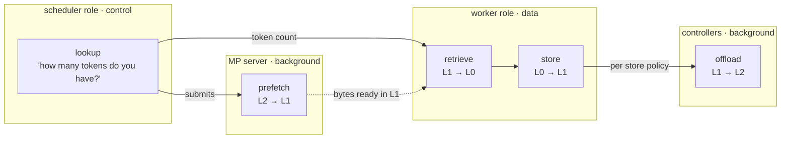
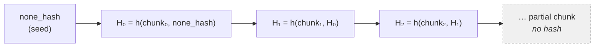
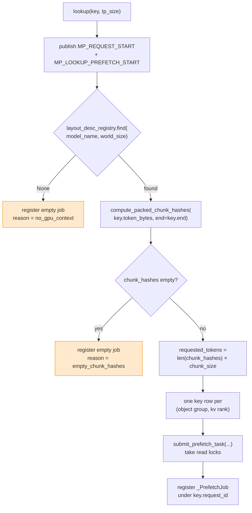

# KV cache lifecycle: `lookup` → `prefetch` → `retrieve` → `store`

> Code references in this document are permalinks pinned to upstream `dev`
> @ [`53bde913`](https://github.com/LMCache/LMCache/tree/53bde913de1adae2a380fe0c2de8d2b9355b4702).

This is the spine of LMCache. Every other subsystem exists to serve one of the four verbs
below. If you read one feature document, read this one.

Prerequisite: the vocabulary in
[§1.5 of the project overview](../01-project-overview.md#15-vocabulary) — *chunk*,
*object group*, *kv_rank*, *L0/L1/L2*.

---

## Contents

1. [The four verbs are not interchangeable](#1-the-four-verbs-are-not-interchangeable)
2. [Identity: how a chunk of KV is named](#2-identity-how-a-chunk-of-kv-is-named)
3. [Rolling prefix hashes](#3-rolling-prefix-hashes)
4. [`lookup`](#4-lookup)
5. [`prefetch`](#5-prefetch)
6. [`retrieve`](#6-retrieve)
7. [`store`](#7-store)
8. [The reserve/finish protocol](#8-the-reservefinish-protocol)
9. [Failure and partial-hit behaviour](#9-failure-and-partial-hit-behaviour)
10. [Where to look next](#10-where-to-look-next)

---

## 1. The four verbs are not interchangeable

| Verb | Called by | Direction | Synchronous? |
|---|---|---|---|
| **lookup** | engine **scheduler** | no data moves | yes (or polled) |
| **prefetch** | the MP server itself | L2 → L1 | no |
| **retrieve** | engine **worker** | L1 → L0 | yes |
| **store** | engine **worker** | L0 → L1 (then maybe → L2) | L1 yes, L2 no |

The two most common misconceptions:

- **`lookup` does not return KV.** It returns a *token count*. Its purpose is to let the
  scheduler decide how much of the prompt to skip. Nothing is copied.
- **`store` does not write to L2.** It writes to L1. Whether those bytes ever reach an
  external tier is decided later, by a policy, on a background thread.



---

## 2. Identity: how a chunk of KV is named

Two types, and the split between them is deliberate.

[`ObjectKeyIdentity`](https://github.com/LMCache/LMCache/blob/53bde913de1adae2a380fe0c2de8d2b9355b4702/lmcache/v1/distributed/api.py#L211)
— *"Matching fields shared by local objects and internal wire messages"*:

```python
@dataclass(frozen=True)
class ObjectKeyIdentity:
    chunk_hash: bytes
    kv_rank: int
    model_name: str
    object_group_id: int = 0
    cache_salt: str = ""
    tags: Mapping[str, str] = field(default_factory=dict)
```

Every field is part of the match, and each is there for a reason:

| Field | Why it must be in the key |
|---|---|
| `chunk_hash` | identifies the token content (§3) |
| `kv_rank` | rank *i*'s KV shard is not interchangeable with rank *j*'s |
| `model_name` | different weights produce different KV for the same tokens |
| `object_group_id` | a sliding-window group matches differently from a full-attention group |
| `cache_salt` | per-tenant isolation: different salts can never share an entry |
| `tags` | identity-affecting attributes (e.g. a serde that changed the bytes) |

[`ObjectKey`](https://github.com/LMCache/LMCache/blob/53bde913de1adae2a380fe0c2de8d2b9355b4702/lmcache/v1/distributed/api.py#L235)
wraps that identity and adds request-scoped metadata that is **excluded from equality**:

```python
    extra_attributes: dict[str, object] = field(
        default_factory=dict, compare=False, repr=False
    )
    """Request-scoped metadata exposed to L2 adapters.

    This field is excluded from equality, hashing, and ``repr``.
    Upstream modules may enrich it before dispatch.
    L1 managers and L2 adapters should not mutate it.
    """
```

This is a neat piece of design worth copying: adapters often need per-request context
(a trace id, a tenant hint) that must *not* change what the key matches. Putting it in a
`compare=False` field makes "contextual but not identifying" a property of the type rather
than a convention people have to remember.

### 2.1 Validation at the boundary

`ObjectKeyIdentity.__post_init__` rejects malformed identity eagerly:

```python
        if "@" in self.model_name:
            raise ValueError("model_name must not contain '@'")
        if self.object_group_id < 0:
            raise ValueError("object_group_id must be >= 0")
        if any(char in self.cache_salt for char in "@/\\\x00"):
            raise ValueError("cache_salt must not contain '@', '\\', '/' or NUL")
        if len(self.cache_salt) > 128:
            raise ValueError("cache_salt exceeds max length 128")
```

The character restrictions are not arbitrary: `@` is the field separator in composed key
strings, and `/`, `\` and NUL are path-unsafe because `cache_salt` ends up **embedded in
persistent L2 object names**. A key type that can be serialised into a filesystem path has
to validate like one, and doing it in `__post_init__` means no adapter can ever receive an
unsafe salt.

### 2.2 The wire key is different

What travels from engine to server is **not** an `ObjectKey`. It is
[`IPCCacheServerKey`](https://github.com/LMCache/LMCache/blob/53bde913de1adae2a380fe0c2de8d2b9355b4702/lmcache/v1/common/custom_types.py#L28),
carrying:

```python
    token_bytes: bytes  # packed big-endian uint32, one word per token
    start: int
    end: int
```

**The server hashes, not the client.** The engine sends tokens and a range; the server turns
them into chunk hashes. Two consequences:

1. The hash algorithm lives in one place, so engine and server cannot disagree.
2. The server **must honour `end`** — and a missing `end=key.end` was half of
   [#5151](../issue-deep-dives/difficult-5151-mamba-full-hit-restoration.md).

`end` is the *exclusive* end of the key's range, and it need not be chunk-aligned:
`has_unfull_chunk()` reports `self.end % chunk_size != 0`, addressing the partial chunk
`[floor(end/chunk)*chunk, end)`. Only the opt-in unfull-chunk path loads it; *"other paths
floor `end`"*.

---

## 3. Rolling prefix hashes

The one idea the whole cache rests on:

> **The hash of chunk *n* depends on every token from position 0 through the end of chunk
> *n*.**

So a stored chunk is only reusable at *the same position in the same prefix*. That is what
makes prefix matching a hash lookup instead of a search, and it is why a cache hit is always
a prefix of the prompt — never a fragment from the middle. (Reusing a chunk at a different
position is the separate CacheBlend feature.)

[`TokenHasher`](https://github.com/LMCache/LMCache/blob/53bde913de1adae2a380fe0c2de8d2b9355b4702/lmcache/v1/common/token_hasher.py#L77)
implements it. The core loop,
[`compute_chunk_hashes`](https://github.com/LMCache/LMCache/blob/53bde913de1adae2a380fe0c2de8d2b9355b4702/lmcache/v1/common/token_hasher.py#L279):

```python
        effective_len = min(len(token_ids), end) if end is not None else len(token_ids)
        num_complete = effective_len - effective_len % self.chunk_size
        for i in range(0, num_complete, self.chunk_size):
            prefix_hash = self.hash_tokens(
                token_ids[i : i + self.chunk_size], prefix_hash
            )
            if i >= start:
                hashes.append(self.hash_to_bytes(prefix_hash))
```

Three details that matter:

- **`prefix_hash` is threaded through every iteration** — that is the "rolling" part. Chunk
  *n*'s hash is a function of chunk *n*'s tokens *and* the accumulated prefix.
- **Chunks before `start` are computed but not returned.** You cannot skip them; the rolling
  hash requires them. The docstring is explicit: *"The rolling hash is always computed from
  the beginning of `token_ids` ... but only hashes for chunks within `[start, end)` are
  returned."*
- **Partial chunks are discarded** — `num_complete` floors to a chunk multiple. A trailing
  partial chunk has no stable hash yet, because appending the next token would change it.



### 3.1 Hash algorithm selection

`blake3` is the default and is **self-contained**; every other algorithm is **loaded from
vLLM**:

```python
        # Try get_hash_fn_by_name from both locations (PR#27151)
        for module_path in ["vllm.utils.hashing", "vllm.utils"]:
```

The reason is interoperability: when LMCache uses vLLM's hash function, LMCache's chunk
identity agrees with vLLM's own prefix-cache block hashes. The cost is a hard dependency on
vLLM's internal module layout — hence the two-location search and the fallbacks for older
versions. This is the single most version-fragile piece of the integration, and it is
guarded by try/except rather than a version check, which is pragmatic but means a vLLM
refactor degrades silently to the next candidate.

There is also a packed fast path:

```python
        #: blake3 hashes the packed layout directly; every other algorithm
        #: unpacks first and so only saves the transport cost.
```

So `blake3` avoids an unpack; other algorithms pay it. Another reason `blake3` is the
default.

---

## 4. `lookup`

[`LookupModule.lookup`](https://github.com/LMCache/LMCache/blob/53bde913de1adae2a380fe0c2de8d2b9355b4702/lmcache/v1/multiprocess/modules/lookup.py#L205).
Its docstring states the contract:

> Hashes the key, submits a prefetch task to the storage manager, and registers the job
> under `key.request_id` for later polling via `query_prefetch_status`. When the KV load
> policy declines the request, no prefetch is submitted and the job reports zero hits.

Step by step:



### 4.1 Lookup needs the layout registry

The first thing lookup does is resolve `(model_name, world_size)` into a layout descriptor,
chunk size and token hasher:

```python
        layout_desc = self._ctx.layout_desc_registry.find(model_name, world_size)
        if layout_desc is None:
            logger.error(
                "No GPU context found for model %s with world size %d during lookup!",
                model_name,
                world_size,
            )
            self._register_empty_prefetch_job(key, early_exit_reason="no_gpu_context")
            return
```

This is why **registration must precede lookup** (see
[architecture §2.3.1](../02-architecture.md)). A lookup from an unregistered instance is
not an error the caller sees — it is a zero-hit job with an `early_exit_reason`. Good for
availability, and a thing to check first when hit rates are mysteriously zero.

### 4.2 One key row per (object group, kv rank)

A single logical lookup fans out:

```python
        # Submit one key row per (object group, kv rank), each with its own
        # attention window.
```

A TP4 deployment of a hybrid model with two object groups submits 4 × 2 = 8 key rows per
chunk, each with its own `AttnWindowDesc`. This is why `object_group_id` and `kv_rank` are
in the key, and why a "full hit" is a per-group decision: a sliding-window group needs only
the last *w* chunks, a full-attention group needs all of them.

### 4.3 `requested_tokens` — the hit-rate denominator

```python
        # Total chunk-aligned tokens submitted for lookup; surfaces as the
        # denominator of the L1+L2 token-level hit-rate via the
        # ``requested_tokens`` field on ``MP_LOOKUP_PREFETCH_END``.  Sub-chunk
        # trailing tokens are intentionally excluded -- they cannot hit at
        # chunk granularity.
        requested_tokens = len(chunk_hashes) * chunk_size
```

Two things follow. First, reported hit rate is *chunk-aligned* — the partial tail is
excluded from both numerator and denominator, so the metric measures what the cache could
possibly have served rather than prompt coverage. Second, because it is derived from
`len(chunk_hashes)`, **a bug in hash-range computation corrupts the metric in the same
direction as the behaviour**, which is exactly how [#5151](../issue-deep-dives/difficult-5151-mamba-full-hit-restoration.md)
reported a full hit while restoring the wrong boundary. A metric derived from the same
expression as the behaviour cannot detect a bug in that expression.

### 4.4 Lookup takes read locks

Between lookup and retrieve, eviction must not reclaim what was matched. Lookup therefore
acquires read locks on matched objects, released after the transfer. The mechanism —
`TTLLock`, counted read locks, `MAX_READ_LOCK_COUNT = 128` — is in
[L1 memory and eviction §4](03-l1-memory-and-eviction.md). The TTL matters: a scheduler that
looks up and then never retrieves (preempted, aborted) must not pin memory forever.

---

## 5. `prefetch`

[`StorageManager.submit_prefetch_task`](https://github.com/LMCache/LMCache/blob/53bde913de1adae2a380fe0c2de8d2b9355b4702/lmcache/v1/distributed/storage_manager.py#L539).
Asynchronous by construction: lookup submits, and the worker's retrieve later consumes
whatever arrived.

The handle-based API:

| Method | Purpose |
|---|---|
| `submit_prefetch_task` | start the pull, return a `PrefetchHandle` |
| `query_prefetch_status(handle)` | non-blocking poll → `PrefetchResult \| None` |
| `wait_prefetch_status(...)` | blocking wait |
| `read_prefetched_results(...)` | take the objects |
| `finish_read_prefetched(...)` | release the read locks |

Both a polling and a blocking interface exist because the connector supports both an eager
(submit on arrival in the waiting queue) and a lazy mode. `lmcache.mp.eager_prefetch`
submits the lookup when a request enters vLLM's waiting queue, maximising the overlap
between prefetch I/O and queueing time; it is disabled by default.

**The point of prefetch is that `retrieve` should be an L1→L0 copy.** If prefetch has not
finished, retrieve either waits or serves a smaller hit. So prefetch depth is what converts
L2 latency into something hideable, and a cold L2 with no queueing time to hide behind is
where the hierarchy stops helping.

---

## 6. `retrieve`

[`LMCacheDrivenTransferModule.retrieve`](https://github.com/LMCache/LMCache/blob/53bde913de1adae2a380fe0c2de8d2b9355b4702/lmcache/v1/multiprocess/modules/lmcache_driven_transfer.py#L1037).
Called by the **worker** role, before the forward pass, with the block ids vLLM allocated.

Two drive modes exist, in two modules:

| Module | Who issues the copy |
|---|---|
| `lmcache_driven_transfer.py` | **LMCache** — the server runs the copy kernels |
| `engine_driven_transfer.py` | **the engine** — LMCache hands over descriptors |

The LMCache-driven path is the default and the one to read first. It needs the GPU handles
from registration, the block ids from the scheduler's allocation, and a layout descriptor
to know how to stride through the engine's paged blocks. The copy itself runs through
`v1/gpu_connector/` and the kernels in `csrc/`, signalled with IPC events so the engine's
stream can synchronise without a round trip.

A retrieve may legitimately load **less** than lookup promised — preemption, an unfull-chunk
boundary, sliding-window suffix-only reads. The connector reconciles the difference; the
scheduler is told how many tokens are actually computed.

---

## 7. `store`

[`LMCacheDrivenTransferModule.store`](https://github.com/LMCache/LMCache/blob/53bde913de1adae2a380fe0c2de8d2b9355b4702/lmcache/v1/multiprocess/modules/lmcache_driven_transfer.py#L647).
Called as the forward pass exits, moving freshly computed KV L0 → L1.

What is **not** stored by default:

- **The trailing partial chunk** — its hash is not stable. Opt in with
  `lmcache.mp.save_unfull_chunk`; see
  [`docs/design/v1/multiprocess/unfull_chunk.md`](https://github.com/LMCache/LMCache/blob/53bde913de1adae2a380fe0c2de8d2b9355b4702/docs/design/v1/multiprocess/unfull_chunk.md).
- **Chunks containing generated tokens** — `lmcache.mp.save_decode_cache` defaults to
  False: *"only complete prompt chunks are stored."* Decode KV is rarely reused, and storing
  it would churn the cache with single-use objects.

Then a **policy** decides whether the object goes to L2
(`storage_controllers/store_policy.py`, `write_policy.py`): write-through, write-back, or
never. The offload runs on the store controller's thread.

This asynchrony is why an L2 failure is invisible from the request path — the store already
succeeded, into L1. See [#5022](../issue-deep-dives/difficult-5022-turboquant-sm80-bfloat16.md).

---

## 8. The reserve/finish protocol

Every mutation of L1 is **two-phase**, and the `StorageManager` surface shows it:

```
reserve_write(...)   →   finish_write(...)
read_prefetched_results(...)   →   finish_read_prefetched(...)
prepare_read_completion(...)   →   finish_read_by_owner(...)
```

Reserve allocates and locks; finish admits or discards. The reason is that the *writer*
needs a destination buffer before it has the bytes — a GPU copy writes into host memory
asynchronously, so the buffer must exist, be pinned, and be invisible to readers until the
copy completes.

That invisibility is explicit in `BaseL1Manager`:

> A write creates a *staging object* owned by the writer's `tag`. Staging objects are kept
> apart from the resident objects: readers of the key do not see them, and writers with
> different tags may stage the same key at the same time.

So two writers can race to store the same chunk without corrupting each other, and no reader
observes a half-written object. `finish_write` then admits one (or discards). The full state
machine is in [L1 memory and eviction §3](03-l1-memory-and-eviction.md).

**If you add a code path that writes to L1, you must pair every reserve with a finish**,
including on the error path — an abandoned reservation holds a write lock until its TTL
expires, and until then the key looks busy.

---

## 9. Failure and partial-hit behaviour

The invariant: **a cache miss is never an error.** Everything degrades to recompute.

| Situation | Result |
|---|---|
| Instance not registered | zero-hit job, `early_exit_reason="no_gpu_context"` |
| Prompt shorter than one chunk | zero-hit job, `early_exit_reason="empty_chunk_hashes"` |
| KV load policy declines | no prefetch submitted, job reports zero hits |
| Prefetch not finished at retrieve | smaller hit; remaining tokens recomputed |
| L2 adapter failing | store succeeds into L1; offload logged and dropped |
| Partial hit (common case) | scheduler prefills only the uncovered suffix |
| **Full hit (all tokens)** | **special-cased** — see below |

The last row is the dangerous one. A 100% hit leaves the scheduler no work, which trips
vLLM's `assert num_new_tokens > 0`. The guard in
[`lmcache_mp_connector.py#L1555`](https://github.com/LMCache/LMCache/blob/53bde913de1adae2a380fe0c2de8d2b9355b4702/lmcache/integration/vllm/lmcache_mp_connector.py#L1555)
shaves one token off the load:

```python
        # In full-prompt-hit case, we need to recompute the last token.
        # Without this, num_computed_tokens would equal request.num_tokens,
        # causing num_new_tokens to be 0 and triggering the
        # `assert num_new_tokens > 0` in the scheduler.
```

Correct for pure attention, where per-token KV is self-contained. **Not** correct for models
with recurrent state, whose snapshots exist only at block boundaries — the whole of
[#5151](../issue-deep-dives/difficult-5151-mamba-full-hit-restoration.md). Treat "the hit
covers the entire prompt" as a distinct case whenever you touch this path.

---

## 10. Where to look next

- [L1 memory and eviction](03-l1-memory-and-eviction.md) — the object state machine, locks and the reserve/finish mechanics of §8.
- [L2 adapters and storage](04-l2-adapters-and-storage.md) — where prefetch reads from and offload writes to.
- [vLLM integration](05-vllm-integration.md) — the connector that calls all four verbs, and the scheduler-side token arithmetic.
- [Serde and compression](07-serde-and-compression.md) — what happens to bytes between L1 and L2.
- [#5151](../issue-deep-dives/difficult-5151-mamba-full-hit-restoration.md) — a bug spanning §4.3, §9 and the hash-range handling of §3.
- Upstream: [`docs/design/v1/cache-identity.md`](https://github.com/LMCache/LMCache/blob/53bde913de1adae2a380fe0c2de8d2b9355b4702/docs/design/v1/cache-identity.md) for §2, and [`docs/design/v1/distributed/storage_controllers/prefetch_controller.md`](https://github.com/LMCache/LMCache/blob/53bde913de1adae2a380fe0c2de8d2b9355b4702/docs/design/v1/distributed/storage_controllers/prefetch_controller.md) for §5.
