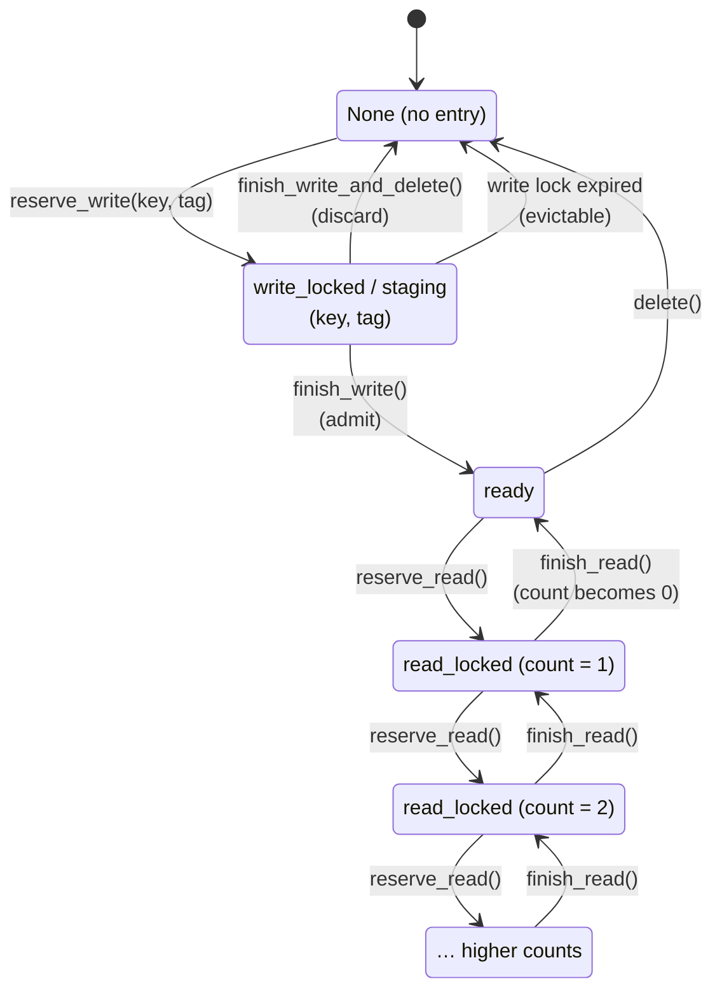
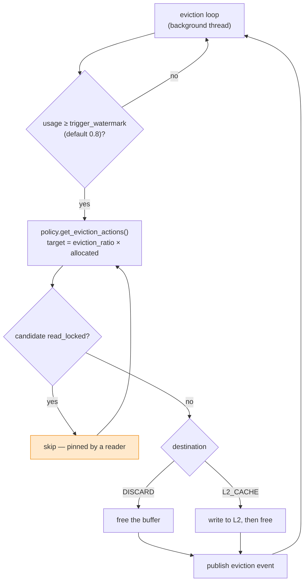

# L1 memory and eviction

> Code references in this document are permalinks pinned to upstream `dev`
> @ [`53bde913`](https://github.com/LMCache/LMCache/tree/53bde913de1adae2a380fe0c2de8d2b9355b4702).

L1 is the tier LMCache actually owns: the local memory pool that holds KV objects on this
node. This document covers the object lifecycle state machine, the locking that keeps
readers and writers apart, allocation, and eviction.

---

## Contents

1. [What L1 is, and what it is not](#1-what-l1-is-and-what-it-is-not)
2. [The three media](#2-the-three-media)
3. [The object lifecycle state machine](#3-the-object-lifecycle-state-machine)
4. [Locks: `TTLLock`, read counts, write reservations](#4-locks-ttllock-read-counts-write-reservations)
5. [Staging, and why writers do not collide](#5-staging-and-why-writers-do-not-collide)
6. [Allocators](#6-allocators)
7. [Eviction](#7-eviction)
8. [Capacity, quotas and the memory orchestrator](#8-capacity-quotas-and-the-memory-orchestrator)
9. [Operating it](#9-operating-it)
10. [Where to look next](#10-where-to-look-next)

---

## 1. What L1 is, and what it is not

L1 is **a closed set of local media**, unlike L2's open adapter registry. From
[`L1BackendType`](https://github.com/LMCache/LMCache/blob/53bde913de1adae2a380fe0c2de8d2b9355b4702/lmcache/v1/distributed/api.py#L103):
`dram`, `devdax`, `gds`. You cannot add an L1 medium out of tree, and that is deliberate —
the object lifecycle state machine has to understand how the medium allocates, pins and
frees.

It is also **not** the GPU cache. L0 belongs to the engine. L1 is host-side (or
host-addressable) memory the MP server allocated for itself.

The implementations live in
[`l1_manager/`](https://github.com/LMCache/LMCache/tree/53bde913de1adae2a380fe0c2de8d2b9355b4702/lmcache/v1/distributed/l1_manager),
and the package docstring is the best one-paragraph summary in the repo:

> **L1 managers: one object-lifecycle state machine, one subclass per medium.**
>
> - `DramL1Manager`, `DevDaxL1Manager` and `GdsL1Manager` implement `L1ManagerInterface`
>   for one memory medium each, sharing the state machine in `base.py` (an implementation
>   detail of this package).
> - `ShadowL1Manager` is an index of a peer's memory: borrowed views, no bytes of its own.
> - `create_l1_manager` / `create_l1_managers` pick the subclass from an `L1ManagerConfig`.

Note the design: **one state machine, several media.** `BaseL1Manager` owns everything about
keys, locks, staging and notifications; a subclass contributes only a memory manager, the
medium's memory tags, and a metrics label.

---

## 2. The three media

| Backend | Medium | Why you would use it |
|---|---|---|
| `dram` | pinned host DRAM | the default; fastest host-side tier, DMA-able |
| `devdax` | CXL / persistent memory via Device-DAX | far more capacity per node than DRAM, at higher latency |
| `gds` | NVMe via GPUDirect Storage | capacity at SSD prices, DMA straight to GPU |

Plus a fourth that is not really a medium:

**`ShadowL1Manager`** — *"an index of a peer's memory: borrowed views, no bytes of its
own."* This is the mechanism behind [P2P sharing](08-p2p-sharing.md): a peer's L1 is
modelled as a local manager that holds *descriptors* rather than bytes, so the rest of the
system reads from it with the same code path. A good example of making a distributed feature
look local to everything above it.

`devdax` is unusual in being **hot-pluggable** — `StorageManager` exposes
[`add_l1_devdax_device`](https://github.com/LMCache/LMCache/blob/53bde913de1adae2a380fe0c2de8d2b9355b4702/lmcache/v1/distributed/storage_manager.py#L857)
and `remove_l1_devdax_device`, with per-arena status reporting. DRAM is sized once at
startup.

---

## 3. The object lifecycle state machine

`BaseL1Manager`'s docstring carries the authoritative diagram. Transcribed as Mermaid:



And the guarantee that makes it usable:

> For every operation on list of keys, the operation is atomic.

Batch atomicity, not per-key atomicity. A lookup that matches 128 chunks takes read locks on
all 128 or none — so a concurrent eviction cannot reclaim chunk 57 while the caller believes
it holds the whole range.

The states in words:

| State | Meaning |
|---|---|
| **None** | no entry for this key |
| **write_locked / staging** | a writer has reserved space; **readers cannot see it** |
| **ready** | resident and visible; evictable |
| **read_locked (count = n)** | *n* readers hold it; **not evictable** |

The only path from `None` to `ready` is through staging, and the only way an object becomes
evictable is by returning to `ready` with a read count of zero.

---

## 4. Locks: `TTLLock`, read counts, write reservations

Both locks are the same native primitive,
[`TTLLock`](https://github.com/LMCache/LMCache/blob/53bde913de1adae2a380fe0c2de8d2b9355b4702/lmcache/lmcache_native.pyi#L93):

> A thread-safe lock with TTL (Time-To-Live) support.
>
> The lock maintains a counter that can be incremented (lock) and decremented (unlock).
> **If the TTL expires, the lock is considered unlocked regardless of the counter value.**

That last sentence is the important one. The TTL (default 300 s) is a **leak backstop**, not
a correctness mechanism. Consider what holds a read lock: a scheduler did a lookup, and the
matching worker retrieve has not happened yet. If that request is aborted, preempted and
never resumed, or its engine process dies, the `finish_read` never comes. Without a TTL the
memory would be pinned until the server restarted.

So the design accepts a weaker guarantee — *a lock can expire out from under you* — in
exchange for not leaking a cache. The state machine reflects it on the write side too:

```
|   | (write lock expired: evictable)
```

An abandoned write reservation becomes evictable rather than permanent. The consequence for
anyone writing code here: **a reserve is a lease, not ownership.** Holding one across a slow
or unbounded operation is a bug, and 300 seconds is the budget.

Read locks are counted and clamped
([`base.py#L41`](https://github.com/LMCache/LMCache/blob/53bde913de1adae2a380fe0c2de8d2b9355b4702/lmcache/v1/distributed/l1_manager/base.py#L41)):

```python
MAX_READ_LOCK_COUNT = 128
```

```python
    if read_locks < 1:
        logger.warning(
            "L1Manager: read_locks=%d is invalid, clamping to 1", read_locks,
        )
    if read_locks > MAX_READ_LOCK_COUNT:
        logger.warning(
            "L1Manager: read_locks=%d exceeds limit=%d, clamping",
            read_locks, MAX_READ_LOCK_COUNT,
        )
        return MAX_READ_LOCK_COUNT
```

Why take more than one read lock at once? Because one lookup fans out to several readers —
[one key row per (object group, kv rank)](02-kv-cache-lifecycle.md#42-one-key-row-per-object-group-kv-rank).
A TP64 deployment needs 64 read locks on the same object, one per rank's retrieve. The cap
of 128 bounds that, and **clamps rather than raises** — so a world size above 128 would
silently under-lock. Worth knowing before deploying something very wide.

---

## 5. Staging, and why writers do not collide

From `BaseL1Manager`:

> A write creates a *staging object* owned by the writer's `tag`. Staging objects are kept
> apart from the resident objects: readers of the key do not see them, and writers with
> different tags may stage the same key at the same time.

Three properties, each solving a concrete problem:

1. **Readers cannot see staging objects.** A GPU→host copy lands asynchronously, so between
   `reserve_write` and `finish_write` the buffer contains garbage. Hiding it means no reader
   ever observes a partially written object — the invariant that makes the whole cache safe
   without a global lock.
2. **Writers with different tags can stage the same key concurrently.** Two engine instances
   can both compute and store the same chunk without serialising on it. One wins at
   `finish_write`; the other's work is discarded. Wasteful in bytes, cheap in contention —
   the right trade for a cache.
3. **Staging bytes are accounted separately.** `get_staging_memory_usage()` is a distinct
   gauge from `get_memory_usage()`, so in-flight writes are visible as their own number.
   Useful: a server whose staging usage is high and stable has stores that are not
   completing.

See [`docs/design/v1/distributed/l1_manager/staging-and-write-tags.md`](https://github.com/LMCache/LMCache/blob/53bde913de1adae2a380fe0c2de8d2b9355b4702/docs/design/v1/distributed/l1_manager/staging-and-write-tags.md).

---

## 6. Allocators

[`memory_allocators/`](https://github.com/LMCache/LMCache/tree/53bde913de1adae2a380fe0c2de8d2b9355b4702/lmcache/v1/memory_allocators)
holds ten allocators, composed rather than selected one-of:

| Allocator | Role |
|---|---|
| `pin_memory_allocator` | pinned (page-locked) host memory — DMA-able |
| `host_memory_allocator` | plain host memory |
| `devdax_memory_allocator` | Device-DAX arenas |
| `gpu_memory_allocator` | device memory |
| `tensor_memory_allocator`, `paged_tensor_memory_allocator` | carve tensors / paged blocks out of a buffer |
| `buffer_allocator` | the underlying slab |
| `mixed_memory_allocator` | dispatches across several |
| `lazy_memory_allocator` | defers the real allocation |
| `ad_hoc_memory_allocator` | one-off allocations outside the pool |

The thing to understand is **why pinning matters**. A GPU DMA engine can only transfer to or
from page-locked memory; if the destination is pageable, the driver stages through an
internal pinned buffer, adding a copy. Since L1's entire job is to be the place GPU KV lands
and comes back from, L1 DRAM is pinned. Pinned memory cannot be swapped, so **L1 is a hard
reservation against the host's RAM**, not a soft cache the OS can reclaim. Size it
accordingly: `--max-local-cpu-size` is memory the box no longer has.

---

## 7. Eviction

### 7.1 Policies

[`EvictionConfig`](https://github.com/LMCache/LMCache/blob/53bde913de1adae2a380fe0c2de8d2b9355b4702/lmcache/v1/distributed/config.py#L436):

```python
    eviction_policy: Literal["LRU", "ARC", "IsolatedLRU", "noop"]
    """ The eviction policy to use. """

    trigger_watermark: float = field(default=0.8)
    """ The memory usage watermark to trigger eviction (0.0 to 1.0). """

    eviction_ratio: float = field(default=0.2)
    """ The fraction of *allocated* memory to evict when triggered (0.0 to 1.0). """
```

| Policy | Behaviour |
|---|---|
| `LRU` | least-recently-used; the default choice |
| `ARC` | adaptive replacement — balances recency against frequency, better under scans |
| `IsolatedLRU` | LRU with isolation between groups (e.g. per `cache_salt`), so one tenant cannot evict another's working set |
| `noop` | never evict; stores fail when full |

`IsolatedLRU` is the multi-tenant answer: with plain LRU, one tenant streaming a huge
unique working set evicts everyone else's hot prefixes. Pair it with the per-salt quotas of
§8.

### 7.2 Watermark and batch size

Eviction is **batched and hysteretic**, not per-allocation. At 80% usage the controller wakes
and frees 20% of allocated memory in one pass. Evicting one object per allocation would put
policy bookkeeping on the hot path; a batch amortises it and leaves headroom before the next
trigger.

Note the wording: `eviction_ratio` is a fraction of ***allocated*** memory, not of the gap
to the watermark. At 80% of a 100 GiB pool, a 0.2 ratio frees ~16 GiB, landing near 64% —
comfortably below the trigger. Raise the ratio for fewer, larger eviction passes; lower it
for smoother but more frequent ones.

### 7.3 Eviction is not necessarily deletion

[`EvictionDestination`](https://github.com/LMCache/LMCache/blob/53bde913de1adae2a380fe0c2de8d2b9355b4702/lmcache/v1/distributed/internal_api.py#L186):

```python
class EvictionDestination(enum.Enum):
    """The destination of evicted objects"""

    DISCARD = enum.auto()
    """Discard the evicted objects"""

    L2_CACHE = enum.auto()
    """Evict to L2 storage"""
```

So **eviction from L1 can be a demotion to L2** rather than a loss. That turns the hierarchy
into a genuine cascade: hot chunks in L1, warm chunks pushed down to disk or object storage
under pressure, and a later lookup finds them in L2 and prefetches them back up.

Policies register destinations (`register_eviction_destination`) and emit
`EvictionAction(destination, keys)` — the policy decides *what* to evict, the controller
decides *where* it goes. Clean separation, and the reason the same LRU implementation serves
both tiers.

### 7.4 The controller

[`EvictionController`](https://github.com/LMCache/LMCache/blob/53bde913de1adae2a380fe0c2de8d2b9355b4702/lmcache/v1/distributed/storage_controllers/eviction_controller.py):

> Abstract base class for eviction controllers.
>
> Provides the shared eviction loop structure: background thread and stop flag. Subclasses
> implement `eviction_loop` and `execute_eviction_action` for their specific tier (L1 or L2).

One `StorageControllerInterface` implementation, two tiers — `L1EvictionPolicy` and
`L2EvictionPolicy` bind the same policy logic to different storage.



A read-locked object is never evicted — that is the guarantee lookup relies on when it takes
locks before the retrieve. **Which means a pool full of read-locked objects cannot be
evicted at all**: if every object is pinned by an in-flight request, eviction finds no
candidates and stores start failing. This is where the TTL of §4 earns its keep.

---

## 8. Capacity, quotas and the memory orchestrator

Three mechanisms at different scopes:

**Per-L1 accounting.** `get_l1_usage()` returns `(used, total)`;
`get_l1_devdax_arena_statuses()` breaks DevDAX down per arena.

**Per-tenant quotas.** `QuotaManager` plus
`get_usage_bytes_by_cache_salt()` give per-salt byte accounting, so a tenant can be capped.
Combine with `IsolatedLRU` so a capped tenant's pressure stays theirs.

**Cross-process arbitration.**
[`memory_orchestrator/`](https://github.com/LMCache/LMCache/tree/53bde913de1adae2a380fe0c2de8d2b9355b4702/lmcache/v1/memory_orchestrator)
is a gRPC service (it has its own `protos/`, `server.py`, `client.py`, `__main__.py`) that
arbitrates memory *between* processes. The problem it solves: several MP servers, or an MP
server and something else, competing for one host's RAM, where each individually sizing
itself to 80% of the box overcommits it. `StorageManager.publish_capacity()` is the
reporting side.

`CapacitySnapshot` and `ModuleMemoryCapacity` in
[`api.py`](https://github.com/LMCache/LMCache/blob/53bde913de1adae2a380fe0c2de8d2b9355b4702/lmcache/v1/distributed/api.py)
are the shared vocabulary.

---

## 9. Operating it

**Sizing.** L1 DRAM is pinned and therefore unswappable — subtract it from the host's usable
RAM before sizing anything else. Pin too much and the OOM killer arrives for the model
server, not for LMCache.

**Reading `lmcache describe`.** L1 reports `used / total` plus staging bytes. Two
diagnostics:

- *High staging, not falling* → stores are reserved but not finishing. Look at the worker
  transfer path, not at eviction.
- *Usage pinned just below 100% with eviction running constantly* → the working set exceeds
  the pool. Either grow L1, or add an L2 tier so eviction becomes demotion (§7.3) instead of
  loss.

**Choosing a policy.** `LRU` unless you have a reason. `ARC` if the workload scans (long
unique documents evicting hot shared prefixes). `IsolatedLRU` for multi-tenant. `noop` only
for experiments where you want stores to fail loudly instead of churning.

**Tuning the watermark.** Lower `trigger_watermark` to start evicting earlier, trading usable
capacity for a smaller chance of a store failing at a burst. Raise `eviction_ratio` for
fewer, bigger passes.

**A caution on metrics.** L1 usage is a gauge sampled by the metrics layer
(`_l1_usage_ratio_or_zero` returns 0.0 rather than raising when a target is gone, *"so the
observable-gauge callback never raises during scrape"*). A zero in a dashboard can therefore
mean "no manager" rather than "empty pool" — check against `describe` before concluding
anything.

---

## 10. Where to look next

- [KV cache lifecycle](02-kv-cache-lifecycle.md) — the reserve/finish protocol from the caller's side, and why lookup takes read locks.
- [L2 adapters and storage](04-l2-adapters-and-storage.md) — where `L2_CACHE`-destined evictions go, and L2's own eviction and quotas.
- [P2P sharing](08-p2p-sharing.md) — `ShadowL1Manager` and borrowed memory.
- [Observability](09-observability.md) — the L1 gauges and eviction events.
- Upstream design docs: [`l1_manager_interface.md`](https://github.com/LMCache/LMCache/blob/53bde913de1adae2a380fe0c2de8d2b9355b4702/docs/design/v1/distributed/l1_manager_interface.md), [`l1_manager/l1-manager-types.md`](https://github.com/LMCache/LMCache/blob/53bde913de1adae2a380fe0c2de8d2b9355b4702/docs/design/v1/distributed/l1_manager/l1-manager-types.md), [`l1_manager/staging-and-write-tags.md`](https://github.com/LMCache/LMCache/blob/53bde913de1adae2a380fe0c2de8d2b9355b4702/docs/design/v1/distributed/l1_manager/staging-and-write-tags.md), [`memory_manager/device-dax-l1.md`](https://github.com/LMCache/LMCache/blob/53bde913de1adae2a380fe0c2de8d2b9355b4702/docs/design/v1/distributed/memory_manager/device-dax-l1.md), [`memory_tags.md`](https://github.com/LMCache/LMCache/blob/53bde913de1adae2a380fe0c2de8d2b9355b4702/docs/design/v1/distributed/memory_tags.md).
