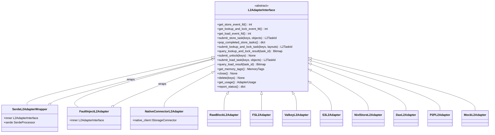
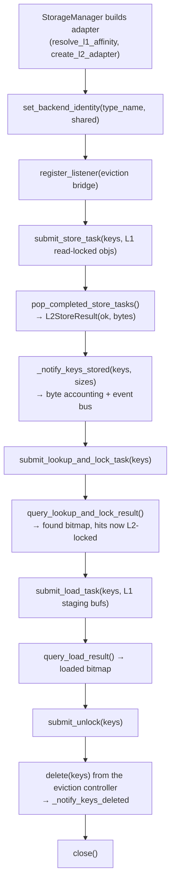
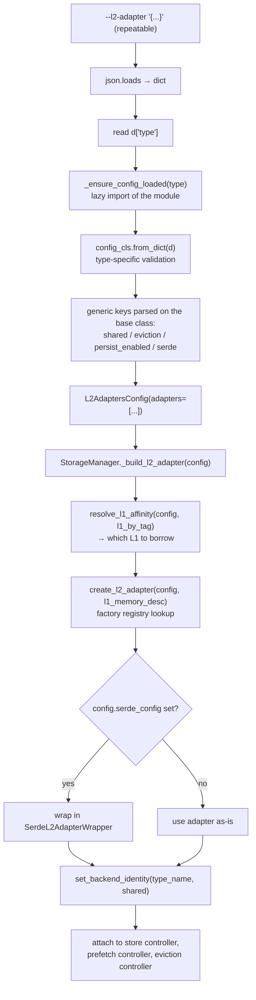
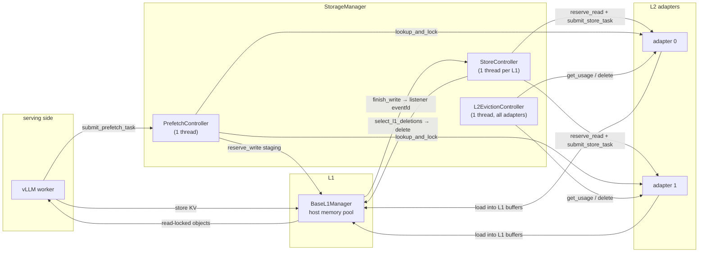
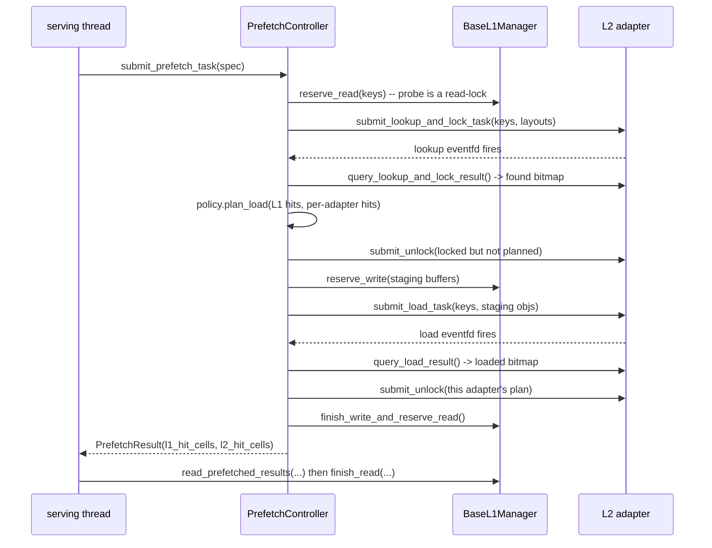
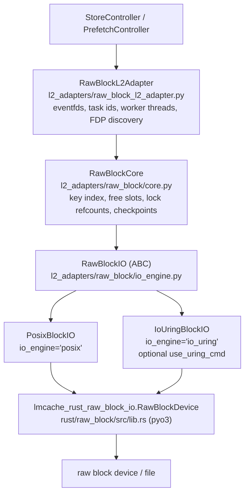
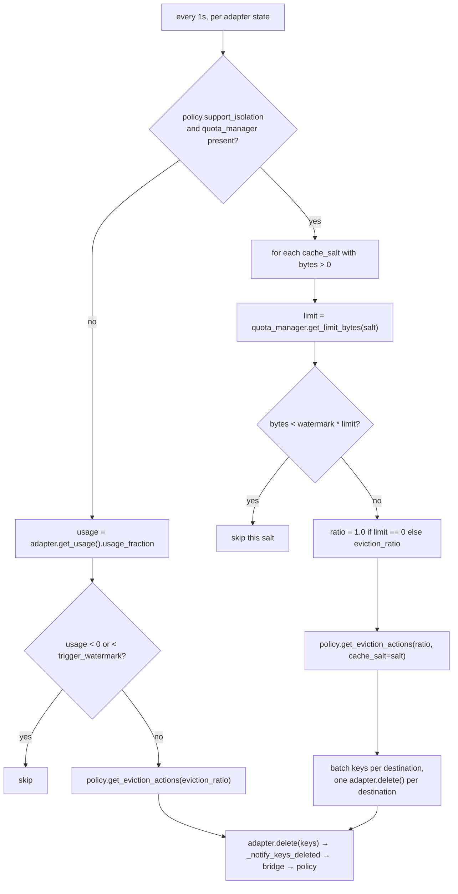
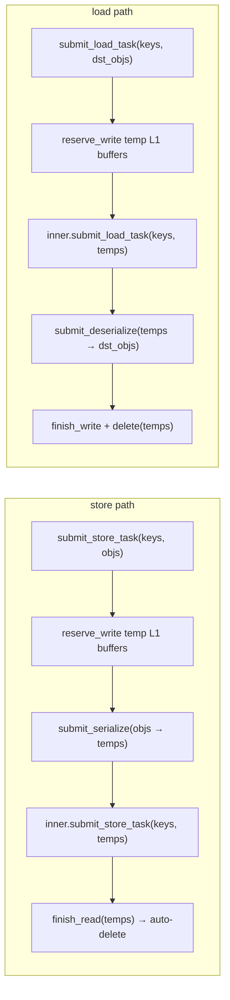

# L2 adapters and external storage

> Code references are permalinks pinned to upstream `dev` @ `53bde913`.

L1 is the host-memory pool described in [L1 memory and eviction](03-l1-memory-and-eviction.md):
fast, bounded, and gone when the process exits. **L2 is everything else** — a local
filesystem, an NVMe raw block device, a Redis/Valkey cluster, an S3 bucket, a NIXL
storage backend, a peer node's DRAM. All of it hides behind one interface,
`L2AdapterInterface`, and all of it is optional: an LMCache server with no
`--l2-adapter` flag is an L1-only cache.

This document covers the adapter contract, the adapters that ship on this revision,
how one is selected and built from configuration, how data moves between L1 and L2,
and how L2 eviction and per-tenant quotas work.

The upstream design docs for this area are unusually complete and live at
[`docs/design/v1/distributed/l2_adapters/`](https://github.com/LMCache/LMCache/tree/53bde913de1adae2a380fe0c2de8d2b9355b4702/docs/design/v1/distributed/l2_adapters).
This document cites them where they are accurate and flags the places where they
have drifted from the code (see [Where the design docs are stale](#9-where-the-design-docs-are-stale)).

---

## 1. The L2 adapter contract

### 1.1 Why it looks the way it does

Three constraints shaped the interface, and most of its oddities follow from them:

1. **The caller owns the buffers.** An adapter never allocates a destination for a
   load and never keeps a reference to a stored object. Store receives L1 objects
   that the caller has read-locked; load receives L1 staging buffers that the caller
   has write-reserved. This keeps all memory accounting in one place (the L1 manager)
   and makes it possible for an adapter to DMA straight into registered L1 memory
   instead of copying through a Python buffer.
2. **Nothing may block.** Both controllers that drive adapters are single background
   threads shared by every adapter. A synchronous `get()` against S3 would stall every
   other backend. So every operation is **submit → wait on an eventfd → query the
   result**, and each adapter brings its own threads, event loop, or native worker
   pool to do the actual I/O.
3. **A hit must survive until it is read.** Between "the lookup said this key exists"
   and "the bytes are in L1" the adapter could evict the object. So lookup *is* a
   lock: `submit_lookup_and_lock_task` atomically reports existence and pins what it
   found, and the caller is responsible for unlocking.

### 1.2 The interface

[`L2AdapterInterface`](https://github.com/LMCache/LMCache/blob/53bde913de1adae2a380fe0c2de8d2b9355b4702/lmcache/v1/distributed/l2_adapters/base.py#L85)
in `lmcache/v1/distributed/l2_adapters/base.py`. The abstract methods — the ones a
new adapter *must* implement — are:

| Group | Method | Contract |
|---|---|---|
| Event fds | [`get_store_event_fd`](https://github.com/LMCache/LMCache/blob/53bde913de1adae2a380fe0c2de8d2b9355b4702/lmcache/v1/distributed/l2_adapters/base.py#L161) | Signalled when a store task completes |
| | [`get_lookup_and_lock_event_fd`](https://github.com/LMCache/LMCache/blob/53bde913de1adae2a380fe0c2de8d2b9355b4702/lmcache/v1/distributed/l2_adapters/base.py#L176) | Signalled when a lookup task completes |
| | [`get_load_event_fd`](https://github.com/LMCache/LMCache/blob/53bde913de1adae2a380fe0c2de8d2b9355b4702/lmcache/v1/distributed/l2_adapters/base.py#L191) | Signalled when a load task completes |
| Store | [`submit_store_task(keys, objects) -> L2TaskId`](https://github.com/LMCache/LMCache/blob/53bde913de1adae2a380fe0c2de8d2b9355b4702/lmcache/v1/distributed/l2_adapters/base.py#L210) | Write `objects[i]` under `keys[i]` |
| | [`pop_completed_store_tasks() -> dict[L2TaskId, L2StoreResult]`](https://github.com/LMCache/LMCache/blob/53bde913de1adae2a380fe0c2de8d2b9355b4702/lmcache/v1/distributed/l2_adapters/base.py#L236) | Drain completions; each task appears once |
| Lookup | [`submit_lookup_and_lock_task(keys, group_layout_descs)`](https://github.com/LMCache/LMCache/blob/53bde913de1adae2a380fe0c2de8d2b9355b4702/lmcache/v1/distributed/l2_adapters/base.py#L252) | Existence check **and** L2-side lock |
| | [`query_lookup_and_lock_result(task_id) -> Bitmap \| None`](https://github.com/LMCache/LMCache/blob/53bde913de1adae2a380fe0c2de8d2b9355b4702/lmcache/v1/distributed/l2_adapters/base.py#L274) | `None` while pending, then the bitmap exactly once |
| | [`submit_unlock(keys) -> None`](https://github.com/LMCache/LMCache/blob/53bde913de1adae2a380fe0c2de8d2b9355b4702/lmcache/v1/distributed/l2_adapters/base.py#L294) | Fire-and-forget; **must** eventually succeed |
| Load | [`submit_load_task(keys, objects)`](https://github.com/LMCache/LMCache/blob/53bde913de1adae2a380fe0c2de8d2b9355b4702/lmcache/v1/distributed/l2_adapters/base.py#L318) | Fill the caller's buffers |
| | [`query_load_result(task_id) -> Bitmap \| None`](https://github.com/LMCache/LMCache/blob/53bde913de1adae2a380fe0c2de8d2b9355b4702/lmcache/v1/distributed/l2_adapters/base.py#L344) | Per-key success bitmap, once |
| Placement | [`get_memory_tags() -> MemoryTags`](https://github.com/LMCache/LMCache/blob/53bde913de1adae2a380fe0c2de8d2b9355b4702/lmcache/v1/distributed/l2_adapters/base.py#L368) | Where this adapter's bytes live |
| Lifecycle | [`close()`](https://github.com/LMCache/LMCache/blob/53bde913de1adae2a380fe0c2de8d2b9355b4702/lmcache/v1/distributed/l2_adapters/base.py#L620) | Release threads, fds, connections |

Plus non-abstract methods with useful defaults, which an adapter overrides only if
it can support them:

- [`delete(keys)`](https://github.com/LMCache/LMCache/blob/53bde913de1adae2a380fe0c2de8d2b9355b4702/lmcache/v1/distributed/l2_adapters/base.py#L549) — default no-op; required for eviction.
- [`get_usage() -> AdapterUsage`](https://github.com/LMCache/LMCache/blob/53bde913de1adae2a380fe0c2de8d2b9355b4702/lmcache/v1/distributed/l2_adapters/base.py#L589) — the base class already maintains both the aggregate byte count and a per-`cache_salt` breakdown, so an adapter that routes its sizes through `_notify_keys_stored` / `_notify_keys_deleted` gets this for free.
- [`supports_global_eviction`](https://github.com/LMCache/LMCache/blob/53bde913de1adae2a380fe0c2de8d2b9355b4702/lmcache/v1/distributed/l2_adapters/base.py#L529) — `True` only when the adapter declared a positive `max_capacity_bytes` at construction.
- [`list_l2_keys(...)`](https://github.com/LMCache/LMCache/blob/53bde913de1adae2a380fe0c2de8d2b9355b4702/lmcache/v1/distributed/l2_adapters/base.py#L565) — paginated key listing; raises `NotImplementedError` by default.
- [`report_status() -> dict`](https://github.com/LMCache/LMCache/blob/53bde913de1adae2a380fe0c2de8d2b9355b4702/lmcache/v1/distributed/l2_adapters/base.py#L632) — must include `is_healthy`; surfaced by the server's `/status` endpoint.



In prose: every concrete adapter implements the same abstract interface. Three of the
implementations are **decorators** that themselves hold another adapter —
`SerdeL2AdapterWrapper` (adds serialization, §7), `FaultInjectL2Adapter` (drops a
deterministic subset of loads for testing), and `NativeConnectorL2Adapter` (bridges a
pybind-wrapped C++ connector). The rest are leaf adapters that talk to a storage
medium. The diagram lists a representative selection; §2 is the complete table.

### 1.3 Three eventfds, and why they must be unique

Each adapter exposes three *distinct* file descriptors. The store controller and the
prefetch controller each build an `fd → adapter index` map and `select.poll()` over
it. If two methods returned the same fd — within one adapter or across two —
completions would be silently attributed to the wrong adapter. The base class says so
in a block comment above the three getters, and
[`plugin.md`](https://github.com/LMCache/LMCache/blob/53bde913de1adae2a380fe0c2de8d2b9355b4702/docs/design/v1/distributed/l2_adapters/plugin.md)
repeats it as rule 3 of the plugin contract. Adapters get their fds from
`create_event_notifier()` in `lmcache/v1/platform` (`os.eventfd` on Linux, an
`os.pipe` fallback elsewhere), which makes uniqueness automatic.

Related sharp edge: `L2TaskId` is only unique **within one adapter**. Callers tracking
work across adapters key on `(adapter_index, task_id)`.

### 1.4 Lifecycle of one key



In prose: the storage manager picks which L1 the adapter will borrow buffers from,
constructs it, stamps its backend name for observability, and registers the eviction
listener. Then the steady state is: stores arrive from the store controller and are
acknowledged with a success flag plus a real transferred-byte count; lookups lock the
hits; loads fill caller-provided L1 buffers; unlocks release the L2-side pins; the
eviction controller calls `delete` when the adapter is over its watermark or a tenant
is over quota; `close()` tears everything down.

One detail worth noticing in `L2StoreResult`: adapters that fast-path a duplicate key
(the key already exists in the backend, so nothing is written) are asked to report the
*real, non-skipped* byte count, so the L2 throughput histogram measures actual work
rather than submitted work.

### 1.5 Memory tags: which L1 an adapter borrows

An adapter does not choose its L1 — the storage manager does, from two tag sets:

- `L2AdapterInterface.get_memory_tags()` describes where the adapter's *own* bytes
  live (anything off-host or shared with other hosts is `REMOTE`).
- [`L2AdapterConfigBase.get_wanted_l1_memory_tags()`](https://github.com/LMCache/LMCache/blob/53bde913de1adae2a380fe0c2de8d2b9355b4702/lmcache/v1/distributed/l2_adapters/config.py#L376)
  lists acceptable L1 tags, most preferred first. The default is
  `((DRAM, LOCAL), (CXL, LOCAL))`, which fits every adapter that just wants a host
  buffer.

[`resolve_l1_affinity`](https://github.com/LMCache/LMCache/blob/53bde913de1adae2a380fe0c2de8d2b9355b4702/lmcache/v1/distributed/storage_controllers/utils.py#L414)
picks the first L1 manager, in write-placement order, whose tags equal the adapter's
most-preferred available choice, and raises if none match. It is documented as pure:
same config plus same managers always picks the same L1. That purity matters because
the function is called from three places (build, add-at-runtime, delete-at-runtime)
and all three must agree on which store controller owns the adapter.

---

## 2. The adapters that exist on this revision

Enumerated from the `register_l2_adapter_type` calls in
[`lmcache/v1/distributed/l2_adapters/`](https://github.com/LMCache/LMCache/tree/53bde913de1adae2a380fe0c2de8d2b9355b4702/lmcache/v1/distributed/l2_adapters)
— 22 built-in types:

| `"type"` | Module | Stores to | Native or Python |
|---|---|---|---|
| `fs` | `fs_l2_adapter.py` | Local/NFS directory, one file per object, raw tensor bytes, filename encodes the key | Python (`aiofiles` + asyncio thread) |
| `fs_native` | `fs_native_l2_adapter.py` | Same idea, via the C++ FS connector | **Native C++** (`csrc/storage_backends/fs`) |
| `raw_block` | `raw_block_l2_adapter.py` | Raw NVMe block device or a dedicated file, fixed-size slots | Python core + **Rust** I/O (see §6) |
| `dax` | `dax_l2_adapter.py` | Device-DAX arenas (persistent memory / CXL), fixed-size slots, `mmap` | Python (`mmap` + `ctypes`) |
| `hf3fs` | `hf3fs_l2_adapter.py` | DeepSeek 3FS mount | **Native C++** (`csrc/storage_backends/hf3fs`) |
| `resp` | `resp_l2_adapter.py` | Redis / Valkey over RESP | **Native C++** (`csrc/storage_backends/redis`) |
| `valkey` | `valkey_l2_adapter.py` | Valkey or Redis, standalone or cluster, via the `glide` sync client | Python (worker pool of glide clients) |
| `aerospike` | `aerospike_l2_adapter.py` | Aerospike namespace/set | **Native C++** (`csrc/storage_backends/aerospike`) |
| `mooncake_store` | `mooncake_store_l2_adapter.py` | Mooncake Store | **Native C++** (`csrc/storage_backends/mooncake`) |
| `nixl_store` | `nixl_store_l2_adapter.py` | A NIXL storage backend (`GDS`, `GDS_MT`, `POSIX`, `HF3FS`, `OBJ`, `AZURE_BLOB`) via a pre-allocated pool | Python, over the `nixl` Python package |
| `nixl_store_dynamic` | `nixl_store_dynamic_l2_adapter.py` | Same, but one file created per store instead of a fixed pool | Python, over `nixl` |
| `nixl_native` | `nixl_native_l2_adapter.py` | A NIXL backend plugin (e.g. `POSIX`, `OBJ`) through the C++ connector | **Native C++** (`csrc/storage_backends/nixl`) |
| `s3` | `s3_l2_adapter.py` | S3 or an S3-compatible endpoint (virtual-hosted style), SigV4 | Python over `awscrt` (a native AWS CRT library) |
| `hfbucket` | `hfbucket_l2_adapter.py` | Hugging Face Buckets, `hf://buckets/<ns>/<bucket>[/<prefix>]` | Python (HF API, worker threads) |
| `bigtable` | `bigtable_l2_adapter.py` | Google Cloud Bigtable table | Python (async Bigtable client) |
| `sagemaker-hyperpod` | `sagemaker_hyperpod_l2_adapter.py` | Node-local SageMaker HyperPod ai-toolkit daemon over HTTP + a shared-memory segment | Python (asyncio) |
| `p2p` | `p2p_l2_adapter.py` | **Another LMCache server's L1** — see [P2P cache sharing](08-p2p-sharing.md) | Python (RPC + transfer channel) |
| `mock` | `mock_l2_adapter.py` | Process RAM, with a simulated bandwidth; the reference implementation | Python |
| `fault_inject` | `fault_inject_l2_adapter.py` | Nothing — decorator that deterministically drops a subset of load results | Python |
| `plugin` | `plugin_l2_adapter.py` | Whatever the loaded out-of-tree class stores to (§4) | Python |
| `native_plugin` | `native_plugin_l2_adapter.py` | Whatever the loaded out-of-tree *connector* stores to (§4) | Loader is Python; connector is typically C++ |

A note on "native": the six types marked **Native C++** are thin Python factories that
construct a pybind-wrapped `IStorageConnector` from `csrc/storage_backends/` and hand
it to
[`NativeConnectorL2Adapter`](https://github.com/LMCache/LMCache/blob/53bde913de1adae2a380fe0c2de8d2b9355b4702/lmcache/v1/distributed/l2_adapters/native_connector_l2_adapter.py#L114),
which does the Python-side work once for all of them: splitting the connector's single
eventfd into the three the interface requires, running a demux thread that routes
completions by operation type, serializing `ObjectKey`s to strings, exposing
`MemoryObj` buffers as `memoryview`s, and keeping a client-side refcount lock table for
backends that have no server-side lock. The same C++ connector is reusable outside MP
mode, which is why the bridge exists rather than each connector implementing the full
adapter.

Three things this table does **not** claim, because they could not be verified from
this repository:

- Behaviour of the third-party libraries themselves. `nixl`, `glide`, `awscrt`, the
  Aerospike C client, the Mooncake SDK, the 3FS client and the Google Cloud Bigtable
  client are not vendored here. Where an adapter forwards a parameter dict "as-is" —
  `mooncake_store`'s `setup_config` says explicitly that LMCache does not interpret,
  validate or default any Mooncake key — the semantics live entirely in the vendor
  library.
- Which backends actually work in any given deployment. Every one of these modules is
  imported lazily precisely because its dependency may be absent (§3.2).
- Anything about relative performance. Nothing was benchmarked for this guide.

### 2.1 Multiple adapters, including several of the same type

`--l2-adapter` is `action="append"`, so the configuration is an **ordered list** of
adapter instances, not a single choice. Two `fs` adapters with different `base_path`s
are two independent adapters. Order is the adapter index, which matters: the default
prefetch policy serves each needed chunk from the lowest-indexed tier that has it.

---

## 3. Selection and construction

### 3.1 From JSON to an adapter object

Each `--l2-adapter` value is a JSON object whose `"type"` field names a registered
adapter and whose other keys are type-specific:

```bash
lmcache server \
  --l2-adapter '{"type":"fs","base_path":"/data/lmcache"}' \
  --l2-adapter '{"type":"s3","s3_endpoint":"s3://my-bucket.s3.us-east-1.amazonaws.com",
                 "s3_region":"us-east-1","max_capacity_gb":512,
                 "eviction":{"eviction_policy":"LRU","trigger_watermark":0.8},
                 "serde":{"type":"fp8"}}'
```

The argument is added by
[`add_l2_adapters_args`](https://github.com/LMCache/LMCache/blob/53bde913de1adae2a380fe0c2de8d2b9355b4702/lmcache/v1/distributed/l2_adapters/config.py#L415),
whose help text is generated from the live registry, and parsed by
[`parse_args_to_l2_adapters_config`](https://github.com/LMCache/LMCache/blob/53bde913de1adae2a380fe0c2de8d2b9355b4702/lmcache/v1/distributed/l2_adapters/config.py#L459).



In prose: the JSON is decoded, the `type` triggers a lazy import, the adapter's own
config class validates its type-specific keys via `from_dict`, and then four *generic*
keys are parsed by the base class regardless of adapter type — `shared`,
[`eviction`](https://github.com/LMCache/LMCache/blob/53bde913de1adae2a380fe0c2de8d2b9355b4702/lmcache/v1/distributed/l2_adapters/config.py#L231),
[`persist_enabled`](https://github.com/LMCache/LMCache/blob/53bde913de1adae2a380fe0c2de8d2b9355b4702/lmcache/v1/distributed/l2_adapters/config.py#L271)
and
[`serde`](https://github.com/LMCache/LMCache/blob/53bde913de1adae2a380fe0c2de8d2b9355b4702/lmcache/v1/distributed/l2_adapters/config.py#L204).
On any `TypeError`/`ValueError` the parser logs the offending adapter index *and* the
adapter's own `help()` text before re-raising — a small touch that turns a typo in a
nested JSON key into an actionable message. (One legacy key is rejected outright:
`affinity_tag`, removed in favour of memory tags.)

`StorageManager`'s
[`_build_l2_adapter`](https://github.com/LMCache/LMCache/blob/53bde913de1adae2a380fe0c2de8d2b9355b4702/lmcache/v1/distributed/storage_manager.py#L1561)
then does the construction, including the serde wrap. The same function is used at
startup and by `add_l2_adapter()` at runtime, which is how adapters can be hot-added
and drained without restarting the server.

### 3.2 Two registries and lazy import

There are two parallel registries, both keyed by the same type name:

- **Config registry** —
  [`register_l2_adapter_type(name, config_cls)`](https://github.com/LMCache/LMCache/blob/53bde913de1adae2a380fe0c2de8d2b9355b4702/lmcache/v1/distributed/l2_adapters/config.py#L58).
- **Factory registry** —
  [`register_l2_adapter_factory(name, factory)`](https://github.com/LMCache/LMCache/blob/53bde913de1adae2a380fe0c2de8d2b9355b4702/lmcache/v1/distributed/l2_adapters/factory.py#L62),
  where a factory is `(config, l1_memory_desc) -> L2AdapterInterface`.

Each adapter module calls both at the bottom of the file. Adding a built-in adapter
therefore means **creating one file** — no existing file is edited. Discovery is by
convention:
[`l2_adapters/__init__.py`](https://github.com/LMCache/LMCache/blob/53bde913de1adae2a380fe0c2de8d2b9355b4702/lmcache/v1/distributed/l2_adapters/__init__.py#L32)
walks the package with `pkgutil.iter_modules()` and registers every `*_l2_adapter`
module as **pending**, without importing it.

The laziness is the interesting part. These modules import `nixl`, `glide`, `awscrt`,
`google.cloud.bigtable`, the Aerospike client, the Mooncake SDK — dependencies almost
no single deployment has all of. Importing the package eagerly would either crash or
require every optional dependency to be installed.
[`ensure_adapter_loaded(name)`](https://github.com/LMCache/LMCache/blob/53bde913de1adae2a380fe0c2de8d2b9355b4702/lmcache/v1/distributed/l2_adapters/factory.py#L101)
instead pops pending modules one at a time until the requested name appears, skipping
`ImportError`s with a debug log, and re-raising the last one only if the name never
showed up — so a genuinely missing dependency still produces the right error, while an
unrelated missing dependency stays silent.

CLI enumeration needs the opposite: *try everything, tolerate failures*.
[`load_all_adapters()`](https://github.com/LMCache/LMCache/blob/53bde913de1adae2a380fe0c2de8d2b9355b4702/lmcache/v1/distributed/l2_adapters/factory.py#L138)
attempts each pending module exactly once. `ImportError` is skipped; an import-time
`TypeError` (the comment names incompatible Bigtable protobuf descriptors as the real
case) is logged with a traceback and the module is pushed **back** onto the pending
list — so `--help` still completes, but an explicit `--l2-adapter '{"type":"bigtable"}'`
still surfaces the original error. Because each enumeration pass is bounded by the
initial pending count, a failing import cannot loop forever.

---

## 4. Out-of-tree adapters: the plugin mechanism

Both plugin types exist so that a storage vendor can ship an adapter as a separate
pip-installable package and never touch the LMCache tree. The design is in
[`plugin.md`](https://github.com/LMCache/LMCache/blob/53bde913de1adae2a380fe0c2de8d2b9355b4702/docs/design/v1/distributed/l2_adapters/plugin.md).

### 4.1 `plugin` — load a full adapter class

```json
{
  "type": "plugin",
  "module_path": "my_plugin.adapter",
  "class_name": "MyL2Adapter",
  "adapter_params": {"host": "10.0.0.1"}
}
```

[`_create_plugin_adapter`](https://github.com/LMCache/LMCache/blob/53bde913de1adae2a380fe0c2de8d2b9355b4702/lmcache/v1/distributed/l2_adapters/plugin_l2_adapter.py#L126)
imports `module_path`, pulls `class_name` out of it, checks it subclasses
`L2AdapterInterface`, and then tries to find a typed config class for it so that the
plugin gets the same `from_dict` validation a built-in adapter gets. The resolution
order is: an explicit `config_class_name` in the JSON → the convention
`<AdapterClass>Config` in the same module → a `config_class_name` attribute on the
adapter class → nothing, in which case the raw `adapter_params` dict is passed
through. Candidates that do not exist or are not `L2AdapterConfigBase` subclasses are
skipped silently and the chain continues.

The plugin contract is the whole interface from §1.2, plus two framework-level rules
that are easy to get wrong: the three eventfds must be distinct (use
`create_event_notifier()`), and the plugin must bring **its own** event loop or thread
pool — unlike the removed non-MP connector architecture, the framework hands an L2
adapter no loop. `plugin.md` also asks for `**kwargs` in `__init__` for forward
compatibility. `examples/lmc_external_l2_adapter/` is a complete worked example.

### 4.2 `native_plugin` — load a connector instead

A C++ vendor connector should not have to re-implement eventfd demuxing and refcount
locking in Python. `native_plugin` loads a *connector* object and wraps it in the same
`NativeConnectorL2Adapter` that the six built-in native backends use, so the
third-party surface is six methods rather than the full adapter:

```python
def event_fd(self) -> int: ...
def submit_batch_get(self, keys, memoryviews) -> int: ...
def submit_batch_set(self, keys, memoryviews) -> int: ...
def submit_batch_exists(self, keys) -> int: ...
def drain_completions(self) -> list[tuple[int, bool, str, list[bool] | None]]: ...
def close(self) -> None: ...
```

[`_create_native_plugin_l2_adapter`](https://github.com/LMCache/LMCache/blob/53bde913de1adae2a380fe0c2de8d2b9355b4702/lmcache/v1/distributed/l2_adapters/native_plugin_l2_adapter.py#L116)
validates those methods at construction and raises `TypeError` if any is missing.
`examples/lmc_external_native_connector/` is the worked example;
`csrc/storage_backends/README.md` is the integration guide for writing the connector
itself.

---

## 5. L1 ↔ L2: store policy and prefetch

Adapters never talk to L1 directly, and the engine never talks to adapters directly.
Two single-threaded controllers sit in between, both documented in
[`overall.md`](https://github.com/LMCache/LMCache/blob/53bde913de1adae2a380fe0c2de8d2b9355b4702/docs/design/v1/distributed/l2_adapters/overall.md).



In prose: the write path is **L1-first and asynchronous**. The engine's store lands in
L1; when `finish_write()` completes, an `L1ManagerListener` appends the keys and signals
an eventfd; the store controller wakes, groups the keys, asks the policy which adapters
get which keys, takes L1 **read** locks so eviction cannot pull the bytes out from
under the adapter, and submits. The read path is the mirror image: the prefetch
controller looks up in L1 (by read-locking) and in every adapter (by
`lookup_and_lock`), plans once over the union, reserves L1 staging buffers, and has
each adapter write directly into those buffers. Eviction is a third, independent loop.

### 5.1 Write-through: the store controller

Source: `storage_controllers/store_controller.py`. The flow, from `overall.md` and the
code:

1. [`StoreListener.on_l1_keys_write_finished`](https://github.com/LMCache/LMCache/blob/53bde913de1adae2a380fe0c2de8d2b9355b4702/lmcache/v1/distributed/storage_controllers/store_controller.py#L122)
   runs **inside the L1 manager's lock**, so it may only append keys and signal an
   eventfd. `overall.md` calls this out as invariant 6: calling back into the L1
   manager from here deadlocks.
2. [`_process_new_keys`](https://github.com/LMCache/LMCache/blob/53bde913de1adae2a380fe0c2de8d2b9355b4702/lmcache/v1/distributed/storage_controllers/store_controller.py#L573)
   groups the drained keys by shape — today `(model_name, kv_rank)`. L1 is a shared
   pool, so one drain can span models with different KV shapes, and each
   `submit_store_task` must see a uniform `(shape, dtype)`.
3. Per group, `StorePolicy.select_store_targets(keys, adapters)` returns
   `{adapter_index: keys}`. A key may go to several adapters.
4. `reserve_read` on L1, then `submit_store_task`.
5. On completion,
   [`_finalize_store`](https://github.com/LMCache/LMCache/blob/53bde913de1adae2a380fe0c2de8d2b9355b4702/lmcache/v1/distributed/storage_controllers/store_controller.py#L750)
   releases the read locks and asks `select_l1_deletions` whether the L1 copy can go.
   **Failures are not retried** — they are logged, and the data stays in L1 where
   normal eviction applies.

The built-in policies
([`store_policy.md`](https://github.com/LMCache/LMCache/blob/53bde913de1adae2a380fe0c2de8d2b9355b4702/docs/design/v1/distributed/storage_controllers/store_policy.md)),
selected with `--l2-store-policy`:

| Name | Class | Targets | L1 deletions |
|---|---|---|---|
| `default` | [`DefaultStorePolicy`](https://github.com/LMCache/LMCache/blob/53bde913de1adae2a380fe0c2de8d2b9355b4702/lmcache/v1/distributed/storage_controllers/store_policy.py#L128) | every key to every adapter | none (write-through: L2 is a copy, not a move) |
| `skip_l1` | [`BufferOnlyStorePolicy`](https://github.com/LMCache/LMCache/blob/53bde913de1adae2a380fe0c2de8d2b9355b4702/lmcache/v1/distributed/storage_controllers/store_policy.py#L169) | every key to every adapter | every key, after any successful store (write-through becomes write-*behind*: L1 is only a staging buffer) |
| `p2p` | [`P2PStorePolicy`](https://github.com/LMCache/LMCache/blob/53bde913de1adae2a380fe0c2de8d2b9355b4702/lmcache/v1/distributed/storage_controllers/p2p_store_policy.py#L38) | one write-enabled peer, round-robin, and only above that peer's `write_l1_usage_threshold` | keys stored into a peer |

New policies register themselves with `register_store_policy(name, cls)` at import
time and `storage_controllers/__init__.py` imports every module in the directory, so a
policy is also a single new file. The `--l2-store-policy` choices come from the live
registry.

`P2PStorePolicy` is the one with interesting mechanics, and the trade-off it exposes is
worth reading even if you never use P2P. The threshold must sit below the L1 eviction
trigger watermark, or eviction discards local objects before any are pushed to a peer
(the server warns at startup when it does not). And because the *default prefetch
policy retains* everything it loads from L2, read-backs from peers accumulate locally,
lift L1 over the eviction watermark, and evict objects that exist nowhere else — so
`--enable-p2p-write` also switches the prefetch policy to `skip_l1` when it was left at
`default`. Two policies that are individually reasonable combine into a cache that
evicts its only copy of data; the fix is a coupled default. See
[P2P cache sharing](08-p2p-sharing.md).

### 5.2 Pull-up: the prefetch controller

Source: `storage_controllers/prefetch_controller.py`, designed in
[`prefetch_controller.md`](https://github.com/LMCache/LMCache/blob/53bde913de1adae2a380fe0c2de8d2b9355b4702/docs/design/v1/distributed/storage_controllers/prefetch_controller.md).

A prefetch request is a **grid**: one row per key group (an object group on one KV
rank), one column per chunk. Every lookup result, plan and lock set is a `Bitmap2D`
over that grid. The phases:



In prose and with the invariants that make it safe:

- **Observation is acquisition.** L1 is probed by read-locking it; L2 is probed by
  `lookup_and_lock`. A concurrent eviction can shrink what gets *discovered*, but can
  never invalidate a hit that was already reported.
- **One planning step.** The policy sees the L1 locked map and every adapter's found
  bitmap *at once* and plans once. L1 is not folded first and handed to L2 as a
  remainder. Every planned cell is locked in the tier it is planned from, and no cell
  is planned twice.
- **Locks are always released.** After planning, for keys locked but not planned;
  after a failed L1 reservation; after each adapter's load is admitted; and on abort
  or `stop()`. The controller never retries `submit_unlock`, which is exactly why the
  interface demands that adapters make it eventually succeed internally.
- **Admission is per adapter.** Each adapter's loads are admitted into L1 as they
  arrive, so a slow adapter does not delay a fast one's objects becoming readable.
- **`finish_write_and_reserve_read` is atomic**, so eviction cannot slip between
  completing the staging write and handing the read lock to the serving engine.
- **An in-flight watermark bounds concurrency.** A queued request starts only when,
  in every L1 that will receive loads, staging bytes plus the worst-case load bytes
  of requests still in the lookup phase stay under
  `--l2-prefetch-inflight-watermark` (default `0.5`) of capacity, and the remaining
  free bytes can hold the new request's worst case. With nothing in flight the head
  request is admitted regardless, so a request that can never fit cannot block the
  queue — its reservations just fail per cell. The older fixed-count flag
  `--l2-prefetch-max-in-flight` is still accepted and ignored, with a comment
  explaining why it was not removed: released operator deployments render it into
  server args, and rejecting it would crash the pod at startup.

Prefetch policies, selected with `--l2-prefetch-policy`:
[`DefaultPrefetchPolicy`](https://github.com/LMCache/LMCache/blob/53bde913de1adae2a380fe0c2de8d2b9355b4702/lmcache/v1/distributed/storage_controllers/prefetch_policy.py#L197)
(`default`) serves each cell from the lowest-indexed tier that holds it and **retains**
what it loaded from L2;
[`BufferOnlyPrefetchPolicy`](https://github.com/LMCache/LMCache/blob/53bde913de1adae2a380fe0c2de8d2b9355b4702/lmcache/v1/distributed/storage_controllers/prefetch_policy.py#L308)
(`skip_l1`) plans identically and retains nothing. `retain` is a deprecated alias of
`default`.

So the two directions are asymmetric by design: L1 → L2 is a *copy* the policy may
later turn into a move, and L2 → L1 is a *load into caller-owned staging buffers*
whose retention the policy decides per key.

---

## 6. `raw_block`: the Python/Rust split

`raw_block` writes KV objects into fixed-size slots on a raw NVMe block device (or a
dedicated file), with a durable metadata checkpoint region on the same device so the
index survives a restart. Design:
[`raw_block.md`](https://github.com/LMCache/LMCache/blob/53bde913de1adae2a380fe0c2de8d2b9355b4702/docs/design/v1/distributed/l2_adapters/raw_block.md).



In prose, three layers with a clean responsibility split:

- **`RawBlockL2Adapter`** (Python) implements `L2AdapterInterface`: three eventfds,
  adapter-local task ids, worker thread pools sized by `num_store_workers` /
  `num_lookup_workers` / `num_load_workers`, listener notifications, and NVMe
  Flexible Data Placement discovery.
- **`RawBlockCore`** (Python) owns the durable state: the in-memory key index, free
  slot tracking, the L2-side lock refcounts that back `lookup_and_lock`/`unlock`, and
  metadata checkpointing and recovery. It leases buffers from the engine through
  `lease_buffer` / `lease_buffers` context managers so callers never touch raw
  pointers.
- **`RawBlockIO`** (Python ABC, two implementations) is the only thing that knows *how*
  bytes reach the device: `PosixBlockIO` does synchronous `pread`/`pwrite`;
  `IoUringBlockIO` does batched io_uring, optionally with NVMe raw-command passthrough
  (`use_uring_cmd`).

**The Rust part** is only the bottom layer:
[`rust/raw_block/`](https://github.com/LMCache/LMCache/tree/53bde913de1adae2a380fe0c2de8d2b9355b4702/rust/raw_block)
is a small `pyo3` extension crate (`lmcache_rust_raw_block_io`, dependencies `pyo3`,
`libc`, `io-uring`) exporting exactly **one** class, `RawBlockDevice`, whose methods
include `pwrite_from_buffer` and `pread_into`. Everything above it is Python.

Why split there? Three reasons visible in the code:

1. **This layer is the one Python cannot do.** `O_DIRECT` with alignment guarantees,
   io_uring submission/completion rings, and NVMe `uring_cmd` passthrough need real
   systems code; `ctypes` wrappers around them would be both slow and fragile.
2. **It is the layer where you must release the GIL.** The Rust side calls
   `py.allow_threads(...)` around blocking device work, so many Python worker threads
   can have device I/O in flight at once. That is the whole point of putting the
   *engine* in Rust and keeping the *index* in Python.
3. **The complicated logic is the policy, and policy belongs in Python.** Slot
   allocation, checkpoint format, recovery, lock refcounts and FDP bucket mapping are
   intricate but not hot; keeping them in Python keeps them testable and shared with
   the legacy non-MP `RustRawBlockBackend`, which is now a thin facade over the same
   `RawBlockCore`. One on-device format, one recovery path, two front ends.

Two behaviours worth knowing because they are unusual among the adapters:

- **Worker failure is reported through task results, not exceptions.** After a
  terminal io_uring error (or 30 s with no submission/completion progress), the adapter
  still accepts submissions but completes them as failures — all-zero bitmaps for
  lookup and load, `L2StoreResult(False, 0)` for store — and `report_status()` returns
  `is_healthy=False` with the reason in `worker_error`. This is deliberate: the
  controllers' normal completion paths then release buffers and locks, L1 and healthy
  adapters keep serving, and the engine recomputes what is missing. A synchronous raise
  from `submit_*` would leak locks.
- **FDP placement is derived from `cache_salt`.** With `io_engine="io_uring"` and
  `use_uring_cmd=true`, the adapter maps the part of `ObjectKey.cache_salt` before `:`
  to an NVMe placement identifier in first-seen order. The mapping is process-local and
  availability-first: more buckets than identifiers means the extras get no directive
  and one warning. Read correctness is unaffected because `cache_salt` is part of the
  object key, not of the read path's directive.

---

## 7. L2 eviction and per-tenant quotas

### 7.1 Opt-in, per adapter

L2 eviction is configured per adapter instance with an `"eviction"` sub-object; an
adapter without one is simply not in the eviction loop
([`l2_eviction.md`](https://github.com/LMCache/LMCache/blob/53bde913de1adae2a380fe0c2de8d2b9355b4702/docs/design/v1/distributed/l2_adapters/l2_eviction.md)):

```json
{
  "type": "resp", "host": "localhost", "port": 6379, "max_capacity_gb": 10,
  "eviction": {"eviction_policy": "LRU", "trigger_watermark": 0.8, "eviction_ratio": 0.2}
}
```

`eviction_policy` must be one of `LRU`, `ARC`, `IsolatedLRU`, `noop` — validated in
[`_parse_eviction_config`](https://github.com/LMCache/LMCache/blob/53bde913de1adae2a380fe0c2de8d2b9355b4702/lmcache/v1/distributed/l2_adapters/config.py#L231),
with `trigger_watermark` defaulting to `0.8` and `eviction_ratio` to `0.2`.

One
[`L2EvictionController`](https://github.com/LMCache/LMCache/blob/53bde913de1adae2a380fe0c2de8d2b9355b4702/lmcache/v1/distributed/storage_controllers/eviction_controller.py#L218)
handles every eviction-enabled adapter from a single thread. Per adapter it holds an
[`L2AdapterEvictionState`](https://github.com/LMCache/LMCache/blob/53bde913de1adae2a380fe0c2de8d2b9355b4702/lmcache/v1/distributed/storage_controllers/eviction_controller.py#L201)
bundling the adapter, its config, an `EvictionPolicy` instance, and an
`L2EvictionPolicy` **listener bridge** registered on the adapter. The bridge is
composition, not multi-inheritance: it implements `L2AdapterListener` and forwards
`on_l2_keys_stored → on_keys_created`, `on_l2_keys_accessed → on_keys_touched`,
`on_l2_keys_deleted → on_keys_removed`. The policy classes themselves are pure data
structures shared with L1 eviction (`LRU`, `ARC`, `IsolatedLRU`, `NoOp`) and know
nothing about adapters.

The loop
([`_eviction_loop`](https://github.com/LMCache/LMCache/blob/53bde913de1adae2a380fe0c2de8d2b9355b4702/lmcache/v1/distributed/storage_controllers/eviction_controller.py#L303))
sleeps one second, then for each adapter takes one of two branches:



In prose: the **global** branch reads one number, `usage_fraction`, and does nothing
when it is negative — the sentinel for "this adapter declared no capacity, so it has no
eviction signal". The **per-salt** branch runs when the policy supports isolation
(`IsolatedLRU`) and a quota manager exists; it compares each salt's byte count against
`watermark × quota` and scopes the eviction to that salt's own LRU list. Keys are
batched by destination before calling the adapter, so an adapter with real per-call
overhead (NIXL handle setup, FS sync) sees one `delete` per destination rather than one
per `(salt, destination)` pair.

`StorageManager` refuses to wire up a global eviction state for an adapter that cannot
support it: if the policy is not `IsolatedLRU` and `supports_global_eviction` is
`False`, it logs a warning and skips. Per-salt eviction is orthogonal — it works off
per-bucket byte counts regardless of whether aggregate capacity was declared.

### 7.2 Per-tenant quotas

Design:
[`l2_per_user_quota.md`](https://github.com/LMCache/LMCache/blob/53bde913de1adae2a380fe0c2de8d2b9355b4702/docs/design/v1/distributed/l2_adapters/l2_per_user_quota.md).
The motivation is multi-tenancy: with aggregate-only eviction, one tenant's traffic
burst evicts everybody else's cache.

The mechanism rests on one decision: **`cache_salt` is an identity field of
`ObjectKey`**, participating in `__eq__` and `__hash__`. Two requests with identical
tokens but different salts are different keys and store separate copies. The salt comes
from vLLM's existing per-request `cache_salt` field (already supported by the
OpenAI-compatible API for prefix-cache isolation), carried on `IPCCacheServerKey` and
read by `ipc_key_to_object_keys()`.

The trade-off is explicit in the design doc: N tenants caching the same prompt consume
N× the storage, in both L1 and L2. What strict isolation buys is that ownership is
unambiguous (no first-storer-wins race, no shared-entry accounting), per-tenant byte
accounting is exact, and lookup scopes to the right tenant with no filtering. The doc
also records a wire-compatibility detail: `cache_salt` was appended as the *last*
positional field of `IPCCacheServerKey` because the struct is serialized positionally
by `msgspec`, so an old 7-field client decodes against a new server with the salt
defaulting to `""`.

Quotas live in
[`QuotaManager`](https://github.com/LMCache/LMCache/blob/53bde913de1adae2a380fe0c2de8d2b9355b4702/lmcache/v1/distributed/quota_manager.py#L38),
a thread-safe `cache_salt → byte limit` registry with CRUD endpoints under `/quota/`
on the MP server's HTTP API
([`quota_api.py`](https://github.com/LMCache/LMCache/blob/53bde913de1adae2a380fe0c2de8d2b9355b4702/lmcache/v1/multiprocess/http_apis/quota_api.py#L67)
— `PUT`/`GET`/`DELETE /quota/{cache_salt}` and `GET /quota`; `_default` in the URL
means the empty salt, since an empty string cannot be a path parameter).

Unregistered salts resolve through two different lenses, and the distinction is the
subtle part:

| Method | Unregistered salt resolves to | Used by |
|---|---|---|
| [`get_limit_bytes`](https://github.com/LMCache/LMCache/blob/53bde913de1adae2a380fe0c2de8d2b9355b4702/lmcache/v1/distributed/quota_manager.py#L86) | `0` — **allowlist**: data evicted next cycle (`effective_ratio = 1.0`) | the MP server's own `L2EvictionController` |
| [`effective_limit_bytes`](https://github.com/LMCache/LMCache/blob/53bde913de1adae2a380fe0c2de8d2b9355b4702/lmcache/v1/distributed/quota_manager.py#L124) | the registry's *default limit*, initially `None` = exempt | the coordinator's eviction manager |

Why two: under pure allowlist semantics, a freshly booted **coordinator** whose quota
table has not yet been re-synced by the external quota controller would see every
tenant as unregistered and mass-evict the fleet. So the coordinator starts permissive
and the controller arms enforcement by setting the default to `0` (`PUT /quota/config`)
after syncing. The per-server controller keeps the strict allowlist. Writes are never
rejected on the hot path in either case — an unknown tenant's stores succeed and are
reclaimed within about one eviction cycle.

---

## 8. The serde wrapper: compression as composition

An adapter stores whatever bytes it is handed. Quantizing, compressing or encrypting
those bytes is therefore not an adapter concern — it is a *decorator* on one.
`"serde": {"type": "...", ...}` in any adapter's JSON makes `StorageManager` wrap it in
[`SerdeL2AdapterWrapper`](https://github.com/LMCache/LMCache/blob/53bde913de1adae2a380fe0c2de8d2b9355b4702/lmcache/v1/distributed/l2_adapters/serde_wrapper.py#L108),
which itself implements `L2AdapterInterface`. The controllers cannot tell the
difference.



In prose: the wrapper borrows **temporary L1 buffers** from the L1 manager, marked
`is_temporary=True` so `finish_read` deletes them automatically, and runs the transform
between the caller's buffers and those temps. One background thread per wrapper polls
four fds — the inner adapter's store and load fds plus the serde processor's serialize
and deserialize fds. Lookup, unlock, `delete`, `get_usage` and listener registration
are delegated straight through, including the lookup **eventfd itself**, so a lookup
costs no thread hop. The wrapper keeps no byte accounting of its own: eviction and
quota logic see the inner adapter's real on-disk sizes, not the pre-compression ones.

Two policies are load-bearing:

- **All-or-nothing per submit.** If any temp allocation or any `submit_*` raises, the
  whole wrapped task fails — store returns `L2StoreResult(False, 0)`, load returns an
  all-zeros bitmap. Dropping the failed keys and succeeding with the rest would break
  the caller's assumption that a store either wholly succeeded or wholly failed, and
  keeping the coarse semantics is exactly what lets the controllers stay unmodified.
  *Partial* failures from the inner adapter are preserved faithfully: only keys whose
  bit is set get deserialized, and the same bitmap is reported upward.
- **Homogeneity.** Temp sizes come from `objects[0]`'s shapes and dtypes, under the
  assumption that one submit carries one layout. The store controller shape-groups
  before submitting and the prefetch controller uses one `layout_desc` per request, so
  the assumption holds — and `_alloc_temp_buffers` raises `ValueError` if it ever stops
  holding.

What goes *inside* the wrapper — the serializers themselves, TurboQuant, AES-GCM, and
how the stages compose — is [Serde and compression](07-serde-and-compression.md).

---

## 9. Where the design docs are stale

Checked against the code at `53bde913`:

- **`l2_eviction.md` describes the old `get_usage()` signature.** It says
  `get_usage()` returns a `(current_usage, usage_after_ongoing_eviction)` tuple (step 6
  of the adapter guide, the eviction-loop section, and the "returns `(-1, -1)`" note in
  the support matrix). The interface now returns the
  [`AdapterUsage`](https://github.com/LMCache/LMCache/blob/53bde913de1adae2a380fe0c2de8d2b9355b4702/lmcache/v1/distributed/l2_adapters/base.py#L41)
  dataclass — `total_bytes_used`, `total_capacity_bytes`, `bytes_by_cache_salt`, and a
  `usage_fraction` property that keeps the old `-1.0` "no signal" sentinel.
  `l2_per_user_quota.md` describes the new shape correctly.
- **`plugin.md`'s self-registration diagram attributes registrations to the wrong
  module.** It shows `native_connector_l2_adapter.py` registering `resp`, `fs_native`
  and `native_plugin`. In the code those three names are registered by
  `resp_l2_adapter.py`, `fs_native_l2_adapter.py` and `native_plugin_l2_adapter.py`
  respectively; `native_connector_l2_adapter.py` registers nothing and only provides
  the bridge class. The same section says `__init__.py` "imports" discovered modules,
  while the code registers them as *pending* and imports on demand — which the rest of
  the same document describes correctly.
- **`l2_eviction.md`'s adapter support matrix is a snapshot of five adapters** and
  predates most of the table in §2. Treat it as illustrative, not current.

Everything else cited here matched the code when checked. `overall.md`,
`store_policy.md`, `prefetch_controller.md`, `serde_wrapper.md`, `raw_block.md` and
`l2_per_user_quota.md` were accurate on the points this document relies on.

---

## 10. Where to look next

| Question | Go to |
|---|---|
| What is L1 and how does it evict? | [L1 memory and eviction](03-l1-memory-and-eviction.md) |
| Who calls `submit_prefetch_task`? | [KV cache lifecycle](02-kv-cache-lifecycle.md) |
| What runs the controllers? | [MP architecture](01-mp-architecture.md) |
| How do the bytes actually move? | [Transport layer](06-transport-layer.md) |
| What do the serializers do? | [Serde and compression](07-serde-and-compression.md) |
| How does the `p2p` adapter reach a peer? | [P2P cache sharing](08-p2p-sharing.md) |
| Where do `L2_KEYS_STORED` events go? | [Observability](09-observability.md) |
| A real L2 adapter bug | [#4698 — NIXL pool slot units](../issue-deep-dives/medium-4698-nixl-pool-slot-units.md) |

Upstream design docs for this subsystem:
[`l2_adapters/`](https://github.com/LMCache/LMCache/tree/53bde913de1adae2a380fe0c2de8d2b9355b4702/docs/design/v1/distributed/l2_adapters)
(`overall.md`, `plugin.md`, `raw_block.md`, `dax.md`, `nixl_store.md`,
`nixl_native.md`, `valkey.md`, `valkey_rdma.md`, `fs_native_read_depth.md`,
`fault_inject.md`, `p2p_l2_adapter.md`, `l2_eviction.md`, `l2_per_user_quota.md`,
`serde_wrapper.md`) and
[`storage_controllers/`](https://github.com/LMCache/LMCache/tree/53bde913de1adae2a380fe0c2de8d2b9355b4702/docs/design/v1/distributed/storage_controllers)
(`store_policy.md`, `prefetch_controller.md`).
