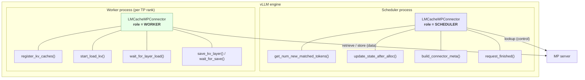
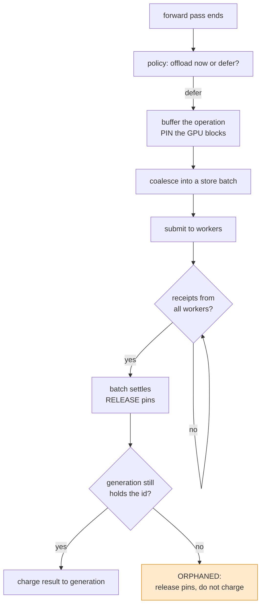

# vLLM integration

> Code references in this document are permalinks pinned to upstream `dev`
> @ [`53bde913`](https://github.com/LMCache/LMCache/tree/53bde913de1adae2a380fe0c2de8d2b9355b4702).

vLLM is LMCache's primary target, and this is the largest integration surface in the repo.
This document covers the connector's two roles, the scheduler and worker hooks, KV cache
groups (and why hybrid models are hard), lazy offload, and how LMCache stays loosely coupled
to a dependency that moves fast.

---

## Contents

1. [The shape of the integration](#1-the-shape-of-the-integration)
2. [Two roles, one class](#2-two-roles-one-class)
3. [The scheduler-side hooks](#3-the-scheduler-side-hooks)
4. [The worker-side hooks](#4-the-worker-side-hooks)
5. [KV cache groups](#5-kv-cache-groups)
6. [Staying decoupled from vLLM](#6-staying-decoupled-from-vllm)
7. [Lazy offload](#7-lazy-offload)
8. [Preemption, aborts and request generations](#8-preemption-aborts-and-request-generations)
9. [Autostart](#9-autostart)
10. [Configuration](#10-configuration)
11. [Where to look next](#11-where-to-look-next)

---

## 1. The shape of the integration

vLLM V1 has a **KV connector** extension point. LMCache implements it:

```python
class LMCacheMPConnector(KVConnectorBase_V1, SupportsHMA):
```

([`lmcache_mp_connector.py#L590`](https://github.com/LMCache/LMCache/blob/53bde913de1adae2a380fe0c2de8d2b9355b4702/lmcache/integration/vllm/lmcache_mp_connector.py#L590))

`SupportsHMA` advertises hybrid-memory-allocator support, which is what lets vLLM
auto-select a hybrid backend for Mamba-style models without extra flags.

The files, and what each is for:

| File | Role |
|---|---|
| `lmcache_mp_connector.py` | the connector itself — all vLLM hooks (~2200 lines) |
| `vllm_multi_process_adapter.py` | talks to the MP server; `LMCacheMPSchedulerAdapter`, worker adapter |
| `kv_cache_groups.py` | read vLLM's group/spec structures without importing vLLM |
| `kv_cache_group_edits.py` | validate and rewrite group config; reject what cannot be served |
| `lazy_offload_manager.py`, `lazy_offload_policy/`, `lazy_offload_state.py` | deferred store orchestration |
| `mp_lookup_state.py` | non-blocking lookup state machine |
| `mp_server_launcher.py` | auto-start the MP server |
| `lmcache_mp_metadata.py`, `lmcache_mp_metrics.py` | connector metadata and Prometheus metrics |

**The connector holds no KV.** It is a policy and plumbing layer: it decides how many tokens
to claim, and it asks the MP server to move bytes.

---

## 2. Two roles, one class

vLLM instantiates the connector **twice**, with a `KVConnectorRole`:



| | SCHEDULER role | WORKER role |
|---|---|---|
| Runs in | the scheduler | each TP worker |
| Sees | token ids, block ids, request state | GPU tensors |
| Does | lookups, token accounting, policy | copies bytes |
| Touches tensors | never | always |

Many methods guard on the role explicitly:

```python
        if self.role != KVConnectorRole.SCHEDULER:
            return
```

**Why this matters for debugging:** a wrong *number* of cached tokens is a scheduler-role
bug; wrong *bytes* are a worker-role or transport bug. [#5151](../issue-deep-dives/difficult-5151-mamba-full-hit-restoration.md)
looked like data corruption and was entirely scheduler-side arithmetic — the worker moved
exactly what it was told to, to a boundary that was wrong.

---

## 3. The scheduler-side hooks

### 3.1 `get_num_new_matched_tokens` — the hit decision

[Line 1377](https://github.com/LMCache/LMCache/blob/53bde913de1adae2a380fe0c2de8d2b9355b4702/lmcache/integration/vllm/lmcache_mp_connector.py#L1377).
The single most important method in the integration: vLLM asks *"how many tokens of this
request can you supply beyond what my own prefix cache already has?"*

It reconciles three numbers:

- `num_computed_tokens` — what vLLM's own APC already holds
- `ret` — what LMCache's lookup matched
- `need_to_load = max(0, ret - num_computed_tokens)` — the delta LMCache must transfer

Plus the chunk-alignment bookkeeping:

```python
        full_chunk_tokens = ret - ret % self.scheduler_adapter.lmcache_tokens_per_chunk
        tracker.num_stored_tokens = full_chunk_tokens
        tracker.num_lmcache_hit_tokens = ret
        if ret != full_chunk_tokens:
            tracker.unfull_chunk_boundaries.add(ret)
```

and the full-prompt-hit special case discussed at length in
[the lifecycle document §9](02-kv-cache-lifecycle.md#9-failure-and-partial-hit-behaviour):

```python
        # In full-prompt-hit case, we need to recompute the last token.
        # Without this, num_computed_tokens would equal request.num_tokens,
        # causing num_new_tokens to be 0 and triggering the
        # `assert num_new_tokens > 0` in the scheduler.
        if ret == len(request.all_token_ids):
            if self._prefix_replay_tokens > 0:
                # SWA bounded replay floors the hit to a block boundary before
                # allocating, so give back a whole chunk instead of one token.
                chunk = self.scheduler_adapter.lmcache_tokens_per_chunk
                aligned = max(0, (ret - 1) // chunk * chunk)
                ...
            else:
                need_to_load = max(0, need_to_load - 1)
```

Note that the sliding-window branch already does the right thing — floors to a chunk
boundary and gives back a whole chunk. The `else` branch shaves one token. The existence of
two policies side by side, one alignment-aware and one not, is exactly the seam #5151 fell
through.

### 3.2 Lookup can be non-blocking

The scheduler must not stall on an IPC round trip. `mp_lookup_state.py` implements a
lookup state machine so a lookup can be *submitted* on one scheduler pass and *collected* on
a later one. `lmcache.mp.eager_prefetch` goes further and submits when the request enters the
waiting queue (`on_new_request`), maximising overlap with queueing time. Off by default.

See [`docs/design/integration/vllm/mp_lookup_state.md`](https://github.com/LMCache/LMCache/blob/53bde913de1adae2a380fe0c2de8d2b9355b4702/docs/design/integration/vllm/mp_lookup_state.md).

### 3.3 The rest

| Hook | Purpose |
|---|---|
| `update_state_after_alloc` | vLLM has allocated blocks; record which, and submit the store-side lookup |
| `build_connector_meta` | package per-step instructions for the workers |
| `update_connector_output` | absorb worker results |
| `request_finished` / `request_finished_all_groups` | release sessions, flush stores |
| `take_events` | surface KV cache events to vLLM |
| `reset_cache` | respond to `POST /reset_prefix_cache` |
| `get_required_kvcache_layout` | tell vLLM which layout LMCache needs |
| `bind_gpu_block_pool` | get a handle on vLLM's block pool, for pinning (§7) |

---

## 4. The worker-side hooks

The worker's contract is layer-granular, which is what allows transfer to overlap compute:

| Hook | When |
|---|---|
| `register_kv_caches` | once, at startup — hands GPU tensor handles to the server |
| `start_load_kv` | beginning of a forward pass; kick off L1→L0 |
| `wait_for_layer_load(layer_name)` | before layer *n* runs; block until its KV has landed |
| `save_kv_layer(...)` | after layer *n* computes; queue L0→L1 |
| `wait_for_save` | end of the pass; ensure stores are submitted |
| `get_finished` / `get_transfer_results` | report completions back to the scheduler |
| `get_block_ids_with_load_errors` | report blocks whose load failed, so vLLM recomputes them |
| `unregister_kv_caches` / `restore_kv_caches` | sleep-mode support |

**`wait_for_layer_load` is the latency win.** Rather than loading the whole cache before the
pass, the worker waits per layer, so layer 0 can compute while layer 63's KV is still in
flight. The transfer is hidden behind compute.

**`get_block_ids_with_load_errors` is the correctness backstop.** A failed load is reported
as a set of block ids, and vLLM recomputes them. That is what makes a transport error a
performance event rather than a wrong answer — and the reason `register_kv_caches` is
idempotent (see [architecture §2.3.1](../02-architecture.md)).

Sleep mode (`unregister_kv_caches` / `restore_kv_caches`) lets vLLM release GPU memory while
idle and come back; the registration handles have to be torn down and re-established. See
[`docs/design/integration/vllm/mp_sleep_mode.md`](https://github.com/LMCache/LMCache/blob/53bde913de1adae2a380fe0c2de8d2b9355b4702/docs/design/integration/vllm/mp_sleep_mode.md).

---

## 5. KV cache groups

### 5.1 What they are

A **KV cache group** is, per
[`docs/design/integration/vllm/hybrid-kv-cache-groups.md`](https://github.com/LMCache/LMCache/blob/53bde913de1adae2a380fe0c2de8d2b9355b4702/docs/design/integration/vllm/hybrid-kv-cache-groups.md),
*"one distinct paged-block address space; block IDs are only meaningful within one group."*

A plain transformer has one. A **hybrid** model has several, because its layers need
different caching:

| Layer kind | Caching need |
|---|---|
| full attention | every token of the prefix |
| sliding-window attention | only the last *w* tokens |
| Mamba / linear attention | a recurrent state snapshot, valid only at block boundaries |
| MLA | one latent head, replicated on every TP rank |
| scratch | never cached — vLLM marks it non-prefix-cacheable |

LMCache maps engine groups onto its own **object groups** (see
[the overview's vocabulary](../01-project-overview.md#15-vocabulary)), because a
sliding-window group and a full-attention group cannot share one match decision: the former
hits with the last *w* chunks, the latter needs all of them. Hence `object_group_id` in the
cache key, and `AttnWindowDesc` (`-1` = full attention, `w >= 1` = a window of *w* chunks)
per group.

### 5.2 Classifying groups

`kv_cache_groups.py` is a pile of small predicates over vLLM's structures:

```
_is_attention_spec   _is_mla_spec        is_scratch_spec
_is_sliding_window_spec                  is_per_request_state_spec
_is_mamba_spec       is_align_mode_mamba_spec   _is_cachable_mamba
group_sliding_window group_mamba_cache_mode     group_prefix_replay_tokens
tokens_per_group_block   get_tokens_per_block
```

Unexciting individually; collectively they are the entire compatibility layer, and they are
where support for a new model architecture gets added.

### 5.3 Rejecting what cannot be served

`kv_cache_group_edits.py` validates at registration and **refuses** configurations the
transfer path cannot serve correctly. From
[`hybrid_models.rst`](https://github.com/LMCache/LMCache/blob/53bde913de1adae2a380fe0c2de8d2b9355b4702/docs/source/mp/hybrid_models.rst):

> - **Encoder-decoder cross-attention caches** (`CrossAttentionSpec`).
> - **Mamba groups in** `none` **mode** (`mamba_cache_mode` other than `"align"` or
>   `"all"`): they keep no reusable per-block state snapshots.

Failing loudly at startup rather than silently returning wrong KV is the right default, and
it is the discipline that [#5151](../issue-deep-dives/difficult-5151-mamba-full-hit-restoration.md)
tested: `align` mode *is* supported, so the bug was in the alignment arithmetic rather than
in the admission check.

### 5.4 Why align-mode Mamba is special

```python
def is_align_mode_mamba_spec(spec: Any) -> bool:
    """Return whether the spec is a Mamba/linear-attention spec in align mode.

    Align mode keeps state snapshots only at chosen boundaries and may move
    them between blocks, so a block-table position does not identify one;
    vLLM hands each snapshot's block to connectors instead
    (``SchedulerOutput.kv_connector_block_state.boundary_state_offloads``).
    """
```

Two things break the usual assumptions. **Snapshots exist only at boundaries** — so a
restore boundary must *be* a boundary. And **snapshots move between blocks** — so a block
id is not a stable name for one, and vLLM must tell the connector which block holds which
snapshot each step. Both are why the Mamba path needs its own arithmetic throughout the
connector, and both are the deep background to #5151.

---

## 6. Staying decoupled from vLLM

LMCache tracks a fast-moving dependency's internals. Three techniques, used consistently:

**1. Class-name checks instead of imports.**

```python
    return any(cls.__name__ == "AttentionSpec" for cls in type(spec).__mro__)
```

with the rationale stated in nearly every such docstring: *"Checked by class name so this
module stays importable without vLLM."* Walking the MRO by name gives subclass-aware
matching with no import, so `kv_cache_groups.py` is importable (and unit-testable) with no
vLLM installed.

**2. `getattr` with defaults for fields that may not exist.**

```python
    mamba_cache_mode = getattr(vllm_config.cache_config, "mamba_cache_mode", "none")
```

A vLLM build without the field behaves as `"none"` — the conservative value. This is how
one LMCache release supports several vLLM versions.

**3. A fallback stub for optional protocols.**

```python
    from vllm.distributed.kv_transfer.kv_connector.v1.base import SupportsHMA
except ImportError:
    class SupportsHMA:  # type: ignore[no-redef]
```

**The trade-off is real and worth stating.** Duck typing means a vLLM rename does not raise
`ImportError` at startup; it makes a predicate return `False` and silently disables a
feature. A `getattr` default means a renamed field reads as absent, not as an error. So the
integration prefers *degrading quietly* over *failing loudly* — the opposite of §5.3's
admission checks, and a deliberate split: identity/compat probes degrade, correctness
preconditions reject. When a feature mysteriously stops engaging after a vLLM upgrade, these
predicates are the first place to look.

---

## 7. Lazy offload

Storing KV synchronously at the end of a forward pass costs latency on the critical path.
Lazy offload defers and batches it. The design is in
[`lazy_offload_manager.py`](https://github.com/LMCache/LMCache/blob/53bde913de1adae2a380fe0c2de8d2b9355b4702/lmcache/integration/vllm/lazy_offload_manager.py),
whose module docstring is the clearest statement of the hard parts:

> The boundary between `LMCacheMPConnector` and the lazy-offload policies: it owns policy
> dispatch, GPU block pinning, store-batch coalescing, completion handling and deferred
> session release. The connector only forwards events.

The vocabulary it defines is the actual content of the feature:

| Term | Meaning |
|---|---|
| **Request generation** | one *use* of a request id. vLLM recreates a tracker under the same id when resuming a preempted request, and an unrelated later request may reuse a finished id — so one id can outlive several generations. |
| **Receipt** | a worker's report that a store batch ended. The batch settles once every worker has reported. |
| **Pin** | the reference taken on a GPU block so vLLM cannot recycle it while a worker is still reading. The receipt releases it. |
| **Orphaned** | a batch whose generation ended before its receipt arrived. Its pins are still released, but its failure is not charged to the generation now holding the id. |
| **Token ledger** | the one token-id list a request's buffered operations share. |



**Pinning is the load-bearing idea.** Deferring a store means the GPU blocks must still hold
the data when the worker finally reads them — but vLLM owns those blocks and will recycle
them. So the manager takes a reference through the block pool (`bind_gpu_block_pool`) and
releases it on receipt. A leaked pin is a GPU block vLLM can never reuse, which is why the
orphan path releases pins even when it discards the result.

Policies live in `lazy_offload_policy/`, including an eviction-aware one
([`eviction_aware.md`](https://github.com/LMCache/LMCache/blob/53bde913de1adae2a380fe0c2de8d2b9355b4702/docs/design/integration/vllm/lazy_offload_policy/eviction_aware.md))
that offloads blocks vLLM is about to evict — the moment when offloading is most valuable,
since the alternative is losing them.

---

## 8. Preemption, aborts and request generations

vLLM preempts. The cache has to cope with a request that was mid-transfer being evicted from
the running batch and resumed later — or never.

- **`handle_preemptions`** processes preemption events on the worker side.
- The scheduler logs resume-load decisions distinctly:
  ```python
        if request.status == RequestStatus.PREEMPTED:
            logger.info(
                "<resume-load> req=%s apc=%d lmcache=%d load=%d", ...
  ```
- **Request generations** (§7) exist because a request id is not unique over time. Charging
  a late failure to whoever currently holds the id would be wrong, hence "orphaned".
- Read-lock TTLs ([L1 §4](03-l1-memory-and-eviction.md#4-locks-ttllock-read-counts-write-reservations))
  are the backstop for an aborted request that holds locks it will never release.

Correctness here is tested in CI with dedicated preemption suites — there are upstream
branches named `ci/preemption-correctness-legacy-ipc`, and
[`mp_preemption_correctness.md`](https://github.com/LMCache/LMCache/blob/53bde913de1adae2a380fe0c2de8d2b9355b4702/docs/design/integration/vllm/mp_preemption_correctness.md)
documents the model.

---

## 9. Autostart

`mp_server_launcher.py` — *"Helpers for auto-starting the LMCache multiprocess server"* —
lets vLLM spawn the server itself (`subprocess`, then a ZMQ readiness probe) so a quickstart
does not require managing two daemons. For production you generally want the server
supervised independently, which is the whole point of it being a separate process. See
[`mp-autostart.md`](https://github.com/LMCache/LMCache/blob/53bde913de1adae2a380fe0c2de8d2b9355b4702/docs/design/integration/vllm/mp-autostart.md).

---

## 10. Configuration

Everything is passed through vLLM's `--kv-transfer-config`:

```bash
vllm serve <model> \
    --kv-transfer-config '{"kv_connector":"LMCacheMPConnector", "kv_role":"kv_both"}'
```

The connector's own options, documented in its class docstring:

| Key | Default | Meaning |
|---|---|---|
| `lmcache.mp.host` | `tcp://localhost` | MP server host; `tcp://` prepended if no scheme |
| `lmcache.mp.port` | — | MP server port |
| `lmcache.mp.mq_timeout` | — | message-queue request timeout (s) |
| `lmcache.mp.heartbeat_interval` | — | server ping interval (s) |
| `lmcache.mp.eager_prefetch` | `False` | submit the lookup when the request enters the waiting queue |
| `lmcache.mp.save_decode_cache` | `False` | also store chunks containing generated tokens |
| `lmcache.mp.save_unfull_chunk` | `False` | also store the prompt's partial chunk, and let a hit stop mid-chunk |

A hybrid-model launch, from
[`hybrid_models.rst`](https://github.com/LMCache/LMCache/blob/53bde913de1adae2a380fe0c2de8d2b9355b4702/docs/source/mp/hybrid_models.rst):

```bash
vllm serve <model> \
    --enable-prefix-caching --mamba-cache-mode align \
    --kv-transfer-config \
    '{"kv_connector":"LMCacheMPConnector", "kv_role":"kv_both"}'
```

> No `--no-disable-hybrid-kv-cache-manager` or attention-backend flag is needed;
> `LMCacheMPConnector` advertises hybrid support and vLLM auto-selects the GDN backend.

### 10.1 Verifying a hybrid deployment honestly

The upstream docs are unusually candid, and this is worth repeating because it determines
how you test:

> Generation is **not bit-exact** between a cached and a fresh run: GDN backends do not
> support vLLM's batch-invariant mode. Validate with a **score-level** comparison, not a
> token-level diff.

So the procedure is: run an eval, `POST /reset_prefix_cache` (without `reset_external=true`,
so LMCache keeps its copy), re-run, and compare **scores**. Shipped as the `hma_lm_eval` CI
test.

This cuts both ways. A token-level diff is the *right* check for pure attention — and it is
exactly what caught #5151, where the reporter's same-instance comparison showed 1 of 2045
characters matching. "Not bit-exact" means small score-level differences are expected; it
does not mean a continuation that diverges from character one is acceptable.

---

## 11. Where to look next

- [KV cache lifecycle](02-kv-cache-lifecycle.md) — the four verbs this connector calls.
- [MP architecture](01-mp-architecture.md) — the server side of every call here.
- [Transport layer](06-transport-layer.md) — how the connector reaches the server.
- [#5151](../issue-deep-dives/difficult-5151-mamba-full-hit-restoration.md) — §3.1, §5.4 and §10.1, as one bug.
- Upstream design docs under [`docs/design/integration/vllm/`](https://github.com/LMCache/LMCache/tree/53bde913de1adae2a380fe0c2de8d2b9355b4702/docs/design/integration/vllm): `hybrid-kv-cache-groups.md`, `kv_cache_group_edits.md`, `lazy_offload.md`, `mp_lookup_state.md`, `mp_preemption_correctness.md`, `mp_sleep_mode.md`, `mp-autostart.md`, `multimodal_cache_keying.md`, `token-dropping-kv-compaction.md`.
- User docs: [`docs/source/mp/hybrid_models.rst`](https://github.com/LMCache/LMCache/blob/53bde913de1adae2a380fe0c2de8d2b9355b4702/docs/source/mp/hybrid_models.rst).
