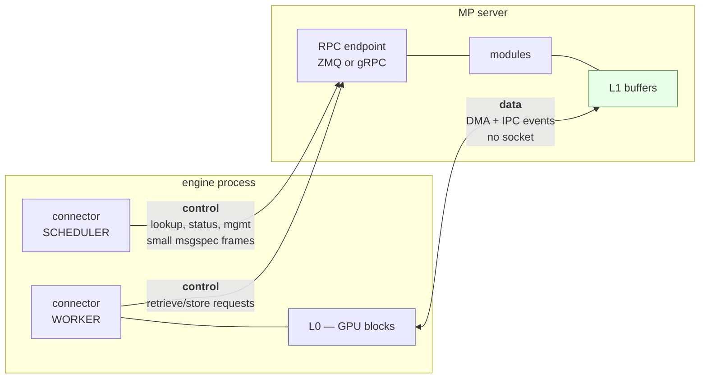
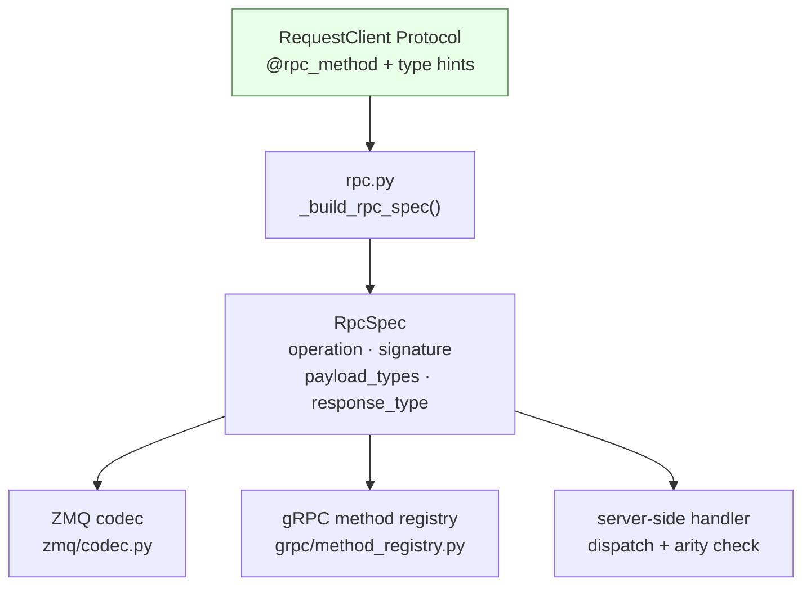

# Transport layer

> Code references in this document are permalinks pinned to upstream `dev`
> @ [`53bde913`](https://github.com/LMCache/LMCache/tree/53bde913de1adae2a380fe0c2de8d2b9355b4702).

Everything in LMCache crosses a process boundary. This document covers the **two distinct
paths** — small control messages and bulk KV bytes — the transport-neutral RPC contract that
generates both the ZMQ and gRPC bindings, authentication, and how to debug a hang.

---

## Contents

1. [Two paths, two technologies](#1-two-paths-two-technologies)
2. [The RPC contract is derived, not written twice](#2-the-rpc-contract-is-derived-not-written-twice)
3. [Futures and streams](#3-futures-and-streams)
4. [ZMQ](#4-zmq)
5. [gRPC](#5-grpc)
6. [The data path](#6-the-data-path)
7. [Serialization: msgspec, and no pickle](#7-serialization-msgspec-and-no-pickle)
8. [Authentication](#8-authentication)
9. [Out-of-tree server modules](#9-out-of-tree-server-modules)
10. [Debugging](#10-debugging)
11. [Where to look next](#11-where-to-look-next)

---

## 1. Two paths, two technologies

The single most important fact about LMCache's transport:

> **Control messages and KV bytes do not travel the same way.**



| | Control path | Data path |
|---|---|---|
| Carries | lookups, status, management, metadata | KV tensors |
| Volume | bytes to kilobytes | megabytes to gigabytes per request |
| Transport | ZMQ or gRPC | shared memory / IPC handles / DMA |
| Latency budget | sub-millisecond round trip | bounded by PCIe or NVLink |
| Code | `v1/transport/`, `v1/client/` | `v1/gpu_connector/`, `csrc/`, `v1/platform/` |

Pushing KV through a socket would add at least one copy to a path whose entire purpose is
avoiding recomputation; at tens of GB/s that copy is the whole budget. So the control path
carries *descriptors* — "the data for key K is at this offset in this registered region" —
and the bytes move by DMA.

**When you are debugging, decide which path first.** Wrong *numbers* are control-path;
wrong *bytes*, or a stall with healthy RPCs, are data-path.

---

## 2. The RPC contract is derived, not written twice

LMCache speaks both ZMQ and gRPC. Rather than maintain two schemas, it keeps **one typed
Python Protocol** and derives everything from it by introspection.

The source of truth is
[`request_client.py`](https://github.com/LMCache/LMCache/blob/53bde913de1adae2a380fe0c2de8d2b9355b4702/lmcache/v1/transport/request_client.py)
— *"Typed request contract shared by multiprocess clients and servers"* — a `Protocol` whose
methods are tagged:

```python
def rpc_method(func: F) -> F:
    """Mark a typed ``RequestClient`` method as an RPC contract member."""
    setattr(func, _RPC_METHOD_ATTR, True)
    return func
```

[`rpc.py`](https://github.com/LMCache/LMCache/blob/53bde913de1adae2a380fe0c2de8d2b9355b4702/lmcache/v1/transport/rpc.py)
— *"Discover transport-neutral RPC contracts from the request client API"* — turns each
tagged method into an `RpcSpec`:

```python
@dataclass(frozen=True)
class RpcSpec:
    """Transport-neutral RPC name, call signature, payloads, and response."""

    operation: RpcOperation
    signature: Signature
    payload_types: tuple[Any, ...]
    response_type: Any
    streaming: bool = False
```

### 2.1 The validation is strict, and that is the point

`_build_rpc_spec` refuses anything it cannot represent on a wire:

```python
        if parameter.kind not in (
            Parameter.POSITIONAL_ONLY,
            Parameter.POSITIONAL_OR_KEYWORD,
            Parameter.KEYWORD_ONLY,
        ):
            raise TypeError(
                f"RPC {operation!r} uses unsupported parameter kind "
                f"{parameter.kind.name}"
            )
        if parameter.name not in hints:
            raise TypeError(
                f"RPC {operation!r} parameter {parameter.name!r} has no type hint"
            )
```

```python
        if get_origin(return_hint) not in (MessagingFuture, MessagingStream):
            raise TypeError(
                f"RPC {operation!r} must return MessagingFuture[T] or MessagingStream[T], "
                f"got {return_hint!r}"
            )
```

So: **no `*args`/`**kwargs`, every parameter annotated, and the return type must be a
future or a stream of a concrete type.** These failures happen at import time, not at call
time — you cannot ship an RPC that one transport can encode and the other cannot.

This is why the repo's "all functions must have type hints" rule is more than style here:
on `RequestClient`, a missing annotation is a `TypeError` at startup.

### 2.2 Why this design is worth stealing



Adding an RPC means adding **one annotated method**. Both transports and the server-side
dispatch follow. The failure mode that normally plagues dual-transport systems — a schema
updated on one side only — is structurally impossible, because there is no second schema.

`bind_payloads` makes call-site flexibility free:

```python
    def bind_payloads(self, args, kwargs) -> tuple[Any, ...]:
        """Bind args/kwargs/defaults to the contract's ordered payloads."""
        bound = self.signature.bind(*args, **kwargs)
        bound.apply_defaults()
        return tuple(bound.arguments.values())
```

Callers use keywords and defaults; the wire gets a canonical positional tuple. Adding a
parameter *with a default* stays wire-compatible for old callers — which is exactly how
`reserve_last_token: bool = False` was added in
[#5151's fix](../issue-deep-dives/difficult-5151-mamba-full-hit-restoration.md) without a
protocol version bump.

---

## 3. Futures and streams

[`futures.py`](https://github.com/LMCache/LMCache/blob/53bde913de1adae2a380fe0c2de8d2b9355b4702/lmcache/v1/transport/futures.py)
defines the two shapes every RPC takes:

- **`MessagingFuture[T]`** — one request, one eventual response.
- **`MessagingStream[T]`** — one request, many responses (KV event streams, status
  subscriptions, coordinator announcements).

Every RPC is asynchronous at the type level. A caller that wants to block does so
explicitly. For the scheduler this is not optional: blocking on an IPC round trip inside
the scheduling loop would stall every request in the batch, which is why there is a
non-blocking lookup state machine (`mp_lookup_state.py`, see
[vLLM integration §3.2](05-vllm-integration.md)).

The `handler_response_type` property keeps the server side honest:

```python
    @property
    def handler_response_type(self) -> Any:
        """Return the module handler's annotation, including a stream wrapper."""
```

A streaming RPC's handler must be annotated as returning a stream — so client and handler
cannot disagree about cardinality.

---

## 4. ZMQ

[`transport/zmq/`](https://github.com/LMCache/LMCache/tree/53bde913de1adae2a380fe0c2de8d2b9355b4702/lmcache/v1/transport/zmq)
is small — `codec.py` and `wire.py` — because `RpcSpec` does the structural work. ZMQ is the
default for local, same-node communication: no connection setup per call, very low latency,
and no HTTP/2 framing.

Errors are a reserved operation rather than an exception leaking across the boundary:

```python
ZMQ_ERROR_OPERATION: RpcOperation = "__lmcache_rpc_error__"
"""Transport-reserved operation identifying a failed ZMQ RPC."""


class ZmqErrorResponse(msgspec.Struct, frozen=True):
    """Describe a request rejected by the remote ZMQ server.

    Attributes:
        code: Stable machine-readable error category.
        operation: RPC operation rejected by the server.
        message: Human-readable explanation of the rejection.
    """
```

Note `code: str` described as a *"stable machine-readable error category"*, separate from the
human-readable `message`. Clients branch on `code`; logs show `message`. The double-underscore
operation name is reserved so it cannot collide with a real RPC — including one from an
out-of-tree module (§9).

---

## 5. gRPC

[`transport/grpc/`](https://github.com/LMCache/LMCache/tree/53bde913de1adae2a380fe0c2de8d2b9355b4702/lmcache/v1/transport/grpc)
is larger: `protos/`, `_proto_gen/`, `codecs/`, `proto_codec.py`, `descriptors.py`,
`method_registry.py`, `endpoint.py`. You want gRPC when you need what it provides — TLS,
cross-node routing, standard load balancers and service meshes, and non-Python clients.

`method_registry.py` is the bridge: it maps `RpcSpec` operations onto gRPC methods, so the
proto surface tracks the Protocol. The server can run in a native or an asyncio mode
(upstream `dev` defaulted to "native or aio" selection in
[#6754](https://github.com/LMCache/LMCache/pull/6754)); the mode affects concurrency
behaviour under load, not semantics.

**Rule of thumb:** ZMQ for engine ↔ server on one node, gRPC when a network, a proxy or a
non-Python client is involved.

---

## 6. The data path

KV bytes never go through §4 or §5. Instead:

1. At **registration**, the worker hands over IPC handles to its GPU KV tensors
   ([architecture §2.3.1](../02-architecture.md)). The server maps them.
2. L1 buffers are **pinned** and DMA-registered once
   ([L1 §6](03-l1-memory-and-eviction.md)).
3. A transfer request on the control path names *keys and block ids*, not bytes.
4. The copy runs as **GPU kernels** (`csrc/cuda`, `csrc/musa`, `csrc/sycl`) driven by
   `v1/gpu_connector/`.
5. Completion is signalled with **device IPC events**, so the engine's stream synchronises
   without a round trip through Python.

`v1/platform/` abstracts the device specifics — `DeviceIPCWrapper` and friends — which is
how the same path serves CUDA, ROCm, MUSA and SYCL. See
[`docs/design/ARCHITECTURE_MULTI_HARDWARE.md`](https://github.com/LMCache/LMCache/blob/53bde913de1adae2a380fe0c2de8d2b9355b4702/docs/design/ARCHITECTURE_MULTI_HARDWARE.md).

### 6.1 The Q ring (SDK path)

[`qstore.py`](https://github.com/LMCache/LMCache/blob/53bde913de1adae2a380fe0c2de8d2b9355b4702/lmcache/v1/transport/qstore.py)
exposes the same idea to SDK users:

```python
class QRingInfo(msgspec.Struct):
    """One worker's Q ring, as an SDK needs it to transfer through the ring.

    Returned by ``get_q_ring``. The ring's GPU memory is reached through its
    original IPC handles, as the serving engine registered them; shapes and
    dtype come from the rebuilt tensors.
```

A ring buffer in GPU memory, reached through the IPC handles the engine already registered.
So an SDK client gets the zero-copy path rather than a socket. See
[`docs/design/sdk/qringbuffer.md`](https://github.com/LMCache/LMCache/blob/53bde913de1adae2a380fe0c2de8d2b9355b4702/docs/design/sdk/qringbuffer.md).

### 6.2 Remote data paths

For cross-node transfer (P2P, disaggregated prefill) the data path is **NIXL/UCX** rather
than local IPC, with the same separation: control over RPC, bytes over RDMA where available.
What "TCP fallback" actually means, and its performance implications, is covered in
[P2P sharing §6](08-p2p-sharing.md).

---

## 7. Serialization: msgspec, and no pickle

All wire types are `msgspec.Struct`s. msgspec is fast and, more importantly, **schema-bound**:
it decodes into declared types rather than reconstructing arbitrary objects.

Pickle is **banned by lint**, in
[`pyproject.toml`](https://github.com/LMCache/LMCache/blob/53bde913de1adae2a380fe0c2de8d2b9355b4702/pyproject.toml#L135):

```toml
[tool.ruff.lint.flake8-tidy-imports.banned-api]
"pickle".msg = "Use a data-only serialization format instead."
```

This is a security control with teeth. Unpickling untrusted data is arbitrary code
execution, and LMCache's transport carries data between processes that may sit on different
trust boundaries — an engine, a peer node, an out-of-tree plugin. A lint rule that fails CI
is a much better guarantee than a convention.

**And this one does fire** — verified by running the repo's pinned `ruff` (0.11.7) with the
`53bde913` config over a file that imports `pickle`:

```
probe_pickle.py:1:8: TID251 `pickle` is banned: Use a data-only serialization format instead.
  |
1 | import pickle
  |        ^^^^^^ TID251
```

Worth checking explicitly, because the neighbouring SLF rule in the same `[tool.ruff.lint]`
block is configured with every intention of being enforced and
[silently is not](../issue-deep-dives/medium-4698-nixl-pool-slot-units.md#7-a-finding-from-the-margins-the-lint-rule-is-off).
`TID251` escapes that problem because it is not subject to the negated-glob
`per-file-ignores` that cancel SLF out.

Token ids get a dedicated compact encoding rather than a generic one:
`token_bytes: bytes  # packed big-endian uint32, one word per token`. A 100k-token prompt is
400 KB packed; as a JSON array of ints it would be several times that, on the latency-
critical control path. `blake3` can hash the packed layout directly, so the fast path never
unpacks ([lifecycle §3.1](02-kv-cache-lifecycle.md#31-hash-algorithm-selection)).

---

## 8. Authentication

[`auth.py`](https://github.com/LMCache/LMCache/blob/53bde913de1adae2a380fe0c2de8d2b9355b4702/lmcache/v1/transport/auth.py)
— *"Authentication configuration shared by multiprocess request transports"* — is shared
across transports, so ZMQ and gRPC cannot drift in their auth behaviour. It composes
`lmcache/security/`:

- `APIKeyVerifier` — verification
- `load_api_keys_from_files` / `load_service_api_keys` — keys from files, not from argv
  (so they do not appear in `ps` or in shell history)
- `bearer_authorization_header` — standard `Authorization: Bearer` framing

Design doc:
[`docs/design/security/api_key_authentication.md`](https://github.com/LMCache/LMCache/blob/53bde913de1adae2a380fe0c2de8d2b9355b4702/docs/design/security/api_key_authentication.md).

**Operationally:** the control path is what authentication protects. The data path relies on
IPC handles and registered memory regions — i.e. on OS-level process and device access, not
on API keys. A peer that can map your registered memory is already inside the trust
boundary, which is why P2P deployments need their own network-level thinking
([P2P §7](08-p2p-sharing.md)).

---

## 9. Out-of-tree server modules

[`server_module.py`](https://github.com/LMCache/LMCache/blob/53bde913de1adae2a380fe0c2de8d2b9355b4702/lmcache/v1/transport/server_module.py)
— *"Protocol envelope for out-of-tree server-module extensions"*:

```python
class ServerModuleCallRequest(msgspec.Struct):
    """Opaque request envelope dispatched by namespaced extension method.

    Args:
        method: Namespaced extension method, such as
            ``"my_package.echo"``.
        payload: Plugin-owned serialized payload bytes.
    """
```

An extension gets one generic RPC with a **namespaced** method name and an **opaque**
payload. Two consequences, both good: a plugin cannot collide with a core RPC name (its
methods are `package.method`), and the core transport never has to understand the plugin's
types — the plugin owns its payload encoding. The cost is that plugin RPCs get no §2
type-checking; that is the plugin's problem, by design.

---

## 10. Debugging

### 10.1 Classify the symptom first

| Symptom | Likely path | Start at |
|---|---|---|
| Lookups time out | control | server reachability, `mq_timeout`, server liveness |
| Hit rate is zero but server is healthy | control | registration — see `early_exit_reason="no_gpu_context"` |
| Transfer stalls, RPCs fine | data | IPC events, GPU stream sync, `v1/gpu_connector/` |
| Wrong KV restored | **neither** | scheduler-side arithmetic — see [#5151](../issue-deep-dives/difficult-5151-mamba-full-hit-restoration.md) |
| `ZmqErrorResponse` with a `code` | control | the `code` names the category; check server logs for the matching operation |
| `TypeError` about RPC contract at startup | contract | a new/edited `RequestClient` method violates §2.1 |

### 10.2 Useful knobs

- `lmcache.mp.mq_timeout` — request timeout. Raising it hides a slow server rather than
  fixing it, but it distinguishes "slow" from "dead".
- `lmcache.mp.heartbeat_interval` — ping cadence; also what the server's liveness reaper
  measures against. Too long and a dead worker's state lingers; too short and you add
  chatter.
- `lmcache ping` — the first thing to run. Confirms the control path end to end without an
  engine. See [CLI](10-cli.md).
- `lmcache describe` — shows transport status alongside tier status.

### 10.3 A note on timeouts and liveness

The server reaps instances that stop pinging, and registration is idempotent so a recovering
worker re-registers rather than duplicating
([architecture §2.3.1](../02-architecture.md)). The interaction to watch: if
`heartbeat_interval` approaches the reaper's threshold, a worker under GC pressure or a slow
forward pass can be reaped while alive, lose its registration, and then serve zero-hit
lookups (`no_gpu_context`) until it re-registers. Zero hit rate with a healthy server and no
errors is the signature.

---

## 11. Where to look next

- [MP architecture](01-mp-architecture.md) — request dispatch, sessions and the liveness reaper on the server side of these calls.
- [KV cache lifecycle](02-kv-cache-lifecycle.md) — what the control messages actually ask for.
- [vLLM integration](05-vllm-integration.md) — the client side, and non-blocking lookup.
- [P2P sharing](08-p2p-sharing.md) — the cross-node data path and NIXL/UCX.
- [Observability](09-observability.md) — transport metrics and tracing.
- Upstream: [`docs/design/security/api_key_authentication.md`](https://github.com/LMCache/LMCache/blob/53bde913de1adae2a380fe0c2de8d2b9355b4702/docs/design/security/api_key_authentication.md), [`docs/design/sdk/qringbuffer.md`](https://github.com/LMCache/LMCache/blob/53bde913de1adae2a380fe0c2de8d2b9355b4702/docs/design/sdk/qringbuffer.md), [`docs/design/ARCHITECTURE_MULTI_HARDWARE.md`](https://github.com/LMCache/LMCache/blob/53bde913de1adae2a380fe0c2de8d2b9355b4702/docs/design/ARCHITECTURE_MULTI_HARDWARE.md).
