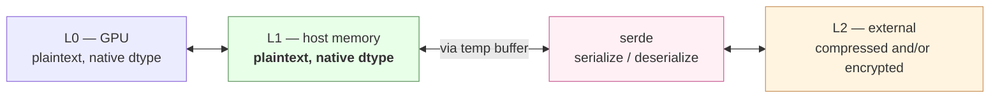
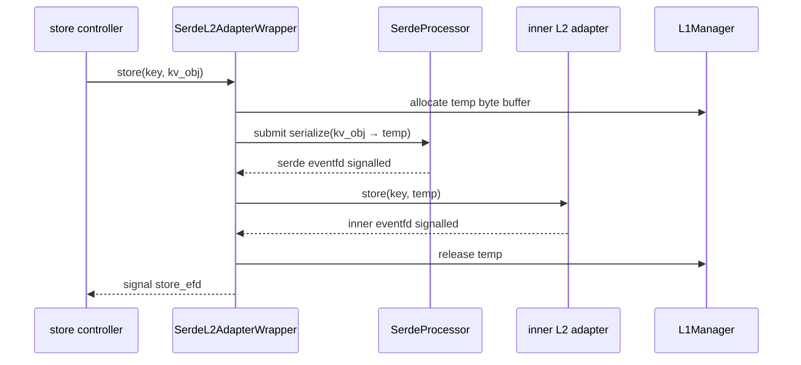

# Serde: compression, quantization and encryption

> Code references in this document are permalinks pinned to upstream `dev`
> @ [`53bde913`](https://github.com/LMCache/LMCache/tree/53bde913de1adae2a380fe0c2de8d2b9355b4702).

A **serde** sits between L1 and an L2 tier and transforms bytes on the way through: quantize
to shrink them, or encrypt to protect them. This document covers the two-layer interface,
the three registered types, the wrapper that makes a serde invisible to the rest of the
system, and the multi-output extension for asymmetric K/V treatment.

---

## Contents

1. [Where a serde sits](#1-where-a-serde-sits)
2. [Two layers: sync transform, async processor](#2-two-layers-sync-transform-async-processor)
3. [Configuration and the registry](#3-configuration-and-the-registry)
4. [`SerdeL2AdapterWrapper`](#4-serdel2adapterwrapper)
5. [`fp8`](#5-fp8)
6. [`turboquant`](#6-turboquant)
7. [`aesgcm`](#7-aesgcm)
8. [Multi-output serdes](#8-multi-output-serdes)
9. [Operating it](#9-operating-it)
10. [Where to look next](#10-where-to-look-next)

---

## 1. Where a serde sits



**L1 and L0 always hold plaintext at the model's native dtype.** The transform happens only
on the L1 ↔ L2 boundary. Two consequences worth internalising:

- Compression buys **L2 capacity and bandwidth**, never L1 capacity. A serde does not let
  you fit more in host memory.
- A serde failure cannot corrupt a served request, because the request path reads L1. It can
  only prevent data reaching or returning from L2 — which is precisely why
  [#5022](../issue-deep-dives/difficult-5022-turboquant-sm80-bfloat16.md) was invisible for
  49 days.

Serdes are configured **per L2 adapter**, not globally. Two tiers can use different
transforms — fast local disk uncompressed, remote object storage quantized and encrypted.

---

## 2. Two layers: sync transform, async processor

[`serde/base.py`](https://github.com/LMCache/LMCache/blob/53bde913de1adae2a380fe0c2de8d2b9355b4702/lmcache/v1/distributed/serde/base.py)
states the split up front:

> Two layers:
> 1. **Sync interface** (Serializer / Deserializer): user implements these. Pure transform
>    logic, no threading or eventfds.
> 2. **Async interface** (SerdeProcessor): controllers consume this. Provides non-blocking
>    submit/query/eventfd pattern matching L2 adapters.
>
> Use `AsyncSerdeProcessor` to wrap sync implementations into the async interface
> automatically.

This is the cleanest separation-of-concerns in the codebase, and the reason adding a serde is
tractable. As an implementer you write one method:

```python
class Serializer(abc.ABC):
    """Sync serializer — users implement this.

    Defines the pure transform from KV-shaped data to serialized bytes.
    """

    @abc.abstractmethod
    def serialize(self, src: MemoryObj, dst: MemoryObj, key: ObjectKey) -> int:
        """Serialize src KV data into dst byte buffer (in-place).

        Args:
            src: Source MemoryObj containing KV-shaped data (read-locked).
            dst: Destination MemoryObj byte buffer (write-locked).
```

No threads, no event loops, no completion signalling. Four details of the contract matter:

- **In-place.** You are given both buffers. You do not allocate.
- **Locks are already held** — `src` read-locked, `dst` write-locked. The caller did that.
- **Return the actual byte count.** `dst` is sized from `estimate_serialized_size`, an
  *upper bound*; returning `n` lets the pipeline narrow the logical size so L2 stores exactly
  `n` bytes rather than the over-allocation. `AsyncSerdeProcessor` applies it:

  ```python
                    n = self._serializer.serialize(src, dst, key)
                    if isinstance(n, int) and hasattr(dst, "set_used_size"):
                        dst.set_used_size(n)
  ```
- **You receive the `ObjectKey`.** Which is how `aesgcm` can key on `cache_salt` (§7) —
  identity is available to the transform.

`AsyncSerdeProcessor` then supplies threading, task ids, eventfd signalling, and the
error handling examined in [#5022 §2.1](../issue-deep-dives/difficult-5022-turboquant-sm80-bfloat16.md#21-why-this-was-easy-to-miss-in-production).

---

## 3. Configuration and the registry

`SerdeConfig` is parsed from a `"serde"` sub-dict on an L2 adapter spec:

```json
{
  "type": "fs",
  "base_path": "/cache",
  "serde": {"type": "fp8", "fp8_dtype": "float8_e4m3fn"}
}
```

```python
@dataclass
class SerdeConfig:
    """Per-adapter serde configuration.

    Mirrors the role of ``EvictionConfig``: parsed from the ``"serde"``
    JSON sub-dict on an L2 adapter spec, then handed to the serde factory
    to build a SerdeProcessor.
    """

    type: str
    kwargs: dict[str, object] = field(default_factory=dict)
```

Registration is a decorator-free call at module import, in
[`factory.py`](https://github.com/LMCache/LMCache/blob/53bde913de1adae2a380fe0c2de8d2b9355b4702/lmcache/v1/distributed/serde/factory.py):

```python
register_serde_factory("fp8", _create_fp8_serde)
register_serde_factory("aesgcm", _create_aesgcm_serde)
register_serde_factory("turboquant", _create_turboquant_serde)
```

Three registered types. Duplicate registration raises:

```python
        raise ValueError(f"Serde type already registered: {name!r}")
```

and an unknown type lists what exists, which is the single best thing an error message can do
for a config typo:

```python
        known = ", ".join(sorted(_SERDE_FACTORY_REGISTRY)) or "(none)"
        raise ValueError(f"Unknown serde type {config.type!r}. Registered: {known}")
```

---

## 4. `SerdeL2AdapterWrapper`

[`serde_wrapper.py`](https://github.com/LMCache/LMCache/blob/53bde913de1adae2a380fe0c2de8d2b9355b4702/lmcache/v1/distributed/l2_adapters/serde_wrapper.py)
is how a serde becomes invisible:

> `SerdeL2AdapterWrapper`: wraps an inner L2 adapter with a `SerdeProcessor` so controllers
> see a plain `L2AdapterInterface` while data is transparently serialized on store and
> deserialized on load.

So compression is **composition, not configuration of the adapter**. Every one of the ~25 L2
adapters gets every serde for free, and no adapter contains compression code. Adapter authors
and serde authors never meet.

The chaining, from the module docstring:

```
    store : caller → serialize → inner.store            → signal store_efd
    load  : caller → inner.load → deserialize           → signal load_efd
```



Three design points worth copying:

**Temp buffers come from L1, deliberately.**

> Temp buffer lifecycle: temp byte buffers come from the injected `L1Manager` so the extra
> memory shows up in L1 accounting just like the non-serde path's temporary KV buffers.

The alternative — a private pool — would make compression invisible to capacity accounting
and let a deep store queue consume memory nobody is measuring. Instead the cost appears as
L1 staging bytes ([L1 §5](03-l1-memory-and-eviction.md#5-staging-and-why-writers-do-not-collide)).
**Enabling a serde therefore raises L1 pressure**, which is counter-intuitive if you think
of compression as a space saving.

**Only the data path is wrapped.**

> Lookup / unlock / delete / eviction pass straight through to the inner adapter (no serde
> transform involved).

Key-space operations are unaffected, because keys are not transformed. Note the implication
for the key: if a serde changes the stored bytes, that must be reflected in the key's `tags`,
or a reader with a different serde configuration would decode garbage.

**Failure is all-or-nothing per submit.** *"A partial temp-alloc …"* — a batch that cannot
get all its buffers fails as a unit rather than storing some objects and dropping others,
which keeps the key space consistent with the byte space.

The wrapper owns a poll thread chaining two independent eventfd sources. That is where the
concurrency lives, and it is written once rather than in each serde — the payoff of §2's
split.

---

## 5. `fp8`

[`fp8.py`](https://github.com/LMCache/LMCache/blob/53bde913de1adae2a380fe0c2de8d2b9355b4702/lmcache/v1/distributed/serde/fp8.py).
The simple one: cast KV to an 8-bit float on store, widen back on load. Roughly **2× on L2
footprint** from a 16-bit model dtype, with the precision loss of fp8.

Configured with the target dtype:

```json
"serde": {"type": "fp8", "fp8_dtype": "float8_e4m3fn"}
```

Start here if you are writing a serde — it is the smallest complete implementation of §2's
contract.

---

## 6. `turboquant`

[`turboquant/`](https://github.com/LMCache/LMCache/tree/53bde913de1adae2a380fe0c2de8d2b9355b4702/lmcache/v1/distributed/serde/turboquant)
is the serious compressor: fused Triton kernels, asymmetric treatment of keys and values,
and four presets
([`TQ_PRESETS`](https://github.com/LMCache/LMCache/blob/53bde913de1adae2a380fe0c2de8d2b9355b4702/lmcache/v1/distributed/serde/turboquant/turboquant.py#L35)):

| Preset | key bits | value bits | norm correction |
|---|---|---|---|
| `turboquant_k8v4` *(default)* | 8 | 4 | no |
| `turboquant_4bit_nc` | 4 | 4 | yes |
| `turboquant_k3v4_nc` | 3 | 4 | yes |
| `turboquant_3bit_nc` | 3 | 3 | yes |

Two patterns to read off that table.

**Keys get at least as many bits as values, never fewer.** Attention logits are a dot product
against keys, so key error propagates through a softmax; value error is averaged by attention
weights. Hence 8/4 and 3/4 — and never 4/8.

**`_nc` = norm correction**, and only the sub-8-bit presets use it. At 3–4 bits, naive
quantization biases the norm of the reconstructed tensor; correcting it recovers accuracy
that matters most where precision is scarcest. `turboquant_k8v4` keeps keys in a float format
and does not need it.

`key_quant_bits == 8` is also the switch that selects the FP8 kernel path:

```python
    return self.key_quant_bits == 8
```

which is why exactly one preset — the default — was affected by #5022, and the three MSE-based
presets were not. The hardware-portability trap in that kernel (two FP8 types, two device
capabilities, two input dtypes) is the subject of
[the deep dive](../issue-deep-dives/difficult-5022-turboquant-sm80-bfloat16.md), and is the
main thing to know before enabling TurboQuant on pre-Hopper hardware.

There is also a per-layer seed stride (`_TQ_LAYER_SEED_STRIDE = 1337`), so stochastic
elements decorrelate across layers rather than applying the same perturbation everywhere.

Design doc:
[`turboquant.md`](https://github.com/LMCache/LMCache/blob/53bde913de1adae2a380fe0c2de8d2b9355b4702/docs/design/v1/distributed/serde/turboquant.md).

---

## 7. `aesgcm`

[`aesgcm.py`](https://github.com/LMCache/LMCache/blob/53bde913de1adae2a380fe0c2de8d2b9355b4702/lmcache/v1/distributed/serde/aesgcm.py)
— encryption at rest for L2:

> Encrypts KV cache bytes on store (L1->L2) and decrypts on load (L2->L1), keyed per
> `cache_salt` so each tenant's ciphertext is distinct. Content is treated as an opaque byte
> blob (not tensor-typed), an exact round-trip.
>
> Scope is the L2 tier only: L1 and L0 hold plaintext.

Four things the docstring is admirably precise about:

1. **Per-tenant keys.** Keyed by `cache_salt`, so one tenant's ciphertext is distinct from
   another's. Combined with `cache_salt` already being part of cache identity
   ([lifecycle §2](02-kv-cache-lifecycle.md#2-identity-how-a-chunk-of-kv-is-named)), tenant
   isolation holds at both the matching layer and the bytes.
2. **Opaque blob, exact round-trip.** Unlike the quantizers, this is lossless — and because
   it does not interpret the tensor, it composes with any layout.
3. **Scope is explicitly L2 only.** L1 and L0 are plaintext. This is the honest statement of
   the threat model: it protects *disks and object stores*, not *host memory*. An attacker
   who can read the MP server's RAM reads plaintext KV.
4. **It points at its own threat model** rather than implying completeness —
   [`aesgcm.md`](https://github.com/LMCache/LMCache/blob/53bde913de1adae2a380fe0c2de8d2b9355b4702/docs/design/v1/distributed/serde/aesgcm.md),
   including *"residual-metadata notes"*. Worth reading before relying on it: object **names**
   embed `cache_salt`, and sizes and access patterns are not hidden by encrypting contents.

Key material comes from a
[`KeyProvider`](https://github.com/LMCache/LMCache/blob/53bde913de1adae2a380fe0c2de8d2b9355b4702/lmcache/v1/distributed/serde/key_provider.py)
— *"Key providers mapping a `cache_salt` to AES key bytes"* — using HKDF-SHA256, so a tenant
key is *derived* rather than stored per tenant. `cache_salt` is described as *"the public
tenant selector"*: it is an identifier, not a secret, and must not be treated as one.

---

## 8. Multi-output serdes

[`multi.py`](https://github.com/LMCache/LMCache/blob/53bde913de1adae2a380fe0c2de8d2b9355b4702/lmcache/v1/distributed/serde/multi.py)
exists because the §2 contract is one-tensor-in/one-buffer-out, and that shape breaks in two
cases. The docstring is unusually good at explaining *why* an abstraction had to be extended:

> * **K and V at different data types.** A typed tensor has one dtype, so a serde that wants
>   K at one dtype (e.g. fp16/bf16) and V at another (e.g. FP8) cannot carry both — one of
>   them would have to be reinterpreted bytewise, losing the typed-tensor contract every
>   other consumer relies on.
> * **One side absent.** For tier-split placements where K or V is [stored separately]

So `MultiSerializer` / `MultiDeserializer` take **tuples** of tensors. Note the reasoning: the
alternative (bytewise reinterpretation) would have *worked*, and was rejected because it
would break a contract other code depends on. That is the right instinct — widen the
interface rather than quietly violate an invariant.

[`asym_k16_v8.py`](https://github.com/LMCache/LMCache/blob/53bde913de1adae2a380fe0c2de8d2b9355b4702/lmcache/v1/distributed/serde/asym_k16_v8.py)
is the concrete pair, bridging `AsymK16V8Codec` from `lmcache/v1/kv_codec`:

> **Storage-only-dequant mode.** Group of size 2 on both endpoints:
>
> * serialize input `src = (K, V)` — both at the model's native dtype (fp16 / bf16). The
>   codec quantizes V to FP8 internally and writes a single byte buffer containing K bytes,
>   V FP8 bytes, and the codec header with V's scale.
> * deserialize output `dst = (K_out, V_out)` — both at the [native dtype]

K stays 16-bit, V goes to FP8 — §6's asymmetry principle again, in a lossless-for-K form.
"Storage-only-dequant" means the widening happens on load, so the engine always sees native
dtypes and nothing downstream knows V was ever quantized.

---

## 9. Operating it

**Decide per tier.** Serdes are per-adapter. A sensible arrangement is plaintext on fast
local disk and quantized + encrypted on remote object storage, where bandwidth and
confidentiality both matter.

**Compression costs L1, not just CPU/GPU.** §4: temp buffers come from the L1 manager. Budget
for it, and watch staging bytes after enabling a serde.

**Quantization is lossy, and the loss is not visible in cache metrics.** Hit rate, latency and
byte counters look identical whether the restored KV is faithful or degraded. Validate at the
*score* level — the eval-based procedure in
[vLLM integration §10.1](05-vllm-integration.md#101-verifying-a-hybrid-deployment-honestly)
is the right shape: run an eval, reset vLLM's prefix cache only, re-run, compare scores.

**Check that your serde is actually running.** This is the #5022 lesson, and it is cheap:
after a workload, confirm L2 has grown and that per-task serde failures are absent. A serde
that rejects every task presents as a healthy server with a smaller cache. `lmcache describe`
shows per-adapter L2 usage; a configured L2 tier stuck at zero bytes is the signal.

**Pre-Hopper hardware + bfloat16 + TurboQuant** is the specific combination to check against
your LMCache version, per #5022.

---

## 10. Where to look next

- [L2 adapters and storage](04-l2-adapters-and-storage.md) — the adapters a serde wraps, and §8 there on composition.
- [L1 memory and eviction](03-l1-memory-and-eviction.md) — where temp buffers are accounted.
- [#5022](../issue-deep-dives/difficult-5022-turboquant-sm80-bfloat16.md) — the TurboQuant FP8 kernel bug, in detail.
- Upstream: [`docs/design/v1/distributed/serde/README.md`](https://github.com/LMCache/LMCache/blob/53bde913de1adae2a380fe0c2de8d2b9355b4702/docs/design/v1/distributed/serde/README.md), [`turboquant.md`](https://github.com/LMCache/LMCache/blob/53bde913de1adae2a380fe0c2de8d2b9355b4702/docs/design/v1/distributed/serde/turboquant.md), [`aesgcm.md`](https://github.com/LMCache/LMCache/blob/53bde913de1adae2a380fe0c2de8d2b9355b4702/docs/design/v1/distributed/serde/aesgcm.md), [`l2_adapters/serde_wrapper.md`](https://github.com/LMCache/LMCache/blob/53bde913de1adae2a380fe0c2de8d2b9355b4702/docs/design/v1/distributed/l2_adapters/serde_wrapper.md).
