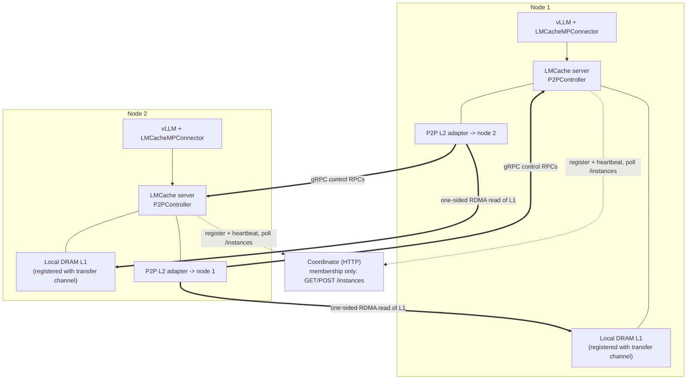
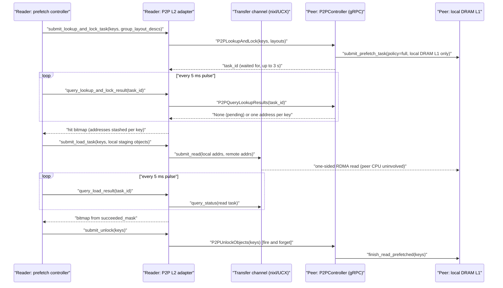
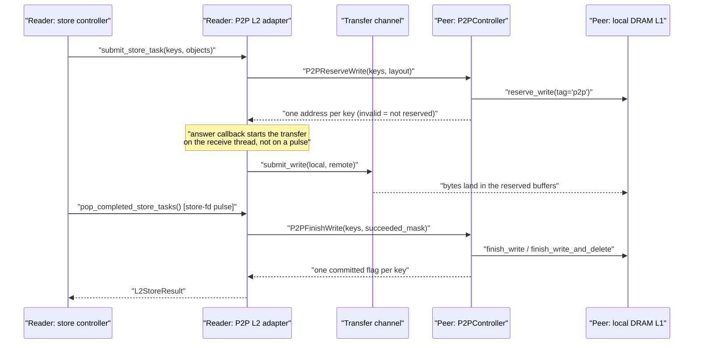

# P2P KV Sharing: reading KV out of a peer node's memory

> **Scope and evidence note.** No multi-node cluster (and no RDMA fabric) was
> available while writing this guide. **Everything below is derived from reading
> the source and the in-repo documentation at commit `53bde913`, not from a
> running deployment.** No timings, bandwidths or hit-rate numbers are reported,
> and nothing here has been reproduced live. Where the repository's own prose
> docs say something the code does not state, that is called out explicitly.

Related reading: [`../02-architecture.md`](../02-architecture.md),
[`03-l1-memory-and-eviction.md`](03-l1-memory-and-eviction.md),
[`04-l2-adapters-and-storage.md`](04-l2-adapters-and-storage.md),
[`06-transport-layer.md`](06-transport-layer.md),
[`09-observability.md`](09-observability.md),
[`10-cli.md`](10-cli.md).

---

## 1. The problem

In a multi-node serving fleet each node runs its own LMCache server, and each
one caches only the KV of the requests *it* served. A prefix computed on node 1
is invisible to node 2. When a router sends a similar request to node 2 — a
different replica, a retry, a follow-up turn of the same conversation that
landed elsewhere — node 2 recomputes a prefix that already exists in DRAM one
hop away.

The classic fix is a shared L2 tier: push everything to Redis/Valkey, S3 or a
filesystem and pull it back. That works, but it puts a storage system in the hot
path, pays a store on every node, and the read is bounded by that backend.

P2P takes the other route: **the per-node L1 caches become one logical cache.**
On a miss, a node asks its live peers whether any of them is holding the chunks,
and if one is, it pulls the bytes straight out of that peer's registered L1
buffer with a one-sided RDMA read. The owning node is not interrupted to serve
the transfer, and no central tier is involved.

The trade-offs this design accepts, all visible in the code:

- **It is a read path, not a replication scheme.** By default a node never
  writes into a peer. There is no rebalancing, no replica count, no durability.
- **No global eviction accounting.** The P2P adapter is constructed with
  `max_capacity_bytes=0`, so it reports no capacity and never deletes on the
  peer; it simply never learns when the peer drops an object
  ([`PeerL2AdapterBase.__init__`](https://github.com/LMCache/LMCache/blob/53bde913de1adae2a380fe0c2de8d2b9355b4702/lmcache/v1/distributed/l2_adapters/p2p_l2_adapter.py#L231)).
- **One hop.** A node reads from the peer that holds the prefix; reads are not
  chained peer → peer → peer. This is stated as a limitation in
  [`docs/source/mp/p2p.rst`](https://github.com/LMCache/LMCache/blob/53bde913de1adae2a380fe0c2de8d2b9355b4702/docs/source/mp/p2p.rst#L353)
  and is consistent with the adapter model (one adapter = one peer, and an
  adapter only looks in the peer's *local DRAM L1*).
- **Best-effort.** Every peer interaction is deadline-bounded and a blown
  deadline is reported as a plain miss. P2P is an opportunistic accelerator; it
  is never allowed to make a request fail.

---

## 2. The three moving parts

| Piece | Where | Role |
|---|---|---|
| Coordinator | [`lmcache/v1/mp_coordinator/`](https://github.com/LMCache/LMCache/blob/53bde913de1adae2a380fe0c2de8d2b9355b4702/lmcache/v1/mp_coordinator/http_apis/instances_api.py) | Membership only. Who is alive, and at which addresses. Never sees KV bytes and never participates in a lookup. |
| P2P controller | [`lmcache/v1/multiprocess/modules/p2p_controller.py`](https://github.com/LMCache/LMCache/blob/53bde913de1adae2a380fe0c2de8d2b9355b4702/lmcache/v1/multiprocess/modules/p2p_controller.py#L169) | Per server. Two jobs: poll the coordinator and keep one L2 adapter per live peer; and *serve* peers' lookup/lock/read-release and write RPCs against the local L1. |
| P2P L2 adapter | [`lmcache/v1/distributed/l2_adapters/p2p_l2_adapter.py`](https://github.com/LMCache/LMCache/blob/53bde913de1adae2a380fe0c2de8d2b9355b4702/lmcache/v1/distributed/l2_adapters/p2p_l2_adapter.py#L466) | Per peer. Makes one remote peer look like an ordinary L2 tier to the storage manager. |
| Transfer channel | [`lmcache/v1/distributed/transfer_channel/`](https://github.com/LMCache/LMCache/blob/53bde913de1adae2a380fe0c2de8d2b9355b4702/lmcache/v1/distributed/transfer_channel/impl/nixl_impl.py#L356) | Per server. Registers the L1 buffer once and moves bytes. See [`06-transport-layer.md`](06-transport-layer.md). |

Note the symmetry: **every participating server is both a client and a server of
P2P.** The same `P2PController` object that discovers peers also answers their
requests. There is no separate "cache server" role.

The vLLM side is unaware of any of this. vLLM talks to its local LMCache server
through the connector (see
[`05-vllm-integration.md`](05-vllm-integration.md)); the local server does P2P
on its behalf.



In words: both nodes register with and heartbeat to the coordinator, and both
poll its `/instances` list to learn about each other. Each then holds a P2P L2
adapter pointing at the other. Control traffic (lookup, lock, unlock, and the
optional write reservation/commit) goes over a gRPC service on the peer; the KV
bytes themselves bypass the peer's CPU entirely and are read directly out of its
registered L1 buffer. vLLM only ever talks to the LMCache server on its own
node.

---

## 3. Registration and discovery

Discovery is deliberately boring: an HTTP list, polled.

**Registering.** The MP server's HTTP lifespan starts a long-lived
`keep_registered` task
([`registrar.py`](https://github.com/LMCache/LMCache/blob/53bde913de1adae2a380fe0c2de8d2b9355b4702/lmcache/v1/mp_coordinator/registrar.py#L111))
which `POST`s to `/instances` and then heartbeats on a timer. Two of the fields
it sends exist purely for P2P
([`http_server.py`](https://github.com/LMCache/LMCache/blob/53bde913de1adae2a380fe0c2de8d2b9355b4702/lmcache/v1/multiprocess/http_server.py#L220)):

- `p2p_advertised_url` — the transfer-channel `host:port` from
  `--p2p-advertise-url`. Empty when P2P is off.
- `mq_port` — the bound port of this server's **independent P2P gRPC listener**
  ([`MPCacheServerEngine.mq_port`](https://github.com/LMCache/LMCache/blob/53bde913de1adae2a380fe0c2de8d2b9355b4702/lmcache/v1/multiprocess/server.py#L113)),
  i.e. `--p2p-rpc-port`. `0` when P2P is off.

The registrar is written to survive a flaky coordinator: transient failures are
logged and retried on the next tick while the current identity is kept, so a
down coordinator never stops the MP server. The identity is rebuilt only on an
explicit `404` — "the coordinator forgot us" — or after a failed first
registration. On shutdown the task deregisters.

**Discovering.** `P2PController._start_orchestration`
([L228](https://github.com/LMCache/LMCache/blob/53bde913de1adae2a380fe0c2de8d2b9355b4702/lmcache/v1/multiprocess/modules/p2p_controller.py#L228))
spins up a periodic thread at the *coordinator heartbeat interval* — the same
knob doubles as the discovery poll interval — running `_poll_cycle`
([L613](https://github.com/LMCache/LMCache/blob/53bde913de1adae2a380fe0c2de8d2b9355b4702/lmcache/v1/multiprocess/modules/p2p_controller.py#L613)):

1. `GET <coordinator>/instances`.
2. **Check that we are in the list ourselves**, with our own advertise URL
   (`_is_self_registered`, [L674](https://github.com/LMCache/LMCache/blob/53bde913de1adae2a380fe0c2de8d2b9355b4702/lmcache/v1/multiprocess/modules/p2p_controller.py#L674)).
   If not, the state is `unregistered` and *all* peer adapters are torn down. A
   node that the fleet cannot see should not be reading from the fleet.
3. Keep every other instance that has a non-empty `p2p_advertised_url`, `ip`
   **and** `mq_port` — i.e. peers that actually have P2P enabled.
4. Reconcile (`_reconcile`, [L715](https://github.com/LMCache/LMCache/blob/53bde913de1adae2a380fe0c2de8d2b9355b4702/lmcache/v1/multiprocess/modules/p2p_controller.py#L715)):
   add an adapter for a new peer, drop-and-recreate one whose advertised
   connection info changed, and remove one whose peer has been absent for more
   than `_MAX_MISSES = 3` consecutive polls
   ([L58](https://github.com/LMCache/LMCache/blob/53bde913de1adae2a380fe0c2de8d2b9355b4702/lmcache/v1/multiprocess/modules/p2p_controller.py#L58)).

The three-miss grace period is the usual anti-flap measure: one lost poll or one
slow coordinator response should not tear down a working RDMA connection and
force a fresh handshake.

The controller exposes this through `report_status()`
([L272](https://github.com/LMCache/LMCache/blob/53bde913de1adae2a380fe0c2de8d2b9355b4702/lmcache/v1/multiprocess/modules/p2p_controller.py#L272)),
which is what the `/status` HTTP endpoint surfaces:
`p2p_enabled`, `p2p_state` (`registered` / `disconnected` / `unregistered`),
`p2p_peer_count`, `p2p_peers`, `active_p2p_lookup_jobs`. `disconnected` is
specifically "the coordinator timed out", distinguished from the generic
`unregistered`.

### Startup validation

Three preconditions are checked before the server comes up
([`run_http_server`](https://github.com/LMCache/LMCache/blob/53bde913de1adae2a380fe0c2de8d2b9355b4702/lmcache/v1/multiprocess/http_server.py#L308)):

- `--p2p-advertise-url` without `--coordinator-url` → refuse. There is no static
  peer list, so without a coordinator P2P can never find anyone.
- P2P with a GDS L1 (`--gds-l1-path`) or Device-DAX L1 (`--l1-devdax-path`) →
  refuse. The transfer channel registers **one contiguous L1 region**, so those
  tiers are incompatible.
- `--enable-p2p-write` without P2P → refuse.

And inside the controller, `_start_orchestration` requires **exactly one local
DRAM L1** exposing a registerable buffer
([L240](https://github.com/LMCache/LMCache/blob/53bde913de1adae2a380fe0c2de8d2b9355b4702/lmcache/v1/multiprocess/modules/p2p_controller.py#L240)).
That single L1 — tagged `MemorySegment.DRAM` / `MemoryResidency.LOCAL`
([`_P2P_L1_TAGS`, L61](https://github.com/LMCache/LMCache/blob/53bde913de1adae2a380fe0c2de8d2b9355b4702/lmcache/v1/multiprocess/modules/p2p_controller.py#L61))
— is the one peers may read and write. Objects in any other L1 tier are
invisible to peers.

---

## 4. A peer is just another L2 tier

This is the central design decision, and it is what keeps P2P small.

The P2P adapter implements the same `L2AdapterInterface` as the filesystem,
Valkey and NIXL-storage adapters, and self-registers under the type name
`"p2p"` at import time
([L896](https://github.com/LMCache/LMCache/blob/53bde913de1adae2a380fe0c2de8d2b9355b4702/lmcache/v1/distributed/l2_adapters/p2p_l2_adapter.py#L896)):

```python
register_l2_adapter_type("p2p", P2PL2AdapterConfig)
...
register_l2_adapter_factory("p2p", _create_p2p_adapter)
```

So the prefetch and store controllers do not know what a peer is. They call
`submit_lookup_and_lock_task` → `query_lookup_and_lock_result` →
`submit_load_task` → `query_load_result` → `submit_unlock`, exactly as they
would against a disk. The consequences are worth spelling out, because they are
the payoff of the abstraction:

- P2P composes with real L2 tiers. A node can have a peer adapter *and* a
  Valkey adapter; the prefetch controller picks per key.
- The P2P controller does not manage transfers itself — it just calls
  `storage_manager.add_l2_adapter(config)` / `delete_l2_adapter(adapter_id)`
  ([L788](https://github.com/LMCache/LMCache/blob/53bde913de1adae2a380fe0c2de8d2b9355b4702/lmcache/v1/multiprocess/modules/p2p_controller.py#L788)).
  Peer churn is adapter churn.
- Observability is shared: P2P load/failure counters are the generic
  `lmcache_mp.l2_*` instruments, tagged with the adapter name.

There are two visible seams where "peer" does leak through the L2 interface:

1. `get_memory_tags()` returns `MemoryTags(MemorySegment.DRAM,
   MemoryResidency.REMOTE)`
   ([L661](https://github.com/LMCache/LMCache/blob/53bde913de1adae2a380fe0c2de8d2b9355b4702/lmcache/v1/distributed/l2_adapters/p2p_l2_adapter.py#L661)),
   so placement policies can tell "another host's DRAM" from "local disk".
2. `group_layout_descs` on the lookup call. For most adapters it is an advisory
   hint they ignore; the P2P adapter forwards the real descriptors verbatim so
   the peer can size the objects it is being asked about
   ([`base.py` docstring](https://github.com/LMCache/LMCache/blob/53bde913de1adae2a380fe0c2de8d2b9355b4702/lmcache/v1/distributed/l2_adapters/base.py#L263)).

### Class split: control plane vs read strategy

```
PeerL2AdapterBase    lookup/unlock RPCs, event fds, no-op store, close
└── P2PL2Adapter     import the peer's region; RDMA load, optional RDMA store
```

[`PeerL2AdapterBase`](https://github.com/LMCache/LMCache/blob/53bde913de1adae2a380fe0c2de8d2b9355b4702/lmcache/v1/distributed/l2_adapters/p2p_l2_adapter.py#L208)
owns everything about *talking* to a peer. Subclasses implement three hooks —
`_register_peer_region`, `_unregister_peer_region`, `_process_lookup_result` —
plus an optional `_stores_need_polling`. The reason for the split is given in
[`docs/design/v1/distributed/l2_adapters/p2p_l2_adapter.md`](https://github.com/LMCache/LMCache/blob/53bde913de1adae2a380fe0c2de8d2b9355b4702/docs/design/v1/distributed/l2_adapters/p2p_l2_adapter.md):
the *read strategy* decides what a hit means, while the polling, timeout and
failure handling stay shared.

- **Copy** (`P2PL2Adapter`, the only implementation on this revision): a hit
  records the remote address; a later load copies bytes into local L1.
- **Lend** (described in the design doc as a follow-up, e.g. Device-DAX L1 on a
  CXL pool both hosts map): a hit keeps the reservation and hands L1 a borrowed
  view — no copy and no local capacity needed. *Not present in the code at this
  commit;* only the hook that would make it possible is.

A constructor subtlety worth knowing if you ever write such a subclass: the
region hook runs *inside* the base constructor, so a subclass must set
everything its hook needs **before** calling `super().__init__()` and must
acquire nothing afterwards. `P2PL2Adapter.__init__` does exactly that
([L475](https://github.com/LMCache/LMCache/blob/53bde913de1adae2a380fe0c2de8d2b9355b4702/lmcache/v1/distributed/l2_adapters/p2p_l2_adapter.py#L475)).

### Why the periodic event notifier

Every L2 adapter signals progress on event fds. Neither the gRPC control RPCs
nor the RDMA transfer offers a completion fd — the RPC resolves asynchronously
in the transport and the read completes inside the transfer engine. So the
adapter registers its lookup and load fds with the process-wide
`PeriodicEventNotifier`, which pulses them every 5 ms
([`_PERIODIC_NOTIFIER_INTERVAL_MS`, L64](https://github.com/LMCache/LMCache/blob/53bde913de1adae2a380fe0c2de8d2b9355b4702/lmcache/v1/distributed/l2_adapters/p2p_l2_adapter.py#L64)).
Each pulse drives the prefetch controller to re-poll, which checks the in-flight
RPC and transfer state.

This is a pragmatic bridge, not an elegant one, and the code says so. The store
fd is pulsed **only** when writes are enabled (`_stores_need_polling`,
[L679](https://github.com/LMCache/LMCache/blob/53bde913de1adae2a380fe0c2de8d2b9355b4702/lmcache/v1/distributed/l2_adapters/p2p_l2_adapter.py#L679));
the no-op store signals its fd directly.

---

## 5. A cross-node read, step by step



Walking that through:

**Lookup-and-lock.** The reader sends the keys plus one `MemoryLayoutDesc` per
object group. On the peer, `p2p_lookup_and_lock`
([L311](https://github.com/LMCache/LMCache/blob/53bde913de1adae2a380fe0c2de8d2b9355b4702/lmcache/v1/multiprocess/modules/p2p_controller.py#L311))
buckets the flat key list per object group and submits a prefetch task with
`fetching_policy="full"`, `allowed_l1_memory_tags={local DRAM}` and
`allowed_l2_memory_tags=frozenset()`. Two things follow from those arguments:
the peer looks **only** in the one L1 that the transfer channel has registered
(never another L1 tier, never its own L2 — that is what makes "one hop" true),
and `"full"` means every resident key is locked, with gaps allowed, rather than
only a contiguous prefix. It returns a task id.

The read lock matters: without it the peer could evict the object between
answering the lookup and the reader's RDMA read, and the reader would pull
garbage out of a reused buffer.

The reader's `submit_lookup_and_lock_task`
([L317](https://github.com/LMCache/LMCache/blob/53bde913de1adae2a380fe0c2de8d2b9355b4702/lmcache/v1/distributed/l2_adapters/p2p_l2_adapter.py#L317))
does *wait* for that task id, but only for `_LOOKUP_RPC_TIMEOUT_S = 3.0`
seconds, and a timeout is recorded as `failed=True` — a miss, not an error.

**Query.** On each pulse the adapter polls `P2PQueryLookupResults`. The peer
returns `None` while the prefetch is still running, otherwise exactly one
`TransferChannelAddress` per submitted key, in request order, with an invalid
(negative) offset for keys it did not lock
([`_INVALID_ADDRESS`, L55](https://github.com/LMCache/LMCache/blob/53bde913de1adae2a380fe0c2de8d2b9355b4702/lmcache/v1/multiprocess/modules/p2p_controller.py#L55)).
`_build_addresses`
([L566](https://github.com/LMCache/LMCache/blob/53bde913de1adae2a380fe0c2de8d2b9355b4702/lmcache/v1/multiprocess/modules/p2p_controller.py#L566))
builds that list, and handles the "locked but unreadable under a race" case by
leaving the entry invalid so the reader simply skips the key. The query is
exactly-once: the job is popped once answered.

`_process_lookup_result`
([L881](https://github.com/LMCache/LMCache/blob/53bde913de1adae2a380fe0c2de8d2b9355b4702/lmcache/v1/distributed/l2_adapters/p2p_l2_adapter.py#L881))
stashes the valid addresses per key and returns the hit bitmap.

**Load.** `submit_load_task`
([L596](https://github.com/LMCache/LMCache/blob/53bde913de1adae2a380fe0c2de8d2b9355b4702/lmcache/v1/distributed/l2_adapters/p2p_l2_adapter.py#L596))
translates the *local* destination objects' `(shm_offset, shm_byte_length)` into
transfer-channel addresses, pairs them with the stashed remote addresses and
calls `submit_read`. `query_load_result` turns the transfer's `succeeded_mask`
into a bitmap.

Note where the staging memory comes from: the reader must reserve local L1 for
every object it is about to pull. That reservation is the source of the `l1_oom`
failure mode in §7.

**Unlock.** `submit_unlock` releases the peer's read locks and drops the stashed
addresses. It is deliberately fire-and-forget — the result future is never
awaited — because the reader has nothing useful to do with a failed unlock, and
the peer's read-lock TTL will reclaim it anyway.

### Deadlines everywhere

Both the lookup and the load carry a per-task deadline (`lookup_timeout_s` /
`load_timeout_s`). Past it, the adapter returns an **all-zero bitmap**: a blown
lookup is a miss, a blown load is a failure, and the prefetch controller trims
those keys as if the peer never had them. The request then recomputes.

The owner side has the mirror-image problem — a requester that submits a lookup
and never queries it would leak jobs. `p2p_lookup_and_lock` therefore drops
finished jobs older than `--p2p-lookup-timeout`, scanning at most once per
timeout (`_drop_abandoned_jobs`,
[L533](https://github.com/LMCache/LMCache/blob/53bde913de1adae2a380fe0c2de8d2b9355b4702/lmcache/v1/multiprocess/modules/p2p_controller.py#L533)).
Their read locks are intentionally *not* released — unlocking after TTL expiry
could release a later reader's lock — so they are left to expire. A late query
gets `None` and counts as a miss.

---

## 6. The data path: NIXL/UCX, and what "TCP fallback" means

The transfer channel (see
[`06-transport-layer.md`](06-transport-layer.md) and
[`docs/design/v1/distributed/transfer_channel/overall.md`](https://github.com/LMCache/LMCache/blob/53bde913de1adae2a380fe0c2de8d2b9355b4702/docs/design/v1/distributed/transfer_channel/overall.md))
is a transport-agnostic interface with two registered implementations:

| `--p2p-transfer-engine` | Module | Notes |
|---|---|---|
| `nixl` (default) | [`impl/nixl_impl.py`](https://github.com/LMCache/LMCache/blob/53bde913de1adae2a380fe0c2de8d2b9355b4702/lmcache/v1/distributed/transfer_channel/impl/nixl_impl.py#L356) | NIXL bindings, backend list defaults to `["UCX"]` ([L383](https://github.com/LMCache/LMCache/blob/53bde913de1adae2a380fe0c2de8d2b9355b4702/lmcache/v1/distributed/transfer_channel/impl/nixl_impl.py#L383)). Optional `lmcache[nixl]` extra. |
| `mooncake_te` | [`impl/mooncake_te_impl.py`](https://github.com/LMCache/LMCache/blob/53bde913de1adae2a380fe0c2de8d2b9355b4702/lmcache/v1/distributed/transfer_channel/impl/mooncake_te_impl.py) | Mooncake Transfer Engine. |

The nixl path, as implemented:

- **One agent per process.** The context creates a single `nixl_agent`,
  registers the whole L1 buffer once, and builds a page-granular transfer
  descriptor list over `[base, base+size)` using the L1's `align_bytes` as page
  size.
- **Handshake over ZMQ, not over the LMCache MQ.** A small `msgspec` tagged
  union (`InitReq`/`InitResp`, `MemRegReq`/`MemRegResp`) is exchanged over a
  ZMQ `REP`/`REQ` socket bound at `tcp://host:port`
  ([L292](https://github.com/LMCache/LMCache/blob/53bde913de1adae2a380fe0c2de8d2b9355b4702/lmcache/v1/distributed/transfer_channel/impl/nixl_impl.py#L292))
  — the `--p2p-listen-url` / `--p2p-advertise-url` endpoint. The design doc's
  reason for not reusing the global MQ: it would leak transfer-channel functions
  into an unrelated interface. Only *metadata* crosses this socket; no KV.
- **Passive client creation.** When a peer dials this server and sends its
  descriptor list, the server registers a reverse client for that peer, so after
  a single handshake bytes can flow either way.
- **Bounded handshake.** The dialing side sets a 60 s `RCVTIMEO`
  ([`_HANDSHAKE_TIMEOUT_MS`, L43](https://github.com/LMCache/LMCache/blob/53bde913de1adae2a380fe0c2de8d2b9355b4702/lmcache/v1/distributed/transfer_channel/impl/nixl_impl.py#L43)),
  so a wrong or firewalled URL raises a clear `TimeoutError` instead of hanging.
- **Alignment is a cross-node contract.** Object offsets must be aligned to the
  registered `align_bytes`, and both sides must use the *same* value, because
  the page-index math is computed against the reader's alignment but indexes the
  peer's descriptor list. This is why the docs recommend
  `--l1-align-bytes 65536` on P2P nodes (and why changing it requires restarting
  every participant).

**On "TCP fallback" — be precise, there are two different things:**

1. **UCX choosing a TCP transport.** The code picks the `UCX` NIXL backend; it
   does not itself select rails or protocols. Which transport UCX ends up using
   is decided by UCX (`UCX_TLS`, available devices, reachable GIDs/routes). The
   in-repo P2P skills state plainly that a host with no RDMA devices "will run
   over TCP: fine for a functional test, not for performance", and the diagnose
   skill has a symptom row for `rail_check.sh` reporting "traffic went over TCP"
   with the cause "no RDMA devices, or UCX could not use them". This fallback is
   **UCX behaviour, not LMCache logic** — there is no code path in LMCache that
   detects RDMA failure and switches to TCP.
2. **Mooncake defaulting to TCP.** `mooncake_te` uses TCP unless both
   `MC_TE_PROTOCOL=rdma` and `MC_TE_DEVICE=<nic>` are set in the environment, per
   [`p2p.rst`](https://github.com/LMCache/LMCache/blob/53bde913de1adae2a380fe0c2de8d2b9355b4702/docs/source/mp/p2p.rst#L138).

Also worth noting from the environment-tuning side (documented in the skills,
not in LMCache code): with nixl ≥ 1.5 on GPU hosts, `UCX_TLS` must include
`cuda_copy` or the server dies at startup with `NIXL_ERR_BACKEND`; and
`UCX_MAX_RMA_RAILS` counts *paths*, which is two per LAG bond, so a value set to
the number of bonds uses only half the NICs.

---

## 7. Failure modes

P2P is the part of the system most exposed to the physical world: another host,
another NIC, another process's memory pressure. The code's stance is uniform —
**degrade to a miss, never to an error.**

### Control-plane and connectivity failures

| Situation | What happens |
|---|---|
| Coordinator times out | `_poll_cycle` sets state `disconnected` and reconciles against an empty peer set, so adapters are dropped after `_MAX_MISSES` polls. The server keeps serving from its own L1. |
| Coordinator returns an HTTP error / malformed body | state `unregistered`, adapters dropped. `ValueError("malformed /instances response")` on a bad shape. |
| We are not in `/instances` ourselves | state `unregistered`, all peer adapters torn down. |
| Peer left the fleet | absent for > 3 polls → `_remove_adapter` → `delete_l2_adapter`. |
| Peer's advertised IP/port changed (restart) | `_peer_changed` → remove then re-add, forcing a fresh handshake. Peer identity is `(ip, p2p_advertised_url, mq_port)`, not just the instance id. |
| Peer unreachable at lookup submit | the 3 s RPC wait expires → `failed=True` → all-zero bitmap → treated as a miss. Logged at WARNING. |
| Peer unreachable mid-lookup / mid-read | the per-task deadline (`--p2p-lookup-timeout` / `--p2p-load-timeout`, default 30 s each) expires → all-zero bitmap. |
| `add_l2_adapter` fails for a peer | `_add_adapter` logs via `logger.exception` and returns `False`; the next poll retries. One bad peer does not break discovery. |
| `delete_l2_adapter` fails | logged, **not retried** by the controller. `StorageManager.close()` will try again at shutdown; if a close fails, L1 managers are deliberately left open because the adapter may still touch L1 buffers. |

An important asymmetry: a connector/engine never sees any of this. A failed peer
read and an ordinary cache miss are indistinguishable downstream. `p2p.rst`
[notes this explicitly](https://github.com/LMCache/LMCache/blob/53bde913de1adae2a380fe0c2de8d2b9355b4702/docs/source/mp/p2p.rst#L205)
for vLLM's `kv_load_failure_policy`: LMCache passes the setting through
unchanged but its L2 adapters do not read or enforce it, so a genuine load
failure also just falls through to recompute.

### The peer evicted the key

There is no invalidation protocol — the adapter "never learns when the peer
evicts an object". Three guards cover the window:

1. The lookup **read-locks** every key it reports, so an object cannot be
   evicted between the answer and the read.
2. If a key is locked but turns out unreadable (an eviction race), the peer
   leaves its address invalid and the reader skips it.
3. If the reader's stash has no valid address when the load is submitted, the
   load is marked failed immediately and logged at WARNING ("missing/invalid
   remote address; treating as a failure") rather than reading from a stale
   offset
   ([L608](https://github.com/LMCache/LMCache/blob/53bde913de1adae2a380fe0c2de8d2b9355b4702/lmcache/v1/distributed/l2_adapters/p2p_l2_adapter.py#L608)).

The residual exposure is acknowledged in the design doc: the transfer channel
has **no cancel**, so a read still in flight when its deadline passes can land
in a local buffer the reader has already given up on (and symmetrically for
writes against a peer buffer that was freed).

### Reader-side L1 pressure: `l1_oom` and `l1_contended`

These two are the most common "zero errors but a low hit rate" causes, and they
are not P2P-specific — they come from the shared prefetch staging path
([`prefetch_controller.py` L355–L377](https://github.com/LMCache/LMCache/blob/53bde913de1adae2a380fe0c2de8d2b9355b4702/lmcache/v1/distributed/storage_controllers/prefetch_controller.py#L355)):

- **`l1_oom`** — the reader could not reserve staging L1 for the load
  (`L1Error.OUT_OF_MEMORY`). Published as an `L2_PREFETCH_FAILED` event with
  `reason="l1_oom"`, and preceded by a WARNING: "N L1 reservations failed with
  out-of-memory; L1 may be under memory pressure". **Why P2P makes this more
  likely:** every in-flight peer load needs prompt-sized temporary L1 *on top
  of* the resident set, and by default loaded keys are temporary (they are not
  retained), so they also drive eviction. The launch skill's rule of thumb is
  `L1_GB >= resident_KV + concurrency × prompt_KV`.
- **`l1_contended`** — `L1Error.KEY_NOT_WRITABLE`: the key is resident in an
  affinity L1 this request may not read (memory-tag filtering), so it can
  neither be reused nor loaded again. Published with `reason="l1_contended"`.

Both surface on `lmcache_mp.l2_prefetch_failure` (Prometheus:
`lmcache_mp_l2_prefetch_failure_chunks_total{reason=...}`), documented in
[`subscribers/metrics/l2_failures.py`](https://github.com/LMCache/LMCache/blob/53bde913de1adae2a380fe0c2de8d2b9355b4702/lmcache/v1/mp_observability/subscribers/metrics/l2_failures.py#L7).

### What to look at

Code-verified signals:

- `GET /status` on a server's `--http-port`: `p2p_state`, `p2p_peer_count`,
  `p2p_peers`, `active_p2p_lookup_jobs`.
- `GET /instances` on the coordinator: the fleet, with each instance's `ip`,
  `p2p_advertised_url` and `mq_port`.
- `lmcache_mp.active_p2p_lookup_jobs` — an observable gauge registered by the
  controller ([L829](https://github.com/LMCache/LMCache/blob/53bde913de1adae2a380fe0c2de8d2b9355b4702/lmcache/v1/multiprocess/modules/p2p_controller.py#L829)):
  lookups this node is serving **for peers**.
- The generic L2 instruments in
  [`subscribers/metrics/l2.py`](https://github.com/LMCache/LMCache/blob/53bde913de1adae2a380fe0c2de8d2b9355b4702/lmcache/v1/mp_observability/subscribers/metrics/l2.py#L36)
  and the lookup instruments in
  [`lookup.py`](https://github.com/LMCache/LMCache/blob/53bde913de1adae2a380fe0c2de8d2b9355b4702/lmcache/v1/mp_observability/subscribers/metrics/lookup.py#L63),
  tagged by adapter.
- At `LMCACHE_LOG_LEVEL=DEBUG`: `Added P2P adapter … for peer <instance-id>` /
  `Removed P2P adapter for peer …`.

See [`09-observability.md`](09-observability.md) for how events become metrics,
and note the operational caveat recorded in the P2P skills: `POST /metrics/reset`
is a no-op in MP mode, so compare two `/metrics` scrapes instead.

---

## 8. The optional write path (`--enable-p2p-write`)

Reads make peers a shared cache. Writes make a peer an **extension of this
server's DRAM** — the intended shape is a main server plus "headless" peers that
run only an LMCache server and no engine
([`p2p_deployment.rst`](https://github.com/LMCache/LMCache/blob/53bde913de1adae2a380fe0c2de8d2b9355b4702/docs/source/mp/p2p_deployment.rst),
scenario B).

The protocol is two RPCs around one RDMA write:



Reading that back: the store controller only *submits* the reservation and never
blocks. When the peer answers, the answer's done-callback — running on the
request client's receive thread — immediately submits the RDMA write. The
transfer's completion is noticed on a store-fd pulse (the transfer channel has
no completion callback), which triggers the commit RPC; the commit's callback
signals the store fd so the loop picks the result up at once.

**Why nothing waits.** The store controller's loop is one thread shared by every
L2 adapter. If `submit_store_task` waited for a peer round trip, a slow or dead
peer would stall stores to *every other tier*. The design doc records the
measurements that motivated moving from polling to callbacks, and is careful to
add that they predate the independent gRPC control service and are not current
performance evidence. (This guide makes no performance claims either way.)

Semantics worth knowing:

- **A reservation is invisible to readers until committed**, and an invalid
  address means nothing was reserved for that key: peer L1 out of memory, the
  key is already resident there, or another peer write of it is in progress.
- **All-or-nothing success.** A task succeeds only if *every* key is resident on
  the peer; anything else is `L2StoreResult(False, 0)`. That strictness exists
  because the `p2p` store policy deletes local copies after a successful store
  ([`P2PStorePolicy.select_l1_deletions`](https://github.com/LMCache/LMCache/blob/53bde913de1adae2a380fe0c2de8d2b9355b4702/lmcache/v1/distributed/storage_controllers/p2p_store_policy.py#L97)) —
  a partial success must not be allowed to drop data.
- **Peers keep no per-write state.** Reserve, commit and discard are single L1
  calls under the writer tag `"p2p"`
  ([`_P2P_WRITE_TAG`, L64](https://github.com/LMCache/LMCache/blob/53bde913de1adae2a380fe0c2de8d2b9355b4702/lmcache/v1/multiprocess/modules/p2p_controller.py#L64)),
  and an abandoned reservation is reclaimed by the L1 write TTL like any other
  dropped write. If the requester dies mid-store, nothing has to clean up.
- **`store_timeout_s` must stay below the peer's `--l1-write-ttl-seconds`**,
  or the peer may hand a buffer to another writer while this one is still
  writing.
- **Enable writes on one side of a pair only.** With both sides writing, an
  object one side stored and dropped locally can be stored right back by the
  other. The flag help text says this, and so does the design doc.
- A peer-L1 OOM during reserve publishes an `L1_ALLOCATION_FAILED` event with
  `during="p2p_store"`
  ([L471](https://github.com/LMCache/LMCache/blob/53bde913de1adae2a380fe0c2de8d2b9355b4702/lmcache/v1/multiprocess/modules/p2p_controller.py#L471)),
  so you can see peer-side pressure in the peer's metrics.

The placement decision lives in `P2PStorePolicy`
([`p2p_store_policy.py`](https://github.com/LMCache/LMCache/blob/53bde913de1adae2a380fe0c2de8d2b9355b4702/lmcache/v1/distributed/storage_controllers/p2p_store_policy.py#L38)):
keys go to every non-P2P adapter as usual, and additionally to **one**
write-enabled peer — chosen round-robin — but only once the local DRAM L1's used
fraction reaches that peer's `write_l1_usage_threshold`. Below the threshold,
objects stay local. Passing `--enable-p2p-write` selects the `p2p` store policy
and the `skip_l1` prefetch policy unless `--l2-store-policy` /
`--l2-prefetch-policy` override them
([`_with_p2p_write_policies`](https://github.com/LMCache/LMCache/blob/53bde913de1adae2a380fe0c2de8d2b9355b4702/lmcache/v1/multiprocess/http_server.py#L321)).

---

## 9. Configuration reference

All flags are on `lmcache server`; see
[`add_p2p_args`](https://github.com/LMCache/LMCache/blob/53bde913de1adae2a380fe0c2de8d2b9355b4702/lmcache/v1/multiprocess/config.py#L757)
and [`P2PConfig`](https://github.com/LMCache/LMCache/blob/53bde913de1adae2a380fe0c2de8d2b9355b4702/lmcache/v1/multiprocess/config.py#L242),
and [`10-cli.md`](10-cli.md) for the rest of the server surface.

| Flag | Default | Meaning |
|---|---|---|
| `--p2p-advertise-url HOST:PORT` | `""` | Transfer-channel endpoint advertised to peers. **Setting it enables P2P.** |
| `--p2p-listen-url HOST:PORT` | `""` → advertise URL | Address the transfer-channel server binds. Set to `0.0.0.0:PORT` while advertising a routable IP. |
| `--p2p-rpc-port PORT` | `0` (OS-assigned) | Independent P2P gRPC control port, bound on `--host`. Pin it when a firewall / Docker port mapping / NetworkPolicy restricts ports — allowing only the worker `--port` is **not** enough. |
| `--p2p-lookup-timeout SECONDS` | `30` | Deadline for a peer lookup before it counts as a miss. |
| `--p2p-load-timeout SECONDS` | `30` | Deadline for a peer read before it counts as a failure. |
| `--p2p-transfer-engine ENGINE` | `nixl` | Transfer-channel implementation. |
| `--enable-p2p-write` | off | Store into peers' L1 above the threshold and drop the local copy. One side of a pair only. |
| `--p2p-write-l1-usage-threshold FRACTION` | `0.7` | Local DRAM L1 used fraction from which new objects go to a peer. Must be in `(0, 1]`; keep it below `--eviction-trigger-watermark`. |
| `--p2p-store-timeout SECONDS` | `30` | Deadline for a store into a peer. |

P2P also reuses `--coordinator-url`, `--coordinator-advertise-ip` and
`--coordinator-heartbeat-interval`; the heartbeat interval doubles as the
peer-discovery poll interval.

**A defaults mismatch to be aware of.** The adapter's own config defaults
(`P2PL2AdapterConfig`) are **10 s** for `lookup_timeout_s`, `load_timeout_s` and
`store_timeout_s`
([L126](https://github.com/LMCache/LMCache/blob/53bde913de1adae2a380fe0c2de8d2b9355b4702/lmcache/v1/distributed/l2_adapters/p2p_l2_adapter.py#L126)),
while the CLI defaults are **30 s**. These are not in conflict — the controller
always passes the CLI values explicitly when it creates an adapter — but the 10 s
figures are what you get if you hand-write a `"type": "p2p"` L2 adapter config.

That hand-written form is possible, because the adapter goes through the normal
L2 factory:

```json
{
  "type": "p2p",
  "peer_mq_server_url": "grpc://peer-host:9555",
  "peer_transfer_channel_server_url": "peer-host:7600",
  "lookup_timeout_s": 10.0,
  "load_timeout_s": 10.0,
  "write_enabled": false,
  "store_timeout_s": 10.0,
  "write_l1_usage_threshold": 0.7
}
```

In a normal deployment you never write this: the P2P controller synthesizes it
per discovered peer, with `peer_mq_server_url = grpc://<peer ip>:<peer mq_port>`.

---

## 10. In-repo tooling

The repository ships three agent skills under `.claude/skills/` that package the
P2P recipes as runnable scripts. They are useful reading even without an agent,
because they encode operational knowledge that is nowhere in the Python:

| Skill | What it covers |
|---|---|
| `lmcache-p2p-launch` | Per-node probe (GPUs, RDMA devices and NUMA placement, Python stack, free ports, HF cache), venv setup, one `env.sh` per instance, start coordinator → servers → vLLM, and block until every node reports `p2p_state=registered` with the expected peer count. References explain the UCX multi-rail variables and the single-node two-instance variant. |
| `lmcache-p2p-test` | Cross-node correctness (`basic_test.py`: a prompt served cold on one node, then from the peer on the other, with `num_lmcache_cached_tokens > 0` and identical outputs as the pass criteria), a stress ladder, `lmcache bench engine` long-doc-qa across nodes, Prometheus scraping with a live monitor, and a Markdown summary. |
| `lmcache-p2p-diagnose` | Symptom → cause → fix decision tree, plus RDMA readiness checks, a NIXL/UCX probe, per-NIC traffic attribution, UCX trace reading, and a debug-bundle collector. |

Two gotchas from those references that are easy to lose a day to, and that the
code does not tell you:

- **`--http-host 0.0.0.0`.** The default binds `127.0.0.1`, which hides
  `/status` and `/metrics` from every other host — including your Prometheus.
- **Restarting an LMCache server requires restarting its vLLM**; the connector
  does not reconnect.

### Documentation drift found while writing this

- `.claude/skills/lmcache-p2p-launch/references/flags-and-ports.md` describes
  `MP_PORT` (`lmcache server --port`) as serving "peers' lookup/unlock RPCs".
  **That is stale on this revision:** peers reach each other on the *independent
  P2P gRPC listener* (`--p2p-rpc-port`), whose bound port is what the server
  registers as `mq_port` and what `P2PController._add_adapter` turns into
  `grpc://<ip>:<mq_port>`. `docs/source/mp/p2p.rst` has the current story.
- The field name `mq_port` and `P2PL2AdapterConfig.peer_mq_server_url` are
  historical: the docstring of
  [`keep_registered`](https://github.com/LMCache/LMCache/blob/53bde913de1adae2a380fe0c2de8d2b9355b4702/lmcache/v1/mp_coordinator/registrar.py#L144)
  still calls it "this server's ZMQ message-queue server for P2P lookup RPCs",
  but [`p2p.py`](https://github.com/LMCache/LMCache/blob/53bde913de1adae2a380fe0c2de8d2b9355b4702/lmcache/v1/distributed/p2p.py#L77)
  is gRPC-only and explicitly rejects non-gRPC endpoints. Read "mq" as "peer
  control endpoint".
- `docs/design/v1/distributed/l2_adapters/p2p_l2_adapter.md` is otherwise
  accurate against the code, but it refers to peer discovery and runtime
  `add_l2_adapter` as "owned by separate PRs". Both landed: the controller is
  in the tree and calls `storage_manager.add_l2_adapter` / `delete_l2_adapter`.
  It also cites a Confluence design doc, which is not publicly reachable.

---

## 11. Things this guide could not verify

Stated plainly, because the instructions for this guide are accuracy over
completeness:

- **Nothing was run.** No cluster, no RDMA fabric, no single-node two-instance
  loopback deployment. There is no evidence here that a cross-node read
  succeeds, only that the code paths exist and fit together.
- **No performance characterisation of any kind.** The latency table in the P2P
  design doc is reproduced nowhere above; even that doc marks its numbers as
  predating the current gRPC control service.
- **UCX/NIXL behaviour** (rail selection, TCP fallback, `NIXL_ERR_BACKEND` at
  startup, the `cuda_copy` requirement) is taken from the skill references and
  from `p2p.rst`. It is outside LMCache's own code, and was not observed.
- **The "lend" read strategy** (CXL / Device-DAX in place, GPU-direct) is
  described in the design doc as a follow-up. At commit `53bde913` the only
  `PeerL2AdapterBase` subclass is the copying `P2PL2Adapter`.
- **Eviction interaction over time** — how often a peer's eviction invalidates a
  stashed address in practice, how `l1_oom` scales with concurrency — needs a
  running fleet to say anything about.
