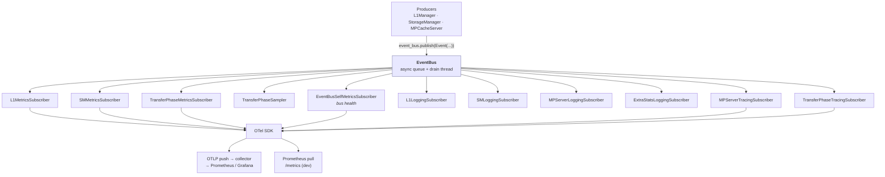

# Observability: the event bus, metrics, tracing and logs

> Code references in this document are permalinks pinned to upstream `dev`
> @ [`53bde913`](https://github.com/LMCache/LMCache/tree/53bde913de1adae2a380fe0c2de8d2b9355b4702).

LMCache degrades rather than fails
([architecture §2.7](../02-architecture.md#27-failure-domains)), which makes observability
unusually load-bearing: a broken tier looks exactly like a smaller cache. This document
covers the event bus, the four subscriber families, metrics export, tracing, and what to
actually watch.

---

## Contents

1. [One producer path, many consumers](#1-one-producer-path-many-consumers)
2. [The event bus](#2-the-event-bus)
3. [Keeping the hot path cheap](#3-keeping-the-hot-path-cheap)
4. [Event types](#4-event-types)
5. [Subscribers](#5-subscribers)
6. [Metrics export](#6-metrics-export)
7. [Tracing](#7-tracing)
8. [Trace recording — a different thing](#8-trace-recording--a-different-thing)
9. [The GC monitor, and why it is not a subscriber](#9-the-gc-monitor-and-why-it-is-not-a-subscriber)
10. [What to watch](#10-what-to-watch)
11. [Adding an event](#11-adding-an-event)
12. [Where to look next](#12-where-to-look-next)

---

## 1. One producer path, many consumers

The architecture, from
[`lmcache/v1/mp_observability/README.md`](https://github.com/LMCache/LMCache/blob/53bde913de1adae2a380fe0c2de8d2b9355b4702/lmcache/v1/mp_observability/README.md):



The key property: **producers publish one event; subscribers decide what it becomes.** A
store does not know whether it will be counted, logged, traced or ignored. So you can turn
metrics off without touching the code that produces the data, and adding a new view of
existing behaviour requires no changes to the hot path.

This is what the decoupling buys in practice — the four families (metrics, logging, tracing,
sampling) are independently switchable, and the hot path has one branch (§3) rather than one
per consumer.

---

## 2. The event bus

[`event_bus.py`](https://github.com/LMCache/LMCache/blob/53bde913de1adae2a380fe0c2de8d2b9355b4702/lmcache/v1/mp_observability/event_bus.py)
— *"EventBus: unified pub/sub dispatcher for MP observability events"*. An async queue plus a
drain thread, which matters for two reasons:

- **`publish()` does not do the work.** It enqueues. Counter updates, log formatting and span
  creation happen on the drain thread, off the request path.
- **The queue is bounded, and overflow is a tail-drop.** `--event-bus-queue-size` defaults to
  **10 000**; beyond that, events are dropped.

Tail-dropping is the right call — blocking a store to record a metric would be absurd — but
it has a consequence you must know: **under heavy load, metrics undercount.** Drops are
themselves counted (§5), so you can tell. A cache whose throughput counters look suspiciously
low during a burst should be checked against the drop counter before anyone concludes the
cache slowed down.

---

## 3. Keeping the hot path cheap

The bus exposes a guard specifically so producers can skip building an event nobody wants:

```python
    def has_subscribers(self, event_type: EventType) -> bool:
        """Return True if at least one callback is registered for *event_type*.

        Use this to skip expensive event construction on the hot path when
        no subscriber is listening::

            if bus.has_subscribers(EventType.MP_LOOKUP):
                bus.publish(Event(event_type=EventType.MP_LOOKUP, ...))
        """
```

Used exactly as documented in the lookup path
([`lookup.py#L272`](https://github.com/LMCache/LMCache/blob/53bde913de1adae2a380fe0c2de8d2b9355b4702/lmcache/v1/multiprocess/modules/lookup.py#L272)):

```python
        # Guard with has_subscribers() to avoid allocating the metadata dict
        # (including dtype/shape list comprehensions) when no subscriber is
        # listening (e.g. lookup hash logger is disabled).
        if self._ctx.event_bus.has_subscribers(EventType.MP_LOOKUP):
            self._ctx.event_bus.publish(
                Event(
                    event_type=EventType.MP_LOOKUP,
                    ...
                    "dtypes": [str(d) for d in layout_desc.dtypes],
                    "shapes": [list(s) for s in layout_desc.shapes],
                    "token_ids": unpack_token_ids(key.token_bytes),
```

Look at what that payload would cost unguarded: two list comprehensions over every layer,
plus **unpacking every token id of the prompt** — for a 100k-token prompt, a 100 000-element
Python list, allocated on every lookup, to be thrown away. The guard turns a per-request
allocation storm into one dict lookup.

**This is the pattern to copy when adding events.** Cheap events can publish unconditionally;
any event whose payload involves a comprehension, a copy or an unpack should be guarded.

---

## 4. Event types

[`EventType`](https://github.com/LMCache/LMCache/blob/53bde913de1adae2a380fe0c2de8d2b9355b4702/lmcache/v1/mp_observability/event.py#L15)
— *"All observable event types in the MP system"* — uses dotted string values (`"l1.read.reserved"`),
grouped by producer:

| Group | Examples |
|---|---|
| **L1 lifecycle** | `l1.read.reserved`, `l1.read.finished`, `l1.write.reserved`, `l1.write.finished`, `l1.write_finished_and_read_reserved` |
| **L1 capacity** | `l1.keys.evicted`, `l1.keys.accessed`, `l1.eviction.loop_tick` |
| **L1 failures** | `l1.allocation.failed`, `l1.read.failed` |
| **Storage manager** | `sm.read.prefetched_finished`, `sm.write.reserved`, `sm.write.finished`, `sm.capacity.changed` |
| **L2 stores** | `l2.store.submitted`, `l2.store.completed` |
| **L2 prefetch** | `l2.prefetch.lookup.submitted`, `l2.prefetch.load.submitted`, `l2.prefetch.load.completed`, `l2.prefetch.failed` |
| **L2 keys** | `l2.keys.stored`, `l2.keys.accessed`, `l2.keys.deleted`, `l2.keys.evicted` |
| **MP requests** | `mp.request.start`, `mp.store.start/end`, `mp.retrieve.start/end`, `mp.lookup_prefetch.start/end`, `mp.lookup`, `mp.tokens`, `mp.transfer.phase_samples` |

Three things to notice:

**Reserved/finished pairs everywhere.** `l1.read.reserved` → `l1.read.finished` mirrors the
two-phase protocol of [lifecycle §8](02-kv-cache-lifecycle.md#8-the-reservefinish-protocol).
Because both ends are observable, a **leaked reservation is directly measurable**: reserved
minus finished, over time, is the count of locks waiting on their TTL. That is the metric to
watch for the failure mode described in
[L1 §4](03-l1-memory-and-eviction.md#4-locks-ttllock-read-counts-write-reservations).

**Failures are first-class event types**, not just log lines — `l1.allocation.failed`,
`l1.read.failed`, `l2.prefetch.failed`. So they can be counted and alerted on rather than
grepped for.

**`l2.store.submitted` and `l2.store.completed` are separate.** Submitted-minus-completed is
the real health signal for a tier, and it is exactly what would have caught
[#5022](../issue-deep-dives/difficult-5022-turboquant-sm80-bfloat16.md): every serialize task
failed, so stores were submitted and never completed, for 49 days. The data to detect it was
being produced the whole time; nobody was differencing the two counters.

---

## 5. Subscribers

| Subscriber | Produces |
|---|---|
`L1MetricsSubscriber` | OTel counters for L1 activity |
`SMMetricsSubscriber` | OTel counters for storage-manager activity |
`TransferPhaseMetricsSubscriber` | DMA staging throughput per step |
`TransferPhaseSampler` | on `MP_*_END`, pops finished GPU phase timings → `MP_TRANSFER_PHASE_SAMPLES` |
`EventBusSelfMetricsSubscriber` | **bus health**: queue depth, drain lag, drops, subscriber exceptions |
`L1LoggingSubscriber`, `SMLoggingSubscriber`, `MPServerLoggingSubscriber` | `logger.debug(...)` |
`ExtraStatsLoggingSubscriber` | opt-in periodic per-GPU L0↔L1 stats at INFO |
`MPServerTracingSubscriber` | OTel spans from START/END pairs |
`TransferPhaseTracingSubscriber` | per-phase child spans under `mp.store` / `mp.retrieve` |

**`EventBusSelfMetricsSubscriber` deserves attention.** The observability system measures
itself: queue depth, drain lag, drops, and *subscriber exceptions*. Without it, a saturated
bus would silently flatten every other metric — and you would be debugging the cache when the
problem is the telemetry. Check bus health before trusting anything else on a dashboard.

Note also `TransferPhaseSampler`: a subscriber that **publishes** an event
(`MP_TRANSFER_PHASE_SAMPLES`). GPU phase timings are not available until the transfer ends,
so it waits for `MP_*_END`, collects the completed timings and re-publishes them for the
metrics and tracing subscribers to consume. Events can be derived from events.

---

## 6. Metrics export

Two modes, selected by whether `--otlp-endpoint` is set:

| `otlp_endpoint` | Mode | How to query |
|---|---|---|
| `http://host:4317` | OTLP push | query the collector's Prometheus exporter |
| `None` | Prometheus pull fallback | `curl http://localhost:<prometheus-port>/metrics` |

`--prometheus-port` defaults to **9090**.

The flags that matter:

| Flag | Default | Effect |
|---|---|---|
| `--disable-observability` | off | kills the EventBus entirely — no events published or consumed |
| `--disable-metrics` | off | no metrics subscribers |
| `--disable-logging` | off | no logging subscribers |
| `--enable-tracing` | off | spans; **requires `--otlp-endpoint`** |
| `--event-bus-queue-size N` | 10000 | tail-drop threshold |
| `--disable-grpc-metrics` | off | drop gRPC runtime metrics, keep LMCache's |
| `--enable-extra-logging` | off | periodic per-GPU throughput at INFO; **conflicts with `--disable-observability`** |
| `--extra-logging-interval` | 10.0 s | below 1.0 s is limited by a 1 Hz internal heartbeat |

### 6.1 The gotcha that wastes an afternoon

Straight from the README:

> **Note:** OTel counters only appear on `/metrics` after the first increment. If you see
> only Python runtime metrics, trigger a store/retrieve first.

An empty-looking `/metrics` on a freshly started server is **normal**. Send one request
before concluding anything is broken.

`service_instance_id` is worth knowing about in a fleet: it becomes the OTel resource
attribute `service.instance.id` on every metric and span, and `run_cache_server` projects
the server's `--instance-id` onto it. It has no CLI flag of its own; standalone callers that
leave it unset get a random UUID v4 per start, which makes series discontinuous across
restarts.

---

## 7. Tracing

Opt-in, and deliberately strict:

> Trace export requires an OTLP endpoint — there is no local fallback. `--enable-tracing`
> **requires** `--otlp-endpoint`; the server will raise a `ValueError` at startup if the
> endpoint is missing.

Failing at startup rather than silently discarding spans is the right behaviour, and a
pleasant contrast with the quiet-degradation pattern elsewhere in the system.

`MPServerTracingSubscriber` builds spans from START/END pairs, and
`TransferPhaseTracingSubscriber` nests per-phase children under `mp.store` / `mp.retrieve`.
That nesting is the useful part when diagnosing latency: a slow retrieve resolves into
*which phase* was slow — queueing, L2 read, DMA staging, or the GPU copy — rather than one
opaque duration. See `docs/source/mp/observability/traces.rst` and
[`docs/design/observability/request-event-span.md`](https://github.com/LMCache/LMCache/blob/53bde913de1adae2a380fe0c2de8d2b9355b4702/docs/design/observability/request-event-span.md).

---

## 8. Trace recording — a different thing

Confusingly, "trace" means two things in this codebase. §7 is OTel distributed tracing. The
other is
[`mp_observability/trace/`](https://github.com/LMCache/LMCache/tree/53bde913de1adae2a380fe0c2de8d2b9355b4702/lmcache/v1/mp_observability/trace)
(`recorder.py`, `reader.py`, `codecs.py`, `format.py`, `lifecycle.py`, `decorator.py`) — a
**recording** subsystem behind `lmcache trace`, which captures storage-manager calls to a
file for later in-process replay.

That is a profiling tool, not telemetry: you can replay a recorded trace and profile the
storage path with no model and no GPU. It is also the subsystem whose percentile reporting
was wrong in [#4416](../issue-deep-dives/medium-4416-percentile-off-by-one.md). See
[CLI](10-cli.md) for the commands and
[`docs/design/v1/mp_observability/trace.md`](https://github.com/LMCache/LMCache/blob/53bde913de1adae2a380fe0c2de8d2b9355b4702/docs/design/v1/mp_observability/trace.md).

---

## 9. The GC monitor, and why it is not a subscriber

`--enable-gc-monitor` times every CPython garbage collection and logs the slow ones. The
design note is the interesting part:

> `gc_monitor` … Not an EventBus subscriber: the hook runs inside the collector and logs
> directly, so GC timing is never coupled to the bus's queue depth or drain lag.

This is careful thinking. A long GC pause is *itself* a cause of drain lag and queue
build-up — so routing GC timings through the bus would mean the instrument stops working
precisely when the thing it measures happens. Keeping it out of the bus makes it a reliable
witness.

Two knobs, with honest warnings:

- `--gc-monitor-min-pause-ms` (default 1.0) — `0` logs every collection, *"including the
  very frequent sub-millisecond gen-0 sweeps"*.
- `--gc-monitor-top-objects N` (default 0) — appends the N most common object types, but
  *"walks the whole generation on **every** collection (O(heap)) — debugging only."*

Reach for the GC monitor when latency is spiky and the transfer phases all look fine.

---

## 10. What to watch

### 10.1 First: is the telemetry healthy?

Check `EventBusSelfMetricsSubscriber`'s output — **queue depth, drain lag, drops, subscriber
exceptions** — before trusting any other number. Nonzero drops mean every throughput counter
is an undercount (§2).

### 10.2 Then: is each tier actually working?

| Question | Signal |
|---|---|
| Is L2 receiving data? | `l2.store.submitted` vs `l2.store.completed` — a growing gap means a dead tier (the #5022 signature) |
| Is L2 serving data? | `l2.prefetch.load.completed`, `l2.prefetch.failed` |
| Is L1 under pressure? | `l1.keys.evicted` rate, `l1.eviction.loop_tick`, `l1.allocation.failed` |
| Are locks leaking? | `l1.read.reserved` − `l1.read.finished` over time |
| Is the cache useful? | `mp.lookup_prefetch.end`'s hit vs `requested_tokens` |

### 10.3 Caveats on the hit-rate metric

Two, both already noted elsewhere and both worth repeating:

- The denominator is **chunk-aligned**: `requested_tokens = len(chunk_hashes) * chunk_size`
  excludes the trailing partial chunk. It measures what the cache could possibly have served,
  not prompt coverage.
- It is **derived from the same expression as the behaviour**. A bug in hash-range
  computation moves the metric and the behaviour together, which is how
  [#5151](../issue-deep-dives/difficult-5151-mamba-full-hit-restoration.md) reported a
  perfect hit while restoring a wrong boundary. A metric derived from the code it measures
  cannot detect a bug in that code — hit rate was never going to catch that bug, and no
  amount of dashboards would have.

### 10.4 Gauges can read zero for the wrong reason

L1 usage gauges are observable callbacks written to never raise during scrape:
`_l1_usage_ratio_or_zero` returns `0.0` when the target is gone *"so the observable-gauge
callback never raises during scrape"*. So a zero can mean "no manager" rather than "empty
pool". Cross-check with `lmcache describe` before drawing a conclusion.

---

## 11. Adding an event

The README documents the full procedure; the shape is:

1. **Define the type** — add a member to `EventType` in `event.py`, with a dotted name
   matching the existing `producer.noun.verb` convention.
2. **Publish it** — from the producer, guarded with `has_subscribers()` if the payload is
   expensive (§3).
3. **Subscribe** — add handling in the relevant metrics/logging/tracing subscriber.
4. **Document the payload** — event metadata contracts live in
   [`EVENTS.md`](https://github.com/LMCache/LMCache/blob/53bde913de1adae2a380fe0c2de8d2b9355b4702/docs/design/v1/mp_observability/EVENTS.md);
   metrics in
   [`METRICS.md`](https://github.com/LMCache/LMCache/blob/53bde913de1adae2a380fe0c2de8d2b9355b4702/docs/design/v1/mp_observability/METRICS.md).

Step 4 is not optional in practice: the payload is an untyped `metadata` dict, so the doc is
the only contract between producer and subscriber.

---

## 12. Where to look next

- [MP architecture](01-mp-architecture.md) — the producers, and server status reporting.
- [KV cache lifecycle](02-kv-cache-lifecycle.md) — the operations these events describe.
- [L1 memory and eviction](03-l1-memory-and-eviction.md) — the gauges and eviction events.
- [CLI](10-cli.md) — `describe`, `query` and `trace` as interactive alternatives to metrics.
- Upstream: [`lmcache/v1/mp_observability/README.md`](https://github.com/LMCache/LMCache/blob/53bde913de1adae2a380fe0c2de8d2b9355b4702/lmcache/v1/mp_observability/README.md), [`METRICS.md`](https://github.com/LMCache/LMCache/blob/53bde913de1adae2a380fe0c2de8d2b9355b4702/docs/design/v1/mp_observability/METRICS.md), [`EVENTS.md`](https://github.com/LMCache/LMCache/blob/53bde913de1adae2a380fe0c2de8d2b9355b4702/docs/design/v1/mp_observability/EVENTS.md), [`event-bus.md`](https://github.com/LMCache/LMCache/blob/53bde913de1adae2a380fe0c2de8d2b9355b4702/docs/design/v1/mp_observability/event-bus.md), [`trace.md`](https://github.com/LMCache/LMCache/blob/53bde913de1adae2a380fe0c2de8d2b9355b4702/docs/design/v1/mp_observability/trace.md).
