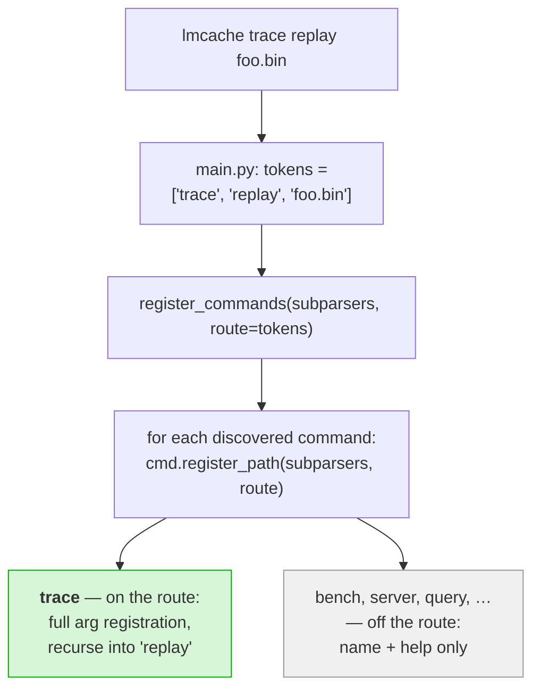

# CLI: the `lmcache` command

> Code references in this document are permalinks pinned to upstream `dev`
> @ [`53bde913`](https://github.com/LMCache/LMCache/tree/53bde913de1adae2a380fe0c2de8d2b9355b4702).

`lmcache` is both how you *run* LMCache (`server`, `coordinator`, `memory`) and how you
*inspect* it (`describe`, `ping`, `query`, `trace`, `bench`). At ~102 files it is one of the
largest areas of the package. This document covers the command framework — which is worth
reading on its own merits — and what each command group is for.

---

## Contents

1. [The command surface](#1-the-command-surface)
2. [The framework: auto-discovery](#2-the-framework-auto-discovery)
3. [Directed registration](#3-directed-registration)
4. [The `BaseCommand` contract](#4-the-basecommand-contract)
5. [Daemons: `server`, `coordinator`, `memory`](#5-daemons-server-coordinator-memory)
6. [`ping` and `describe`](#6-ping-and-describe)
7. [`query`](#7-query)
8. [`trace`](#8-trace)
9. [`bench`](#9-bench)
10. [`quota`, `kvcache`, `tool`](#10-quota-kvcache-tool)
11. [Adding a command](#11-adding-a-command)
12. [Where to look next](#12-where-to-look-next)

---

## 1. The command surface

| Command | Help text (verbatim) |
|---|---|
| `server` | Launch the LMCache request server and HTTP API. |
| `coordinator` | Launch the LMCache mp coordinator (HTTP). |
| `memory` | Launch the memory orchestrator: the allocation and readiness authority for one shared memory region. |
| `ping` | Ping LMCache or vLLM server (liveness check). |
| `describe` | Show detailed status of a running LMCache service. |
| `query` | Run one inference request and report metrics. |
| `bench` | Run sustained performance benchmarks. |
| `trace` | Inspect and replay LMCache trace files. |
| `quota` | Manage per-salt cache quotas. |
| `kvcache` | Manage KV cache state. |
| `tool` | Run offline analysis tools. |
| `mock` | Run a mock command (example/test). |

Three daemons, two health commands, two measurement commands, three management commands,
and one deliberate example. `mock` exists as the reference implementation for §11.

---

## 2. The framework: auto-discovery

Commands are **discovered, not registered**. From
[`cli/commands/__init__.py`](https://github.com/LMCache/LMCache/blob/53bde913de1adae2a380fe0c2de8d2b9355b4702/lmcache/cli/commands/__init__.py):

> To add a new top-level command, simply create a new module (or sub-package with an
> `__init__.py`) under this package that defines a concrete `BaseCommand` subclass. It will
> be discovered and registered automatically — **no edits to this file are required.**

```python
    return [
        cls()
        for cls in discover_subclasses(
            __name__,
            BaseCommand,  # type: ignore[type-abstract]
            module_filter=lambda name: name != "base",
            on_import_error=_raise,
        )
    ]
```

No central list means no merge conflicts on a registry file and no way to add a command and
forget to wire it up.

**The error policy is the interesting choice:**

```python
    Import errors are intentionally re-raised: a broken CLI command
    module should fail loudly rather than silently disappear from the
    CLI.
```

```python
    def _raise(module_name: str, exc: Exception) -> None:
        raise exc
```

The tempting alternative — skip modules that fail to import — would make a broken command
*vanish*, so `lmcache mycommand` reports "unknown command" rather than the real
`ImportError`. Debugging that is miserable. Failing loudly is right, and it is a nice
contrast with the quiet-degradation pattern used in the
[vLLM integration](05-vllm-integration.md#6-staying-decoupled-from-vllm) — different
contexts, different correct answers.

---

## 3. Directed registration

A CLI with a `bench` subtree this large has a startup-cost problem: building every
subcommand's `ArgumentParser` on every invocation means importing every command's
dependencies to run `lmcache ping`.

The solution:

```python
def register_commands(
    subparsers: argparse._SubParsersAction,
    route: Sequence[str] = (),
) -> None:
    """Directed registration: *route* names the one fully-registered path;
    every other command binds a name/help summary.

    Args:
        subparsers: The root parser's subparsers action.
        route: Invocation tokens after the program name; ambient
            ``sys.argv`` is not read.
    """
```

**Only the invoked path is fully registered.** Everything else contributes just a name and a
help string — enough for `lmcache -h` to list it, not enough to cost anything.



Two details worth copying:

- **`route` is a parameter, not `sys.argv`.** *"ambient `sys.argv` is not read"* — so the
  whole dispatcher is testable by passing a token list, with no global state.
- **It composes recursively.** `CompositeCommand` lets `trace replay` and `bench
  engine_bench` register only the branch being invoked.

This is also why the `server` command can degrade gracefully when CUDA extensions are
missing — its docstring says it *"silently skips argument registration when server
dependencies (e.g. CUDA extensions) are not installed; `execute` will then print an
actionable error."* A user without the extensions still gets a working `lmcache -h` and a
clear message when they try to start a server, rather than an import traceback. The
semantics and limitations are documented in section 1 of
[`docs/design/cli/framework-and-metrics.md`](https://github.com/LMCache/LMCache/blob/53bde913de1adae2a380fe0c2de8d2b9355b4702/docs/design/cli/framework-and-metrics.md).

---

## 4. The `BaseCommand` contract

Four abstract methods
([`base.py#L106`](https://github.com/LMCache/LMCache/blob/53bde913de1adae2a380fe0c2de8d2b9355b4702/lmcache/cli/commands/base.py#L106)):

```python
    @abc.abstractmethod
    def name(self) -> str:
        """Return the subcommand name (e.g. ``"mock"``)."""

    @abc.abstractmethod
    def help(self) -> str:
        """Return short help text shown by ``lmcache -h``."""

    @abc.abstractmethod
    def add_arguments(self, parser: argparse.ArgumentParser) -> None:
        """Add command-specific arguments to *parser*."""

    @abc.abstractmethod
    def execute(self, args: argparse.Namespace) -> None:
        """Execute the subcommand."""
```

Plus shared argparse validators that remove a whole class of bad error messages:

```python
def positive_int(value: str) -> int:
    count = int(value)
    if count <= 0:
        raise argparse.ArgumentTypeError("must be a positive integer")
    return count
```

and `nonnegative_int`. Using `type=positive_int` gets you argparse's standard "invalid value"
formatting at parse time, rather than a `ZeroDivisionError` 200 lines into `execute`.

`BaseCommand` also imports the shared `Metrics` / `FileHandler` / `StreamHandler` machinery
from `lmcache.v1.common.metrics`, which is how `describe`, `query` and `bench` all produce
consistently formatted output and can write to a file or a stream.

---

## 5. Daemons: `server`, `coordinator`, `memory`

| Command | What it starts |
|---|---|
| `lmcache server` | the **MP server** — owns L1, the L2 adapters, the request transport ([MP architecture](01-mp-architecture.md)) |
| `lmcache coordinator` | the **coordinator** — membership, L2 pins, per-salt quotas; *never sees KV data* ([P2P](08-p2p-sharing.md)) |
| `lmcache memory` | the **memory orchestrator** — *"the allocation and readiness authority for one shared memory region"* ([L1 §8](03-l1-memory-and-eviction.md#8-capacity-quotas-and-the-memory-orchestrator)) |

`server`'s argument surface is assembled rather than written:

> Composes argument groups from the multiprocess, storage manager, HTTP frontend, Prometheus,
> and telemetry config modules.

So each subsystem owns its own flags, and `--chunk-size`, `--max-local-cpu-size`,
`--transport`, the observability flags of
[Observability §6](09-observability.md#6-metrics-export) and the L2 adapter specs all arrive
from their respective config modules. Adding a config option to a subsystem exposes it on the
CLI without touching `server.py`.

The phrase "and readiness authority" in `memory`'s help is worth noting: the orchestrator does
not only allocate, it also gates *readiness* — processes wait on it before using the shared
region, which is what prevents two servers from racing to size themselves against the same
host RAM.

---

## 6. `ping` and `describe`

**`lmcache ping`** — *"Ping LMCache or vLLM server (liveness check)."* The first command to
run when anything is wrong. It exercises the control path end to end with no engine and no
model, which immediately splits "the server is unreachable" from "the server is fine and the
cache is not working". Design doc:
[`ping.md`](https://github.com/LMCache/LMCache/blob/53bde913de1adae2a380fe0c2de8d2b9355b4702/docs/design/cli/commands/ping.md).

**`lmcache describe`** — *"Show detailed status of a running LMCache service."* The
human-readable counterpart to the metrics pipeline: L1 usage and staging bytes, per-adapter L2
usage and health, pool occupancy, transport status, active prefetch jobs. It is built from the
same `report_status()` dicts the modules and adapters expose — which is exactly why a units
bug in one adapter's `report_status` surfaced as `-6 / 2 (-300%)` on this command's output in
[#4698](../issue-deep-dives/medium-4698-nixl-pool-slot-units.md).

Use `describe` to answer the questions metrics are bad at:

- Is this L2 tier configured and receiving bytes? (A configured tier stuck at zero is the
  [#5022](../issue-deep-dives/difficult-5022-turboquant-sm80-bfloat16.md) signature.)
- Is L1 staging high and not draining?
- Is a gauge reading zero because the pool is empty, or because the manager is gone
  ([Observability §10.4](09-observability.md#104-gauges-can-read-zero-for-the-wrong-reason))?

Design doc:
[`describe.md`](https://github.com/LMCache/LMCache/blob/53bde913de1adae2a380fe0c2de8d2b9355b4702/docs/design/cli/commands/describe.md).

---

## 7. `query`

*"Run one inference request and report metrics."* Sub-commands in
[`commands/query/`](https://github.com/LMCache/LMCache/tree/53bde913de1adae2a380fe0c2de8d2b9355b4702/lmcache/cli/commands/query):
`engine_command.py`, `kvcache_command.py`, `coordinator_command.py`.

The gap it fills: `ping` proves liveness, `bench` measures sustained throughput, and between
them sits "send **one** request and tell me exactly what happened to it" — TTFT, how many
tokens hit, which tier served them. That is the right granularity for verifying a
configuration change or confirming a cache is actually being used. Design docs:
[`query-command.md`](https://github.com/LMCache/LMCache/blob/53bde913de1adae2a380fe0c2de8d2b9355b4702/docs/design/cli/commands/query-command.md),
[`kvcache-command.md`](https://github.com/LMCache/LMCache/blob/53bde913de1adae2a380fe0c2de8d2b9355b4702/docs/design/cli/commands/kvcache-command.md).

---

## 8. `trace`

*"Inspect and replay LMCache trace files."*
[`commands/trace/`](https://github.com/LMCache/LMCache/tree/53bde913de1adae2a380fe0c2de8d2b9355b4702/lmcache/cli/commands/trace):
`info_command.py`, `replay_command.py`, `replay_events_command.py`, `_driver.py`,
`_stats.py`, `_dispatch.py`.

Paired with the recording subsystem in `v1/mp_observability/trace/`
([Observability §8](09-observability.md#8-trace-recording--a-different-thing)): record
storage-manager calls to a file, then **replay them in-process**.

**This is the most useful tool in the CLI for storage work**, because it removes the model
entirely. No GPU, no weights, no engine — just the storage path, replayed deterministically,
with per-operation latency statistics. You can profile an L2 adapter or compare eviction
policies against a real production access pattern, repeatably.

`_stats.py` holds `ReplayStatsCollector`, which buckets latencies by qualname and reports
`count`, `mean_ms`, `p50_ms`, `p90_ms`, `p99_ms`, `min_ms`, `max_ms` — to terminal output,
CSV and JSON. Its percentile function was the subject of
[#4416](../issue-deep-dives/medium-4416-percentile-off-by-one.md), where a 1-based rank used
as a 0-based index made p90 and p99 report the maximum at exactly the sample counts you are
most likely to hit. **If you are reading percentiles out of a trace replay, check your
version against that fix.**

Design doc:
[`trace.md`](https://github.com/LMCache/LMCache/blob/53bde913de1adae2a380fe0c2de8d2b9355b4702/docs/design/v1/mp_observability/trace.md).

---

## 9. `bench`

*"Run sustained performance benchmarks."* Five sub-benchmarks in
[`commands/bench/`](https://github.com/LMCache/LMCache/tree/53bde913de1adae2a380fe0c2de8d2b9355b4702/lmcache/cli/commands/bench),
each measuring a different layer:

| Sub-bench | Measures |
|---|---|
| `engine_bench` | end-to-end through a real serving engine (TTFT, decode throughput, hit rate) |
| `l2_adapter_bench` | one L2 adapter in isolation |
| `server_bench` | the MP server's request path |
| `quality_bench` | output *quality*, not speed |
| `trace_analyze` | analysis over recorded traces |

`quality_bench` is the one people forget exists, and it is the right tool for the problem
flagged in [Serde §9](07-serde-and-compression.md#9-operating-it): quantization losses are
invisible in every cache metric. Its design doc is
[`bench-quality.md`](https://github.com/LMCache/LMCache/blob/53bde913de1adae2a380fe0c2de8d2b9355b4702/docs/design/cli/commands/bench/quality_bench/bench-quality.md);
`engine_bench` has
[`bench-engine.md`](https://github.com/LMCache/LMCache/blob/53bde913de1adae2a380fe0c2de8d2b9355b4702/docs/design/cli/commands/bench/engine_bench/bench-engine.md).

`engine_bench` ships purpose-built workloads, including `kv_tier_pressure`, whose module
docstring explains the knob that makes tier benchmarking meaningful:

> `pool_size` is the knob that decides whether the storage tier is reached at all: the
> distinct working set is `pool_size x context_length` tokens

That is the trap in benchmarking a cache hierarchy: if your working set fits in L1, you are
measuring L1 no matter what you configured. The workload decouples request size from working-
set size so you can deliberately push past L1 and actually exercise L2.

> **This guide ran no benchmarks.** No throughput, latency or hit-rate numbers here are
> LMCache's or mine — the commands are described, not executed.

---

## 10. `quota`, `kvcache`, `tool`

**`quota`** — *"Manage per-salt cache quotas."* `get`, `set`, `list`, `delete`. Per-`cache_salt`
byte caps, the operator-facing half of the multi-tenant story whose other half is
`IsolatedLRU` ([L1 §7.1](03-l1-memory-and-eviction.md#71-policies)). Quotas are fleet-wide
state held by the coordinator, so they persist across server restarts.

**`kvcache`** — *"Manage KV cache state."* Inspection and lifecycle operations on cache
entries, including pins. Note the interaction with vLLM: `POST /reset_prefix_cache` without
`reset_external=true` clears only vLLM's own cache and leaves LMCache's intact — which is the
basis of the correctness-verification procedure in
[vLLM §10.1](05-vllm-integration.md#101-verifying-a-hybrid-deployment-honestly).

**`tool`** — *"Run offline analysis tools."*

- `cache_simulator` — simulate cache behaviour over an access pattern without running
  anything. The cheapest way to ask "what hit rate would 2× the L1 give me?"
- `flamegraph.py` — profiling output
- `transfer_channel_benchmark.py` — the transfer channel in isolation
  ([design doc](https://github.com/LMCache/LMCache/blob/53bde913de1adae2a380fe0c2de8d2b9355b4702/docs/design/tools/transfer_channel_benchmark/README.md))

---

## 11. Adding a command

1. Create `lmcache/cli/commands/mycommand.py` (or a sub-package with `__init__.py`).
2. Subclass `BaseCommand` and implement `name`, `help`, `add_arguments`, `execute`.
3. Use `positive_int` / `nonnegative_int` from `base.py` for numeric arguments.
4. For sub-commands, use `CompositeCommand` so §3's directed registration works down the
   tree.
5. Nothing else. Discovery handles registration.

Read [`mock.py`](https://github.com/LMCache/LMCache/blob/53bde913de1adae2a380fe0c2de8d2b9355b4702/lmcache/cli/commands/mock.py)
first — it exists to be that example. Then
[`framework-and-metrics.md`](https://github.com/LMCache/LMCache/blob/53bde913de1adae2a380fe0c2de8d2b9355b4702/docs/design/cli/framework-and-metrics.md)
for the metrics-output conventions and the limits of directed registration.

One caution: because import errors are re-raised (§2), **a module-level import of an optional
dependency breaks the entire CLI**, not just your command. Import heavy or optional
dependencies inside `execute`, the way `server` defers its CUDA-extension requirements.

---

## 12. Where to look next

- [Observability](09-observability.md) — metrics and the trace-recording subsystem `trace` consumes.
- [MP architecture](01-mp-architecture.md) — what `lmcache server` starts.
- [L2 adapters and storage](04-l2-adapters-and-storage.md) — the adapter specs `server` takes and `describe` reports on.
- [#4416](../issue-deep-dives/medium-4416-percentile-off-by-one.md) — the trace-replay percentile bug, in `_stats.py`.
- [#4698](../issue-deep-dives/medium-4698-nixl-pool-slot-units.md) — how a bad `report_status` surfaced in `describe`.
- Upstream: [`docs/design/cli/`](https://github.com/LMCache/LMCache/tree/53bde913de1adae2a380fe0c2de8d2b9355b4702/docs/design/cli) — `framework-and-metrics.md`, `commands.md`, and one doc per command group.
