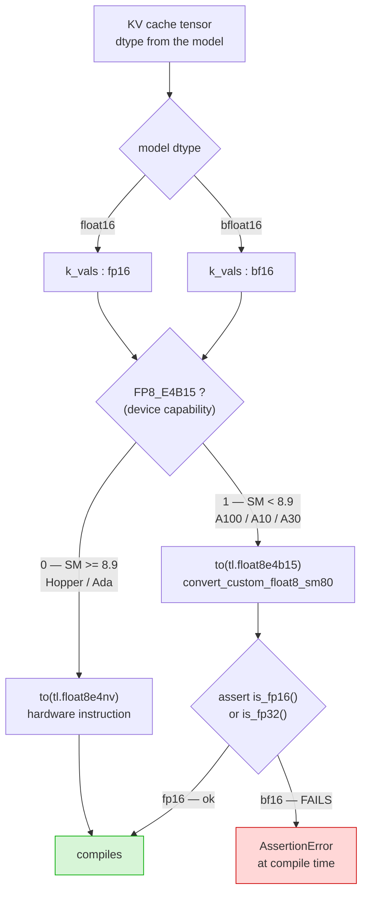
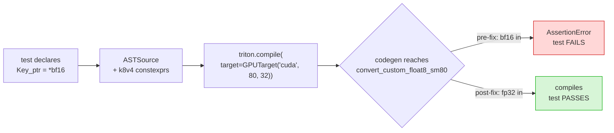

# Difficult · #5022 — a Triton FP8 kernel that could not compile on A100, for every bfloat16 model

| | |
|---|---|
| **Issue** | [LMCache/LMCache#5022](https://github.com/LMCache/LMCache/issues/5022) — *"[BUG][TURBOQUANT] FP9 key store kernel fails on A100 (SM80) with bfloat16 models — Triton assertion error in `convert_custom_float8`"* |
| **Label** | `good second issue` |
| **Reported** | 2026-09-08 by [`@AdarshPradhanJMT`](https://github.com/AdarshPradhanJMT) |
| **Fixing PR** | [#5994](https://github.com/LMCache/LMCache/pull/5994) by [`@mohan-zeyu`](https://github.com/mohan-zeyu) |
| **Fix commit** | [`f5feba80`](https://github.com/LMCache/LMCache/commit/f5feba8054e82ce56d531661379ab1d7d87b316f) (merged 2026-10-27, 49 days after the report) |
| **Diff size** | 2 files, +64 / −0 — of which the production change is **+3 / −0** |

> **Verification status.** Nothing here was executed. This needs CUDA and a Triton
> install; the environment used for this guide has neither `torch` nor `triton`, so the
> compilation failure was not reproduced and the fix was not compiled. Everything below
> is read from the issue's traceback, the merged diff and the surrounding source.
> Claims about Triton's internals are sourced to the traceback in the issue, which names
> the exact file, line and assertion. Where I am reasoning rather than reading, it says so.
>
> *(The issue title says "FP9"; it is a typo for FP8, carried through the whole thread.)*

---

## 1. TL;DR

- **Symptom.** With the `turboquant_k8v4` preset on an A100, every serialize task failed with a Triton `CompilationError` ending in a bare `AssertionError`. No compressed data ever reached L2. The server kept serving from L1, so throughput looked fine and nothing user-visible broke.
- **Root cause.** Triton's Ampere FP8 conversion helper (`convert_custom_float8_sm80`) asserts that its input is **fp16 or fp32**. The kernel fed it values loaded straight from a **bfloat16** KV cache. bfloat16 is neither, so the assert fired — at *compile* time, for the whole kernel.
- **Scope.** Not a corner case: *every* bfloat16 model on *every* GPU with SM < 8.9 — A100, A10, A30, L4-era parts. In 2026 that is most of the installed base, and bfloat16 is the default dtype for most open-weight models.
- **Fix.** Three lines: on the Ampere path only, upcast bfloat16 to fp32 before the FP8 cast. Triton's own helper then does the narrowing it is designed for.
- **The interesting part.** The regression test compiles the kernel for `GPUTarget("cuda", 80, 32)` — an **explicit, synthetic A100 target** — so CI reproduces an A100-only bug on whatever GPU it happens to have, or on none.

---

## 2. The symptom

The report is unusually complete: it names the file and line, pastes the full traceback,
scopes the blast radius, and identifies which presets are unaffected. The failure:

```
triton.compiler.errors.CompilationError: at 45:12:
    k_fp8 = k_vals.to(tl.float8e4b15) if FP8_E4B15 else k_vals.to(tl.float8e4nv)
            ^
AssertionError
```

and the bottom of the Triton-side stack, which is where the whole diagnosis lives:

```
  File ".../triton/language/extra/cuda/utils.py", line 104, in convert_custom_float8_sm80
    return convert_custom_float8(arg, dst_ty, fp_downcast_rounding, has_minx2=True, ...)
  File ".../triton/language/extra/cuda/utils.py", line 94, in convert_custom_float8
    assert arg.type.scalar.is_fp16() or arg.type.scalar.is_fp32()
           ^^^^^^^^^^^^^^^^^^^^^^^^^^^^^^^^^^^^^^^^^^^^^^^^^^^^^^
AssertionError
```

An assertion with no message, three libraries down. The LMCache-side frames:

```
  File ".../lmcache/v1/distributed/serde/async_processor.py", line 194, in _run_task
    n = self._serializer.serialize(src, dst, key)
  File ".../lmcache/v1/distributed/serde/turboquant/turboquant.py", line 675, in serialize
    triton_turboquant_store(...)
```

### 2.1 Why this was easy to miss in production

The reporter's own framing:

> This means the `turboquant_k8v4` preset (FP8 keys + 4-bit values) **silently fails** for
> all bfloat16 models on all GPUs with **SM < 8.9** (A100, A10, A30, etc.). Every serialize
> task is rejected by the `AsyncSerdeProcessor`, and no compressed data reaches the L2 disk
> adapter. The LMCache server continues serving requests using L1 cache only, masking the
> failure.

"Silently" is doing a lot of work, and it is worth being precise, because the error *is*
logged. Here is the swallowing site, in
[`async_processor.py`](https://github.com/LMCache/LMCache/blob/53bde913de1adae2a380fe0c2de8d2b9355b4702/lmcache/v1/distributed/serde/async_processor.py#L200):

```python
        except Exception:
            logger.exception(
                "Serde task %d (%s) failed",
                task_id,
                task_type.name,
            )
            success = False
```

That is textbook-correct error handling by this repo's own standards — a narrow-ish
`except` with `logger.exception` inside it, exactly as `AGENTS.md` demands. The failure is
visible at ERROR level with a full traceback. What makes it *effectively* silent is the
system's design: a failed serialize means a chunk does not get written to L2, and a cache
that cannot write to L2 is not broken, just smaller. L1 absorbs the entire working set,
hit rates stay high, latency stays good. You lose the durability and capacity you
configured TurboQuant to buy, and the only evidence is one log line per task.

This is the characteristic failure mode of an **optional-tier** architecture: degradation
is indistinguishable from configuration. A system that fell back to "no compression" and
kept writing to L2 would have been noisier and better.

### 2.2 The scoping the reporter did

> The MSE-based presets (`turboquant_4bit_nc`, `turboquant_k3v4_nc`, `turboquant_3bit_nc`)
> are **unaffected** — they do not use FP8 types in their Triton kernels.

Confirmed from
[`TQ_PRESETS`](https://github.com/LMCache/LMCache/blob/53bde913de1adae2a380fe0c2de8d2b9355b4702/lmcache/v1/distributed/serde/turboquant/turboquant.py#L35):
`turboquant_k8v4` has `key_quant_bits: 8`; the other three have 4, 3 and 3. And the FP8
path is gated on exactly that, at
[`turboquant.py#L104`](https://github.com/LMCache/LMCache/blob/53bde913de1adae2a380fe0c2de8d2b9355b4702/lmcache/v1/distributed/serde/turboquant/turboquant.py#L104):

```python
    return self.key_quant_bits == 8
```

So one preset of four, and it happens to be the **default** —
[`preset: str = "turboquant_k8v4"`](https://github.com/LMCache/LMCache/blob/53bde913de1adae2a380fe0c2de8d2b9355b4702/lmcache/v1/distributed/serde/turboquant/turboquant.py#L77).

---

## 3. Background you need

### 3.1 What TurboQuant is doing

TurboQuant is a serde: a compressor sitting between L1 (host memory) and an L2 tier. The
`k8v4` preset stores **keys as 8-bit floats** and **values as 4-bit uniform-quantized**
integers. Keys get float treatment because attention logits are sensitive to key precision;
values tolerate cruder quantization. The conversion happens inside a fused Triton kernel,
[`_tq_fused_store_fp8`](https://github.com/LMCache/LMCache/blob/53bde913de1adae2a380fe0c2de8d2b9355b4702/lmcache/v1/distributed/serde/turboquant/store_kernel.py#L155),
whose docstring is simply *"FP8 key cast+scatter + value uniform quantization."*

### 3.2 Two different FP8 types, and why there are two

CUDA's native 8-bit float (`e4m3`, Triton's `tl.float8e4nv`) has hardware conversion
instructions only from **SM 8.9** (Ada/Hopper). On Ampere, Triton offers
`tl.float8e4b15` — a different exponent bias, emulated in software. LMCache picks between
them at runtime in
[`_use_fp8_e4b15`](https://github.com/LMCache/LMCache/blob/53bde913de1adae2a380fe0c2de8d2b9355b4702/lmcache/v1/distributed/serde/turboquant/decode_kernel.py#L23):

```python
def _use_fp8_e4b15(device: int = 0) -> int:
    """Return 1 if tuple capability is < (8, 9), else 0.

    Triton supports ``float8e4nv`` on CUDA SM89+ (Hopper and newer). For
    older CUDA architectures we use ``float8e4b15`` as a compatibility
    fallback.
    """
```

The result is cached per device and passed into the kernel as the `FP8_E4B15`
`tl.constexpr`, so each variant specialises at compile time:

```python
    FP8_E4B15: tl.constexpr = 0,  # 1 = e4b15 (Ampere/Ada), 0 = e4nv (Hopper+)
```

**This hardware fork is the bug's habitat.** Two code paths, selected by a property of the
machine, where CI runs one and production runs the other.

### 3.3 The actual incompatibility

Triton implements the Ampere `e4b15` conversion in software, via
`convert_custom_float8_sm80`, and that helper only accepts fp16 or fp32 input — hence
line 94's assert. Meanwhile the KV cache dtype comes from the *model*, and for most
open-weight models in 2026 that is **bfloat16**.

bfloat16 and fp16 are both 16 bits and are *not* interchangeable: bf16 spends 8 bits on
the exponent and 7 on the mantissa, fp16 spends 5 and 10. A conversion routine written
against fp16's bit layout cannot be pointed at bf16 bits. So Triton asserts rather than
silently producing garbage — the right call, poorly reported.



The matrix is small enough to enumerate, and shows how narrow the broken cell is — and how
heavily populated:

| | SM < 8.9 (A100, A10, A30) | SM ≥ 8.9 (L40S, H100) |
|---|---|---|
| **float16 model** | works (`e4b15`, fp16 input) | works (`e4nv`) |
| **bfloat16 model** | **broken** | works (`e4nv`) |

### 3.4 Why only the write path

The read path does the same conversion in the other direction and is fine —
[`decode_kernel.py#L97`](https://github.com/LMCache/LMCache/blob/53bde913de1adae2a380fe0c2de8d2b9355b4702/lmcache/v1/distributed/serde/turboquant/decode_kernel.py#L97):

```python
        if FP8_E4B15:
            k_recon = k_raw.to(tl.float8e4b15, bitcast=True).to(tl.float32)
```

Note `bitcast=True`: this *reinterprets* stored bytes as fp8 and then widens to fp32. It
never asks Triton to *narrow* anything into fp8, so `convert_custom_float8_sm80` is never
called and the assert is never reached. Narrowing is the constrained direction; widening is
not. A symmetric-looking pair of kernels, one broken.

---

## 4. Root cause

At the fix commit's parent, the key handling was three statements with nothing between the
load and the cast:

```python
    d_offs = tl.arange(0, BLOCK_D)
    d_mask = d_offs < D
    k_vals = tl.load(Key_ptr + base + d_offs, mask=d_mask, other=0.0)
    k_fp8 = k_vals.to(tl.float8e4b15) if FP8_E4B15 else k_vals.to(tl.float8e4nv)
```

`k_vals` inherits its dtype from `Key_ptr`, i.e. from the model's KV cache. On the
`FP8_E4B15` branch with a bf16 pointer, `.to(tl.float8e4b15)` routes into
`convert_custom_float8_sm80` and trips the assert.

The defect is a **missing dtype precondition on a platform-specific branch**. The author of
the `e4b15` fallback correctly handled the thing that varies by *hardware* and did not
notice that the helper they fell back to also constrains the *input dtype*. Those two axes —
device capability and tensor dtype — are independent, and the code only forked on one.

What makes it survive review is that the broken line reads as symmetric and total: a
ternary covering both hardware cases, apparently exhaustive. The dtype axis is invisible
at the call site, because `k_vals`'s dtype comes from a pointer argument that is resolved
at JIT specialisation time. You cannot see the bug by reading the expression; you have to
know what is inside Triton's Ampere helper.

---

## 5. The fix

[`f5feba80`](https://github.com/LMCache/LMCache/commit/f5feba8054e82ce56d531661379ab1d7d87b316f)
adds three lines to
[`store_kernel.py#L193`](https://github.com/LMCache/LMCache/blob/53bde913de1adae2a380fe0c2de8d2b9355b4702/lmcache/v1/distributed/serde/turboquant/store_kernel.py#L193):

```python
    k_vals = tl.load(Key_ptr + base + d_offs, mask=d_mask, other=0.0)
+   if FP8_E4B15 and k_vals.dtype == tl.bfloat16:
+       # Ampere's FP8 conversion requires FP16 or FP32 input.
+       k_vals = k_vals.to(tl.float32)
    k_fp8 = k_vals.to(tl.float8e4b15) if FP8_E4B15 else k_vals.to(tl.float8e4nv)
```

Four things make this the right three lines:

1. **fp32, not fp16.** The assert accepts either, and fp16 would be the cheaper widening.
   fp32 is correct anyway: bf16 → fp16 is *lossy and overflowing* — bf16's exponent range
   is far wider than fp16's, so large magnitudes would become `inf` before ever reaching
   FP8. bf16 → fp32 is **exact and total**; every bf16 value is representable in fp32. The
   only precision-losing step stays the one that is supposed to lose precision.
2. **Both conditions are `constexpr`.** `FP8_E4B15` is a `tl.constexpr` and
   `k_vals.dtype` is known at JIT specialisation, so Triton folds the branch away. The
   Hopper path and the fp16 path compile to byte-identical code. No runtime cost.
3. **The comment states the constraint, not the change.** *"Ampere's FP8 conversion
   requires FP16 or FP32 input"* explains the invariant a future reader would otherwise
   have to rediscover inside Triton. This is what `AGENTS.md` means by "comments explain
   why, never narrate the change."
4. **It is scoped to the broken cell.** Guarded on `FP8_E4B15 and ... bfloat16`, so the
   three working cells in §3.3's matrix are untouched.

### 5.1 The test is the clever part

61 of the PR's 64 added lines are one test —
[`test_bf16_k8v4_store_compiles_on_ampere`](https://github.com/LMCache/LMCache/blob/53bde913de1adae2a380fe0c2de8d2b9355b4702/tests/v1/distributed/serde/test_turboquant.py).
It never launches the kernel. It builds an `ASTSource` with bf16 key/value pointers and
compiles for a hard-coded Ampere target:

```python
    pointer_types = {
        "Key_ptr": "*bf16",
        "Value_ptr": "*bf16",
        "KV_cache_ptr": "*u8",
        "Slot_mapping_ptr": "*i32",
    }
    ...
    # Compile for A100 regardless of which GPU is installed.
    triton.compile(
        source,
        target=GPUTarget("cuda", 80, 32),
        options={"num_warps": 4, "num_stages": 1},
    )
```

`GPUTarget("cuda", 80, 32)` *is* the A100 — SM 8.0, 32 warps — asserted independently of
the hardware present. This works because the bug is a **compile-time** failure: the assert
fires in Triton's codegen, so compiling for the target is a complete reproduction. No A100
needed, no GPU needed beyond what Triton requires to codegen.



It also degrades honestly, via two `pytest.importorskip` calls:

```python
    triton = pytest.importorskip("triton")
    pytest.importorskip("triton.backends.nvidia.compiler")
```

No Triton, no test — skipped, not silently passed. (In the environment used for this guide
neither is installed, so this test would skip here; that is why §0 says the fix was not
compiled.)

The trade-off: it is coupled to Triton's private-ish compilation API (`ASTSource`,
`GPUTarget`, the `signature`/`constexprs` shape), which moves between Triton releases. A
Triton upgrade can break this test in a way that has nothing to do with LMCache. For a bug
class that is otherwise *completely untestable in CI*, that is a good trade — but it should
be a conscious one.

---

## 6. Why the fix is correct

- **It satisfies the documented precondition** rather than working around the symptom. The
  assert wants fp16 or fp32; the fix supplies fp32. Nothing is suppressed or bypassed.
- **The added conversion is lossless.** bf16 → fp32 is exact (fp32's exponent range covers
  bf16's and its mantissa is strictly wider), so output bytes for a bf16 model on Ampere are
  whatever the `e4b15` path would always have produced. Numerics are unchanged, not
  "changed acceptably".
- **It cannot regress the working configurations.** Both guard conditions are compile-time
  constants; Hopper (`FP8_E4B15 == 0`) and fp16-on-Ampere keep their exact previous codegen.
- **It is tested at the right layer.** The failure was in codegen, and the test asserts
  codegen succeeds for the specific target. Testing the numerics instead would have required
  the hardware and would not have caught this.

**What it does not do**, and is worth knowing:

- It only fixes `bfloat16`. Any other non-fp16/fp32 key dtype arriving at this kernel —
  fp8 KV caches, say — would hit the same assert. The guard is an allow-list of one.
  Mirroring the helper's own condition (`if FP8_E4B15 and k_vals.dtype not in (tl.float16,
  tl.float32)`) would have been total rather than enumerative. This is a judgement call,
  and the narrow version is defensible under the repo's "no handling for failures that
  cannot occur" rule — but the set of KV dtypes is growing.
- It does nothing about §2.1, the masking. A serde that fails every single task still
  presents as a healthy server with a smaller cache. The 49-day gap between report and fix
  is partly a story about that: nobody was being paged.

---

## 7. The lessons

**A hardware fork doubles your test matrix, and CI only covers one column.** The `e4b15`
fallback exists precisely because the project supports GPUs its CI does not run on. Any
branch keyed on `get_device_capability()` is a branch that production exercises and CI
does not, and it should be treated as untested until something like §5.1's synthetic-target
trick exists. The dtype axis made it a 2×2 and the broken cell was the most common
hardware/dtype combination in the fleet.

**Compile-time bugs are cheap to test — if you notice they are compile-time.** The instinct
with a GPU-specific failure is "we cannot test this without the GPU". Half true: you cannot
test *numerics*, but you can test *compilation*, and this entire bug lived in compilation.
Asking "at what stage does this fail?" turned an untestable hardware bug into a 61-line unit
test that runs anywhere Triton installs.

**Correct error handling can still produce an invisible failure.** The `except` block does
everything right by the book and the outcome is still a silent capacity loss, because in a
tiered cache a dead tier is indistinguishable from an unconfigured one. Handling an error
well is not the same as surfacing it: "every serialize task has failed since startup" is a
*health* signal, and no amount of per-task `logger.exception` adds up to one.

**Widening and narrowing are not symmetric.** The decode path (§3.4) does the same dtype
juggling in the opposite direction and is immune, because widening is unconstrained. When
auditing a conversion, the direction that *loses* information is the one with the
preconditions.

---

## 8. Where to look next

- [Serde and compression](../features/07-serde-and-compression.md) — the serde interface, `AsyncSerdeProcessor`, and where TurboQuant and CacheGen plug in.
- [L2 adapters and storage tiers](../features/04-l2-adapters-and-storage.md) — the tier that never received the compressed data, and `L2AdapterInterface`.
- Upstream: [`docs/design/v1/distributed/serde/turboquant.md`](https://github.com/LMCache/LMCache/blob/53bde913de1adae2a380fe0c2de8d2b9355b4702/docs/design/v1/distributed/serde/turboquant.md) for the preset design, and [`docs/design/v1/distributed/serde/README.md`](https://github.com/LMCache/LMCache/blob/53bde913de1adae2a380fe0c2de8d2b9355b4702/docs/design/v1/distributed/serde/README.md) for the serde contract.
