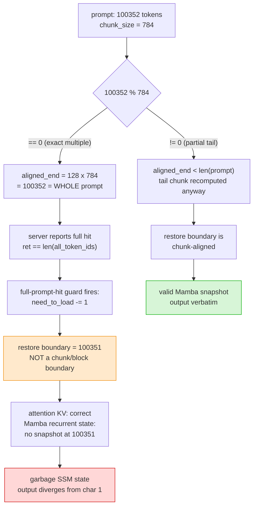
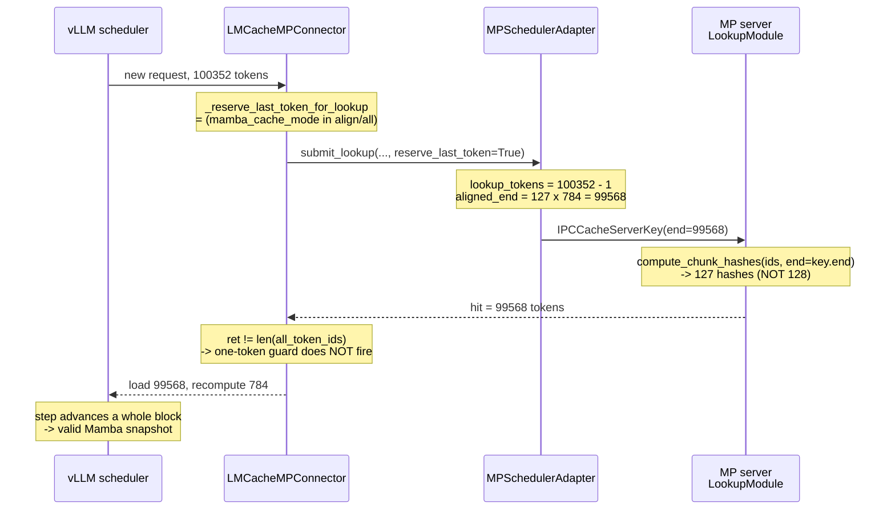

# Difficult · #5151 — a "full hit" that restored the wrong context for Mamba models

| | |
|---|---|
| **Issue** | [LMCache/LMCache#5151](https://github.com/LMCache/LMCache/issues/5151) — *"[Bug] MP server: lookup reports full hit but restored KV context is wrong for long prefixes (breaks between 114 and 128 chunks)"* |
| **Label** | `bug` |
| **Reported** | 2026-09-17 by [`@kezboard233`](https://github.com/kezboard233) |
| **Fixing PR** | [#5249](https://github.com/LMCache/LMCache/pull/5249) by [`@chunxiaozheng`](https://github.com/chunxiaozheng) |
| **Fix commit** | [`1a4b40b1`](https://github.com/LMCache/LMCache/commit/1a4b40b1d79b0e76244f127f96ee0982f8bd270f) (merged 2026-09-20, 3 days after the report) |
| **Diff size** | 7 files, +91 / −3 — of which the production change is **+13 / −3** across three files |

> **Verification status.** No LMCache code was executed for this document, and the
> failure was not reproduced: it needs a TP4 A100-class box, a 27B hybrid GDN model and
> a ~100k-token prompt. What *was* done is a standalone re-derivation of the two index
> expressions in the diff — a `python3` script that reimplements them and replays the
> reporter's six bisection points. That script predicts which runs break *and the exact
> off-by-one hit-counter values the reporter observed*, which is strong evidence that the
> model below is right. It is still a re-derivation of formulas, not a run of the project,
> and it is labelled as such wherever it appears. Claims about **vLLM's** internal Mamba
> snapshot behaviour are sourced to LMCache's own code comments, not to vLLM's source.

---

## 1. TL;DR

- **Symptom.** A prompt stored and then looked up again reported a *100% external hit*, loaded fast (TTFT 0.74 s vs 60.3 s cold) — and produced a continuation unrelated to the same engine's cold output (agreement: **1 character out of 2045**).
- **Root cause.** Nothing was corrupted. When the prompt length is an **exact multiple of the chunk size**, the chunk-aligned lookup covers *every* token. The connector then has to leave the scheduler something to do, so a pre-existing guard shaved exactly **one token** off the load. That put the restore boundary *mid-chunk* — and for a Mamba/hybrid model, vLLM only snapshots the recurrent (SSM) state at **block boundaries**. The attention KV came back correct; the recurrent state did not exist at that offset. The model resumed from a garbage SSM state.
- **Fix.** Reserve the last token *before* chunk-aligning the lookup (`reserve_last_token`), so the restore boundary is always a chunk boundary and a whole chunk is left to recompute. Plus the companion change that makes it bite: the server must honour `key.end` when hashing chunks, or it re-covers the full prompt and cancels the reservation.
- **The interesting part.** The reporter's headline — *"breaks between 114 and 128 chunks"* — was **wrong**, and they said so themselves three days later. It is not a length threshold at all. Every one of their "healthy" runs had a partial tail chunk; both "broken" runs were exact chunk multiples. A 1-chunk prompt (784 tokens) would have broken too.

---

## 2. The symptom

The report is a model of its kind, so it is worth quoting. The setup:

> - LMCache: frozen build `v0.5.6.dev7 (ge5078730)`, MP server (`lmcache server --chunk-size 784 --separate-object-groups`) + `LMCacheMPConnector` on vLLM engines (KV connector V1).
> - vLLM: v1.5.0-based build, TP4.
> - Model: Qwen3.8-27B-FP8, hybrid GDN + full attention, 784-token hybrid KV chunk (64 layers).
> - Realm: L1 40 GiB host memory + `fs_native` L2 (write-through).

Critically, the reporter eliminated every external explanation up front:

> The failure is same-instance and same-process: engine computes prompt P cold (stores
> it), waits until stores fully settle, resets the engine-local prefix cache, then
> recomputes P — the second pass reports a full external hit and finishes fast
> (TTFT 0.74 s vs 60.3 s cold), but the output diverges from char ~1. This rules out
> cross-instance numerics, producer identity, and client-side effects.

That is the hard part of the diagnosis already done. One process, one model instance, one
set of weights, greedy decoding with a fixed seed. The *only* difference between the good
run and the bad run is that the second one was served from LMCache.

### The bracket, and the trap inside it

Over four follow-up comments the reporter bisected, and this table is what sent everyone
(including the reporter) down the wrong path:

| prompt tokens | chunks | result |
|---|---|---|
| 32 768 | 41 | verbatim (agree 1540/1540) |
| 65 536 | 83 | verbatim |
| 90 112 | 114 | verbatim (agree 2522/2522) |
| 92 416 | 117 | verbatim (agree 2060/2060) |
| 94 864 | 121 | **broken, soft** — agree 1463/1962 (74.6%) |
| 100 352 | 128 | **broken, hard** — agree 1/2045 |

Read as a threshold, this says "something breaks above ~117 chunks, and gets worse as it
grows". That reading is wrong, but it is an extremely natural one, and it generated two
plausible and incorrect hypotheses (§3.3).

The second signal in the table turned out to be the actual key, and it was recorded but
not emphasised:

> The off-by-one in the external-hit counter appears only in broken runs (89376 exact at
> 114 chunks vs 94863/100351 at 121/128).

An off-by-**one**. In a system whose unit of work is a 784-token chunk, a one-token
discrepancy is not a corruption signature — it is an *arithmetic* signature. Hold on to
94863 and 100351; §4.3 derives both from the source.

---

## 3. Background you need

### 3.1 Chunk-aligned lookup

LMCache keys KV by **chunk**: a fixed number of tokens (here 784) hashed into a rolling
prefix hash, so chunk *i*'s key depends on chunks 0..*i*. A lookup therefore addresses a
token range `[start, end)` whose bounds are chunk multiples; a partial trailing chunk
cannot hit, because its hash is not determined until it is full. (`save_unfull_chunk`
relaxes this; it is off by default and off in this repro.)

The scheduler-side submission lives in
[`LMCacheMPSchedulerAdapter.submit_lookup`](https://github.com/LMCache/LMCache/blob/53bde913de1adae2a380fe0c2de8d2b9355b4702/lmcache/integration/vllm/vllm_multi_process_adapter.py#L811).
Before the fix it floored the prompt length to a chunk multiple and used that as the key's
exclusive `end`:

```python
aligned_end = (
    len(token_ids) // self.lmcache_tokens_per_chunk
) * self.lmcache_tokens_per_chunk
```

For a 100 352-token prompt and a 784-token chunk, `100352 // 784 == 128` exactly, so
`aligned_end == 100352` — **the entire prompt**, with nothing left over.

### 3.2 Why a full hit is a special case even for pure-attention models

vLLM's scheduler asserts that every scheduled request makes progress. If LMCache says "I
have all 100 352 of your tokens", then `num_computed_tokens == request.num_tokens`,
`num_new_tokens` is 0, and the scheduler trips `assert num_new_tokens > 0`. LMCache has
guarded against this for a long time, in
[`lmcache_mp_connector.py#L1555`](https://github.com/LMCache/LMCache/blob/53bde913de1adae2a380fe0c2de8d2b9355b4702/lmcache/integration/vllm/lmcache_mp_connector.py#L1555):

```python
# In full-prompt-hit case, we need to recompute the last token.
# Without this, num_computed_tokens would equal request.num_tokens,
# causing num_new_tokens to be 0 and triggering the
# `assert num_new_tokens > 0` in the scheduler.
if ret == len(request.all_token_ids):
    if self._prefix_replay_tokens > 0:
        ...
    else:
        need_to_load = max(0, need_to_load - 1)
```

**This guard is the proximate cause of the bug.** It is correct for pure attention — drop
one token from the load, recompute that token, done, and the KV for a single token is
self-contained. For a recurrent layer it is not.

### 3.3 Mamba / hybrid models, and why "one token" is not a free choice

A hybrid model such as Qwen3.8-27B interleaves full-attention layers with **Mamba (SSM)
layers**. An attention layer's cache is per-token and random-access: restore tokens
0..*n* and you can attend over them. A Mamba layer carries a **recurrent state** — a
fixed-size summary of everything seen so far. You cannot reconstruct the state at position
*n* from a slice of per-token data; you either have a snapshot of it at *n*, or you replay
the sequence to get there.

vLLM therefore snapshots the recurrent state only at certain points. LMCache's own
docstring for
[`validate_mamba_step_alignment`](https://github.com/LMCache/LMCache/blob/53bde913de1adae2a380fe0c2de8d2b9355b4702/lmcache/integration/vllm/lmcache_mp_connector.py#L425)
states the rule:

> In `mamba_cache_mode="align"` vLLM snapshots the recurrent state only at the end of each
> scheduler step, on the last block the step advanced.

So reusable recurrent state exists **at block boundaries and nowhere else**. That is also
why LMCache refuses to cache Mamba groups in any other mode — from
[`hybrid_models.rst`](https://github.com/LMCache/LMCache/blob/53bde913de1adae2a380fe0c2de8d2b9355b4702/docs/source/mp/hybrid_models.rst#L267):

> **Mamba groups in** `none` **mode** (`mamba_cache_mode` other than `"align"` or
> `"all"`): they keep no reusable per-block state snapshots.

Now put §3.2 next to §3.3. The full-prompt-hit guard restores a boundary of
`len(prompt) - 1`. If `len(prompt)` is a chunk multiple, that boundary is one token *below*
a block boundary — precisely where no recurrent snapshot exists.

### 3.4 The two wrong hypotheses

Worth recording, because both were reasonable and both cost time.

**Hypothesis 1 — a regression from in-flight PR #5150** (packed uint32 token ids), which
touched `modules/lookup.py`, `token_hasher.py`, `token_codec.py`, `key_resolver.py`. The
reporter checked this properly: their frozen build predated #5150, *and* they back-applied
#5150's Python changes and re-ran. Still broken. Eliminated by experiment.

**Hypothesis 2 — an async store-pipeline overrun.** The reporter's own working theory:

> Working hypothesis: above ~120 chunks the async d2h store pipeline overruns — later
> chunks reuse/overwrite pinned staging buffers before earlier async writes complete, so
> the tail of a long prefix is stored with interleaved/garbage content while bookkeeping
> still records every chunk as stored.

This is a *good* hypothesis. It explains progressive corruption, intact counters, normal
transfer volume, and a clean-looking store — and it is wrong. It was generated by taking
the chunk-count bracket at face value: if the trouble starts "above ~120 chunks", a
pipeline-depth or buffer-reuse effect is exactly what you would reach for. The bracket was
an artifact, so the hypothesis built on it had nowhere to go.

What broke the deadlock was not more bisection. It was
[`@chunxiaozheng`](https://github.com/chunxiaozheng) recognising the shape of the thing
from architectural knowledge — *"I have a general understanding of the cause of this issue,
and I can come and fix it"* — and, notably, never reproducing it locally:

> I haven't reproduced the divergence locally yet, so your validation would help confirm
> whether this is the cause of this issue.

A fix proposed without a local repro, validated on the reporter's hardware. That division
of labour is the only reason this closed in three days.

---

## 4. Root cause

### 4.1 The mechanism, end to end



In prose: exact divisibility → full coverage → the one-token shave → a mid-block restore
boundary → a recurrent state that was never snapshotted there. A partial tail chunk short-
circuits the whole chain at the first branch, which is why 5 of the reporter's 6 data points
looked perfect.

### 4.2 Why the corruption looked "progressive"

It did not, really. Both exact-multiple runs were broken; one happened to diverge at 74.6%
and the other at character 1. A wrong initial recurrent state is wrong — how long the text
stays coincidentally plausible before visibly derailing is a property of the prompt and the
sampling, not a dial on the severity of the bug. Reading "soft" vs "hard" as a gradient
implied an accumulating mechanism (buffers, depth, pressure) and reinforced hypothesis 2.

### 4.3 The derivation that identifies the real trigger

Reimplementing just the two expressions — `aligned_end` from `submit_lookup`, and the
`-1` from the full-prompt-hit guard — and replaying the reporter's six points:

```
chunk_size = 784

  prompt  chunks  n%chunk  end(before)  restored  aligned? | observed
-------------------------------------------------------------------------------------
   32768      41      624        32144     32144      True | verbatim (hit counter 32144)
   65536      83      464        65072     65072      True | verbatim
   90112     114      736        89376     89376      True | verbatim (agree 2522/2522)
   92416     117      688        91728     91728      True | verbatim (agree 2060/2060)
   94864     121        0        94864     94863     False | BROKEN, soft (agree 74.6%)
  100352     128        0       100352    100351     False | BROKEN, hard (agree 1/2045)
```

*(My own re-computation of the formulas, not a run of LMCache.)*

Three things fall out, and the third is the clincher:

1. **`aligned?` predicts the outcome with no exceptions.** The two rows where the restore
   boundary is not chunk-aligned are exactly the two broken rows.
2. **The trigger is `n % 784 == 0`**, not `n`. 94 864 = 784 × 121 and 100 352 = 784 × 128
   are exact; the four healthy lengths all carry a partial tail (624, 464, 736, 688 tokens).
3. **The model reproduces the reporter's off-by-one counters.** It predicts restored
   boundaries of **94863** and **100351** — the two anomalous hit-counter values from the
   issue thread, to the token. A model that merely explained *which* runs broke would be
   suggestive; one that regenerates the observed telemetry is doing real work.

Extending the scan past the reporter's points: of the 128 prompt lengths that are exact
multiples of 784, **all 128** produce a non-aligned restore boundary pre-fix, starting at
784 tokens — a single chunk. There was never a threshold. The reporter had simply not
tested a short exact multiple, and said as much: *"We have not tested shorter
exact-multiple inputs."*

### 4.4 The reporter's own correction

Three days in, they re-examined their records and retracted the framing:

> Also correcting two errors in this thread's bisection data: the healthy 114-chunk run had
> **90112 input tokens** (89376 was the external-hit count, not the input length), and 94864
> is **121** chunks (not 120). The healthy points all carried a partial tail chunk while both
> broken points were exact chunk multiples, so the "(117, 121] chunks" threshold framing
> should be read as an **exact-multiple-full-hit boundary effect rather than a length
> threshold**.

Note the first correction's mechanism: they had recorded 89 376 — an *output* of the
pipeline, the external-hit count — in the column for prompt length. That one transcription
slip is what created the illusion of a threshold between 114 and 117 chunks, because it made
a healthy exact-looking number sit next to broken ones. The bracket was never real.

---

## 5. The fix

[`1a4b40b1`](https://github.com/LMCache/LMCache/commit/1a4b40b1d79b0e76244f127f96ee0982f8bd270f),
+91/−3 over 7 files — but only **13 added lines** are production code, spread over three
files that have to agree with each other.

### 5.1 Decide whether to reserve (connector)

[`lmcache_mp_connector.py#L667`](https://github.com/LMCache/LMCache/blob/53bde913de1adae2a380fe0c2de8d2b9355b4702/lmcache/integration/vllm/lmcache_mp_connector.py#L667):

```python
mamba_cache_mode = getattr(vllm_config.cache_config, "mamba_cache_mode", "none")
self._reserve_last_token_for_lookup = mamba_cache_mode in ("align", "all")
```

Read once at construction, from vLLM's config. `getattr` with a default keeps it working
against vLLM builds that have no such field. Pure-attention deployments get `"none"` and
are completely unaffected — the pre-existing one-token shave is still correct for them, and
the fix deliberately does not touch it.

### 5.2 Apply it before aligning (scheduler adapter)

[`vllm_multi_process_adapter.py#L850`](https://github.com/LMCache/LMCache/blob/53bde913de1adae2a380fe0c2de8d2b9355b4702/lmcache/integration/vllm/vllm_multi_process_adapter.py#L850):

```python
lookup_tokens = max(0, len(token_ids) - int(reserve_last_token))
aligned_end = (
    lookup_tokens // self.lmcache_tokens_per_chunk
) * self.lmcache_tokens_per_chunk
```

The ordering is the entire fix. Subtracting **before** the floor means an exact multiple
drops a whole chunk rather than a single token:

| prompt | pre-fix `end` | post-fix `end` | left to recompute |
|---|---|---|---|
| 100 352 (128 × 784) | 100 352 → restore 100 351 | **99 568** (127 × 784) | 784 tokens |
| 94 864 (121 × 784) | 94 864 → restore 94 863 | **94 080** (120 × 784) | 784 tokens |
| 90 112 (114 × 784 + 736) | 89 376 | 89 376 — *unchanged* | 736 tokens |

Reserving one token costs a whole chunk of recompute, but only on prompts that are exact
multiples, and only for hybrid models. `max(0, ...)` keeps a 0-token prompt from going
negative.

### 5.3 Make the server honour it (lookup module)

[`modules/lookup.py`](https://github.com/LMCache/LMCache/blob/53bde913de1adae2a380fe0c2de8d2b9355b4702/lmcache/v1/multiprocess/modules/lookup.py#L251):

```python
-chunk_hashes = self._ctx.token_hasher.compute_chunk_hashes(list(key.token_ids))
+chunk_hashes = self._ctx.token_hasher.compute_chunk_hashes(
+    list(key.token_ids), end=key.end
+)
```

**Without this line the other two do nothing.** The key carries both the full `token_ids`
and the range `[start, end)`, and
[`compute_chunk_hashes`](https://github.com/LMCache/LMCache/blob/53bde913de1adae2a380fe0c2de8d2b9355b4702/lmcache/v1/common/token_hasher.py#L279)
defaults `end=None`, meaning *hash every complete chunk in the list*:

```python
effective_len = min(len(token_ids), end) if end is not None else len(token_ids)
num_complete = effective_len - effective_len % self.chunk_size
```

So the server was ignoring the reservation and hashing all 128 chunks anyway:

```
  prompt  100352: hashes ignoring end = 128, honoring end=99568 = 127   <-- reservation defeated
  prompt   94864: hashes ignoring end = 121, honoring end=94080 = 120   <-- reservation defeated
```

That also re-inflates `requested_tokens`, which
[`lookup.py#L267`](https://github.com/LMCache/LMCache/blob/53bde913de1adae2a380fe0c2de8d2b9355b4702/lmcache/v1/multiprocess/modules/lookup.py#L267)
derives as `len(chunk_hashes) * chunk_size` and uses as the denominator of the reported
hit rate — so the metric would have gone on claiming a full hit.



### 5.4 The tests

+66 lines across four test files, and the interesting thing is that **none of them test a
Mamba model**. There is no A100, no 27B hybrid checkpoint and no 100k prompt in CI. They
assert the *plumbing* instead: that `reserve_last_token` is threaded through, and that
`submit_lookup` computes the `end` the caller asked for. The behavioural claim — that a
chunk-aligned boundary has a valid recurrent snapshot — is left to vLLM, which is the right
call, but it does mean a regression in the *decision* (`mamba_cache_mode in (...)`) is
better covered than a regression in the *consequence*.

---

## 6. Why the fix is correct

- **It restores an invariant rather than patching a symptom.** The invariant: *a restore
  boundary handed to vLLM is always on the chunk grid*. Pre-fix, exactly one code path —
  the full-prompt-hit shave — could violate it. Post-fix, no path can, because the
  reservation is applied upstream of the alignment.
- **It is correct for every prompt length, not just the reported ones.** The scan in §4.3
  shows 0 of 128 exact multiples produce a non-aligned boundary post-fix; non-multiples are
  bit-identical to before (same `end`, same behaviour).
- **It is scoped by capability, not by symptom.** The behaviour changes only when
  `mamba_cache_mode in ("align", "all")` — i.e. only for models that actually have
  recurrent state with boundary-only snapshots. A pure-attention deployment sees no
  change at all.
- **The three changes are mutually necessary.** §5.1 decides, §5.2 applies, §5.3 makes the
  server obey. Drop §5.3 and the server re-covers the full prompt; drop §5.2 and nothing is
  reserved. This is why a 13-line fix spans three files, and why reviewing any one hunk in
  isolation would look pointless.

**What it does not do:** it leaves the one-token shave in place for the non-Mamba path, so
`restored == len(prompt) - 1` is still reachable there. That is fine today precisely because
attention KV is per-token. Any future layer type with boundary-only state would hit the same
wall, and the `_prefix_replay_tokens` branch right next to it (which already floors to a
chunk for sliding-window replay) shows the codebase has met this shape of problem before.

---

## 7. The lessons

**A bracket is not a cause.** Five of six data points were consistent with "breaks above 117
chunks" *and* with "breaks on exact multiples". Both broken points happened to be the two
largest, which made the wrong reading the obvious one. The tell was sitting in the same
table — an off-by-**one** token counter, a number far too small to come from buffer reuse or
pipeline depth. When a bisection and a magnitude point one way but a tiny arithmetic
anomaly points another, the anomaly is usually the honest witness.

**Watch for outputs recorded as inputs.** The single most expensive error in the thread was
writing 89 376 (an external-hit count) into the prompt-length column. It manufactured a
threshold that did not exist and sustained two hypotheses for three days. The reporter found
it themselves, by re-reading their own records rather than collecting more.

**Separating "can reproduce" from "can diagnose" is a strategy.** The maintainer never
reproduced it and did not need to: the symptom shape identified the mechanism, and the
reporter had the hardware to confirm. Spelling that out explicitly — *"I haven't reproduced
the divergence locally yet, so your validation would help"* — is what made the three-day
turnaround possible.

**Special-case guards are where invariants go to die.** The `need_to_load - 1` shave is
eight lines of defensive code guarding a vLLM assertion, written for pure attention, correct
in that world for years. It became a correctness bug the moment a model type arrived whose
state is only valid on block boundaries — and nothing in the guard's vicinity mentions
alignment, because when it was written there was no alignment requirement to mention.

---

## 8. Where to look next

- [vLLM integration](../features/05-vllm-integration.md) — the connector, the scheduler hooks and KV cache groups, including how hybrid models are validated and rejected.
- [KV cache lifecycle](../features/02-kv-cache-lifecycle.md) — chunking, rolling prefix hashes and the `lookup` → `retrieve` path this bug lives on.
- [Multiprocess architecture](../features/01-mp-architecture.md) — the MP server and the `LookupModule` that §5.3 changes.
- Upstream: [`docs/source/mp/hybrid_models.rst`](https://github.com/LMCache/LMCache/blob/53bde913de1adae2a380fe0c2de8d2b9355b4702/docs/source/mp/hybrid_models.rst) for the supported hybrid configurations, and [`docs/design/integration/vllm/hybrid-kv-cache-groups.md`](https://github.com/LMCache/LMCache/blob/53bde913de1adae2a380fe0c2de8d2b9355b4702/docs/design/integration/vllm/hybrid-kv-cache-groups.md) for the group model.
