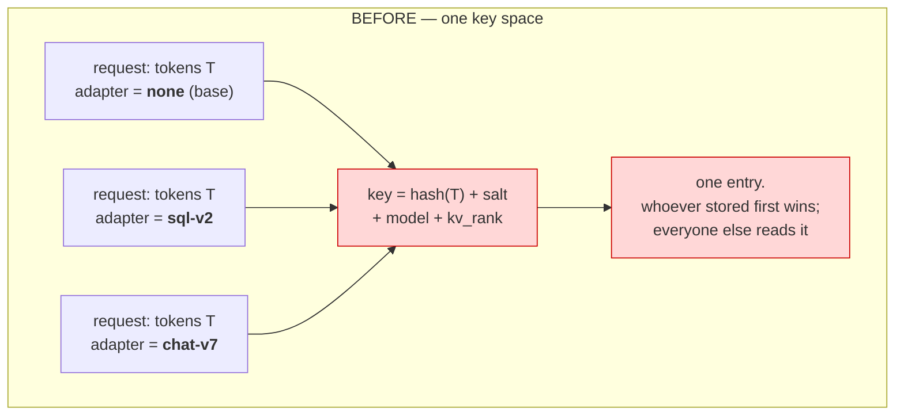
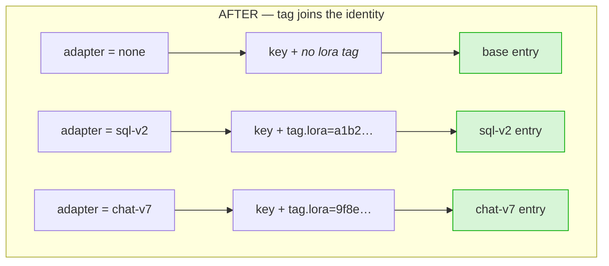

# Difficult · #5713 — every LoRA adapter shared the base model's cache keys

| | |
|---|---|
| **Filed as** | [LMCache/LMCache#5713](https://github.com/LMCache/LMCache/pull/5713) — *"[Bugfix][MP] Isolate vLLM MP cache keys per LoRA adapter"* (filed as a PR, not an issue) |
| **Label** | `full` |
| **Refs** | [#2961](https://github.com/LMCache/LMCache/issues/2961); builds on [#5843](https://github.com/LMCache/LMCache/pull/5843) and [#6199](https://github.com/LMCache/LMCache/pull/6199); companion to [#5448](https://github.com/LMCache/LMCache/pull/5448) (in-process connector). Also reported upstream as [vllm-project/vllm#44250](https://github.com/vllm-project/vllm/issues/44250) |
| **Author** | [`@7konigsberg`](https://github.com/7konigsberg), opened 2026-10-13, merged 2026-11-05 |
| **Fix commit** | [`ea6ecd0a`](https://github.com/LMCache/LMCache/commit/ea6ecd0a3e81768dd40be159422d095720138b21) |
| **Diff size** | 13 files, +415 / −8 — of which the production change is **+61 / −1** across three files; 308 of the added lines are one new test file |

> **Verification status.** Not reproduced: this needs a vLLM deployment with
> `--enable-lora` and at least two adapters. Everything below is read from the PR
> description, the merged diff, and the key-construction code it depends on. The
> mechanism by which `lmcache.tag.*` becomes part of the object key **was** verified by
> reading `get_request_tags` and `ObjectKeyIdentity` at the pinned revision, quoted in §3.2.

---

## 1. TL;DR

- **Symptom.** With `--enable-lora`, a request running under adapter *A* could be served KV that was computed under adapter *B*, or under the base model. Silently. The model produced fluent, wrong output.
- **Root cause.** Cache identity did not include the adapter. The connector sent the same `cache_salt` and the same token ids regardless of which adapter was loaded, so the same tokens hashed to the same key — and all adapters shared one key space.
- **Fix.** Add the adapter to the key as an identity tag: `lmcache.tag.lora` = a 128-bit BLAKE2b digest of the adapter's **name and path**. A value supplied by the client is dropped.
- **Second bug, found on the way.** Lazy-offload store coalescing rebuilt its metadata with the request's `cache_salt` but not its `request_configs`, which silently dropped the new tag — so stores would have been written under base-model keys anyway.
- **What makes it difficult.** Not the diff. The *detection*: this produces plausible text rather than an error, it needs multi-adapter traffic to happen at all, and the fix is inert without two other PRs. Plus a real upgrade hazard: KV written before the fix sits under base-model keys and must be purged.

---

## 2. The symptom

From the PR description:

> With `--enable-lora`, the MP connector sends the same `cache_salt` and token ids for the
> base model and every adapter, so the server hands back KV computed under a different
> adapter.

A LoRA adapter changes the weights. The same prompt under a different adapter produces
*different* KV — that is the entire point of serving adapters. So this is a correctness bug
of the worst available kind:

- **No error.** The cache returns bytes of the right shape at the right offsets. Nothing in
  the transfer path can tell they were computed under other weights.
- **Output stays fluent.** You get coherent text that reflects the wrong adapter's
  behaviour — the adapter's tuning silently stops applying to any cached prefix.
- **It gets worse as the cache gets better.** A cold cache is correct. The bug only bites
  on a hit, so higher hit rates mean more wrong answers.
- **It needs multi-tenant traffic.** One adapter alone is self-consistent — every entry was
  written by the same weights. You need the base model and an adapter, or two adapters, with
  a shared prefix.

That last point is why this survived: the single-adapter smoke test anyone would write is
*correct by construction*.

### 2.1 The shape of the collision





---

## 3. Background you need

### 3.1 What is already in a cache key

From [the lifecycle document §2](../features/02-kv-cache-lifecycle.md#2-identity-how-a-chunk-of-kv-is-named),
[`ObjectKeyIdentity`](https://github.com/LMCache/LMCache/blob/53bde913de1adae2a380fe0c2de8d2b9355b4702/lmcache/v1/distributed/api.py#L211)
carries `chunk_hash`, `kv_rank`, `model_name`, `object_group_id`, `cache_salt` and `tags`.

Every one of those is a dimension along which KV is *not* interchangeable. `model_name` is
there because different weights produce different KV — and **a LoRA adapter is different
weights**, but it is not a different `model_name`. The existing fields covered TP sharding,
tenancy and attention grouping, and simply had no slot for "which adapter is loaded".

`cache_salt` looks like the obvious place to put it, and in fact the authors shipped exactly
that first — *"We've run the salt-folding version of this in production since mid-October"*.
But `cache_salt` belongs to the **client**: it is the per-tenant isolation string a caller
sets. Folding a server-side fact into a client-owned field means the connector has to
rewrite a value the client provided, and the client can no longer rely on its own salt
meaning what it set. Hence the move to tags.

### 3.2 Tags are a general identity-extension mechanism

This is the part worth learning, because it is reusable. Any `lmcache.tag.*` request config
becomes part of the object key, via
[`get_request_tags`](https://github.com/LMCache/LMCache/blob/53bde913de1adae2a380fe0c2de8d2b9355b4702/lmcache/v1/distributed/api.py#L184):

```python
    tags: dict[str, str] = {}
    for name, value in (request_configs or {}).items():
        if not name.startswith("lmcache.tag."):
            continue
        if not isinstance(value, str):
            raise ValueError("tags require non-empty string names and string values")
        tags[name.removeprefix("lmcache.tag.")] = value
    validate_identity_tags(tags)
    return freeze_dict(tags, sort_keys=True)
```

Note `sort_keys=True` and `freeze_dict`: tags are **canonicalised and immutable**, so two
requests with the same tags in different insertion order produce the same key. Without that,
key equality would depend on dict ordering.

The capability landed in [#5843](https://github.com/LMCache/LMCache/pull/5843) and
[#6199](https://github.com/LMCache/LMCache/pull/6199); #5713 is the first *user* of it. The
PR is explicit that this ordering matters:

> The fix takes effect once #5843 and #6199 are in: on `dev` alone the server ignores the
> tag and adapters still collide.

**A fix that is inert without two other merged PRs** is a genuinely hard thing to review and
to test — the diff looks correct and changes nothing observable until its dependencies land.

---

## 4. Root cause

The request tracker built its request configs from the request and stopped there:

```python
        self.request_configs = extract_request_configs_from_request(request)
```

`request.lora_request` was available on the vLLM request object and simply never consulted.
That is the whole defect: **an identity dimension that exists in the input and not in the
key**.

The deeper cause is that LMCache's key was designed before multi-adapter serving mattered,
and `model_name` carried an implicit assumption — *one model name, one set of weights* — that
LoRA broke without changing any type or signature. Nothing failed to compile; a true
statement quietly became false.

---

## 5. The fix

### 5.1 Derive a tag from the adapter

[`lmcache/integration/vllm/utils.py`](https://github.com/LMCache/LMCache/blob/53bde913de1adae2a380fe0c2de8d2b9355b4702/lmcache/integration/vllm/utils.py):

```python
def lora_cache_tag(lora_request: "LoRARequest") -> str:
    """Return the cache key tag value for a vLLM LoRA adapter.

    The tag is a 128-bit BLAKE2b digest of the adapter name and path. Hashing
    the path with the name follows vLLM's prefix cache
    (vllm-project/vllm#59335): a name re-pointed at different weights misses
    instead of hitting stale KV. A short hex digest also keeps adapter names
    out of key strings and keeps tagged storage file names short.
    """
    payload = f"{lora_request.lora_name}\0{lora_request.lora_path}"
    return hashlib.blake2b(payload.encode(), digest_size=16).hexdigest()
```

Four decisions, each defensible and each worth noting:

**Name *and* path, not name alone.** If you hashed only the name, re-pointing `sql-v2` at
retrained weights would keep hitting the old adapter's KV — the identical bug, one level
down. Hashing the path makes a re-pointed name *miss*, which is the safe failure. The PR
grounds this in vLLM's own choice (`vllm-project/vllm#59335`), so the two caches agree on
what an adapter *is*.

**`\0` as the separator.** Without it, `("ab", "c")` and `("a", "bc")` would produce the same
payload. A NUL cannot appear in either field, so the encoding is unambiguous. This is a
small, easy-to-skip detail that prevents a genuine collision class.

**128 bits, not 256.** The PR explains the constraint, and it is a real one:

> The tag is 32 characters, not a 64-character SHA-256, to keep tagged L2 file names short:
> with #5843 a tagged fs L2 file name is the model name plus the salt plus 146 bytes, and
> the limit is 255.

Filesystem path limits leaking into a hash-width choice is the kind of thing that only shows
up in a system that persists keys as filenames. 128-bit collision resistance for an adapter
registry is ample.

**A digest, not the name.** Adapter names and paths can be long and can contain
path-unsafe characters; a hex digest is fixed-width and safe. It also keeps adapter names out
of L2 object names, which is a mild confidentiality benefit.

### 5.2 Apply it, and refuse to trust the client

```python
def apply_lora_tag(
    request_configs: dict[str, Any] | None,
    lora_request: "LoRARequest | None",
) -> dict[str, Any] | None:
    """Make a request's LoRA adapter part of its cache keys.

    ``lmcache.tag.*`` request configs are part of the cache key, so the base
    model and each adapter get separate keys for the same tokens. The
    connector owns ``lmcache.tag.lora``: a value sent by the client in
    ``kv_transfer_params`` is dropped, so a request can only read and write
    the cache of the adapter it actually runs with.
    """
    configs = {
        key: value
        for key, value in (request_configs or {}).items()
        if key != LORA_TAG_KEY
    }
    if lora_request is not None:
        configs[LORA_TAG_KEY] = lora_cache_tag(lora_request)
    return configs or None
```

**The dropped client value is a security property, not tidiness.** `request_configs` come
from the client's `kv_transfer_params`. If a client could set `lmcache.tag.lora`, it could
name *another* adapter's tag and read KV computed under weights it is not running — and
write poisoned entries into that adapter's key space. Stripping the key before re-deriving
it from the actual `lora_request` makes the tag unforgeable: a request can only touch the
cache of the adapter it is genuinely executing under.

Note also that `lora_request is None` adds **no tag at all**, rather than a sentinel like
`"base"`. So base-model keys are byte-identical to pre-fix keys, which is what makes the
upgrade partially compatible (§7).

Wired in at one line in the tracker:

```python
-        self.request_configs = extract_request_configs_from_request(request)
+        self.request_configs = apply_lora_tag(
+            extract_request_configs_from_request(request), request.lora_request
+        )
```

And deliberately placed in shared vLLM utils so the in-process connector
([#5448](https://github.com/LMCache/LMCache/pull/5448)) derives the *same* tag — two
connectors computing adapter identity differently would re-fragment the cache.

### 5.3 The second bug: coalescing dropped the tag

The second commit in the PR is a different bug, found because the first one did not work:

```python
         direction="STORE",
         op=merged_op,
         cache_salt=first.cache_salt,
+        request_configs=first.request_configs,
     )
```

From the commit message:

> `_coalesce_store_metadata` rebuilt the STORE metadata with the request's `cache_salt` but
> not its `request_configs`, so a coalesced store dropped every `lmcache.*` config,
> including the `lmcache.tag.*` key tags.

This is the classic failure mode of **rebuilding a record field by field**. When
`_coalesce_store_metadata` was written, `cache_salt` was the only identity-affecting field it
needed to carry, and it carried it. Tags arrived later, in a different field, and the
rebuild silently excluded them — because a constructor call that lists fields explicitly does
not fail when a new field appears, it just defaults it.

The consequence was precise and nasty: **lookups used the tag, stores did not.** So an
adapter request would look up under its own key, miss, compute, and then store under the
base-model key — poisoning base-model entries while never populating its own. Worse than the
original bug in one respect: the original at least had consistent keys.

Note the cross-reference — *"#6211 makes the same change"* — meaning two independent PRs hit
the same dropped-field bug at the same time. A field that two separate authors forget is a
sign the rebuild should have been `dataclasses.replace(first, ...)` rather than a fresh
constructor call.

### 5.4 The tests

308 of the 415 added lines are `tests/v1/test_mp_connector_lora_keys.py`. The other test
files get **one line each** — and that one line is the interesting part: adding the new
`request_configs` plumbing to existing fixtures. Seven existing test files needed a
one-line update, which is a good sign the change threaded a value through a well-defined
seam rather than reshaping anything.

---

## 6. Why the fix is correct

- **It closes the identity gap at the source.** The adapter is derived from
  `request.lora_request` — the thing that actually determines which weights run — not from
  anything a caller asserts.
- **Base-model behaviour is bit-identical.** No tag is added when `lora_request is None`, so
  existing base-model keys and entries are untouched. The PR states this plainly: *"Base
  model requests behave exactly as before, and adapter requests cannot be correct without
  it."*
- **The tag cannot be forged**, because the connector strips any client-supplied value.
- **It covers every operation.** Because the tag goes into `request_configs`, which the
  server folds into `ObjectKeyIdentity`, it applies to *"every lookup, store, retrieve and
  lock release"* — not just the read path. §5.3 exists precisely because one write path had
  been missed.
- **No new option.** There is no flag to enable it, which is right: a configuration knob here
  would be a knob for "serve wrong KV".

---

## 7. The upgrade hazard

This deserves its own section because it is the part an operator can get wrong:

> KV that adapter requests wrote before this change sits under base-model keys; clear
> persistent L2 when upgrading. Base-model entries are unaffected.

Think about what the pre-fix cache contains: a single key space in which base-model and
*every* adapter's KV are mixed, indistinguishably. After the upgrade, adapter requests look
up under new keys and correctly miss — but base-model requests keep using the old keys, and
some of those entries were written by adapters.

**So the fix does not heal the existing corruption; it stops adding to it.** Persistent L2
must be purged, or base-model requests will keep hitting adapter-written entries
indefinitely. L1 resolves itself on restart; L2 does not.

There is also a documentation correction in the PR worth noting, because it is the sort of
thing that silently misleads:

> The request config note in `configuration.rst` said `lmcache.tag.*` is not part of cache
> identity. With #5843 and #6199 it is, so the docs change updates that note too.

A doc that said the exact opposite of the new truth — and anyone who had read it would have
concluded tags were a safe place for non-identity metadata.

---

## 8. The lessons

**An identity is only as good as its most recent assumption.** `model_name` meant "these
weights" until LoRA made one model name span many weight sets. Nothing in the type system
noticed. When a new serving feature arrives, the question to ask is *"does this change what
makes two requests' KV interchangeable?"* — and if so, the key must change.

**Prefer a dedicated dimension over overloading an existing field.** Folding the adapter into
`cache_salt` worked in production for three weeks and was still replaced, because `cache_salt`
belongs to the client. Tags gave the system a place to put server-derived identity without
taking a field away from its owner — and the next feature that needs an identity dimension
now has an obvious home.

**Never trust a client-supplied value that selects a key space.** Stripping
`lmcache.tag.lora` before re-deriving it is three lines and the difference between an
isolation mechanism and a lookup parameter.

**Rebuilding a record field by field is a latent bug.** §5.3 dropped tags because a
constructor call enumerated the fields that existed when it was written. Two independent PRs
hit it simultaneously. `replace()` over a fresh constructor, where you can.

**Silent-wrong-answer bugs need adversarial tests, not smoke tests.** Single-adapter traffic
is self-consistent and proves nothing. The 308-line test file exists because the only test
that can catch this is one that deliberately runs the same tokens under different adapters
and asserts the keys differ.

---

## 9. Where to look next

- [KV cache lifecycle §2](../features/02-kv-cache-lifecycle.md#2-identity-how-a-chunk-of-kv-is-named) — the full key structure and the `tags` field.
- [vLLM integration §7](../features/05-vllm-integration.md#7-lazy-offload) — the coalescing machinery that dropped the tag.
- [#4698](medium-4698-nixl-pool-slot-units.md) and [#4591](medium-4591-sdk-output-tokens.md) — the other "two things that should have agreed did not" bugs in this set.
- Upstream: [`docs/design/v1/cache-identity.md`](https://github.com/LMCache/LMCache/blob/53bde913de1adae2a380fe0c2de8d2b9355b4702/docs/design/v1/cache-identity.md), [`docs/design/integration/vllm/multimodal_cache_keying.md`](https://github.com/LMCache/LMCache/blob/53bde913de1adae2a380fe0c2de8d2b9355b4702/docs/design/integration/vllm/multimodal_cache_keying.md) (the same tag mechanism applied to multimodal inputs), and the request-config reference in [`docs/source/mp/configuration.rst`](https://github.com/LMCache/LMCache/blob/53bde913de1adae2a380fe0c2de8d2b9355b4702/docs/source/mp/configuration.rst).
