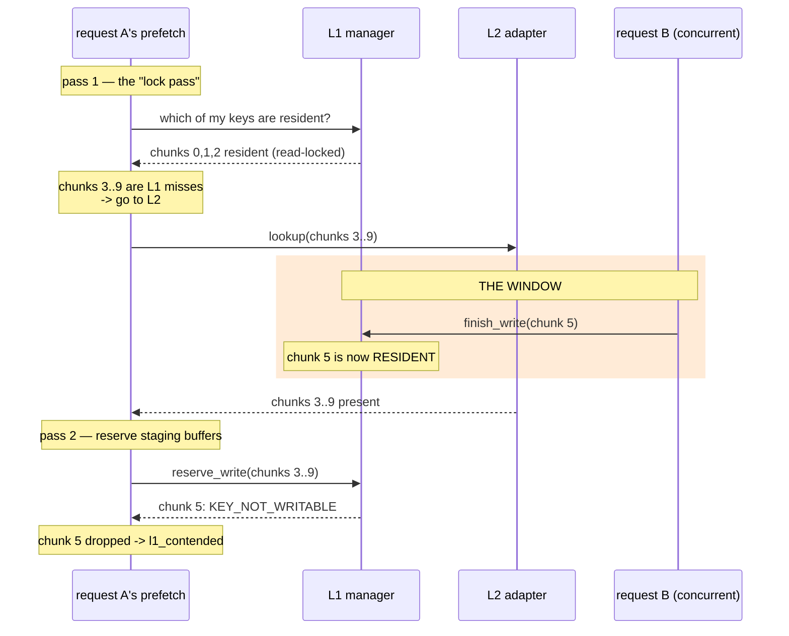

# Difficult · #6392 — a chunk that arrived in L1 at the wrong moment became a miss

| | |
|---|---|
| **Filed as** | [LMCache/LMCache#6392](https://github.com/LMCache/LMCache/pull/6392) — *"[Bugfix][MP] Stage prefetch keys that land in L1 during the L2 lookup"* (filed as a PR) |
| **Label** | `full` |
| **Author** | [`@daegyu94`](https://github.com/daegyu94), opened 2026-11-06, merged 2026-11-18 (12 days, 5 comments) |
| **Fix commit** | [`95737da9`](https://github.com/LMCache/LMCache/commit/95737da9d12774f08b242e589dfb3a76ac7250a7) |
| **Diff size** | 14 files, +121 / −50 — of which the production change is **+40 / −11** across five files; the rest is docs, tests and a metric description |
| **AI-assisted** | Yes, declared in the PR (Claude Code), with an attached explainer |

> **Verification status.** Not reproduced. The race needs concurrent requests hitting a
> narrow window on a real MP server; the author built a server-only bench to provoke it and
> their numbers are quoted as *theirs*, not re-measured here. The code path and the state
> machine claims below are read from the diff and the surrounding L1 manager at the pinned
> revision.

---

## 1. TL;DR

- **Symptom.** Under concurrency, chunks that were **present in L1** were reported as misses and recomputed by the engine. The author's bench saw lost hits in **116 of 240 rounds**.
- **Root cause.** Prefetch locks its L1 hits first, *then* looks up L2. A chunk that another request admitted to L1 inside that window failed `reserve_write` with `KEY_NOT_WRITABLE` — the key was resident, which normally means "another writer already has it, don't duplicate". Prefetch treated that as a failure and dropped the chunk.
- **The amplifier.** Under the prefix fetch policy a hit must be contiguous, so **one dropped chunk truncates the hit at that point** and every later chunk is recomputed too.
- **Fix.** A keyword-only `allow_resident` flag on `reserve_write`: stage the key anyway, and let the existing admission path discard the staging buffer and read-lock the resident object. The prefetch controller passes it only for an L1 the request is actually allowed to read.
- **Honest cost.** One redundant L2 load per landed key. In the author's 32-client test, L2 chunk reads per round went from 29–63 up to 128 (4 were needed) — correctness bought with bandwidth, with single-flight deduplication named as a follow-up.

---

## 2. The symptom

From the PR:

> A prefetch locks L1 hits first, then looks up L2. A key that another request's load admits
> to L1 in between fails `reserve_write` (`KEY_NOT_WRITABLE`, `l1_contended`), so a resident
> chunk becomes a miss and the engine recomputes it.

The user-visible effect is a hit-rate loss that scales with concurrency and is invisible in
any single-request test. Nothing errors. The cache contains the data, reports a miss, and the
engine does the prefill it was supposed to avoid — which is the one outcome the entire system
exists to prevent.

There *was* a signal: the `l1_contended` reason on the `lmcache_mp.l2_prefetch_failure`
counter. But its description read as benign bookkeeping rather than lost work —
see §5.3.

### 2.1 Why "resident" was treated as a failure

`KEY_NOT_WRITABLE` is not a bug; it is a **de-duplication mechanism**. From the L1 manager's
docstring at the pinned revision:

```
    KEY_NOT_WRITABLE: The key already has a resident object (unless
        ``allow_resident``), or ``tag`` already stages the key.
```

For an **engine store**, that is exactly right: if the chunk is already in L1, don't write it
again. Two requests computing the same chunk should result in one copy.

For a **prefetch**, the same answer is wrong — and the asymmetry is the whole bug. A
prefetch's goal is not "write this chunk", it is "**be able to read this chunk**". A key that
is already resident has *already achieved* the prefetch's goal. Returning "not writable"
answers the question the caller didn't ask.

---

## 3. Background you need

### 3.1 The prefetch controller's two passes

A prefetch resolves a request's chunks against both tiers, in order:



The window is real and not small: it spans an **L2 lookup**, which is network or disk I/O.
Any concurrent request that finishes a load in that interval can land a key in it.

### 3.2 Why one dropped chunk costs many

This is the part that turns a rare race into a visible throughput loss. LMCache's hit is a
**prefix**: chunk *n*'s hash depends on all tokens before it
([lifecycle §3](../features/02-kv-cache-lifecycle.md#3-rolling-prefix-hashes)), so a hit must
be contiguous from the start of the prompt. Under the prefix fetch policy:

| chunk | 0 | 1 | 2 | 3 | 4 | **5** | 6 | 7 | 8 | 9 |
|---|---|---|---|---|---|---|---|---|---|---|
| available | ✓ | ✓ | ✓ | ✓ | ✓ | **dropped** | ✓ | ✓ | ✓ | ✓ |
| served (prefix policy) | ✓ | ✓ | ✓ | ✓ | ✓ | ✗ | ✗ | ✗ | ✗ | ✗ |

Nine chunks were available; five get served. **A single contended chunk forfeits the entire
remainder of the prefix.** With a 784-token chunk that is thousands of tokens of
unnecessary prefill from one lost race.

### 3.3 The admission path already handled this

The key insight that makes the fix three lines rather than a redesign — from the commit
message:

> Admission already handles that case (`finish_write_and_reserve_read` discards the staging
> buffer and read-locks the resident object), so the prefetch controller's state machine is
> unchanged.

So `finish_write_and_reserve_read` was **already** written to cope with "I staged this key
but someone else's copy is now resident": drop my staging buffer, read-lock theirs, hand the
caller a valid read lock. The capability existed; `reserve_write` simply refused to let
anyone reach it. `ShadowL1Manager` (the P2P borrowed-memory index) already staged resident
keys, so one implementation was effectively doing the right thing already.

---

## 4. Root cause

One condition in
[`BaseL1Manager.reserve_write`](https://github.com/LMCache/LMCache/blob/53bde913de1adae2a380fe0c2de8d2b9355b4702/lmcache/v1/distributed/l1_manager/base.py#L477):

```python
            if key in self._objects:
                # -> KEY_NOT_WRITABLE
```

An unconditional policy — *a resident key is never writable* — serving two callers with
opposite needs. The root cause is not the check; it is that **`reserve_write` had one
behaviour for two different intents** (de-duplicate my write vs. get me a read lock) and no
way for a caller to say which it meant.

The second, subtler cause is the ordering: because the lock pass runs *before* the L2 lookup,
the information "which keys are resident" is already stale by the time it is used. Re-running
the lock pass after the lookup would narrow the window but not close it — any check-then-act
on shared state has one. The fix instead makes the *outcome* of losing the race harmless,
which is the more robust shape.

---

## 5. The fix

### 5.1 An opt-in flag, keyword-only

[`internal_api.py`](https://github.com/LMCache/LMCache/blob/53bde913de1adae2a380fe0c2de8d2b9355b4702/lmcache/v1/distributed/internal_api.py#L302)
and `base.py`:

```python
+        *,
+        allow_resident: bool = False,
```

```python
-            if key in self._objects:
+            if key in self._objects and not allow_resident:
```

with the contract documented where a caller will meet it:

```python
+            allow_resident: Stage a key even when it is already resident.
+                Admission then discards the staging object and keeps the
+                resident one (see :meth:`finish_write_and_reserve_read`), so a
+                writer that raced another writer still ends up holding the
+                resident object, at the cost of a redundant write.
```

Three good choices in a two-line change:

- **Default `False`.** Engine stores keep de-duplicating. The commit is explicit: *"Other
  writers keep the default, so engine stores still de-duplicate on `KEY_NOT_WRITABLE`."*
- **Keyword-only** (`*,`), added in review — *"so call sites read as intended"*. A bare
  `True` at a call site would be unreadable, and this is exactly the kind of boolean that
  must never be positional.
- **The docstring names the cost** ("at the cost of a redundant write") rather than
  presenting the flag as free.

### 5.2 Pass it only where it is sound

The controller change is where the real thinking is:

```python
             success, objs, l1_failed_count = _reserve_l1_cells(
-                self._l1_managers[l1_idx], request.key_groups, cells, retain, tag
+                l1_manager,
+                request.key_groups,
+                cells,
+                retain,
+                tag,
+                allow_resident=_tags_allowed(
+                    l1_manager.get_memory_tags(), request.allowed_l1_memory_tags
+                ),
             )
```

The guard is subtle and correct. `allow_resident=True` only for an L1 **this request is
permitted to read**, because:

> The lock pass covers only those, so a resident key there landed during the lookup. In an
> affinity L1 excluded by `allowed_l1_memory_tags` a resident key stays a miss, as before.

The reasoning chain: the lock pass examined exactly the readable L1s. So if a key is resident
in a readable L1 *now* but wasn't during the lock pass, it must have landed in the window —
the race — and staging it is right. If a key is resident in an L1 this request may **not**
read (an affinity tier belonging to someone else), then it was never a candidate, it cannot
be read, and it cannot be loaded there either. That genuinely is a miss.

So the flag is derived from a capability check, not hardcoded. A sloppier fix would have
passed `True` unconditionally and broken affinity-L1 isolation.

### 5.3 Redefine the metric to match

Because `l1_contended` now means something narrower, the PR rewrites its description
([`l2_failures.py`](https://github.com/LMCache/LMCache/blob/53bde913de1adae2a380fe0c2de8d2b9355b4702/lmcache/v1/mp_observability/subscribers/metrics/l2_failures.py)):

```python
-    * ``l1_contended`` — the key appeared in L1 (write-locked by a concurrent
-      request) between the prefetch's L1 claim and its buffer reservation, so
-      the load was skipped.
+    * ``l1_contended`` — the key is resident in the adapter's affinity L1,
+      which the request may not read, so it could not be loaded there.
```

and the inline comment at the publish site:

```python
-        # The key became resident in L1 after the lock pass; the caller
-        # falls back to the L1-only hit.
+        # The key is resident in an L1 this request may not read, so it can
+        # neither be reused nor loaded there again; the caller drops it.
```

**This matters as much as the code change.** The old description described the race as
routine — "so the load was skipped" — with nothing to suggest it cost a recomputed chunk.
Anyone watching that counter would have seen a nonzero value and filed it as normal
contention. After the fix, a nonzero `l1_contended` means something specific and rarer. A
metric whose name outlives its meaning is worse than no metric, and the PR changed the
description, the design docs, the `EVENTS.md` entry and the P2P skill references in the same
commit.

### 5.4 Tests that failed before

> The two tests that pinned the old drop now expect every key served under both the prefix
> and full policies, and fail without the controller change.

Two existing tests **asserted the buggy behaviour** — they encoded "a key that landed after
the lock pass is dropped" as expected. Inverting an existing assertion is the strongest
evidence a bug was a design decision nobody revisited, and it is the same pattern as
[#4416](medium-4416-percentile-off-by-one.md), where a unit test asserted the wrong
percentile with a comment explaining it as intended.

---

## 6. Why the fix is correct

- **It reuses an existing, already-correct admission path** rather than adding a new state.
  The prefetch controller's state machine is untouched.
- **It is scoped by capability.** `allow_resident` is derived from
  `allowed_l1_memory_tags`, so affinity-L1 isolation is preserved and genuine misses are
  still misses.
- **Non-prefetch writers are unaffected**, by defaulting to `False`.
- **The author measured it.** Their server-only bench (fs_native O_DIRECT, no engine,
  arrivals aimed at the race window — *"so these are not production rates"*):

  | | dev | this PR |
  |---|---|---|
  | Rounds with lost hits | 116 / 240 | **0 / 240** |
  | Normal path (1 client): latency, server CPU | | no difference detected |
  | L1 1 GB: `l1_oom` | 0 | 0 |
  | 32 clients, simultaneous: L2 chunks read per round (4 needed) | 29–63 | **128** |

  *(The author's numbers, not re-measured here.)* Note they also checked `l1_oom` stayed at
  zero under a small L1 — the obvious way a fix that allocates extra staging buffers could
  backfire.

### 6.1 The trade-off, stated plainly

That last row is the cost, and the PR does not hide it. 32 clients needing 4 chunks each:
`dev` read 29–63 chunks from L2 (because `KEY_NOT_WRITABLE` deduplicated some loads — while
losing hits), the fix reads 128 (every client loads every chunk; no deduplication inside the
window).

So the fix trades **L2 bandwidth for hit rate**. That is the right trade — a redundant L2
read costs milliseconds, a lost prefix costs a full prefill — but it is a trade, and the
author names the follow-up: *"Single-flight to cut it is a planned follow-up."* The commit
also notes the cost is not new in kind: *"which two overlapping loads already pay when both
reserve before either lands."*

### 6.2 What it does not fix

The PR lists its own residual limits, which is the detail that makes it trustworthy:

- A landed key is **still a miss** when the second staging buffer cannot be allocated
  (`l1_oom`) or the redundant load fails.
- **Over P2P this needs a follow-up:** *"`P2PL2Adapter` drops a peer address on any unlock,
  so the redundant load can fail."*
- **Out-of-tree `L1ManagerInterface` implementations need the new keyword-only parameter** —
  a breaking change to a public protocol, disclosed rather than discovered.
- A `NO_LOCK` limitation (a request can be served a temporary resident object freed when its
  last reader releases it) was moved *from the PR description into the design doc's
  limitations list* during review — exactly where a known limit belongs.

---

## 7. The lessons

**One API, two intents, is a bug waiting for concurrency.** `reserve_write` meant
"de-duplicate my write" to the engine and "get me a readable copy" to prefetch. The same
return code was correct for one and wrong for the other. When a single function serves
callers with different goals, the goal belongs in the signature.

**Make losing a race harmless instead of making it rarer.** Re-running the lock pass after
the L2 lookup would have shrunk the window and felt like a fix. Any check-then-act on shared
state has a window; the durable repair was to make the post-race state recoverable — which
it already was, one layer down.

**Prefix semantics amplify single-chunk losses.** Because a hit must be contiguous, dropping
chunk 5 of 10 forfeits chunks 5–9. Anywhere a per-chunk decision can fail, ask what it costs
the chunks *after* it; in a prefix cache the answer is rarely "just this one".

**Update the metric description when the meaning changes.** `l1_contended` survived the fix
as a name and changed completely as a concept. Shipping the code without the description
would have left a counter that quietly meant something new — and the old wording actively
reassured readers that lost hits were routine.

**A test that asserts current behaviour is not the same as a test that asserts correct
behaviour.** Two tests pinned the drop in place. They passed for as long as the bug existed,
and inverting them was part of the fix.

---

## 8. Where to look next

- [L1 memory and eviction §3, §5](../features/03-l1-memory-and-eviction.md#3-the-object-lifecycle-state-machine) — the object state machine, staging, and write tags.
- [KV cache lifecycle §5, §8](../features/02-kv-cache-lifecycle.md#5-prefetch) — prefetch and the reserve/finish protocol.
- [Observability §4](../features/09-observability.md#4-event-types) — `l2.prefetch.failed` and why submitted-vs-completed differencing matters.
- [P2P sharing](../features/08-p2p-sharing.md) — `ShadowL1Manager`, and the `P2PL2Adapter` follow-up this PR flags.
- Upstream: [`prefetch_controller.md`](https://github.com/LMCache/LMCache/blob/53bde913de1adae2a380fe0c2de8d2b9355b4702/docs/design/v1/distributed/storage_controllers/prefetch_controller.md) (limitations list) and [`staging-and-write-tags.md`](https://github.com/LMCache/LMCache/blob/53bde913de1adae2a380fe0c2de8d2b9355b4702/docs/design/v1/distributed/l1_manager/staging-and-write-tags.md), both updated by this PR.
