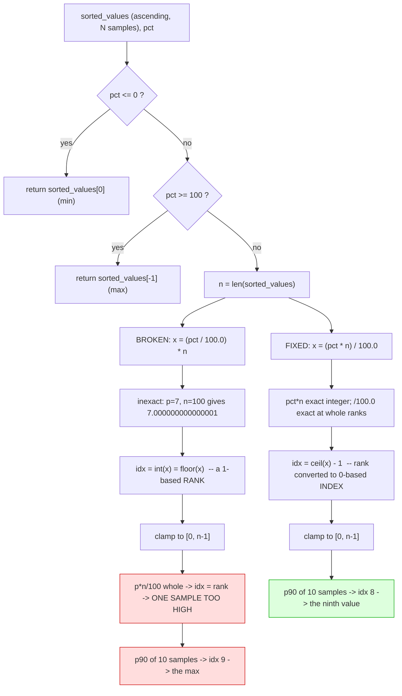

# Medium · #4416 — trace-replay percentiles were one sample too high, so p90/p99 reported the max

| | |
|---|---|
| **Issue** | [LMCache/LMCache#4416](https://github.com/LMCache/LMCache/issues/4416) — *"[Bug][CLI] trace replay percentiles are one sample too high at whole ranks, so p90/p99 report the max"* |
| **Label** | `good second issue` |
| **Reported** | 2026-08-04 by [`@bharadwaj-pendyala`](https://github.com/bharadwaj-pendyala) |
| **Fixing PR** | [#5854](https://github.com/LMCache/LMCache/pull/5854) by [`@kaelzcn`](https://github.com/kaelzcn) |
| **Fix commit** | [`87d1b94c`](https://github.com/LMCache/LMCache/commit/87d1b94c976566b0ced49c534c31cf67e4328a7a) (merged 2026-10-19) |
| **Diff size** | 2 files, +20 / −5 — of which the production change is **+5 / −3** in one function |

> **Nothing in this document was reproduced or executed.** No LMCache code was run: the
> project's test suite was not invoked, and `lmcache trace replay` was not launched.
> The *arithmetic*, however, was re-derived independently — the tables below come from a
> standalone `python3` script that reimplements the two index expressions from the diff.
> That is my own re-computation of the formulas, not a run of the project's code. It is
> labelled as such wherever it appears.

---

## 1. TL;DR

- **Symptom.** `lmcache trace replay` reported `p90_ms` and `p99_ms` equal to `max_ms` at exactly the sample counts you are most likely to hit (10 replayed calls, 100 replayed calls). Every percentile was silently shifted one sample towards the tail.
- **Root cause.** `_percentile()` computes the *nearest-rank* position of a percentile. The nearest-rank formula produces a **1-based rank**; the code used that number directly as a **0-based list index**. The `- 1` that its own docstring specified was missing from the code.
- **Fix.** Compute the index as `math.ceil((pct * n) / 100.0) - 1` instead of `int((pct / 100.0) * n)`: restore the `- 1`, and multiply before dividing so that integer percentiles land exactly on a whole rank instead of on a float a few ulps above it.
- **Why nobody noticed for months.** The existing unit test *asserted the wrong answer*, complete with a comment explaining the off-by-one as if it were the design. Fractional ranks are unaffected, so the numbers always looked plausible.

---

## 2. The symptom

The reporter filed this against `dev` at `3b8093cf` with a self-contained repro. Quoting the
issue body verbatim:

```python
from lmcache.cli.commands.trace._stats import ReplayStatsCollector, _percentile

vals = [float(i) for i in range(1, 101)]
print(_percentile(vals, 50))   # 51.0, want 50.0
print(_percentile(vals, 99))   # 100.0, want 99.0  (this is max)
print(_percentile(vals, 7))    # 8.0,   want 7.0   (the float rounding case)

s = ReplayStatsCollector()
for latency_ms in range(1, 11):
    s.record("op.foo", latency_ms / 1000.0)
stats = s.summary()["op.foo"]
print(stats.p90_ms, stats.max_ms)   # 10.0 10.0, want 9.0 10.0
```

with the observed output on `dev`:

```
51.0
100.0
8.0
10.0 10.0
```

The last line is the one that matters operationally. The reporter's summary of the user-visible
impact:

> The practical effect is that `lmcache trace replay` reports the slowest single sample as p90 or
> p99 at the sample counts you are most likely to hit. With 10 replayed calls for a qualname, p90
> equals max. With 100, p99 equals max. Fractional ranks are unaffected, so the numbers look
> plausible and only the tail is wrong.

That last sentence is the whole reason this survived. A percentile that is wrong by one sample in a
sorted list is wrong by a *small* amount almost everywhere — one notch along the distribution. It
only becomes conspicuous when the shift runs off the end of the array and p90 collides with max,
and even then you have to be looking for it.

The affected surfaces, again from the issue:

> The changed values are user visible: terminal output from `lmcache trace replay`, plus the
> `p50_ms`/`p90_ms`/`p99_ms` columns in the CSV and JSON exports.

Those are [`ReplayStatsCollector.export_csv`](https://github.com/LMCache/LMCache/blob/87d1b94c976566b0ced49c534c31cf67e4328a7a/lmcache/cli/commands/trace/_stats.py#L210)
and [`export_json`](https://github.com/LMCache/LMCache/blob/87d1b94c976566b0ced49c534c31cf67e4328a7a/lmcache/cli/commands/trace/_stats.py#L251),
plus the table printed by
[`replay_command.py`](https://github.com/LMCache/LMCache/blob/87d1b94c976566b0ced49c534c31cf67e4328a7a/lmcache/cli/commands/trace/replay_command.py#L277).

### Issue thread

The thread is short and worth reading as a process artifact rather than a technical one:

- 2026-10-04 — `github-actions[bot]`: *"This issue has been automatically marked as stale because it has not had activity within 60 days."*
- 2026-10-19 — `@kaelzcn`: `/claim`

Merged the same day it was claimed. The report was good enough that the fix needed no discussion:
it named the file, the function, the exact expression, the expected convention, the secondary
float defect, *and* the test that was encoding the bug. There is a lesson there about bug reports,
and it is at the bottom of this document.

---

## 3. Background you need

Very little, which is part of why this is a good second issue.

- **What `lmcache trace replay` is.** The `trace` command group records storage-manager calls to a
  trace file and replays them in-process so you can profile the storage path without a model or a
  GPU. See [the CLI deep dive](../features/10-cli.md) for the command framework and the rest of the
  `trace` group.
- **Where the numbers come from.**
  [`lmcache/cli/commands/trace/_stats.py`](https://github.com/LMCache/LMCache/blob/87d1b94c976566b0ced49c534c31cf67e4328a7a/lmcache/cli/commands/trace/_stats.py)
  holds `ReplayStatsCollector`, which buckets per-call latencies by qualname and, in
  [`summary()`](https://github.com/LMCache/LMCache/blob/87d1b94c976566b0ced49c534c31cf67e4328a7a/lmcache/cli/commands/trace/_stats.py#L173),
  turns each bucket into an `OpStats` with `count`, `mean_ms`, `p50_ms`, `p90_ms`, `p99_ms`,
  `min_ms`, `max_ms`. The module docstring explains why it does not share code with the
  bench-side collector: the bench one is tailored to streaming inference metrics (TTFT, decode
  speed) that do not apply to in-process storage replay.
- **The one piece of theory: nearest-rank percentiles.** There is no single definition of "the
  p-th percentile of N samples"; there is a family of conventions. This module deliberately picks
  the simplest: **nearest-rank, no interpolation** — the answer is always one of the observed
  samples, never an average of two. The convention is stated in the function's own docstring:

  > Uses nearest-rank with no interpolation: for N samples, the p-th percentile is the sample at
  > index ``ceil(p/100 * N) - 1``.

  Read that carefully. `ceil(p/100 * N)` is the **rank**, counting from 1. Index = rank − 1. The
  docstring is correct and was correct all along; the code simply did not implement it.

The issue also did the scoping work, confirming that the repo's two *other* percentile helpers are
different methods and out of scope:

> - `lmcache/cli/commands/bench/engine_bench/stats.py::_percentile` uses linear interpolation on purpose and is documented as such. Not the same method, not affected.
> - `lmcache/cli/commands/bench/l2_adapter_bench/result.py` uses a `+0.999999` ceiling approximation. Different code, worth a separate look, out of scope for this.

---

## 4. Root cause

### The broken expression

At the fix commit's parent
([`aaf1cccf`](https://github.com/LMCache/LMCache/blob/aaf1cccf024e0595313950945266d90ed0a632e8/lmcache/cli/commands/trace/_stats.py#L94)):

```python
    # bisect_left gives the insertion index; the nearest-rank formula
    # maps p to ceil(p/100 * N) which equals floor((p/100 * N - eps) + 1).
    n = len(sorted_values)
    idx = max(0, min(n - 1, int((pct / 100.0) * n)))
    return sorted_values[idx]
```

Two distinct defects are packed into that one line.

**Defect 1 — rank used as index.** `int(x)` on a non-negative float truncates, so
`int((pct/100.0) * n)` is `floor(p·N/100)`. Compare the three quantities:

| quantity | value |
|---|---|
| nearest-rank **rank** (1-based, per the docstring) | `ceil(p·N/100)` |
| nearest-rank **index** (0-based, what we want) | `ceil(p·N/100) − 1` |
| what the code computed | `floor(p·N/100)` |

When `p·N/100` is **not** an integer, `floor(x) == ceil(x) − 1`, so the broken expression
accidentally produces the right index. When `p·N/100` **is** an integer `k`, `floor(k) == k` but
`ceil(k) − 1 == k − 1`. The code lands one slot too high. That is the "whole ranks" in the issue
title: the bug fires *exactly* when the rank is a whole number, and is invisible otherwise.

A note on the stale comment the fix deleted. It mentioned `bisect_left`, which the function does
not call, and asserted that `ceil(x)` equals `floor(x - eps) + 1` — true for non-integer `x`, false
for integer `x`, which is precisely the case that breaks. The comment was effectively a written-down
version of the mistake: the author reasoned about the generic case, found the two expressions
agreed, and never checked the boundary. Worth remembering when a comment tells you two formulas are
equivalent.

**Defect 2 — divide before multiply.** `pct / 100.0` is inexact in binary floating point for most
integer percentiles. The reporter's example: `(7 / 100.0) * 100` is `7.000000000000001`, not `7.0`.
This one is subtle, because it does *not* change the broken code's answer (truncating
`7.000000000000001` still gives 7, same as truncating an exact `7.0`). It is a **trap for the
minimal fix**: if you fix only defect 1 and write `math.ceil((pct / 100.0) * n) - 1`, then
`ceil(7.000000000000001) - 1 == 7`, and `p7` of 1..100 still returns `8.0`. You would have fixed
whole ranks and left a different set of percentiles broken. Multiplying first — `(pct * n) / 100.0`
— keeps `pct * n` an exact integer, and dividing an integer multiple of 100 by `100.0` is exact,
so integer percentiles land exactly on whole ranks and `ceil` behaves.

### The two paths, side by side



In prose: both paths share the same guard clauses — `pct <= 0` returns the minimum, `pct >= 100`
returns the maximum, and the empty list returns `0.0`. They diverge only in the middle. The broken
path divides first (introducing float error), then truncates, producing the 1-based rank and using
it as an index. The fixed path multiplies first (keeping the product exact), takes the ceiling to
get the 1-based rank, then subtracts one to convert it to a 0-based index. Both clamp into
`[0, n-1]` afterwards, which is why the broken version returned the max rather than raising
`IndexError`.

### Worked example: N = 10, values 1…10

*My own re-computation of the two expressions, not a run of project code.*

| pct | `pct·N/100` | broken idx = `int((pct/100)*N)` | broken value | fixed idx = `ceil((pct*N)/100)−1` | fixed value | diverge? |
|---:|---:|---:|---:|---:|---:|:--|
| 10 | 1.0 | 1 | 2.0 | 0 | 1.0 | **yes** |
| 20 | 2.0 | 2 | 3.0 | 1 | 2.0 | **yes** |
| 25 | 2.5 | 2 | 3.0 | 2 | 3.0 | no |
| 50 | 5.0 | 5 | 6.0 | 4 | 5.0 | **yes** |
| 75 | 7.5 | 7 | 8.0 | 7 | 8.0 | no |
| **90** | **9.0** | **9** | **10.0 ← max** | **8** | **9.0** | **yes** |
| 95 | 9.5 | 9 | 10.0 | 9 | 10.0 | no |
| 99 | 9.9 | 9 | 10.0 | 9 | 10.0 | no |

Read the `pct·N/100` column against the `diverge?` column: the divergence is perfectly correlated
with that quantity being a whole number. Note also rows 95 and 99 — with only ten samples,
nearest-rank p95 and p99 legitimately *are* the max (`ceil(9.5) = ceil(9.9) = 10`, index 9). Those
rows are correct in both versions. The bug is specifically that p90 joined them when it should not
have.

### Worked example: N = 100, values 1…100

*Same caveat — my re-computation.* This table also exposes the float defect; the two middle columns
show the actual `repr()` of the float each form produces.

| pct | `(pct/100.0)*N` (divide first) | `(pct*N)/100.0` (multiply first) | broken idx | broken value | fixed idx | fixed value |
|---:|---:|---:|---:|---:|---:|---:|
| 7 | `7.000000000000001` | `7.0` | 7 | 8.0 | 6 | 7.0 |
| 50 | `50.0` | `50.0` | 50 | 51.0 | 49 | 50.0 |
| 90 | `90.0` | `90.0` | 90 | 91.0 | 89 | 90.0 |
| 95 | `95.0` | `95.0` | 95 | 96.0 | 94 | 95.0 |
| **99** | `99.0` | `99.0` | **99** | **100.0 ← max** | **98** | **99.0** |

Both of the reporter's headline numbers reproduce exactly in this re-derivation: `p50 → 51.0` and
`p99 → 100.0`.

### How robust is each formula, really?

I enumerated every `(N, pct)` pair for `N` in 1…2000 and integer `pct` in 1…99 — 198,000 cases —
and compared each float expression against exact rational arithmetic (`fractions.Fraction`), to
separate "wrong convention" from "wrong because of floats":

| expression | cases where the float answer differs from exact arithmetic |
|---|---:|
| broken: `int((pct / 100.0) * n)` | 98 / 198,000 |
| naive fix: `ceil((pct / 100.0) * n) - 1` | **290 / 198,000** |
| merged fix: `ceil((pct * n) / 100.0) - 1` | **0 / 198,000** |

*(My own computation, not project code.)* Two things stand out. First, the merged form is exactly
right across the whole range — this is not "fewer bugs", it is zero. Second, the naive
divide-first fix is *three times worse* at float error than the code it replaces: taking a ceiling
amplifies an upward float error into a whole-index error, where truncation had absorbed it. This
is why defect 2 had to be fixed in the same line as defect 1, and it vindicates the reporter for
flagging it. A contributor who fixed only the off-by-one would have shipped a regression at `p7`,
`p14`, `p28`, `p29`, `p55`–`p58` and friends while making the test for p99 pass.

### Why the sample counts in the issue are the dangerous ones

For `p90`, divergence needs `90·N/100` whole, i.e. `N` a multiple of 10. For `p99`, it needs
`99·N/100` whole, i.e. `N` a multiple of 100. Trace replays are commonly driven with round call
counts, so N = 10, 20, 50, 100, 1000 are exactly the values a human picks. The bug was tuned, by
accident, to fire on the most likely inputs.

---

## 5. The fix

### Hunk 1 — the import

```diff
--- a/lmcache/cli/commands/trace/_stats.py
+++ b/lmcache/cli/commands/trace/_stats.py
@@ -22,6 +22,7 @@ from __future__ import annotations
 from dataclasses import dataclass, field
 import csv
 import json
+import math
 import statistics
 import threading
```

`math.ceil` is needed; `int()` truncation is no longer sufficient. Placed in the `# Standard`
section in alphabetical order, as `isort` with the repo's config requires (see
`docs/coding_standards.md` §7.2).

### Hunk 2 — the actual fix

```diff
@@ -88,10 +89,11 @@ def _percentile(sorted_values: list[float], pct: float) -> float:
         return sorted_values[0]
     if pct >= 100:
         return sorted_values[-1]
-    # bisect_left gives the insertion index; the nearest-rank formula
-    # maps p to ceil(p/100 * N) which equals floor((p/100 * N - eps) + 1).
+    # Nearest-rank: p maps to the 1-based rank ceil(p * N / 100), so the
+    # 0-based index is ceil(p * N / 100) - 1.  Multiply before dividing
+    # so integer percentiles land exactly on a whole rank.
     n = len(sorted_values)
-    idx = max(0, min(n - 1, int((pct / 100.0) * n)))
+    idx = max(0, min(n - 1, math.ceil((pct * n) / 100.0) - 1))
     return sorted_values[idx]
```

Three things happen in three lines:

1. **`- 1` restored.** The rank-to-index conversion the docstring always specified.
2. **`int(...)` → `math.ceil(...)`.** Truncation only coincided with "ceil minus one" at
   non-integer arguments; now the ceiling is taken explicitly and the `- 1` is explicit too, so
   the expression reads as the formula it implements rather than as an algebraic shortcut.
3. **`(pct / 100.0) * n` → `(pct * n) / 100.0`.** Defect 2.

The replaced comment is worth noting on its own. The old one narrated an algebraic identity that
was false at the boundary and referenced a function (`bisect_left`) the code does not use. The new
one states the convention, the rank-to-index relationship, *and* why the operation order matters.
That is comment-as-contract rather than comment-as-derivation, and it is what
`docs/coding_standards.md` asks for: comments explain *why*.

Note what the fix did **not** touch: the docstring. It was already right. The bug was never a
specification bug — it was an implementation that disagreed with its own stated contract. That is
the easiest class of bug to *fix* and, as it turned out, a hard class to *notice*.

### Hunk 3 — un-encoding the bug from the test suite

This is the most instructive hunk in the diff.

```diff
--- a/tests/cli/commands/trace/test_stats.py
+++ b/tests/cli/commands/trace/test_stats.py
@@ -29,8 +29,21 @@ class TestPercentile:
 
     def test_p50_on_100_values(self):
         vals = [float(i) for i in range(1, 101)]
-        # nearest-rank with floor((50/100)*100)=50 → index 50 → value 51
-        assert _percentile(vals, 50) == 51.0
+        # nearest-rank: ceil(50/100 * 100) = 50 → index 49 → value 50
+        assert _percentile(vals, 50) == 50.0
```

The pre-existing test asserted `51.0` — the wrong answer — and its comment,
`nearest-rank with floor((50/100)*100)=50 → index 50 → value 51`, walks you through the error
step by step as though it were the design. The reporter spotted this and called it out:

> The existing unit test encodes the off-by-one rather than catching it. […] which is where the
> 1-based rank got read as a 0-based index. That test needs updating alongside the fix.

This is the single most important thing in the case study. The test suite was not silent about
`_percentile`; it had a dedicated `TestPercentile` class with five cases, and that class
*actively defended the bug*. Anyone who fixed the code without touching the test would have seen
a red build and plausibly concluded they had misunderstood the convention. A test written by
reading the implementation rather than the contract does not just fail to catch a bug — it
converts the bug into the specification. The repo's own standard anticipates exactly this
(`AGENTS.md`, "Testing Practices"): *"Write tests against the public interface and docstring
contract, not the implementation. Test as if you don't know the internals."* Had `test_p50_on_100_values`
been derived from the docstring's `ceil(p/100 * N) - 1`, it would have failed on day one.

The flip side of the standard also applies — *"Never edit a test to fit the implementation"*. This
PR edits a test to fit a *changed* implementation, which is permitted precisely because the
contract (the docstring) was unchanged and the old test contradicted it. The commented
justification in the new test makes that case in-line, which is what lets a reviewer approve a
changed assertion without suspicion.

### Hunk 4 — two new regression tests

```diff
+    def test_whole_rank_percentiles_are_not_off_by_one(self):
+        vals = [float(i) for i in range(1, 101)]
+        # ceil(99/100 * 100) = 99 → index 98 → value 99 (not the max)
+        assert _percentile(vals, 99) == 99.0
+        # p90 of ten samples is the ninth value
+        assert _percentile([float(i) for i in range(1, 11)], 90) == 9.0
+
+    def test_inexact_division_rounds_to_correct_rank(self):
+        vals = [float(i) for i in range(1, 101)]
+        # (7 / 100.0) * 100 == 7.000000000000001, which must still map to
+        # rank 7 (index 6 → value 7), not rank 8.
+        assert _percentile(vals, 7) == 7.0
```

One test per defect, each pinning a distinct failure mode — which is what the repo asks for
(*"Every new test must protect a distinct public contract, regression, or meaningful failure
mode"*):

| test | pins down | would fail against |
|---|---|---|
| `test_whole_rank_percentiles_are_not_off_by_one` | Defect 1. Both assertions are whole-rank cases: `99·100/100 = 99` and `90·10/100 = 9`. The second is the user-visible headline — p90 of ten samples must be the ninth value, not the max. | the broken code (returns `100.0` and `10.0`) |
| `test_inexact_division_rounds_to_correct_rank` | Defect 2, and specifically the *naive fix*. `p7` of 1..100 is a whole rank hit by float error. | the broken code **and** a divide-first `ceil(...) - 1` fix (both return `8.0`) |
| `test_p50_on_100_values` (corrected) | The headline whole-rank case at p50, now asserting the contract. | the broken code (returns `51.0`) |

The second row is the subtle one, and it is why I called the reporter's secondary observation
load-bearing. `test_inexact_division_rounds_to_correct_rank` is a test that a *plausible wrong fix*
fails. Tests that only discriminate "fixed" from "original broken" are cheap; tests that
discriminate "fixed" from "nearly fixed" are the ones that survive future refactors. If someone
later simplifies the expression back to divide-first for readability, this test catches them.

The three untouched tests in the class — `test_empty_returns_zero`, `test_p0_returns_min`,
`test_p100_returns_max` — cover the guard clauses, which the fix did not alter. Their continuing to
pass is the evidence that the change is confined to the middle branch.

### What the PR claimed as verification

From the [PR #5854](https://github.com/LMCache/LMCache/pull/5854) description:

> - `ruff check lmcache/cli/commands/trace/_stats.py tests/cli/commands/trace/test_stats.py`: all checks passed.
> - Confirmed the fixed helper returns p50=50, p99=99, p7=7, p90-of-10=9 via direct module import.

Modest and matched to the change. Those four values are exactly the four assertions added or
corrected, and they agree with my independent re-derivation above.

---

## 6. Why the fix is correct

**The expression now implements the stated convention.** For `0 < p < 100` and `N ≥ 1`, the
nearest-rank p-th percentile is defined as the sample at 1-based rank `ceil(p·N/100)`. The code
computes `ceil((p·N)/100) - 1` and indexes a 0-based list. That is the definition, transcribed.

**The index is always in range, without relying on the clamp.** For `0 < p < 100`:
`p·N/100 > 0`, so `ceil(p·N/100) ≥ 1`, so `idx ≥ 0`; and `p·N/100 < N`, so
`ceil(p·N/100) ≤ N`, so `idx ≤ N-1`. The `max(0, min(n - 1, ...))` is therefore redundant on the
in-range branch — it is retained as defence for non-integer or out-of-contract `pct` values, and it
is also what made the old bug degrade gracefully into "returns max" instead of `IndexError`. (That
is an inference about intent from reading the code; the diff does not discuss it.)

**The float behaviour is exact where it matters.** `pct * n` is an exact float for integer inputs
within 2⁵³. If `pct * n` is a multiple of 100, the true quotient is an integer, exactly
representable, and IEEE-754 division is correctly rounded — so the result is exactly that integer
and `ceil` does not overshoot. If it is not a multiple of 100, the true quotient is at least
`1/100` away from any integer, far more than a double's rounding error at these magnitudes, so
rounding cannot push it across an integer boundary. My 198,000-case enumeration against exact
rational arithmetic found zero disagreements, which is consistent with that argument.

**Monotonicity holds.** `p ↦ ceil(p·N/100) - 1` is non-decreasing in `p`, so `p50 ≤ p90 ≤ p99` for
any sample set — a sanity property the old version also had, and which the fix preserves.

### What the fix does *not* do

- **It does not change the percentile *convention*.** Still nearest-rank, still no interpolation.
  The returned value is always an observed sample. If you want interpolated percentiles for these
  numbers, that is a different (and unfiled) design question.
- **It does not touch the other two percentile helpers.** `bench/engine_bench/stats.py` uses
  linear interpolation deliberately; `bench/l2_adapter_bench/result.py` uses a `+0.999999` ceiling
  approximation. The issue explicitly scoped both out, and the reporter flagged the latter as
  *"worth a separate look"*. **I did not verify the state of either helper**, and no follow-up
  issue for the `l2_adapter_bench` one is cited in the thread. If you are looking for a next
  task, that is an unclaimed loose end left in writing by this issue.
- **It does not make small-N percentiles meaningful.** p99 of ten samples is still the max — and
  that is correct nearest-rank behaviour, not a bug. With N samples you cannot resolve the
  distribution finer than `1/N`. Nothing in the fix (or anywhere else in the module, as far as I
  read) warns a user that a p99 computed from 10 replayed calls is not a p99 in any useful sense.
- **It does not backfill previously exported data.** Any CSV or JSON produced before this commit
  has shifted percentile columns. There is no version marker in the export schema to tell you
  which side of the fix a file came from — an inference from reading `export_csv` / `export_json`,
  which emit a fixed column list with no provenance field.

---

## 7. The lesson

**Rank-vs-index is a two-population bug.** Statistics counts from 1; arrays count from 0. Any
code that converts between a statistical rank and a list index needs that conversion written
*explicitly and in one place*, not folded into an algebraic simplification. The broken line had the
conversion silently absorbed into `int()` versus `ceil()`, and the stale comment that justified the
absorption was the clearest signal that something was off: when a comment says "formula A equals
formula B", check the boundary where they stop being equal. Here the boundary was "the rank is a
whole number", which is also the most common case in practice.

**Off-by-ones hide where they are small.** This bug was wrong on *every* call where the rank was
whole, but the error was one sample along a sorted list — invisible in the middle of a
distribution. It became observable only at the array's edge, when p90 collided with max. Generalise:
if a metric is wrong by a bounded, plausible amount, you will not find it by looking at the metric.
You find it by checking an invariant (here: "p90 should rarely equal max for N ≥ 11") or by deriving
the expected value by hand from a known input. The reporter's repro does exactly the latter —
`range(1, 101)` is a sample set whose every percentile you can state without computing.

**A test that was written from the implementation is worse than no test.** `test_p50_on_100_values`
asserted `51.0` and explained why in a comment. It gave the function a green badge and it made
fixing the function look like breaking it. The repo's standard — *test against the public interface
and docstring contract, as if you don't know the internals* — is not style advice; it is the
specific discipline that would have caught this on the day the function was written, because the
docstring said `ceil(p/100 * N) - 1` and the implementation did not. When you write a test for a
numeric helper, derive the expected value from the specification, by hand, and put the derivation
in the comment. If your comment has to walk through the code to justify the number, you are
writing a snapshot, not a test.

**Report secondary defects even when they are currently harmless.** The float issue did not change
the broken code's output. Flagging it anyway is what prevented the obvious fix from shipping a new
regression — my enumeration says a divide-first `ceil` fix would have been *worse* on float error
than the code it replaced. "This is latent, and it will bite whoever fixes the main bug" is a high-value
thing to put in an issue.

**Honest assessment of difficulty.** Once localised, this is a one-line change that a first-time
contributor can make in minutes; the diff is +5/−3 in production code. Essentially all of the
difficulty was in *noticing*, and essentially all of the value in the issue was the report: it
named the file, the line, the convention, the secondary float defect, the three other percentile
helpers that were *not* in scope, and the test that was defending the bug. The engineering work
after that was transcription. If you are learning from this bug, study the issue, not the patch —
and notice that the thing that made the report possible was reading the docstring and the code as
two independent claims, then checking whether they agreed.

---

### Permalinks

| What | Link |
|---|---|
| Broken `_percentile` (at fix parent `aaf1cccf`) | [`_stats.py#L71-L95`](https://github.com/LMCache/LMCache/blob/aaf1cccf024e0595313950945266d90ed0a632e8/lmcache/cli/commands/trace/_stats.py#L71-L95) |
| Fixed `_percentile` (at fix `87d1b94c`) | [`_stats.py#L72-L97`](https://github.com/LMCache/LMCache/blob/87d1b94c976566b0ced49c534c31cf67e4328a7a/lmcache/cli/commands/trace/_stats.py#L72-L97) |
| The fixed index line | [`_stats.py#L96`](https://github.com/LMCache/LMCache/blob/87d1b94c976566b0ced49c534c31cf67e4328a7a/lmcache/cli/commands/trace/_stats.py#L96) |
| `summary()` — the only caller | [`_stats.py#L173`](https://github.com/LMCache/LMCache/blob/87d1b94c976566b0ced49c534c31cf67e4328a7a/lmcache/cli/commands/trace/_stats.py#L173) |
| Tests after the fix | [`tests/cli/commands/trace/test_stats.py`](https://github.com/LMCache/LMCache/blob/87d1b94c976566b0ced49c534c31cf67e4328a7a/tests/cli/commands/trace/test_stats.py) |
| Issue #4416 | <https://github.com/LMCache/LMCache/issues/4416> |
| PR #5854 | <https://github.com/LMCache/LMCache/pull/5854> |
| Fix commit `87d1b94c` | <https://github.com/LMCache/LMCache/commit/87d1b94c976566b0ced49c534c31cf67e4328a7a> |
