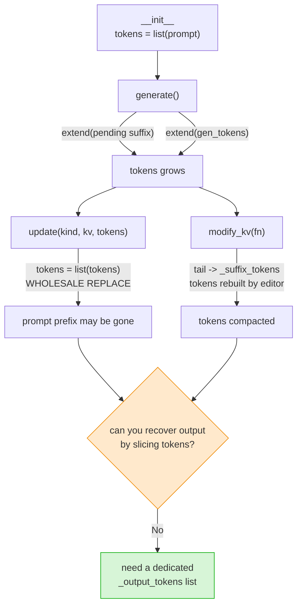

# Medium · #4591 — `output_tokens` returned the prompt as well, because it returned the live sequence

| | |
|---|---|
| **Issue** | [LMCache/LMCache#4591](https://github.com/LMCache/LMCache/issues/4591) — *"[Bug][SDK] LMCacheRequestStream.output_tokens includes prompt tokens"* |
| **Label** | `good second issue` |
| **Reported** | 2026-08-16 by [`@sanjayy0612`](https://github.com/sanjayy0612) |
| **Fixing PR** | [#6282](https://github.com/LMCache/LMCache/pull/6282) by [`@mohan-zeyu`](https://github.com/mohan-zeyu) (after an earlier attempt, [#4595](https://github.com/LMCache/LMCache/pull/4595), was closed unmerged) |
| **Fix commit** | [`34f8a409`](https://github.com/LMCache/LMCache/commit/34f8a409e3631eff51d0b6fff67ca9c68f123377) (merged 2026-11-06, 82 days after the report) |
| **Diff size** | 3 files, +215 / −8 — of which the production change is **+19 / −4**; the other 184 lines are tests |

> **Verification status.** This is the one deep dive in this guide with **executed
> evidence**. The real `lmcache/sdk/request.py` was extracted at both `34f8a409^` and
> `34f8a409` and run against the issue's own repro plus three more scenarios. The
> module's imports (`torch`, `lmcache.logging`, `lmcache.sdk.context`) were stubbed —
> `request.py` uses them only in annotations and the module sets
> `from __future__ import annotations`, and every scenario passes `contexts=[]`, so the
> token bookkeeping under test touches none of them. The two files under test are
> otherwise byte-for-byte the shipped source. All output below is real program output,
> and is marked where it appears.

---

## 1. TL;DR

- **Symptom.** `LMCacheRequestStream.output_tokens` returned `[10, 20, 30, 31]` — prompt *and* generation — when its own docstring promised only the generated tokens, `[30, 31]`.
- **Root cause.** The property was `return self.tokens`, and `self.tokens` is the **live sequence**: it starts as the prompt, gets generated ids appended, and is wholesale *replaced* by `update()` and partially *moved out* by `modify_kv()`. It was never output history. The one-line implementation contradicted the three-line docstring directly above it.
- **Why the obvious fix is wrong.** You cannot recover the output by slicing `self.tokens[len(prompt):]`. The reporter spotted this and said so in the issue; it is the reason the fix took 82 days and two attempts.
- **Fix.** Track generated ids in a dedicated `_output_tokens` list, appended in the same `finally` block that already maintained `_decoded` and `_text_parts`. Return a **copy**.
- **Bonus.** The same PR fixed an unreported aliasing bug in the neighbouring `suffix_tokens` property, where a caller mutating the returned list could corrupt the next prompt.

---

## 2. The symptom

The issue ships a complete, dependency-light repro, which is why it reproduces cleanly
four months later:

```python
from lmcache.sdk.request import LMCacheRequestStream, TokenEvent

def post_completion(prompt_token_ids, sampling_params, cache_salt):
    yield TokenEvent(token_id=30, text="x")
    yield TokenEvent(token_id=31, text="y")

stream = LMCacheRequestStream(
    contexts=[],
    post_completion=post_completion,
    prompt_token_ids=[10, 20],
)
stream.generate({"max_tokens": 2})

print(f"Output tokens: {stream.output_tokens}")
print(f"Decoded length: {stream.decoded_tokens}")
```

Reported actual output:

```text
Output tokens: [10, 20, 30, 31]
Decoded length: 2
```

Expected: `[30, 31]`. The reporter's framing of why this matters:

> This causes downstream token accounting issues for SDK users and creates a stark
> inconsistency with `decoded_tokens`.

That inconsistency is the sharpest statement of the bug. The same object reports
`decoded_tokens == 2` and an `output_tokens` of length 4. One of the two is lying, and
there is an invariant — `len(output_tokens) == decoded_tokens` — that a caller would
reasonably assume and that was false for every stream ever created.

### 2.1 Reproduced

Running the issue's repro against the real pre-fix module, plus three scenarios the issue
suggested as regression tests:

```
======================================================================
BEFORE  34f8a409^
======================================================================
  [BUG] issue repro: prompt [10,20], 2 generated
          output_tokens  = [10, 20, 30, 31]   (want [30, 31])
          decoded_tokens = 2
          invariant len(output_tokens)==decoded_tokens: False
  [BUG] two consecutive generate() calls
          output_tokens  = [10, 20, 30, 31, 30, 31]   (want [30, 31, 30, 31])
          decoded_tokens = 4
          invariant len(output_tokens)==decoded_tokens: False
  [BUG] generation producing zero tokens
          output_tokens  = [10, 20]   (want [])
          decoded_tokens = 0
          invariant len(output_tokens)==decoded_tokens: False
  [BUG] caller mutates the returned list
          output_tokens  = [10, 20, 30, 31, 999]   (want [30, 31])
          decoded_tokens = 2
          invariant len(output_tokens)==decoded_tokens: False
```

*(Real output, executed as described in §0.)* The first block matches the issue's reported
output exactly. The third row is the nastiest for a caller: a request that generated
**nothing** reports two output tokens, so an accounting loop sees phantom output on every
empty completion. The fourth row is the aliasing bug of §5.3 — appending to the list the
property handed back mutated the stream's own live sequence.

---

## 3. Background you need

### 3.1 What `LMCacheRequestStream` is

The LMCache SDK lets you drive a logical request through the cache directly — retrieve KV
for a prefix, generate, edit the KV, generate again — without going through vLLM.
`LMCacheRequestStream`
([`lmcache/sdk/request.py`](https://github.com/LMCache/LMCache/blob/53bde913de1adae2a380fe0c2de8d2b9355b4702/lmcache/sdk/request.py))
is the handle for one such request. Generation itself is delegated to a user-supplied
`post_completion` callback that yields `TokenEvent(token_id, text)`, which is what makes the
repro so cheap: no model, no engine, no GPU.

### 3.2 The five token fields, and why there are five

This is the crux. The upstream design doc
[`docs/design/sdk/request.md`](https://github.com/LMCache/LMCache/blob/53bde913de1adae2a380fe0c2de8d2b9355b4702/docs/design/sdk/request.md)
enumerates them because they genuinely all mean different things:

| field | meaning |
|---|---|
| `tokens` | the **live** sequence: prompt, plus suffix, plus generated — and whatever `update()` installed |
| `_suffix_tokens` | tokens *not* in the stored KV — the non-chunk-aligned tail left by `modify_kv` |
| `_decoded` | cumulative **count** of generated tokens (`decoded_tokens`) |
| `_text_parts` | cumulative generated **text** (`output_text`) |
| `_output_tokens` | cumulative generated **ids** (`output_tokens`) — *added by this fix* |

Before the fix there were four, and the "generated ids" row had no home. `output_tokens`
borrowed `tokens`, which is adjacent to the truth and not the truth.

### 3.3 Why you cannot just slice

`self.tokens` is mutated by three different methods, in three different ways:

- [`generate()`](https://github.com/LMCache/LMCache/blob/53bde913de1adae2a380fe0c2de8d2b9355b4702/lmcache/sdk/request.py#L197) **appends** — `self.tokens.extend(gen_tokens)`, and also extends by any pending suffix *before* generating.
- [`update()`](https://github.com/LMCache/LMCache/blob/53bde913de1adae2a380fe0c2de8d2b9355b4702/lmcache/sdk/request.py#L296) **replaces** — `self.tokens = list(tokens)`. The prompt prefix may be gone entirely.
- [`modify_kv()`](https://github.com/LMCache/LMCache/blob/53bde913de1adae2a380fe0c2de8d2b9355b4702/lmcache/sdk/request.py#L324) **moves and compacts** — the tail beyond the cached length is lifted into `_suffix_tokens`, then `tokens` is rebuilt from the editor's output.

The reporter understood this and wrote the correct design into the issue:

> A robust fix requires tracking generated token IDs in a dedicated structure, similar to
> how `_text_parts` is handled. Simply returning final `_decoded` elements or slicing
> `self.tokens` based on prompt length is **risky**, as `modify_kv()` might replace or
> compact the live token sequence dynamically.

That paragraph is the whole fix, specified four months before it was merged. The merged
code's comment says the same thing in two lines:

```python
        # Kept apart from tokens: generate() appends to tokens, while update()
        # and modify_kv() replace or truncate it, so it is not output history.
```



---

## 4. Root cause

At the fix commit's parent, the property was two lines:

```python
    @property
    def output_tokens(self) -> list[int]:
        """Return the concatenated generated tokens across all segments."""
        return self.tokens
```

The docstring is right. The code returns a different object than the one described. There
is no subtlety here — no edge case, no interaction, no platform. It is a property whose
body does not implement its own first line.

What *is* worth dwelling on is how it survived. Three reasons, all of them about the shape
of the mistake rather than its difficulty:

1. **It returns something plausible.** `[10, 20, 30, 31]` is a list of ints, correctly
   ordered, ending in the generated tokens. Every type check passes. Any assertion weaker
   than exact equality — "is it a list?", "is it non-empty?", "does it end with the last
   token?" — passes too.
2. **The neighbouring properties were right**, so the class looked internally consistent.
   `decoded_tokens` returned `self._decoded`; `output_text` returned
   `"".join(self._text_parts)`. Both read from dedicated accumulators. Only the third
   member of the trio reached for the live sequence.
3. **The correct value was already being computed.** `_decoded` was incremented from
   `len(gen_tokens)` on exactly the list the fix needed. The information was there, one
   line away, discarded.

The deeper cause is a missing field, not a wrong expression. When `_decoded` and
`_text_parts` were introduced for "cumulative generated count" and "cumulative generated
text", the symmetric "cumulative generated ids" was not — and `tokens` was close enough
to fill the gap.

---

## 5. The fix

[`34f8a409`](https://github.com/LMCache/LMCache/commit/34f8a409e3631eff51d0b6fff67ca9c68f123377),
+19/−4 of production code in three hunks.

### 5.1 A dedicated accumulator

```python
        self._decoded: int = 0
        self._text_parts: list[str] = []
+       # Kept apart from tokens: generate() appends to tokens, while update()
+       # and modify_kv() replace or truncate it, so it is not output history.
+       self._output_tokens: list[int] = []
```

Declared next to the two accumulators it is the sibling of. The trio is now complete:
count, text, ids.

### 5.2 Maintained in the `finally` block

```python
         finally:
             self._decoded += len(gen_tokens)
             self._text_parts.extend(gen_texts)
+            self._output_tokens.extend(gen_tokens)
             self.tokens.extend(gen_tokens)
```

One line, placed to inherit three existing correctness properties for free:

- **It is in `finally`**, so tokens produced before an engine error are retained — the same
  policy `_decoded` and `_text_parts` already had. The PR tests this explicitly
  (`test_output_tokens_keep_tokens_from_failed_generate`). Had the line gone after the
  `try`, a failed `generate` would have left `decoded_tokens` and `output_tokens`
  disagreeing — reintroducing the original bug in a rarer form.
- **It is adjacent to `self._decoded += len(gen_tokens)`**, extending the same list whose
  length feeds the counter. The invariant `len(output_tokens) == decoded_tokens` is now
  maintained by construction, not by coincidence, and the two lines are hard to change
  independently by accident.
- **It is untouched by `update()` and `modify_kv()`**, which is the entire point of §3.3.

### 5.3 Return copies — and the bug found on the way

```python
     @property
     def output_tokens(self) -> list[int]:
-        """Return the concatenated generated tokens across all segments."""
-        return self.tokens
+        """Return a copy of the concatenated generated tokens across all
+        segments.
+
+        Only token ids yielded by post_completion are included: never the
+        prompt, suffix tokens, or a sequence installed by update() or
+        modify_kv(). The length always equals decoded_tokens. Mutating the
+        returned list does not change the stream's history.
+        """
+        return list(self._output_tokens)
```

The new docstring is a specification: what is included, what is excluded, the invariant,
and the ownership rule. Compare it with the one-liner it replaced.

The PR then applies the same treatment to a property nobody filed a bug about:

```python
     @property
     def suffix_tokens(self) -> list[int]:
-        """Return the suffix tokens to be appended to the prompt."""
-        return self._suffix_tokens
+        """Return a copy of the suffix tokens to be appended to the prompt.
+
+        Mutating the returned list does not change what the next generate()
+        sends.
+        """
+        return list(self._suffix_tokens)
```

This is a real latent bug: `_suffix_tokens` is consumed by the next `generate()`
([`pending = self._suffix_tokens + list(suffix_tokens)`](https://github.com/LMCache/LMCache/blob/53bde913de1adae2a380fe0c2de8d2b9355b4702/lmcache/sdk/request.py#L213)),
so a caller who inspected `stream.suffix_tokens` and appended to it would have silently
altered the next prompt. Returning the internal list from a property is the same class of
mistake as returning `self.tokens` — leaking a mutable internal — and fixing the whole
class rather than the reported instance is what makes this a good patch rather than a
minimal one.

### 5.4 Verified

The same four scenarios against the post-fix module:

```
======================================================================
AFTER   34f8a409
======================================================================
  [ok ] issue repro: prompt [10,20], 2 generated
          output_tokens  = [30, 31]   (want [30, 31])
          decoded_tokens = 2
          tokens         = [10, 20, 30, 31]
          invariant len(output_tokens)==decoded_tokens: True
  [ok ] two consecutive generate() calls
          output_tokens  = [30, 31, 30, 31]   (want [30, 31, 30, 31])
          decoded_tokens = 4
          invariant len(output_tokens)==decoded_tokens: True
  [ok ] generation producing zero tokens
          output_tokens  = []   (want [])
          decoded_tokens = 0
          invariant len(output_tokens)==decoded_tokens: True
  [ok ] caller mutates the returned list
          output_tokens  = [30, 31]   (want [30, 31])
          decoded_tokens = 2
          invariant len(output_tokens)==decoded_tokens: True
```

*(Real output.)* All four pass, the invariant holds in every case, and `tokens` still
carries the full live sequence `[10, 20, 30, 31]` — the fix adds a view, it does not change
what `tokens` means.

### 5.5 The tests, and the docs

184 of the 215 added lines are tests — a ~10:1 test-to-code ratio, covering exactly the
list the reporter proposed plus two the PR author added:

| test | scenario |
|---|---|
| `test_output_tokens_excludes_prompt` | the issue's repro |
| `test_output_tokens_accumulate_across_generate_calls` | multiple `generate()`s |
| `test_output_tokens_empty_when_nothing_generated` | zero-token generation |
| `test_output_tokens_unaffected_by_modify_kv` | the §3.3 hazard |
| `test_output_tokens_unaffected_by_update` | the other §3.3 hazard |
| `test_output_tokens_keep_tokens_from_failed_generate` | the `finally` policy |
| `test_mutating_output_tokens_does_not_change_stream` | §5.3 aliasing |
| `test_mutating_suffix_tokens_does_not_change_next_prompt` | §5.3 bonus fix |

They use a `_ScriptedEngine` and a `_FakeKVContext` rather than a model — the same
insight that made the issue's repro cheap, turned into fixtures.

The PR also updates
[`docs/design/sdk/request.md`](https://github.com/LMCache/LMCache/blob/53bde913de1adae2a380fe0c2de8d2b9355b4702/docs/design/sdk/request.md),
which matters because the doc previously described the four-field model that *caused* the
bug. It now records why the ids cannot be recovered from `tokens`:

> Generated ids are also appended to `tokens`, but they cannot be recovered from it:
> `tokens` starts as the prompt, `update` replaces it with the edited sequence, and
> `modify_kv` may move recent generated ids into `_suffix_tokens`.

And it disambiguates a genuine name collision the fix exposed — `StreamPerfMetrics` also
has an `output_tokens`, which is a per-call **count**, not a cumulative id list.

---

## 6. Why the fix is correct

- **It implements the docstring that was already there.** The contract did not change; the
  code caught up to it. Nothing downstream needs to relearn anything, except callers who
  had compensated for the bug (see below).
- **It is immune to the hazard that sank the naive fix.** `_output_tokens` is appended only
  in `generate()`'s `finally`. `update()` and `modify_kv()` do not touch it, so no
  replacement or compaction of the live sequence can corrupt it — verified by two of the
  eight tests.
- **The invariant is structural.** `len(output_tokens) == decoded_tokens` holds because the
  counter and the list are updated from the same `gen_tokens` on adjacent lines.
- **Ownership is now explicit.** Both properties return copies, so no caller can reach the
  stream's internals through a read accessor.

**What to watch out for:** this is a **behavioural breaking change** to a public SDK
property, shipped in a bugfix. Any caller that had worked around the bug — slicing
`output_tokens[len(prompt):]`, or relying on it to get the full sequence — breaks on
upgrade. The right call (the old behaviour was indefensible and `tokens` still provides the
full sequence), but it is the kind of fix that deserves a release note, and the 82-day
latency means there was time for workarounds to accumulate.

---

## 7. The lessons

**A docstring is a test that is not run.** This bug was detectable by reading three
consecutive lines, and it lived for months in a public API. The repo's own standard
(`AGENTS.md`) is explicit about this — *"Write tests against the public interface and
docstring contract, not the implementation"* — and that is precisely the test that was
missing: the docstring said "generated tokens", so something should have asserted that the
prompt was absent.

**When sibling fields exist, a missing one is a smell.** `_decoded` and `_text_parts`
accumulate the count and the text of generated output. The absence of an ids accumulator,
with `output_tokens` reaching for the live sequence instead, is the visible shape of the
defect. Asking "why does this one property read from a different source than its
neighbours?" finds it immediately.

**The reporter doing the design work is worth more than the reporter filing fast.** This
issue named the file, the property, the exact line, the expected value, the *reason the
obvious fix is wrong*, and a list of regression tests. The merged PR implements that
specification nearly verbatim, including the test list. The first attempt at a fix
([#4595](https://github.com/LMCache/LMCache/pull/4595)) was closed unmerged — a good report
is not a guarantee of a fast fix, but it is what made the eventual fix complete rather than
a slice.

**Fix the class, not the instance.** Nobody reported `suffix_tokens`. The author noticed it
was the same mistake — a property leaking a mutable internal — and fixed both. That is the
difference between closing a ticket and improving an API.

---

## 8. Where to look next

- Upstream: [`docs/design/sdk/request.md`](https://github.com/LMCache/LMCache/blob/53bde913de1adae2a380fe0c2de8d2b9355b4702/docs/design/sdk/request.md) — the field model, updated by this PR; and [`docs/design/sdk/context.md`](https://github.com/LMCache/LMCache/blob/53bde913de1adae2a380fe0c2de8d2b9355b4702/docs/design/sdk/context.md) for `LMCacheSDKContext`, the retrieve/store side the stream wraps.
- [KV cache lifecycle](../features/02-kv-cache-lifecycle.md) — what `retrieve` and `store` do underneath, and the chunk alignment that `modify_kv`'s suffix handling exists to cope with.
- [#4698](medium-4698-nixl-pool-slot-units.md) — the other "two fields that should agree did not" bug in this set, with a near-identical lesson about invariants between related values.
