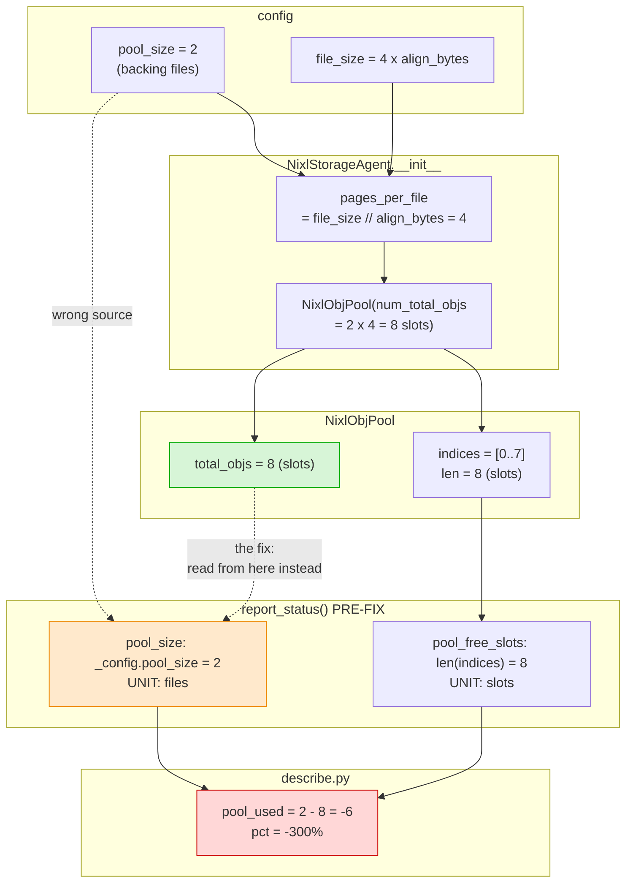

# Medium · #4698 — a status field reported in files and subtracted in pages, so the CLI showed −300%

| | |
|---|---|
| **Issue** | [LMCache/LMCache#4698](https://github.com/LMCache/LMCache/issues/4698) — *"NixlStoreL2Adapter reports negative pool usage for multi-page backing files"* |
| **Label** | `good second issue` |
| **Reported** | 2026-08-21 by [`@amd-ivaganev`](https://github.com/amd-ivaganev) |
| **Fixing PR** | [#5800](https://github.com/LMCache/LMCache/pull/5800) by [`@mohan-zeyu`](https://github.com/mohan-zeyu) (after an earlier attempt, [#4700](https://github.com/LMCache/LMCache/pull/4700), was left open) |
| **Fix commit** | [`46e33e85`](https://github.com/LMCache/LMCache/commit/46e33e85a56d3a65f4839887734ffaf044c34d2a) (merged 2026-10-16, 56 days after the report) |
| **Diff size** | 2 files, +38 / −3 — of which the production change is **one token on one line** |

> **Verification status.** The failure was not reproduced: it needs a working NIXL
> install with a POSIX backend. The *arithmetic* was re-derived by hand from the source
> and reproduces the issue's reported numbers exactly. One claim in §7 — that the
> repository's SLF lint rule is disabled everywhere — **was** verified by running the
> project's pinned `ruff` against a minimal probe, and that output is shown.

---

## 1. TL;DR

- **Symptom.** `lmcache describe` printed `Pool used: -6 / 2 (-300.0%)` for a healthy, empty NIXL pool that should have read `0 / 8 (0%)`.
- **Root cause.** `report_status()` returned two fields the CLI subtracts, measured in **different units**. `pool_size` was the configured count of backing *files*; `pool_free_slots` was the count of free allocation *pages*. With 2 files × 4 pages, that is `2 − 8 = −6`.
- **Fix.** One token: `self._config.pool_size` → `pool.total_objs`. The correctly-unit-ed value already existed as a public property; nothing needed to be added.
- **Not a real over-allocation.** The reporter led with this, and it is why the issue is `good second issue` rather than `bug`: the allocator was always correct, only its report was wrong.
- **The uncomfortable part.** The issue asked for the adapter to stop reaching into the pool's private `_lock` and `indices`. The merged fix did not do that, and §7 shows *why nobody was forced to*: the lint rule that should have flagged it is silently disabled across the entire repository.

---

## 2. The symptom

The report is exemplary in a specific way — it opens by telling you what the bug is *not*:

> The static NixlStoreL2Adapter can report a negative Pool used value when a NIXL backing
> file contains more than one allocation page. This is a status-reporting problem; it does
> not indicate that the allocator has over-allocated storage.

Then a concrete configuration and both numbers:

> Configure the POSIX backend with two backing files, where each file holds four aligned
> pages. A new pool has eight free allocation slots.
>
> Expected status: `pool_size=8` and `pool_free_slots=8`, so the CLI displays `0 / 8 (0%)`.
>
> Actual status: `pool_size=2` and `pool_free_slots=8`, so the CLI calculates and displays
> `-6 / 2 (-300%)`.

And then the cause, correctly identified by the reporter, including both file paths:

> For file-backed NIXL storage, `NixlStorageAgent` creates `pool_size` times
> `pages_per_file` allocation slots. However, `NixlStoreL2Adapter.report_status()` reports
> the configured backing-file count as `pool_size`, while it reports the free
> allocation-page count as `pool_free_slots`. The CLI correctly subtracts these fields, but
> the fields have different units.

There is almost nothing left for a fixer to diagnose. The value of this deep dive is
therefore not the hunt — it is what the bug and its fix reveal about unit discipline, and
what the *unfixed* half of the issue reveals about the project's lint configuration.

---

## 3. Background you need

### 3.1 Files, pages and slots

The NIXL L2 adapter stores KV objects in pre-allocated, fixed-size slots. For a file
backend, slots are **pages carved out of backing files**, and the count comes from a
division — [`nixl_store_l2_adapter.py#L193`](https://github.com/LMCache/LMCache/blob/53bde913de1adae2a380fe0c2de8d2b9355b4702/lmcache/v1/distributed/l2_adapters/nixl_store_l2_adapter.py#L193):

```python
        if self.backend in _FILE_BACKENDS:
            file_size = int(
                self.backend_params.get("file_size", l1_memory_desc.align_bytes)
            )
            pages_per_file = file_size // l1_memory_desc.align_bytes
            self.pool = NixlObjPool(num_total_objs=self.pool_size * pages_per_file)
```

while an object backend has exactly one slot per object:

```python
        elif self.backend in ["OBJ", "AZURE_BLOB"]:
            self.pool = NixlObjPool(num_total_objs=self.pool_size)
```

So `self._config.pool_size` means **"number of backing files"** on a file backend and
**"number of slots"** on an object backend. One config field, two meanings, and the
multiplier `pages_per_file` silently bridges them.

Note the default: `file_size` falls back to `align_bytes`, so `pages_per_file == 1` unless
the operator sets `file_size` explicitly. **That default is why the bug hid for so long** —
with one page per file, `pool_size * 1 == pool_size` and the two units coincide. Every
default-configured deployment, and every test, produced correct output.

### 3.2 The pool

[`NixlObjPool`](https://github.com/LMCache/LMCache/blob/53bde913de1adae2a380fe0c2de8d2b9355b4702/lmcache/v1/distributed/l2_adapters/nixl_store_l2_adapter.py#L80)
is a free-list of integer slot indices. It already knew its own size, as a documented
public property:

```python
    def __init__(self, num_total_objs: int):
        self.indices = list(range(num_total_objs))
        self._total = num_total_objs
        self._lock = threading.Lock()

    @property
    def total_objs(self) -> int:
        """Total number of storage slots this pool manages (allocated + free)."""
        return self._total
```

`total_objs` is **always in slots**, on every backend — it is whatever was passed to the
constructor, which is `pool_size * pages_per_file` for files. It already existed before the
fix, and was already used elsewhere in the same file (at
[line 466](https://github.com/LMCache/LMCache/blob/53bde913de1adae2a380fe0c2de8d2b9355b4702/lmcache/v1/distributed/l2_adapters/nixl_store_l2_adapter.py#L466),
to size the registered memory region).

### 3.3 The consumer

[`describe.py#L345`](https://github.com/LMCache/LMCache/blob/53bde913de1adae2a380fe0c2de8d2b9355b4702/lmcache/cli/commands/describe.py#L345):

```python
        pool_size = adapter.get("pool_size")
        pool_free = adapter.get("pool_free_slots")
        if pool_size is not None and pool_free is not None:
            pool_used = pool_size - pool_free
            pct = pool_used / pool_size * 100 if pool_size > 0 else 0.0
```

The CLI is blameless. Subtracting free from total is the only sensible way to get "used",
and it is the reason the issue insists the fix belongs in the adapter and that the CLI must
not clamp:

> The CLI should then show a non-negative used count and a percentage between 0% and 100%,
> **without any clamping or backend-specific workarounds.**

That instruction is the most important sentence in the report. Clamping at the display layer
would have hidden the symptom and left the broken contract in place, and the next consumer
of `report_status()` would have rediscovered it.

---

## 4. Root cause

Pre-fix, `report_status()` built its dict from two different sources:

```python
        pool = self.nixl_agent.pool
        with pool._lock:
            pool_free_slots = len(pool.indices)
        return {
            ...
            "pool_size": self._config.pool_size,      # <-- files
            "pool_free_slots": pool_free_slots,        # <-- pages
            ...
        }
```

`pool_free_slots` is derived from the live pool, in slots. `pool_size` is read from
**config**, in files. The two values describing one pool were fetched from two different
objects, and only one of them knew about `pages_per_file`.

With the reporter's configuration:

| quantity | value | unit |
|---|---|---|
| configured `pool_size` | 2 | backing files |
| `pages_per_file` (`file_size // align_bytes`) | 4 | pages per file |
| actual slots — `pool.total_objs` | **8** | slots |
| `len(pool.indices)` on a fresh pool | **8** | slots |
| reported `pool_size` (pre-fix) | **2** | **files** |
| CLI `pool_used = 2 − 8` | **−6** | nonsense |
| CLI `pct = −6 / 2 × 100` | **−300%** | nonsense |

*(Re-derived by hand from the source; reproduces the issue's reported figures exactly.)*

The invariant the issue states — and that the reported fields must satisfy —

```
0 <= pool_free_slots <= pool_size
```

was violated as soon as `pages_per_file > 1`, and it was violated *most* on a **brand new,
completely empty** pool, where `pool_free_slots` is at its maximum. The healthier the
cache, the worse the number looked.



---

## 5. The fix

One line, one token:

```python
-            "pool_size": self._config.pool_size,
+            "pool_size": pool.total_objs,
```

That is the entire production change in
[`46e33e85`](https://github.com/LMCache/LMCache/commit/46e33e85a56d3a65f4839887734ffaf044c34d2a).

### 5.1 Why this is the right one token

- **It reads both fields from the same object.** `pool_free_slots` already came from
  `pool`; now `pool_size` does too. The class of bug — two views of one thing, fetched from
  two places — is eliminated structurally, not corrected numerically.
- **It is backend-agnostic by construction.** `total_objs` is `pool_size × pages_per_file`
  for files and `pool_size` for objects, because that is what the constructor was handed.
  The object-backend behaviour is therefore **provably unchanged**, satisfying the issue's
  "preserve existing behavior for object backends" criterion without a branch.
- **It needed no new API.** The issue proposed one:
  > Expose total and free slot counts together from `NixlObjPool` through a public
  > lock-protected method.

  The fixer found that half of it already existed and used it. Fewer lines, no new surface.

### 5.2 Where the merged fix departs from the suggested fix

The issue's proposal had a second motivation:

> This also avoids accessing the pool private lock and mutable index list from the adapter.

The merged fix **does not do this**. At the pinned revision, `report_status()` still reads:

```python
        pool = self.nixl_agent.pool
        with pool._lock:
            pool_free_slots = len(pool.indices)
```

So the adapter still acquires another object's private `_lock` and reads its mutable
`indices`. The reported *values* are now consistent; the *encapsulation* complaint was
dropped.

Two honest readings. In favour of the merged fix: it is minimal, it is trivially reviewable,
it fully resolves the user-visible defect, and the repo's own standard warns against
speculative abstraction. Against it: the combined-accessor design was not speculative —
reading `total_objs` outside the lock and `len(indices)` inside it means the two numbers can
come from different moments. In practice `total_objs` is immutable after construction, so no
inconsistency can actually arise today; the invariant holds. But it holds for a reason that
is nowhere written down, and a future `NixlObjPool` that could grow would break it silently.

### 5.3 The test

+37/−2, and the shape matters more than the size. Rather than add a bespoke case, the PR
**parameterised the existing fixture** so the whole suite can run with multi-page files:

```python
@pytest.fixture
def pages_per_file():
    return 1


@pytest.fixture
def adapter(pages_per_file):
    ...
    backend_params={
        "file_path": tmp_dir,
        "file_size": str(PAGE_SIZE * pages_per_file),
        "use_direct_io": "false",
    },
```

The default stays `1`, so every existing test is unchanged — and the regression test runs
both configurations:

```python
    @pytest.mark.parametrize("pages_per_file", [1, 4])
    def test_report_status_counts_slots_for_multi_page_files(
        self, pages_per_file, adapter
    ):
        """pool_free_slots should be no larger than pool_size"""
        adpt, buffer = adapter

        # Fresh adapter
        status = adpt.report_status()
        assert status["pool_size"] == status["pool_free_slots"]

        obj_size_pages = 2
        ...
        status = adpt.report_status()
        assert status["pool_size"] == status["pool_free_slots"] + obj_size_pages

        # Adapter after deleting the objects
        adpt.delete([key])
        status = adpt.report_status()
        assert status["pool_size"] == status["pool_free_slots"]
```

Three good decisions here:

1. **It asserts the invariant, not the constants.** `pool_size == pool_free_slots + 2`
   rather than `pool_size == 8`. The assertion holds for both parameterisations with one
   expression, and survives a change to `POOL_SIZE`.
2. **It checks before, during and after** — empty, two pages allocated, freed again —
   exactly the issue's acceptance criterion. A fix that got the total right but leaked slots
   on `delete` would fail the third assertion.
3. **It includes `pages_per_file=1`**, the already-working case, pinning the
   object-backend-equivalent behaviour against regression.

What it does not cover: the CLI rendering. Nothing asserts that `describe` prints
`0 / 8 (0%)`. The adapter contract is tested; the display that motivated the issue is
still verified only by eye.

---

## 6. Why the fix is correct

- **It makes the two fields unit-identical by sourcing them from one object.** Both are now
  slot counts from the same `NixlObjPool`, so `0 <= pool_free_slots <= pool_size` holds for
  any `pages_per_file`.
- **Object backends are untouched** — `total_objs == pool_size` there by construction.
- **No clamping anywhere.** The CLI arithmetic is unchanged and now produces correct output
  from correct inputs, which is what the reporter explicitly demanded.
- **The invariant is regression-tested at three pool states and two page geometries.**

---

## 7. A finding from the margins: the lint rule is off

The issue asked for the private-member access to go, and §5.2 notes it is still there. The
obvious question is why CI tolerates it, because `AGENTS.md` is emphatic:

> SLF lint rules are currently enforced by CI only in `lmcache/v1/multiprocess/` and
> `lmcache/v1/distributed/`. However, **all new code should follow SLF discipline regardless
> of location**.

`nixl_store_l2_adapter.py` is in `lmcache/v1/distributed/`. So `pool._lock` should be a CI
failure. It is not — and the reason is a two-line configuration bug in
[`pyproject.toml`](https://github.com/LMCache/LMCache/blob/53bde913de1adae2a380fe0c2de8d2b9355b4702/pyproject.toml#L111):

```toml
[tool.ruff.lint.per-file-ignores]
# Ignore SLF everywhere except lmcache/v1/multiprocess/
"!lmcache/v1/multiprocess/**" = ["SLF"]
"!lmcache/v1/distributed/**" = ["SLF"]
```

The intent is clear from the comment and from the second line having been appended to extend
enforcement to `distributed/`. The effect is the opposite. These are *negated* globs, and
they are independent: a file under `distributed/` is matched by `!…/multiprocess/**` (it is
not under `multiprocess/`), and a file under `multiprocess/` is matched by
`!…/distributed/**`. Since **no file can be under both directories at once**, every file in
the repository matches at least one pattern — so SLF is ignored everywhere, including in the
two directories the rules were written to protect.

Verified with the `ruff` version the repo pins in `.pre-commit-config.yaml` (`v0.11.7`),
using a three-file probe that reproduces the config:

```
########## PINNED ruff 0.11.7, both negated globs (as in repo) ##########
All checks passed!

########## CONTROL: only the multiprocess glob ##########
lmcache/v1/multiprocess/m.py:6:12: SLF001 Private member accessed: `_lock`
Found 1 error.
```

*(Real output. Each probe file contains one private-member access; with both globs present,
none is reported. The same result on ruff 0.17.6.)*

Against the actual tree at `53bde913`, with the rule forced on:

```
$ ruff check --isolated --select SLF --statistics lmcache/v1/distributed/
15    SLF001  private-member-access
$ ruff check --isolated --select SLF --statistics lmcache/v1/multiprocess/
1     SLF001  private-member-access

$ ruff check --select SLF lmcache/v1/distributed/ lmcache/v1/multiprocess/   # repo config
All checks passed!
exit=0
```

and the line this issue asked to clean up is one of the 15:

```
$ ruff check --isolated --select SLF \
      lmcache/v1/distributed/l2_adapters/nixl_store_l2_adapter.py
lmcache/v1/distributed/l2_adapters/nixl_store_l2_adapter.py:694:14: SLF001 Private member accessed: `_lock`
    |
693 |         pool = self.nixl_agent.pool
694 |         with pool._lock:
    |              ^^^^^^^^^^ SLF001
695 |             pool_free_slots = len(pool.indices)
```

**16 real violations masked**, including the exact one the issue raised.
So the "departure" in §5.2 is not really a judgement call that someone made and I second-
guessed — the guard rail that would have raised it during review was not reporting. Worth
a separate upstream issue; it is out of scope for this one, and I have not filed it.

---

## 8. The lessons

**Name the unit, or the unit will be assumed.** `pool_size` is a field name with no unit in
it, and it meant two different things depending on backend. `pool_size_files` versus
`pool_size_slots` — or just reading both numbers from the object that owns them — makes the
mismatch unspeakable. Every unit bug is a naming bug that got to run.

**Any two numbers a consumer will arithmetically combine form a contract.** `pool_size` and
`pool_free_slots` were never documented as a pair, but `describe.py` subtracts them, so
their units are part of the API. Emitting them from one source is the structural fix;
getting the multiplication right at each site is the fragile one.

**A default of 1 is a bug incubator.** `pages_per_file` defaults to 1, which makes the
multiplier invisible: the identity case is the common case, every test exercised it, and the
bug only appeared for operators who tuned `file_size`. When a factor defaults to its
identity, the code that forgets to apply it is correct by default — and the tests agree.
Parameterising the fixture over `[1, 4]`, as the fix did, is the durable answer.

**"Fix the report, not the reporter" — and the reporter said so first.** The issue opens by
clarifying that the allocator is fine, and ends by forbidding CLI clamping. Both instincts
point at the same discipline: push the correction to where the wrong value is *produced*. A
clamp in `describe.py` would have made the screen look right and the contract stay broken.

**When a standard is not enforced, assume it is not followed.** `AGENTS.md` says SLF is
enforced in two directories. It is enforced in none, and there are 16 violations. The
project's intent was documented, implemented, and quietly inverted by a glob — which is a
better argument for testing your lint config than any amount of policy text.

---

## 9. Where to look next

- [L2 adapters and storage tiers](../features/04-l2-adapters-and-storage.md) — `L2AdapterInterface`, the NIXL adapters, and how `report_status` fits the adapter contract.
- [CLI](../features/10-cli.md) — the `describe` command and how it renders adapter status.
- [Observability](../features/09-observability.md) — the other consumers of `report_status`.
- [#4591](medium-4591-sdk-output-tokens.md) — the sibling "two values that should agree did not" bug, in the SDK.
- Upstream: [`docs/design/v1/distributed/l2_adapters/nixl_store.md`](https://github.com/LMCache/LMCache/blob/53bde913de1adae2a380fe0c2de8d2b9355b4702/docs/design/v1/distributed/l2_adapters/nixl_store.md) and [`nixl_native.md`](https://github.com/LMCache/LMCache/blob/53bde913de1adae2a380fe0c2de8d2b9355b4702/docs/design/v1/distributed/l2_adapters/nixl_native.md).
