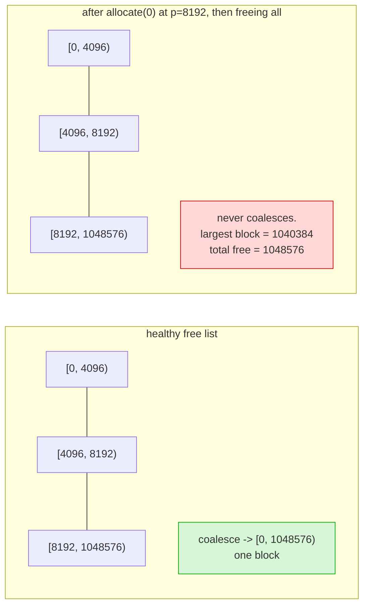

# Medium · #5115 — a zero-byte allocation wedged the free list, and the first fix made things worse

| | |
|---|---|
| **Issue** | [LMCache/LMCache#5115](https://github.com/LMCache/LMCache/issues/5115) — *"[Bug] AddressManager accepts size 0, breaks free list / ZeroDivisionError"* |
| **Reported** | 2026-09-14 by [`@chrisyifanjin`](https://github.com/chrisyifanjin) |
| **Fixing PR** | [#5117](https://github.com/LMCache/LMCache/pull/5117) by [`@LiRunGuo`](https://github.com/LiRunGuo) |
| **Fix commit** | [`b3dc6aff`](https://github.com/LMCache/LMCache/commit/b3dc6affc761141ac1891ffef08da1e79adea1c2) (merged 2026-09-23) |
| **Diff size** | 6 files, +186 / −0 — of which the production change is **+33**; 153 lines are tests |
| **Label** | `good-first-issue` — but see §7 |

> **Verification status.** **Reproduced.** `AddressManager`, `FreeBlock` and the
> `synchronized` decorator were extracted verbatim from
> `lmcache/v1/memory_management.py` at both `b3dc6aff^` and `b3dc6aff` and executed. The
> extraction replaces only the module's unrelated imports (the class needs
> `SortedList`, a logger and a no-op profiling decorator — no torch, no device code); the
> class source is unmodified. All output below is real program output and matches the
> reporter's byte for byte. The downstream eviction/busy-loop measurements in §5.2 are the
> PR author's, not re-measured here.

---

## 1. TL;DR

- **Symptom.** `AddressManager.allocate(0)` was documented as invalid and never checked. A zero-byte request inserted a **zero-sized free block** that permanently prevented its neighbours from coalescing. `get_free_size()` then reported the entire heap as free while allocating the heap failed. Separately, `batched_allocate(0, n)` raised `ZeroDivisionError`.
- **Where it came from.** Not a synthetic edge case: `SegmentTokenDatabase` produces an empty token range for a leading, trailing or doubled separator, and `LMCacheEngine.store()` dutifully asked for 0 bytes.
- **Fix, take one.** Validate the size and raise `RuntimeError`, matching a sibling check.
- **Fix, take two — the interesting part.** `RuntimeError` was *wrong*, and measurably so: every storage backend reads a failed allocation as **memory pressure**. One zero-byte request evicted all 10 cached chunks in a `LocalCPUBackend`, and with `busy_loop=True` it **never returned**. The final fix raises `ValueError` and also stops the engine from ever asking.
- **The lesson.** In an allocator, the *exception type* is a load-bearing protocol. "Caller passed nonsense" and "the machine is out of memory" demand opposite responses, and collapsing them into one type turned a rejected request into a cache wipe.

---

## 2. The symptom

The report is exemplary — a runnable repro, the revision it was tested on, both failure
modes, the real-world trigger, and a proposed fix:

```python
from lmcache.v1.memory_management import AddressManager

am = AddressManager(1 << 20)
a = am.allocate(4096)
z = am.allocate(0)
b = am.allocate(4096)
am.free(*z); am.free(*b); am.free(*a)
print([(x.start, x.size) for x in am._explicit_list])
# [(0, 4096), (4096, 4096), (8192, 1040384)]  <- never coalesced
am.allocate(1 << 20)
# RuntimeError: no memory is available (everything is free)

AddressManager(1 << 20).batched_allocate(0, 3)
# ZeroDivisionError (block.size // aligned_size)
```

and the trigger, which is the part that makes this a real bug rather than a curiosity:

> I hit this through `SegmentTokenDatabase`: a leading/trailing/double separator gives an
> empty range (e.g. `(4, 4)`), and `LMCacheEngine.store()` allocates 0 bytes for it.

### 2.1 Reproduced

Running the reporter's repro against the extracted pre-fix class:

```
========================================================================
BEFORE  b3dc6aff^
========================================================================
  free-list corruption (issue repro 1)
      free list after freeing everything = [(0, 4096), (4096, 4096), (8192, 1040384)]
            get_free_size() = 1048576 (heap is 1048576)
            allocate(whole heap) -> RuntimeError: Failed to allocate memory block of
                                    size 1048576 because no memory is available
  batched_allocate (issue repro 2)
      batched_allocate(0, 3) raised ZeroDivisionError: integer division or modulo by zero
  error type for a caller bug
      allocate(0) did not raise
```

*(Real output.)* The free list matches the reporter's reported output exactly. Note the
contradiction on the middle two lines: **`get_free_size()` says all 1 048 576 bytes are
free, and allocating 1 048 576 bytes fails.** Both statements are produced by the same
object, from the same free list, at the same moment.

---

## 3. Background you need

### 3.1 An explicit free list with coalescing

`AddressManager` manages a virtual address space with a sorted list of free blocks:

```python
        self._explicit_list: SortedList[FreeBlock] = SortedList(key=lambda x: x.start)
        self._explicit_list.add(FreeBlock(start=0, size=size))
```

and `FreeBlock` decides adjacency:

```python
@dataclass
class FreeBlock:
    """Metadata class used by the memory allocators"""

    start: int
    size: int

    def can_be_coalesced(self, succ: "FreeBlock") -> bool:
        return self.start + self.size == succ.start
```

`can_be_coalesced` is exact arithmetic: block *X* and its successor merge iff *X* ends
precisely where the successor begins. That is correct — and it is the mechanism the bug
subverts.

### 3.2 Why a zero-sized block is poison

Allocations are aligned (`ALIGN_BYTES = 4096`), but a zero-byte request aligns to zero, so
`allocate(0)` hands back a block of length 0 at some address *p*. Freeing it inserts
`FreeBlock(start=p, size=0)` into the sorted list.

Now consider the neighbour *L* that ends at *p*, and the neighbour *R* that begins at *p*:

- `L.can_be_coalesced(zero_block)` → `L.start + L.size == p` → **True**, they merge… into a
  block that still ends at *p*.
- But the zero block sits *between* `L` and `R` in a list sorted by `start`, and with
  `size == 0` it occupies no space. Whatever pairwise coalescing the free path performs, a
  zero-length entry at the junction means the real neighbours are never adjacent **to each
  other** in the list.

The result is a permanent fracture at address *p*:



Hence the contradiction in §2.1. `get_free_size()` **sums** the blocks — correctly, 1 048 576.
`allocate()` **searches for one block** large enough:

```python
        for block in self._explicit_list:
            if block.size >= aligned_size:
```

and the largest is 1 040 384. The allocator is not confused about how much memory is free; it
is correct about a heap that has been permanently fragmented by one bad request. **The damage
outlives the request** — that is what makes this worse than a simple input-validation miss.

`batched_allocate(0, n)` fails more straightforwardly, at `block.size // aligned_size` with
`aligned_size == 0`. And as the reporter noted, that one escapes further than it should:

> The `ZeroDivisionError` also gets past `TensorMemoryAllocator.batched_allocate`, which only
> catches `RuntimeError`.

---

## 4. Root cause

A documented precondition that was never enforced. From the PR:

> `AddressManager.allocate()` and `batched_allocate()` document that the requested size must
> be greater than zero but never checked it, so a zero-byte request corrupted the explicit
> free list instead of failing.

Two layers, and both had to be wrong for this to happen:

1. **The allocator trusted its caller** on a precondition it had written down.
2. **The engine violated it**, because `SegmentTokenDatabase` can legitimately yield an empty
   range and `store()` did not treat `end <= start` as a case to skip.

Either layer alone would have prevented the bug — which is why the final fix changes both
(§5.3).

---

## 5. The fix

### 5.1 Take one: validate, raise `RuntimeError`

The first commit added the check and chose `RuntimeError` for consistency with a neighbour:

> Validate size in both methods with the same `RuntimeError` shape used for `batch_size` in
> #5061, and document it in the Raises sections.

This is a defensible instinct — match the local convention — and it was wrong.

### 5.2 Take two: `RuntimeError` is the wrong word

The second commit, and the reason this issue earns a deep dive:

> `RuntimeError` is overloaded in the allocation stack: every storage backend reads a failed
> allocation as memory pressure. Measured with 10 chunks in a `LocalCPUBackend`, one
> zero-byte request **evicted all of them** with `busy_loop=False`, and with
> `busy_loop=True` it **never returned at all**.

Read that again. The *first fix* — which correctly rejected an invalid request — converted a
free-list corruption into:

- **a full cache wipe**, because backends interpret allocation failure as "under pressure,
  evict and retry", or
- **an infinite hang**, because with `busy_loop=True` they retry forever waiting for memory
  to free up, and no amount of eviction will ever make `size=0` allocatable.

The busy-loop case is strictly worse than the original bug. The original corrupted a free
list; this hangs the server, permanently, on a malformed token range.

The mechanism is that `RuntimeError` already had a meaning in this stack — *"allocation
failed, memory is scarce"* — and the whole retry/evict machinery is built on that reading.
Adding a second, unrelated condition under the same type made every handler respond to a
caller bug with the remedy for memory pressure.

So the final fix raises `ValueError`, and says why **in the code**, where the next person to
reach for `RuntimeError` will see it:

```python
        Raises:
            ValueError: If size is not positive. This is a caller bug, not an
                out-of-memory condition, and must not be signalled as one: the
                allocation stack treats a failed request as memory pressure and
                reacts by evicting cached objects or retrying in a busy loop.
            RuntimeError: If no memory is available to allocate.
        """
        if size <= 0:
            raise ValueError("size must be greater than 0")
```

and on `batched_allocate`, a cross-reference rather than a duplicated paragraph:

```python
            ValueError: If size is not positive. See ``allocate`` for why this is
                not reported as ``RuntimeError``.
```

That docstring is the most valuable artifact in the whole PR. It converts a hard-won
measurement into a durable constraint on the API.

### 5.3 Also: stop the engine from asking

Validation alone would have turned a corruption into a crash. The fix also removes the
source, in `LMCacheEngine.store()` and `store_layer()`:

```python
+                # A degenerate range carries no tokens (for example a separator
+                # at the very end of a blend input). Skip it: a zero-byte
+                # allocation is invalid, and the allocation stack reacts to a
+                # rejected request by evicting cached objects or spinning in a
+                # busy loop.
+                if end <= start:
+                    logger.debug(
+                        "Skipping empty token range [%d, %d) during store", start, end
+                    )
+                    continue
```

Defence in depth, with the division of responsibility stated: the allocator **rejects**
nonsense (so the contract is enforceable and testable), the engine **never produces** it (so
the rejection is unreachable in practice). `logger.debug` rather than a warning, because an
empty segment from a trailing separator is normal input, not an anomaly.

### 5.4 Verified

```
========================================================================
AFTER   b3dc6aff
========================================================================
  free-list corruption (issue repro 1)
      allocate(0) raised ValueError: size must be greater than 0
  batched_allocate (issue repro 2)
      batched_allocate(0, 3) raised ValueError: size must be greater than 0
  error type for a caller bug
      allocate(0) -> ValueError  [caller-bug-shaped]
```

*(Real output.)* Both repros now raise before any state is touched, with the type that does
not trigger eviction or a busy loop.

The PR adds 153 lines of tests across four files — `test_address_manager.py`,
`test_memory_management.py`, `test_cache_engine.py` and
`test_local_cpu_backend.py`. That last one is the significant choice: it tests the
**backend's** response, which is where take-one's damage appeared. A test at the allocator
level alone would have passed for both fixes.

---

## 6. Why the fix is correct

- **It enforces a precondition that was already documented**, so no caller contract changed —
  only its enforcement.
- **The exception type matches the error's nature.** `ValueError` for a caller bug,
  `RuntimeError` reserved for genuine exhaustion, so the retry/evict machinery keeps
  responding only to real pressure.
- **It fails before mutating state.** The check precedes `compute_aligned_size`, so a rejected
  request cannot leave a zero-sized block behind.
- **It removes the only known producer**, so the new exception is unreachable through normal
  operation.
- **It is tested at both layers**, including the backend behaviour that made take-one
  dangerous.

**What it does not do:** it does not repair an already-fractured free list. A process that hit
this before upgrading keeps its fragmentation until restart. Given `AddressManager` instances
are per-pool and recreated on startup, that is an acceptable place to stop.

---

## 7. On the `good-first-issue` label

Worth flagging, because the label undersells it. The *reported* bug is a textbook
first issue: a missing guard, with a repro, a named fix, and a sibling check to copy.

The *actual* fix required knowing that `RuntimeError` is overloaded across the entire
allocation stack, that backends respond to it by evicting, that `busy_loop=True` turns it
into a hang — and then measuring all of that. That is deep systems knowledge about
error-type semantics in a layer the contributor was touching for the first time.

The two-commit shape is the evidence: a correct-looking first fix, then a second commit that
rejects it on measured grounds. Reading that sequence is more instructive than reading the
final diff, and it is a good argument for not squashing away the history of *why* an
implementation changed mid-review.

---

## 8. The lessons

**An exception type is part of your protocol.** In a stack where handlers branch on type,
adding a new condition to an existing type conscripts every handler into responding to it.
`RuntimeError` meant "memory is scarce, evict and retry" to a dozen call sites; reusing it
for "you passed 0" made them all respond to a bug with the remedy for pressure. Before
reusing an exception type, ask what already catches it.

**A rejected request must be cheaper than an accepted bad one — check that it is.** Take-one
rejected the request correctly and produced a cache wipe or a hang. "I added validation" is
not the end of the analysis; what *happens* on the rejection path is.

**Zero is not a small number; it is a different number.** A zero-sized free block breaks
coalescing because `can_be_coalesced` is exact adjacency arithmetic, and a zero-length entry
is adjacent to everything while separating its neighbours. Size-0, length-0 and empty-range
cases deserve explicit handling in any arithmetic that assumes extent.

**Prefer a contradiction as a diagnostic.** `get_free_size() == heap` while
`allocate(heap)` fails is the clearest possible signal, and it is the kind of invariant worth
asserting in tests: *the largest free block after freeing everything equals the heap.* That
assertion fails loudly where "total free bytes" passes.

**Fix the producer and the consumer.** The allocator should reject a zero-byte request; the
engine should never make one. Doing only the first converts corruption into a crash; doing
only the second leaves the trap set for the next caller.

---

## 9. Where to look next

- [L1 memory and eviction §6, §7](../features/03-l1-memory-and-eviction.md#6-allocators) — the allocator family `AddressManager` sits in, and the eviction machinery that take-one triggered.
- [KV cache lifecycle §7](../features/02-kv-cache-lifecycle.md#7-store) — the `store()` path that produced the degenerate range.
- [#4698](medium-4698-nixl-pool-slot-units.md) — another allocator-reporting bug, where the identity case (one page per file) hid the defect, as `size > 0` hid this one.
- [#5022](difficult-5022-turboquant-sm80-bfloat16.md) — the other "correct error handling, bad outcome" bug in this set.
