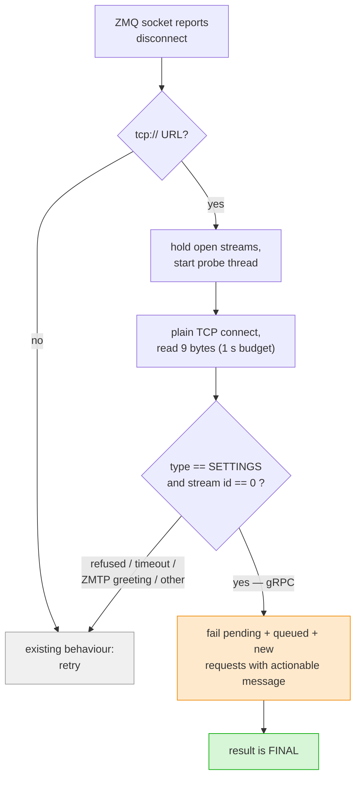

# Medium · #6543 — a ZMQ client pointed at a gRPC server hung for five minutes, then blamed the wrong thing

| | |
|---|---|
| **Issue** | [LMCache/LMCache#6543](https://github.com/LMCache/LMCache/issues/6543) — *"[MP] ZMQ client hangs until timeout when the server is running gRPC"* |
| **Reported** | 2026-11-11 by [`@theminjunchoi`](https://github.com/theminjunchoi) |
| **Fixing PR** | [#6544](https://github.com/LMCache/LMCache/pull/6544) by the same author — *"[Bugfix][MP] Fail fast when a ZMQ client connects to a gRPC server"* |
| **Fix commit** | [`81382fbf`](https://github.com/LMCache/LMCache/commit/81382fbf) (merged 2026-11-11, **same day**) |
| **Diff size** | 4 files, +342 / −8 — of which the production change is **+237 / −8**, almost all of it in the ZMQ client |
| **AI-assisted** | Yes, declared: *"AI-assisted change; the submitter reviews every line before this leaves draft."* |

> **Verification status.** Not reproduced — needs a running MP server in both transport
> modes. The HTTP/2 framing claims in §5.1 are checked against
> [RFC 9113 §4.1](https://www.rfc-editor.org/rfc/rfc9113.html#section-4.1) and the frame-type
> registry, which is public and stable; the code and timings are quoted from the PR.

---

## 1. TL;DR

- **Symptom.** Start the server with `--transport grpc`, point a client at `tcp://`, and every request hangs for the full `mq_timeout` — **300 seconds by default** — after which vLLM reports *that the server isn't running*. Which is false, and sends you debugging the wrong machine.
- **Root cause.** Not really LMCache's: the ZMTP handshake fails, **libzmq drops the connection and never retries**, and gives the application nothing but a disconnect event. There is no error to propagate, so the client waits.
- **Fix.** Use the disconnect as a trigger: open a plain TCP connection and read the first 9 bytes. Every gRPC server opens with an HTTP/2 SETTINGS frame. If that is what comes back, fail every pending, queued and new request immediately with a message naming the fix.
- **Result.** 323 s → 25 s in the vLLM CPU run, and the error says what to do: *"The server at tcp://localhost:6655 speaks gRPC, not ZMQ. Use grpc://localhost:6655, or start the server with --transport zmq."*
- **Why it was worth fixing now.** The reverse direction was already handled, and gRPC is becoming the default — so every existing `tcp://` config was about to walk into this.

---

## 2. The symptom

The issue in full is short enough to quote almost entirely, and it is a model bug report:

> If the server was started with `--transport grpc` but the client points at `tcp://`,
> requests never complete. The ZMQ handshake fails, libzmq drops the connection and never
> retries, so every call just sits there until it times out. vLLM waits out the full
> `mq_timeout` (300 s by default) and then reports that the server isn't running, which
> **sends you looking in the wrong place**.
>
> The reverse case is already handled since #5998: a gRPC client that hits a ZMQ server
> errors out immediately.
>
> This gets more likely once gRPC becomes the default (#4877), since any existing `tcp://`
> config would run into it.

Three separate pieces of work in one report: the mechanism (libzmq's handshake behaviour),
the asymmetry (the reverse case is already fixed, so there is a precedent to match), and the
urgency (a pending default change converts a rare misconfiguration into a common one).

**The misleading error is the actual bug.** A five-minute hang is bad; a five-minute hang
that concludes "the server isn't running" is worse, because it is *confidently wrong*. The
operator goes and checks the server, finds it up and healthy, and now distrusts the only
diagnostic they have.

---

## 3. Background you need

### 3.1 Two transports, one port-shaped hole

LMCache's control path speaks either ZMQ or gRPC
([transport §4, §5](../features/06-transport-layer.md#4-zmq)). Both are selected by URL
scheme on the client (`tcp://` vs `grpc://`) and by `--transport` on the server. Nothing
*structurally* prevents the two from disagreeing — they are separate settings, often in
separate config files, frequently managed by different people.

### 3.2 Why libzmq cannot help

ZMQ's protocol (ZMTP) begins with a greeting exchange. If the peer's first bytes are not a
valid greeting, libzmq concludes this is not a ZMTP peer, closes the socket, and — crucially
— **does not retry and does not surface an error to the application**. The socket simply
reports a disconnect.

From the PR:

> When the handshake fails, libzmq drops the connection and doesn't retry, so **the
> disconnect event is the only hint we get**.

So the client cannot distinguish:

| Situation | What the app sees | Correct response |
|---|---|---|
| Server restarting | disconnect | wait and reconnect |
| Transient network blip | disconnect | wait and reconnect |
| **Server speaks gRPC** | disconnect | **fail now, permanently** |

All three look identical, and the default behaviour — keep waiting — is right for two of
them. That is why this hangs rather than errors: the client is doing the correct thing for
the wrong diagnosis.

### 3.3 The asymmetry

A gRPC client hitting a ZMQ server already failed fast (since
[#5998](https://github.com/LMCache/LMCache/pull/5998)), because gRPC/HTTP/2 *does* produce a
protocol error the library reports. So one direction was diagnosable and the other was not —
not through design, but because of what each library happens to expose.

---

## 4. Root cause

There is no defective line to point at. The cause is a **gap in the information available at
the decision point**: the client must decide "retry or fail?" and holds exactly one bit
(disconnected), which is insufficient to distinguish a restarting peer from a wrong-protocol
peer.

The fix therefore cannot be a corrected condition. It has to **acquire the missing
information**, which is what makes this interesting as a bug.

---

## 5. The fix

### 5.1 Ask the port what it speaks

[`mq_client.py`](https://github.com/LMCache/LMCache/blob/53bde913de1adae2a380fe0c2de8d2b9355b4702/lmcache/v1/client/transport/zmq_impl/mq_client.py):

```python
# HTTP/2 frame header: length (3 bytes), type, flags, stream id (4 bytes).
_HTTP2_FRAME_HEADER_LEN = 9
_HTTP2_SETTINGS = 0x04
_PEER_PROBE_TIMEOUT_S = 1.0


def _peer_speaks_http2(host: str, port: int) -> bool:
    """Return whether the server at ``host:port`` greets like an HTTP/2 server.

    Returns:
        True if the first bytes the server sends are an HTTP/2 SETTINGS frame
        header. False if it sends anything else, nothing in time, or refuses
        the connection (for example while it is restarting).
    """
    header = b""
    try:
        with socket.create_connection((host, port), _PEER_PROBE_TIMEOUT_S) as sock:
            sock.settimeout(_PEER_PROBE_TIMEOUT_S)
            while len(header) < _HTTP2_FRAME_HEADER_LEN:
                chunk = sock.recv(_HTTP2_FRAME_HEADER_LEN - len(header))
                if not chunk:
                    break
                header += chunk
    except OSError:
        return False
    return (
        len(header) == _HTTP2_FRAME_HEADER_LEN
        and header[3] == _HTTP2_SETTINGS
        and header[5:] == bytes(4)
    )
```

The detection rests on a guarantee of HTTP/2 itself: **a server must send a SETTINGS frame as
the first thing on a new connection.** A 9-byte frame header is `length` (3 bytes), `type`
(1), `flags` (1), `stream id` (4). So the predicate checks:

- `header[3] == 0x04` — frame type is SETTINGS
- `header[5:] == bytes(4)` — stream id is 0, which SETTINGS frames are required to use

It deliberately does *not* check `length` (bytes 0–2, which varies with how many settings
the server sends) or `flags` (byte 4, which may carry ACK). Checking only the two invariant
fields is what makes this robust across gRPC implementations — and the PR confirms it was
validated against all three: *"gRPC servers (sync, aio and native) always open with an
HTTP/2 SETTINGS frame."*

**Every non-gRPC outcome returns `False`**, i.e. "keep the old behaviour":

> A restarting ZMQ server will either refuse the connection or send a ZMTP greeting, so it's
> left alone.

Connection refused, timeout, zero bytes, wrong frame type — all fall through to the existing
retry logic. The probe only ever *adds* a conclusion; it cannot turn a recoverable
disconnect into a failure. That asymmetry is what makes a speculative network probe on an
error path safe.



### 5.2 The error message is the deliverable

```python
                self._wrong_transport = (
                    f"The server at {self._server_url} speaks gRPC, not ZMQ. Use "
                    f"grpc://{host}:{port}, or start the server with "
                    "--transport zmq."
                )
```

This is what the issue was really about. It states what was observed, what is wrong, and
**both** ways to fix it — with the corrected URL already assembled from the host and port
the operator used. Compare with what it replaces: a 300-second wait ending in "the server
isn't running".

A diagnostic that names both resolutions is right here, because either may be the intended
one: the client's URL may be stale, or the server may have been started in the wrong mode.
The message does not presume which.

### 5.3 The concurrency, which is where the real work went

Most of the +232 lines in `mq_client.py` are not the probe; they are making a background probe interact
correctly with a live socket loop. The `PeerCheck` docstring lays out the state machine:

```python
class PeerCheck:
    """Track the checks a ZMQ disconnect starts to see if the server is gRPC.

    Only the socket loop uses it. A disconnect holds the streams open at that
    moment and starts a check; a disconnect while a check runs asks for one
    more, since the server may have changed in between. A gRPC result is
    final. Otherwise the held streams are released once a check ends with no
    disconnect after it started.
    """
```

Four properties, each earning its place:

- **"Only the socket loop uses it."** The probe thread *only reports a result*; the socket
  loop applies it. One owner for the state, so no lock.
- **A disconnect during a probe queues another.** The server could have changed mid-probe —
  ZMQ server down, gRPC server up on the same port two seconds later, which is literally one
  of the tested scenarios. A single probe could observe the wrong peer.
- **A gRPC result is final.** No oscillation: once identified, the client stops guessing.
- **Streams open at the disconnect are held until the probe answers.** Otherwise a stream
  reader would be told "closed" and reconnect, racing the probe.

And a small, sharp detail in `put_stream_error`:

```python
def put_stream_error(responses: queue.Queue, error: BaseException) -> None:
    """Hand error to a stream reader, replacing a response it has not read.

    The stream is failing, so dropping its last unread response is better than
    dropping the error: without the error the reader would wait forever.
    """
```

A single-slot response queue that is already full would normally mean "cannot deliver the
error". The code evicts the unread response to make room, with the reasoning written down:
a stale response is worth less than the error that stops an infinite wait. **This is the same
bug class as the outer one** — losing an error and hanging forever — caught one layer in.

### 5.4 Scope limits

- **`tcp://` only.** `_tcp_host_port` returns `None` for anything else, so IPC and inproc
  transports never probe. A probe needs a host and port to connect to.
- **1-second budget.** Long enough for a local or same-datacentre handshake, short enough
  that a probe against a silent port cannot itself become the hang.

### 5.5 Measured

The PR's before/after table (the author's measurements):

| | Before | After |
|:--|:--|:--|
| `tcp://` client, server on `--transport grpc` | Requests hang; vLLM waits out `mq_timeout` (300 s default), then reports the server isn't running — **323 s** in the vLLM CPU run | Requests fail at once with the §5.2 message; **vLLM fails at startup, 25 s** |
| ZMQ server stops, gRPC server takes its port 2 s later | Hang (still waiting at the script's 20 s timeout) | Fails with the same message after **2.5 s** |
| ZMQ server restarts on the same port (0, 0.5, 2, 6 s gaps) | Client reconnects | Client reconnects — **unchanged** |

The third row is the one that matters most for safety: the common recoverable case is
explicitly shown to be unaffected, at four different restart gaps. The new tests are reported
as failing on `dev` and passing 10/10 with the fix — a flakiness check appropriate for a
concurrency change.

---

## 6. Why the fix is correct

- **It only ever adds a conclusion.** Every ambiguous probe outcome returns `False` and falls
  back to existing retry behaviour, so the change cannot break a recoverable disconnect.
- **It keys on a protocol invariant**, not a version-specific string: HTTP/2 mandates a
  SETTINGS frame first, and only the two fields that cannot vary are checked.
- **It is triggered by an event that already means something went wrong.** The probe runs on
  disconnect, never on the hot path, so a healthy client pays nothing.
- **The recoverable case is tested at four restart gaps** and shown unchanged.
- **Narrowly scoped** to `tcp://` URLs with a 1-second timeout.

**What it does not do:** it will not catch a *third* protocol on the port — something that
is neither ZMTP nor HTTP/2 still produces the old hang. The probe answers "is it gRPC?",
not "what is it?". Given there are exactly two supported transports, that is a reasonable
place to stop, and it would be worth revisiting if a third ever appears.

---

## 7. The lessons

**A timeout is not an error message.** The code was "working" — the client retried a
disconnected peer, which is correct — and the user experience was a five-minute wait ending
in a false statement. Hangs that resolve into misleading conclusions cost more debugging time
than crashes.

**When a library gives you one bit, go get another.** libzmq could only say "disconnected".
Rather than accept that, the fix opens a second, independent channel — a bare TCP socket —
to acquire the information the first one could not provide. Unconventional, and correct,
because it is scoped to an error path and fails safe.

**Fail-fast beats fail-eventually when the diagnosis is certain.** The probe either knows it
is gRPC or knows nothing. Only in the certain case does behaviour change, and there it
changes completely: *every* pending, queued and new request fails at once.

**Asymmetric diagnosability is a bug.** One direction of the same misconfiguration errored
immediately and the other hung, purely because of what each library exposed. If one direction
of a mismatch is diagnosable, the other should be too — and the issue correctly cited the
already-fixed reverse case as the precedent to match.

**Fix it before the default changes.** The report's strongest argument was a *forecast*: gRPC
is becoming the default, so every existing `tcp://` config is about to hit this. Same-day
merge. Arguing from a pending change in blast radius is more persuasive than arguing from
current pain.

---

## 8. Where to look next

- [Transport layer §4, §5, §10](../features/06-transport-layer.md#4-zmq) — ZMQ, gRPC, and the debugging table this bug belongs in.
- [MP architecture](../features/01-mp-architecture.md) — the server side and its `--transport` flag.
- [PR #6754 walkthrough](../pr-walkthroughs/6754-grpc-auto-server-mode.md) — the gRPC default-mode change from the same author, part of the same migration this issue anticipated.
- [#5022](difficult-5022-turboquant-sm80-bfloat16.md) — the other "correct error handling, useless diagnostics" bug in this set.
