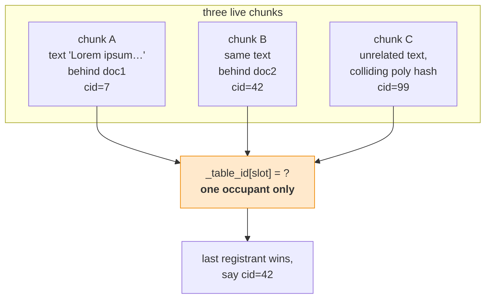
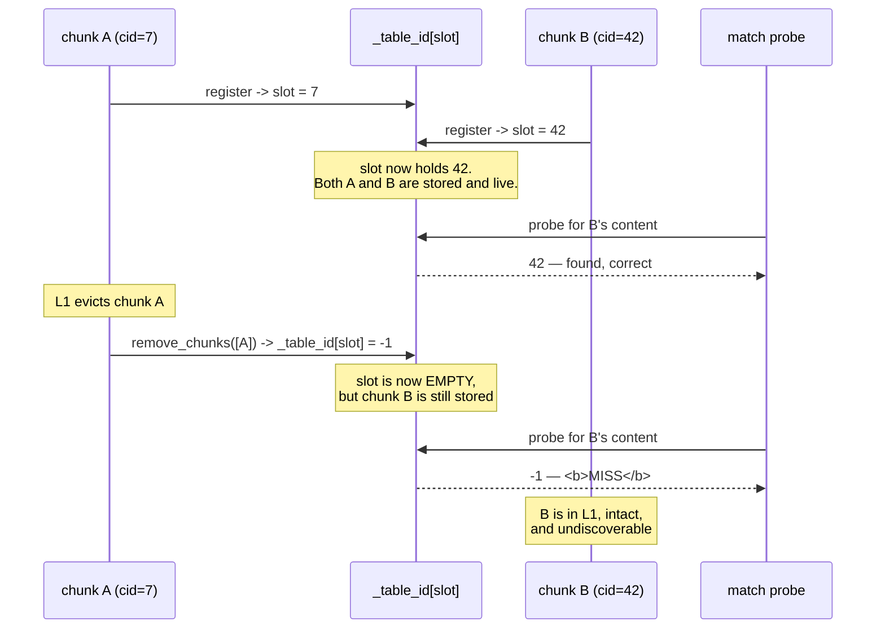

# Medium · #6698 — evicting one copy of a chunk hid a different copy that was still stored

| | |
|---|---|
| **Filed as** | [LMCache/LMCache#6698](https://github.com/LMCache/LMCache/pull/6698) — *"[Bugfix][CB] Clear a blend matcher slot only when the evicted chunk holds it"* (filed as a PR) |
| **Labels** | `full`, `skip expensive ci` |
| **Author** | [`@deng451e`](https://github.com/deng451e) / weishu, opened and merged 2026-11-17 (**same day**, 0 comments) |
| **Fix commit** | [`d051122d`](https://github.com/LMCache/LMCache/commit/d051122d) |
| **Diff size** | 3 files, +44 / −2. The production change is **+5 / −2** in `matcher.py`: one `if`, one comment, a re-indent, and a rewritten docstring. The rest is a 33-line test and a design-note update. |

> **Verification status.** Not reproduced — exercising this needs a CacheBlend deployment
> and a deliberately constructed slot collision. The data structures and the aliasing
> argument in §3 and §4 are read from `matcher.py` at the pinned revision and are quoted
> below.

---

## 1. TL;DR

- **Symptom.** With CacheBlend, evicting one stored chunk could make a **different, still-stored** chunk undiscoverable. Non-prefix matches silently stopped finding it.
- **Root cause.** The matcher's lookup table is a direct-address table: `slot = poly_hash & mask`. Several *live* chunks can legitimately map to one slot, but a slot records only one. Eviction cleared the slot without checking whether the evicted chunk was the one recorded in it.
- **It was permanent.** Re-storing the hidden chunk could not repair the slot, because the chunk was still recorded as registered — so the registration path skipped it. The entry stayed invisible until it was itself evicted.
- **Fix.** `if int(self._table_id[slot]) == cid:` — clear the slot only if this chunk still owns it.
- **Why it is instructive despite being three lines.** It is a textbook **ABA / stale-ownership** bug: an index that records "who holds this slot" was updated by a party that no longer held it, and the repair path was gated on a flag that the bug had already corrupted.

---

## 2. The symptom

The whole report, which is unusually compact:

> `BlendTokenRangeMatcher.remove_chunks` cleared the evicted chunk's slot without checking
> which chunk held it. A slot holds one chunk, but several live chunks can map to it: the
> same text stored behind different prefixes, or a bucket collision. Evicting a copy that
> did not hold the slot therefore hid the copy that did, while it was still stored. Storing
> that copy again could not repair the slot, because it was still recorded as registered.

Four claims, each load-bearing, and §3–§4 unpack them. The observable effect: CacheBlend's
non-prefix matching quietly under-performs. No error, no log line, no metric — the match
probe simply returns fewer results than the data on hand would allow, and the engine
recomputes what it could have reused.

---

## 3. Background you need

### 3.1 What CacheBlend needs that prefix caching does not

Normal LMCache reuse is **prefix** reuse: chunk *n*'s key depends on every token before it
([lifecycle §3](../features/02-kv-cache-lifecycle.md#3-rolling-prefix-hashes)), so a chunk is
only reusable at the same position behind the same history.

**CacheBlend** does non-prefix reuse: find a chunk of text *anywhere* in a new prompt, at
any offset, regardless of what precedes it. That needs a completely different index — you
cannot use a rolling prefix hash to find content at an arbitrary position. Hence
[`BlendTokenRangeMatcher`](https://github.com/LMCache/LMCache/blob/53bde913de1adae2a380fe0c2de8d2b9355b4702/lmcache/v1/multiprocess/modules/blend/matcher.py):

```python
class BlendTokenRangeMatcher:
    """Fingerprint matcher: token-level probe (any offset) + full-hash
    collision rejection over a direct-address table of chunk poly-hashes."""
```

### 3.2 The data structures

```python
    _TABLE_BITS: int = 20  # 2^20 ~ 1 M entries
    _TABLE_SIZE: int = 1 << _TABLE_BITS
    _BASE: np.uint64 = np.uint64(0x9E3779B97F4A7C15)  # Fibonacci-hashing const
```

```python
        # poly_chunk_hash -> compact_chunk_id; -1 = empty
        self._table_id = np.full(self._TABLE_SIZE, -1, dtype=np.int64)
        self._mask = np.uint64(self._TABLE_SIZE - 1)
        # compact_chunk_id -> caller token_hash (full bytes); None once evicted
        self._chunk_token_hash: list[bytes | None] = []
        # Evicted IDs are reusable; the parallel lists retain their high-water mark.
```

The pieces that matter:

| Structure | Maps | Note |
|---|---|---|
| `_table_id` | slot → **one** compact id | `slot = poly_hash & mask`; `-1` = empty |
| `_compact_id_to_slot` | compact id → slot | the reverse pointer; `-1` once evicted |
| `_token_hash_to_compact_id` | full token hash → compact id | the registration record |
| `_free_compact_ids` | reusable ids | ids are recycled after eviction |

A **direct-address table with no chaining**: one slot, one occupant. This is a deliberate
performance choice — the probe is a numba-accelerated scan over token positions, and an array
indexed by a masked hash is as fast as it gets. Collision *rejection* is handled afterwards
by comparing the full hash, so a wrong occupant is safe (it gets rejected), but a **missing**
occupant is a silent miss.

### 3.3 Why several live chunks share one slot

Two independent reasons, and this is the crux:

1. **Same content, different prefixes.** The slot is derived from the chunk's *content* poly
   hash, while the chunk's identity (`token_hash`) includes its prefix context. So the same
   paragraph stored behind two different documents is **two live chunks with two compact ids
   and one slot** — not a collision, a structural consequence of content-addressing the index
   while prefix-addressing the storage. In a RAG workload, where the same passage is pasted
   behind many different queries, this is the *common* case, not a rare one.
2. **Ordinary bucket collisions.** Two unrelated chunks whose poly hashes agree modulo 2²⁰.
   With ~1M slots this is uncommon but inevitable at scale.



---

## 4. Root cause

Before the fix, `remove_chunks` cleared the slot unconditionally:

```python
            slot = int(self._compact_id_to_slot[cid])
            ...
            self._table_id[slot] = -1          # <-- regardless of who holds it
            self._compact_id_to_slot[cid] = -1
            self._chunk_token_hash[cid] = None
```

`_compact_id_to_slot[cid]` correctly tells you *which slot this chunk hashes to*. It does
**not** tell you whether this chunk is the one currently recorded there. Those are different
questions, and the code used the answer to the first as if it answered the second.

### 4.1 The sequence



### 4.2 Why it could not heal

The second half of the report is the part that upgrades this from "transient" to "permanent":

> Storing that copy again could not repair the slot, because it was still recorded as
> registered.

Chunk B's entry in `_token_hash_to_compact_id` is untouched by A's eviction — correctly, B
was not evicted. But the registration path treats presence in that map as "already indexed"
and skips re-registering, which is also what `dedup_content` is for:

```python
        """Initialize with the chunk size (tokens per fingerprint chunk) and
        whether to skip registering already-indexed poly hashes."""
```

So the system is in a state where:

- the slot says "empty" → the probe cannot find B
- the registration record says "B is indexed" → storing B again will not re-populate the slot

**Two structures disagree, and each one's view blocks the repair the other needs.** The entry
stays invisible for the rest of B's residency. The only exit is evicting B — which fixes the
index by deleting the data.

This is why a three-line fix is worth a deep dive: the bug is not "a slot was cleared too
eagerly", it is "an index lost consistency in a way that made itself unrepairable".

---

## 5. The fix

```python
             slot = int(self._compact_id_to_slot[cid])
             ...
-                self._table_id[slot] = -1
+                # Another chunk sharing the slot may hold it now; leave it.
+                if int(self._table_id[slot]) == cid:
+                    self._table_id[slot] = -1
```

Check-before-clear: only relinquish the slot if you are the recorded occupant. The rest of
the eviction — releasing the compact id, clearing the token hash and poly hash, dropping the
registration record — proceeds unconditionally, which is right: *chunk A's* own state should
be fully torn down. Only the **shared** structure needs the ownership test.

The docstring is updated to state the new invariant rather than the old consequence:

```python
-        Later probes cannot match removed chunks. Thread-safe.
+        A chunk's table slot is cleared only when it still maps to that
+        chunk's hash. Thread-safe.
```

Note what the old docstring promised — *"Later probes cannot match removed chunks"* — was
true, and insufficient. It described the intended effect on the evicted chunk and said
nothing about chunks that were *not* removed. The new wording is a statement about slot
ownership, which is the property that was actually violated.

### 5.1 What the fix leaves behind

A slot can now hold a **stale** id: if chunk B (the occupant) is evicted while A is still
live, the slot is cleared, and A — still stored, still live — is no longer in the index. So
the fix does not make the index complete; it makes eviction stop *corrupting* it.

That is the right scope. A complete index needs chaining or an occupancy list per slot, which
costs memory and probe speed on a path that is numba-optimised for exactly that. And the
consequence of an under-populated index is a **missed optimisation**, not a wrong answer —
the full-hash collision rejection means a wrong occupant is always caught. The PR's final
reworded design note reflects this honestly, per its commit titles: *"Describe slot ownership
without assuming the newest holds it."*

### 5.2 A note on the PR's shape

Seven commits for a five-line production change, four of them pure rewording:

```
[Bugfix][CB] Keep a slot's newer chunk when an older one is evicted
[Docs][CB] Rewrap the eviction note
[Bugfix][CB] Reword the remove_chunks docstring
[Docs][CB] Shorten the eviction note
[Bugfix][CB] Trim the remove_chunks docstring
[Docs][CB] Describe slot ownership without assuming the newest holds it
```

Four of them (and the last one in particular) are the author converging on a description that
does not overclaim. The first attempt — "keep a slot's **newer** chunk" — is subtly wrong,
because the occupant is not necessarily the newest; it is whoever registered last and has not
been displaced. Getting from "newer" to "still maps to that chunk's hash" is the difference
between a description that happens to match the common case and one that states the
invariant. Worth noticing that the iteration was on the *words*, not the code.

---

## 6. Why the fix is correct

- **It makes the ownership test match the ownership record.** The slot stores a compact id;
  the fix compares against that id. No new state, no new structure.
- **It is strictly a restriction on when the slot is cleared**, so it cannot cause a stale
  occupant to be *kept* that previously would have been removed — only the reverse.
- **The evicted chunk is still fully torn down**, so its compact id is still recycled and its
  own records are still dropped. No leak.
- **Wrong occupants were already safe.** The matcher does full-hash collision rejection after
  a table hit, so a slot pointing at a chunk whose content does not match the probe is
  rejected normally. Only *absent* occupants cause silent misses — which is exactly what the
  fix prevents.
- **It is inside the existing lock** (`with self._lock:`), so the check-then-act is atomic
  with respect to other matcher operations.

---

## 7. The lessons

**"Which slot do I hash to" is not "which slot do I own".** `_compact_id_to_slot[cid]`
answered the first question and was used to answer the second. Any shared slot, bucket or
cell that records its occupant must be released with an ownership check — the same discipline
as compare-and-swap, applied to an index.

**Content-addressed indexes over prefix-addressed storage guarantee aliasing.** The slot
comes from content, identity comes from content *plus prefix*, so multiple live entries per
slot is a structural certainty — not a rare collision to be handled defensively. In RAG-style
workloads it is the normal case. Any code touching that table has to assume aliasing by
default.

**Watch for repairs gated on the state the bug corrupted.** The natural recovery — store it
again — was blocked by the registration record, which the bug had left untouched. When two
structures can disagree, check whether either one's view prevents the other from being
rebuilt; that is what turns a transient inconsistency into a permanent one.

**A docstring that describes an effect can hide a missing invariant.** *"Later probes cannot
match removed chunks"* was true. It described what should happen to the evicted chunk and was
silent about every other chunk sharing the slot — and that silence was precisely the bug.
Stating invariants ("a slot is cleared only when it still maps to that chunk") constrains more
than stating outcomes.

**Silent under-performance needs its own detection.** This bug produced no error and no
metric movement: the probe just found less. A matcher could cheaply export "live chunks" vs
"occupied slots", and a widening gap between them would have made this visible — the same
submitted-vs-completed differencing argument as in
[#5022](difficult-5022-turboquant-sm80-bfloat16.md).

---

## 8. Where to look next

- [KV cache lifecycle §3](../features/02-kv-cache-lifecycle.md#3-rolling-prefix-hashes) — why prefix hashing cannot serve non-prefix matching, and why CacheBlend needs a separate index.
- [L1 memory and eviction §7](../features/03-l1-memory-and-eviction.md#7-eviction) — the eviction that calls `remove_chunks`.
- [PR #6767 walkthrough](../pr-walkthroughs/6767-blend-chunk-fingerprinting.md) — another blend-fingerprinting correctness fix, three days later, by the same author.
- [#4698](medium-4698-nixl-pool-slot-units.md) — the other one-token fix in this set, also about two values that had to agree.
- Upstream: [`docs/design/v1/multiprocess/modules/blend.md`](https://github.com/LMCache/LMCache/blob/53bde913de1adae2a380fe0c2de8d2b9355b4702/docs/design/v1/multiprocess/modules/blend.md) (the eviction note this PR reworded) and [`docs/design/v1/mp_observability/blend_observability.md`](https://github.com/LMCache/LMCache/blob/53bde913de1adae2a380fe0c2de8d2b9355b4702/docs/design/v1/mp_observability/blend_observability.md).
