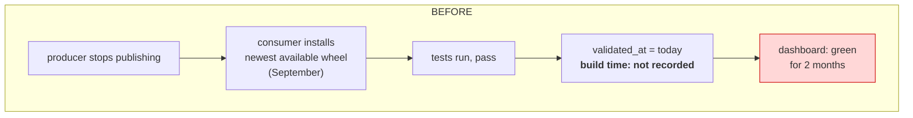
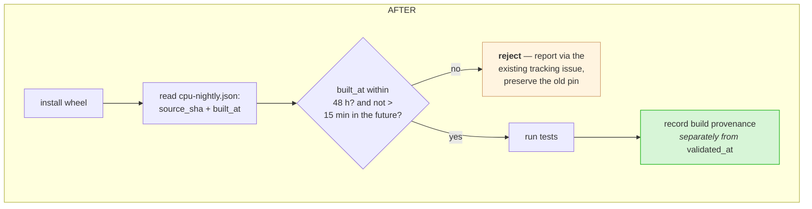

# PR #6752 — a green CI run that proved nothing for two months

| | |
|---|---|
| **PR** | [LMCache/LMCache#6752](https://github.com/LMCache/LMCache/pull/6752) — *"[CI] Reject stale CPU nightly builds and retain provenance"* |
| **Author** | [`@maobaolong`](https://github.com/maobaolong) |
| **Merged** | 2026-11-20, as [`c7e1e1f4`](https://github.com/LMCache/LMCache/commit/c7e1e1f4cedac99c4fa9e7beefd94b8b2a5b2650) |
| **Diff size** | 10 files, +308 / −11 — CI scripts, two workflows, `AGENTS.md`, and 112 lines of tests |
| **Area** | CI / release engineering; no `lmcache/` source changed |

> **Verification status.** Nothing here was executed — these are GitHub Actions workflows
> and scripts that need the project's CI environment and credentials. Everything is read
> from the merged diff and the PR description. The post-merge confirmation quoted in §6 is
> the author's, from the PR.

---

## 1. Why a CI PR is in this guide

Because the failure mode is one the rest of this guide keeps running into, in a new place.

LMCache's CPU nightly job installs a `vllm-cpu-nightly` wheel and runs verification against
it. The wheel is produced by a *different* repository (`LMCache/vllm-cpu`). When that producer
stopped publishing, the consumer kept installing the newest wheel it could find — a
**September** wheel — and kept passing.

From the PR:

> LMCache's CPU nightly verification keeps testing September wheels after the producer stops
> publishing. **A passing run refreshes validation history without showing that the build
> itself is stale.**

So for two months the signal said "CPU support verified today" and meant "CPU support
verified against two-month-old code, today". That is the same shape as
[#5022](../issue-deep-dives/difficult-5022-turboquant-sm80-bfloat16.md) (a serde that failed
every task while the server looked healthy) and
[#6698](../issue-deep-dives/medium-6698-blend-matcher-slot-ownership.md) (an index that
silently found less): **a system that degrades into a state indistinguishable from the
healthy one.** Here the degraded thing is the test suite itself, which is worse, because it
is what you would use to detect the others.

---

## 2. The conflated quantity

One idea does most of the work. There were two different timestamps collapsed into one:

| Quantity | Means | Was recorded? |
|---|---|---|
| `validated_at` | when we last ran the tests | yes |
| **build time / source SHA** | what we ran them *against* | **no** |

A nightly job that records only `validated_at` answers "did the suite pass recently?" and
cannot answer "was there anything new to test?". Re-running yesterday's test on last
September's artifact updates the first and leaves the second invisible.

The `AGENTS.md` note the PR adds puts it in one line, which is the sentence worth
remembering:

> Compare the wheel's build time with `validated_at`: **repeating a passing test does not
> make an old build fresh.**





---

## 3. The change

### 3.1 Read provenance from the artifact

A new script,
[`.github/scripts/cpu_nightly.py`](https://github.com/LMCache/LMCache/blob/53bde913de1adae2a380fe0c2de8d2b9355b4702/.github/scripts/cpu_nightly.py):

```python
"""Install CPU nightly URL dependencies and reject stale nightly builds.

The producer stores URL requirements and provenance in dist-info/cpu-nightly.json.
Older pinned wheels have no manifest; their .devYYYYMMDDHHMM version records
the UTC build time. Freshness checks run in nightly verification only.
"""
```

```python
@dataclass(frozen=True)
class NightlyBuild:
    """Provenance and URL dependencies embedded by the CPU wheel producer."""

    source_sha: str
    built_at: datetime
    direct_requirements: list[str]
```

The provenance travels **inside the wheel** (`dist-info/cpu-nightly.json`), not alongside it.
That is the right place: a manifest in the artifact cannot drift from the artifact, cannot be
lost in transit between repositories, and is available to anyone who installs it.

With a fallback for wheels predating the manifest:

```python
    manifest = dist.read_text("cpu-nightly.json")
    if manifest is None:
        stamp = re.search(r"\.dev(\d{12})(?:\+.*)?$", dist.version)
        if stamp is None:
            raise ValueError("CPU nightly has no build manifest or timestamp")
        return NightlyBuild(
            "",
            datetime.strptime(stamp[1], "%Y%m%d%H%M").replace(tzinfo=timezone.utc),
            [],
        )
```

Mining the build time out of the PEP 440 `.devYYYYMMDDHHMM` version segment — the only
provenance an old wheel carries. Note `source_sha=""`: it is **honest about what it does not
know** rather than inventing a placeholder, and the timestamp is explicitly `timezone.utc`
rather than naive, which is the sort of thing that otherwise produces a 24-hour staleness bug
somewhere in a different timezone.

If neither source exists, it raises. No silent "assume fresh".

### 3.2 The freshness window, in both directions

> Reject CPU nightly builds **older than 48 hours** (or **more than 15 minutes in the
> future**) during nightly verification.

48 hours rather than 24: a nightly job needs slack for a producer that is late, a weekend, or
a single failed publish. Tight enough that two months is caught immediately.

The future bound is the interesting half. A build timestamped ahead of now means clock skew
or a malformed version string — a *provenance* problem, and precisely the thing an attacker or
a misconfigured builder would produce to defeat a staleness check. 15 minutes tolerates
ordinary NTP drift; anything beyond it is rejected rather than treated as maximally fresh.
**Validating both bounds of a timestamp is the difference between a freshness check and a
freshness suggestion.**

### 3.3 Where the check does and does not apply

> **PR builds keep their verified pins without an age gate.**

A deliberate exemption, and correct. A PR is testing *the PR*, against whatever pin the
branch verified. Failing someone's unrelated PR because an upstream producer went quiet would
be noise that teaches contributors to ignore CI. The gate belongs on the job that makes the
claim "CPU support is current" — nightly verification — not on every job that happens to
install a wheel.

### 3.4 Failure handling

Three choices, each the less obvious one:

- **Preserve the existing latest pointer on failure.** A failed verification must not
  overwrite a known-good pin with nothing. Failure means "no new information", not "discard
  what we had".
- **Report stale builds through the existing tracking issue.** Reuses the established
  channel rather than adding a new notification nobody has subscribed to.
- **Fail the aggregation job when tests or pin publication fail.** Previously an aggregation
  step could apparently succeed while its inputs had not. A summary job that can be green
  over red inputs is the same bug as the one being fixed, one level up.

### 3.5 Record provenance separately

> Record build provenance **separately from `validated_at`** in `tested_runtimes.jsonl`.

The structural fix. Two facts, two fields, so the question "is this claim current?" becomes
answerable from the data rather than requiring an archaeologist. The PR also retires the old
format cleanly — *"The old `tested_vllm_versions.csv` remains historical"* — keeping history
readable without pretending it has the new fields. A JSONL file also extends with new keys
without breaking old readers, which a CSV does not.

### 3.6 A recovery path, and a captured gotcha

The `AGENTS.md` addition documents how to get out of a hole without a full rebuild:

> For recovery, dispatch `nightly_build.yml` with `cpu_verify_only=true` to run CPU
> verification and pin reporting without rebuilding unrelated accelerators.

and records an unrelated, hard-won operational fact in the same place:

> CPU serving tests must set `lmcache.mp.use_vmm_api=false` in connector extra config:
> current vLLM checks the declared cache access before initializing the device and rejects
> the automatic CUDA VMM export mode on CPU.

That second note is the kind of thing that costs someone an afternoon exactly once per person
until it is written down. `AGENTS.md` is a slightly odd home for it — it is a human-owned
policy file — but it is the file contributors and agents actually read before touching CI, so
in practice it is the right one.

---

## 4. The tests

112 of the 308 added lines are `tests/ci/test_cpu_nightly.py`. **Unit tests for a CI script**
— which is rarer than it should be, and is the thing that makes this PR exemplary rather than
merely correct.

CI code is usually the least-tested code in a repository, on the reasoning that it is "just
glue" and its failures are visible. This PR is a refutation: the glue had been silently
producing a false claim for two months, and the pieces worth testing — manifest parsing, the
legacy `.devYYYYMMDDHHMM` fallback, both ends of the freshness window, the missing-provenance
error — are pure functions over strings and timestamps. Cheap to test, impossible to
exercise reliably in a real nightly run, since you would have to wait for a producer to go
quiet.

---

## 5. Why it is correct

- **It separates the two conflated facts** (when we tested, what we tested) instead of adding
  a heuristic over the conflated one.
- **Provenance lives in the artifact**, so it cannot drift from what was installed.
- **Both timestamp bounds are validated**, closing the clock-skew path through the check.
- **Absent provenance is an error**, not an assumption of freshness.
- **The gate is scoped to the job that makes the claim**; PR builds are unaffected.
- **Failure preserves prior state** rather than overwriting a good pin.
- **The parsing logic is unit-tested**, including the legacy path.

---

## 6. The author's post-merge confirmation

Unusually, the PR description was updated after merge with read-back evidence:

> **Merged and promoted:** #6752 merged as `c7e1e1f4…` after maintainer approval. [Guarded
> CPU promotion] passed and both Linux and macOS pointers were read back at
> `0.34.1.dev202611191847`, source `b2c92fa9c1d8be6790ddd0852b547bbf927bfbd0`. The latest CPU
> records in `tested_runtimes.jsonl` retain per-OS build times, consumer `4f7d30f7` and
> verification run `44619051586`. The legacy CSV remains historical.

Note the form of the verification: not "CI went green" but **the written state was read back
and inspected** — the pointers resolve, the version is a November build (not September), the
source SHA is present, and the new per-OS build-time fields are actually populated. For a
change whose entire subject is "a green run was not evidence", confirming by reading the
artifact rather than the status badge is the only consistent way to close it.

---

## 7. What to take from it

**Validation has two timestamps, and most systems record one.** *When did we check?* and
*what did we check?* Only the first is usually captured, and only the second tells you whether
the check meant anything. Any "verified nightly" badge should be read as a claim about both.

**A green test can be a false claim.** The suite passed, correctly, against a stale input.
"Did it pass?" and "did it test the current thing?" are independent questions, and CI
dashboards almost universally display the first while implying the second.

**Validate both ends of a timestamp.** A freshness check that only rejects *old* builds is
defeated by a clock set forward. Fifteen minutes of tolerance, then reject.

**Scope a new gate to the claim it protects.** Gating nightly verification catches the real
problem; gating every PR install would have generated noise that trains people to ignore CI.
A gate that fires on unrelated work gets disabled.

**Failure should preserve state, not clear it.** The old pin stays on a failed run. "I learned
nothing" and "the previous answer is void" are different conclusions.

**Test your CI scripts.** The staleness logic is pure functions over strings and times. 112
lines of tests, and the alternative was waiting two months to find out.

---

## 8. Where to look next

- [Code map §3.6](../03-code-map.md#36-where-the-tests-are) — what the pytest suite covers and what only Buildkite does. The same "what is actually being tested?" question.
- [Observability §10](../features/09-observability.md#10-what-to-watch) — "check the telemetry is healthy before trusting it", which is this PR's lesson applied to metrics.
- [#5022 deep dive](../issue-deep-dives/difficult-5022-turboquant-sm80-bfloat16.md) — degradation that looks like health, in the serde layer.
- Upstream: [`AGENTS.md`](https://github.com/LMCache/LMCache/blob/53bde913de1adae2a380fe0c2de8d2b9355b4702/AGENTS.md) for the CPU nightly notes this PR added.
