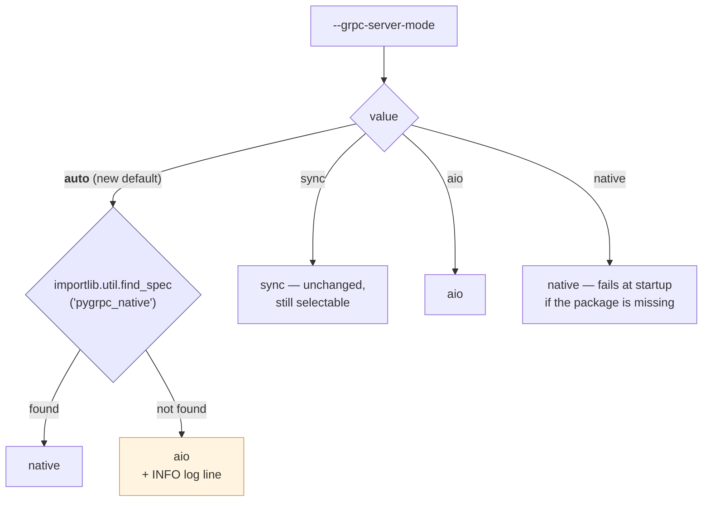

# PR #6754 — changing a default from `sync` to "the best thing installed"

| | |
|---|---|
| **PR** | [LMCache/LMCache#6754](https://github.com/LMCache/LMCache/pull/6754) — *"[MP][gRPC] Default to native or aio gRPC server mode"* |
| **Author** | [`@theminjunchoi`](https://github.com/theminjunchoi) |
| **Merged** | 2026-11-19, as [`e0e64d0e`](https://github.com/LMCache/LMCache/commit/e0e64d0e) |
| **Diff size** | 6 files, +87 / −20 |
| **Context** | Fixes [#6733](https://github.com/LMCache/LMCache/issues/6733). Part of [#6714](https://github.com/LMCache/LMCache/issues/6714), the gRPC migration |
| **AI-assisted** | Yes, declared, with an attached explainer |

> **Verification status.** Not reproduced — needs a running MP server and the optional
> `pygrpc-native` package. The resolution logic is read from the diff; the performance
> rationale is the author's claim, not measured here.

---

## 1. What it does

`--grpc-server-mode` gains an `auto` value, which becomes the default. `auto` resolves to
**`native`** if `pygrpc-native` is installed and **`aio`** if it is not. The old default,
`sync`, is still selectable but no longer chosen for you.

This is a small diff about a large question: **how do you change a default safely in a
project where the default was known to be slow?**

---

## 2. Why the old default was wrong

The PR's whole technical argument is one sentence:

> The old default, `sync`, makes every other call wait behind queued affinity calls.

LMCache's server dispatches some handlers onto an affinity thread pool — requests are pinned
by client identity so a given engine's calls stay on one thread
([MP architecture](../features/01-mp-architecture.md), request dispatch). On a **synchronous**
gRPC server, the gRPC thread pool is also what serves every *other* call, so a queue of
affinity work behind one client blocks unrelated requests: a lookup from engine B waits on a
transfer from engine A. Head-of-line blocking across tenants.

`aio` (asyncio-based) and `native` (backed by the `pygrpc-native` extension) do not have that
coupling.

So `sync` was not merely slower — it made latency on one connection depend on load on
another. The kind of default that is fine in a smoke test and bad in production.

---

## 3. The three modes, and the resolution



The resolver, in
[`server_builder.py`](https://github.com/LMCache/LMCache/blob/53bde913de1adae2a380fe0c2de8d2b9355b4702/lmcache/v1/multiprocess/transport/grpc_impl/server_builder.py):

```python
def resolve_grpc_server_mode(mode: str) -> str:
    """Resolve ``auto`` to ``native`` if pygrpc-native is installed, else ``aio``.

    Args:
        mode: The configured ``grpc_server_mode``.

    Returns:
        ``sync``, ``aio`` or ``native``.
    """
    if mode != "auto":
        return mode
    if importlib.util.find_spec("pygrpc_native") is not None:
        return "native"
    logger.info("pygrpc-native is not installed; using the aio gRPC server")
    return "aio"
```

Four details that make this a good implementation of "auto":

**`find_spec`, not `import`.** It answers "is this installable module present?" without
executing it — so probing costs nothing and cannot fail from a broken module's import side
effects.

**It logs the fallback at INFO.** The one real hazard of an auto default is that nobody knows
what they got. A line saying *why* `aio` was chosen turns a silent decision into a
greppable one. (Only the fallback logs; the `native` path is the intended outcome.)

**Explicit modes keep failing loudly.** From the PR: *"Setting a mode explicitly works as
before, so `native` without the package still fails at startup."* This is the important
asymmetry. `auto` means "pick what works"; `native` means "I require this". If `auto` had
been implemented by making `native` fall back, an operator who *needs* the native server
would silently get `aio` — and never know their deployment was mis-provisioned. Keeping the
explicit path strict preserves the ability to assert a requirement.

**One resolution point.** `resolve_grpc_server_mode` is called inside the builder, so every
construction path gets the same answer:

```python
-    if mp_config.grpc_server_mode == "native":
+    mode = resolve_grpc_server_mode(mp_config.grpc_server_mode)
+    if mode == "native":
-    elif mp_config.grpc_server_mode == "aio":
+    elif mode == "aio":
```

Resolving at the single place where the decision is consumed, rather than normalising config
at parse time, keeps the raw configured value (`"auto"`) intact for diagnostics while
guaranteeing no caller can bypass the resolution.

---

## 4. The reach nobody expects: the P2P listener

The config docstring change is where the genuinely surprising consequence lives:

```python
-    ``pygrpc-native`` package. Only used by gRPC transport."""
+    ``pygrpc-native`` package. ``auto`` picks ``native`` when that package is
+    installed and ``aio`` otherwise. Used by gRPC transport and by the P2P
+    listener."""
```

and the PR spells it out under "Worth checking":

> The P2P listener is always a gRPC server, **even with `--transport zmq`**. When P2P is on,
> it now runs `native` or `aio` instead of `sync`.

So a flag documented as *"Only used by `--transport grpc`"* was, in fact, also governing the
P2P listener — which is a gRPC server regardless of the main transport
([P2P sharing](../features/08-p2p-sharing.md)). An operator running `--transport zmq` with
P2P enabled would reasonably have believed `--grpc-server-mode` was inert for them, and this
PR changes their listener's concurrency model.

The honest handling: the author found it, fixed the docstring and the `--help` text in the
same PR, and flagged it for reviewers rather than letting it be discovered later. A one-word
scope error in a help string (`Only`) had been quietly wrong for as long as P2P has existed.

---

## 5. The reviewer question the author asked

Also under "Worth checking":

> The plain `grpc` CPU device CI leg doesn't set a mode, so it now runs `aio`, same as the
> `grpc-aio` leg. **Should I pin it to `sync` to keep an e2e run on it?**

This is the best thing in the PR. Changing a default **silently changed what CI tests**: a
leg that existed to exercise the default now duplicates another leg, and `sync` — still a
supported, selectable mode — loses its only end-to-end coverage.

Nearly every default change has this shape, and it is almost never noticed. The old default
was tested *because* it was the default; making it non-default orphans it. If `sync` remains
supported, something has to keep running it, or it will rot until someone selects it in
production and finds out.

Worth noting the author also split an unrelated change out mid-review:

> The stream error fix that used to be here is now #6757, as suggested in review.

A streaming-handler error fix (so a failing handler ends the stream normally instead of
returning `INTERNAL`, which made KV event subscribers stop rather than resubscribe) started
in this PR and was moved to its own. The first commit message in the squashed history still
mentions it — a small archaeological trace of the split.

---

## 6. Why it is a safe default change

- **It cannot fail where the old default worked.** `aio` ships with `grpcio`; there is no new
  hard dependency, so the worst case for an existing deployment is a different (better)
  concurrency model, not a startup failure.
- **It is reversible with one flag.** `--grpc-server-mode sync` restores the old behaviour
  exactly.
- **Explicit requirements still assert.** `native` without the package fails at startup, so
  nobody silently loses the performance they provisioned for.
- **The resolution is logged** when it falls back.
- **It is tested at the decision level.** *"The new test checks which server gets built for
  both the worker server and the P2P listener, with and without `pygrpc-native` installed."*
  Testing *which server was constructed*, under both package states, and for both construction
  sites — including the P2P listener that §4 exposed — is exactly the right granularity: it
  pins the resolution logic without needing either server to actually run.

---

## 7. What to take from it

**"Auto" should resolve to the best available, while explicit means required.** The two
behaviours have to differ: if explicit `native` also fell back, there would be no way to
state a hard requirement, and a mis-provisioned host would look healthy.

**Log the inference.** A default that adapts to the environment is a default nobody can
predict from the config file. One INFO line is the difference between a helpful default and
an unanswerable support question.

**Changing a default changes your test matrix.** The old default was covered *because* it was
the default. Ask what loses coverage — the author did, in the PR description, which is where
that question gets answered rather than discovered.

**Check what else reads the flag.** `--grpc-server-mode` was documented as gRPC-transport-only
and also drove the P2P listener. Before changing a default, grep for every consumer; the
docstring is evidence, not proof.

**Use `find_spec` for capability probes.** Cheaper than an import, no side effects, and it
cannot fail for reasons unrelated to presence.

---

## 8. Where to look next

- [Transport layer §5](../features/06-transport-layer.md#5-grpc) — the gRPC endpoint, method registry, and when to prefer gRPC over ZMQ.
- [#6543 deep dive](../issue-deep-dives/medium-6543-zmq-grpc-fail-fast.md) — the same author's fail-fast fix for the mismatch that the gRPC migration was about to make common; this PR is the other half of that story.
- [P2P sharing](../features/08-p2p-sharing.md) — the listener §4 is about.
- [MP architecture](../features/01-mp-architecture.md) — the affinity thread pool whose queueing made `sync` a poor default.
