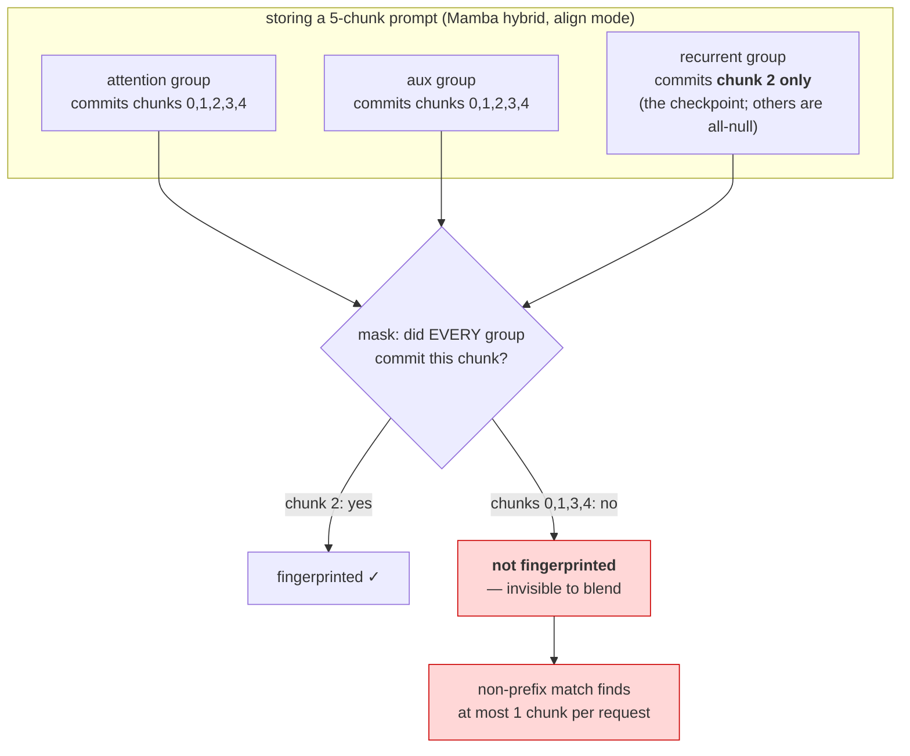

# PR #6767 — fingerprint a chunk against the groups a blend actually reads

| | |
|---|---|
| **PR** | [LMCache/LMCache#6767](https://github.com/LMCache/LMCache/pull/6767) — *"[Blend] Fingerprint stored chunks on the object groups a blend reads"* |
| **Author** | [`@deng451e`](https://github.com/deng451e) / weishu |
| **Merged** | 2026-11-20, as [`53bde913`](https://github.com/LMCache/LMCache/commit/53bde913de1adae2a380fe0c2de8d2b9355b4702) — **the revision this whole guide is pinned to** |
| **Diff size** | 4 files, +107 / −6; the production change is **+32 / −6** |
| **Area** | CacheBlend × hybrid (Mamba) models |

> **Verification status.** Not reproduced: the effect needs a Mamba-hybrid model, a
> CacheBlend deployment and an H200. The author's measurement is quoted as theirs. The
> code paths and group-classification logic are read from the diff and from `read_set.py`
> at this revision.

---

## 1. What it does, in one sentence

CacheBlend advertised a stored prompt as having only **one** reusable chunk on Mamba-hybrid
models, because a chunk was fingerprinted only if *every* object group committed it — and
the recurrent group deliberately commits only one. The fix lets the blend store check just
the groups a blend actually reads.

---

## 2. Background: three kinds of object group

A hybrid model's layers have different caching needs, so LMCache splits them into **object
groups** ([vLLM integration §5](../features/05-vllm-integration.md#5-kv-cache-groups)). For a
Mamba hybrid there are three kinds, and `_classify_cb_read_groups` labels them:

```python
@dataclass
class _BlendReadGroups:
    blend_gids: tuple[int, ...]
    prefix_gids: tuple[int, ...]
    recurrent_gids: tuple[int, ...]
    attn_gids: tuple[int, ...]
```

| Group kind | Holds | Per chunk? |
|---|---|---|
| **attention** | per-token K/V for attention layers | yes, every chunk |
| **aux** | auxiliary per-chunk state | yes, every chunk |
| **recurrent** | the Mamba state snapshot | **no — one checkpoint chunk only** |

That last row is the crux. Under `--mamba-cache-mode align`, vLLM snapshots recurrent state
only at chosen boundaries ([#5151](../issue-deep-dives/difficult-5151-mamba-full-hit-restoration.md)
is a whole deep dive on the consequences), so LMCache's store **deliberately skips** the
other chunks' all-null state blocks. Not storing them is correct: they contain nothing.

And a blend never needs them. From the PR:

> A blend reads two object groups for a non-prefix match: attention KV and the aux group
> (`_classify_cb_read_groups`: `blend_gids = attention + aux`). **It never reads recurrent
> state.**

---

## 3. The defect

The blend STORE hook decides which stored chunks to *fingerprint* — i.e. register in the
`BlendTokenRangeMatcher` so later non-prefix probes can find them. It used
`store_with_chunk_mask`, whose mask marked a chunk as stored only when **all** object groups
had committed it:

```python
-        # A chunk is stored only when every object group committed its key.
```

Put the two facts together:



The PR's statement of the outcome:

> So a stored prompt advertised just its checkpoint chunk, and non-prefix matches on Mamba
> hybrids found **at most one chunk per request**, even though the attention KV and aux state
> of every chunk were in L1.

The data was all there. The index was told to ignore it, by a conjunction over a group whose
absence is by design.

**This is a conjunction over the wrong set** — a close cousin of the bug in
[#6698](../issue-deep-dives/medium-6698-blend-matcher-slot-ownership.md), which the same
author fixed three days earlier: both are cases where blend's index lost entries that were
genuinely present, silently, with no error and no metric movement.

---

## 4. The change

### 4.1 Make the checked set a parameter

[`lmcache_driven_transfer.py`](https://github.com/LMCache/LMCache/blob/53bde913de1adae2a380fe0c2de8d2b9355b4702/lmcache/v1/multiprocess/modules/lmcache_driven_transfer.py):

```python
+        mask_object_groups: Sequence[int] | None = None,
```

```python
+            mask_object_groups: Object groups the returned mask checks; None
+                checks every object group. A caller that reads only some
+                groups passes those.
```

```python
+        mask_gids = (
+            range(num_object_groups)
+            if mask_object_groups is None
+            else [g for g in mask_object_groups if 0 <= g < num_object_groups]
+        )
-            and all(keys[i] in all_dict for keys in obj_keys_per_obj_group)
+            and all(obj_keys_per_obj_group[g][i] in all_dict for g in mask_gids)
```

Two things worth copying here:

- **`None` preserves today's behaviour exactly.** The default checks every group, so no
  existing caller changes. The PR is explicit: *"No other caller changes; the store itself,
  what is committed, and the prefix/recurrent read paths are untouched."*
- **The indices are filtered, not trusted:** `if 0 <= g < num_object_groups`. A caller
  passing a stale group id from a different registration cannot index out of range. For a
  parameter derived from live registration state that can change underneath you, this is
  cheap insurance.

### 4.2 Pass the blend's own read set

[`blend/store.py`](https://github.com/LMCache/LMCache/blob/53bde913de1adae2a380fe0c2de8d2b9355b4702/lmcache/v1/multiprocess/modules/blend/store.py):

```python
+        # A blend reuses only the attention and aux groups, so check just those
+        # and skip the recurrent-state check. If the groups to check are
+        # unknown, check every group.
+        try:
+            entry = self._transfer_module.get_and_touch_context_entry(instance_id)
+            if entry is not None:
+                attn_desc = entry.cache_context.kv_layer_groups_manager.get_attn_desc()
+                extra["mask_object_groups"] = _classify_cb_read_groups(
+                    attn_desc.num_object_groups, attn_desc.group_kinds
+                ).blend_gids
+        except Exception:
+            logger.debug(
+                "CB fingerprint groups unresolved for instance %d", instance_id
+            )
```

The set is **derived from the registered layout**, not configured. `_classify_cb_read_groups`
already existed to compute the blend's read legs for the *read* path; the store path now asks
the same function. One definition of "what a blend reads", used by both sides — which is the
property that stops them drifting apart again.

### 4.3 The one debatable line

```python
+        except Exception:
```

A bare `except Exception` around the resolution, falling back to checking every group. This
sits awkwardly against `AGENTS.md`, which asks for narrow `try/except` with specific types
and warns against *"handling for failures that cannot occur"*.

The argument for it: `_classify_cb_read_groups` **raises deliberately** when a layout is
unresolvable —

```python
    Raises:
        RuntimeError: If a multi-group layout has no resolvable read set:
            kind labels are missing, there is no attention group, or there
            is more than one aux group.
```

— and the registration can also be absent or change concurrently. The fallback is the
*previous* behaviour, which is conservative (under-fingerprints, never over-fingerprints). So
a failure here costs an optimisation, never correctness.

The argument against: `except Exception` also swallows programming errors, and the
`logger.debug` makes them nearly invisible. `except (RuntimeError, AttributeError)` would
have covered the stated failures and let a genuine bug surface. Given this is a *store* path
where an exception would otherwise fail the store, erring toward swallowing is defensible —
but it is the kind of line that hides the next bug in this area, and the two blend bugs
already found in this set were both silent.

---

## 5. Why it is correct

- **It narrows a conjunction to the set the consumer cares about.** Fingerprinting exists for
  blend; blend reads attention + aux; so those are the groups whose commitment matters.
- **Default behaviour is unchanged** (`None` → all groups), so non-blend callers and
  non-hybrid models see identical behaviour.
- **The read set is derived from the same function the read path uses**, so the two cannot
  disagree.
- **It fails safe.** Unresolvable layout → check every group → the old, conservative result.
- **Nothing about storage changes.** What gets committed, and the prefix and recurrent read
  paths, are untouched: the PR changes only which stored chunks get *advertised*.

### 5.1 Measured

The author reports it on *"Nemotron-3-Nano-30B (Mamba2 hybrid, `mamba_cache_mode=align`,
chunk 2176), H200, the cacheblend-plugin CI `recall_perf` step (16K, bs 1)"*. The quoted
description truncates before the numbers, so this guide does not reproduce a figure — but the
mechanism predicts the shape: before, at most one chunk per request could be found by a
non-prefix match; after, every stored chunk whose attention and aux state committed can be.

---

## 6. What to take from it

**A conjunction is a specification of who must agree.** `all(groups)` was written when every
group committed every chunk, and became wrong when a group type arrived that commits one
chunk by design. The question to ask of any `all(...)` over a collection that can grow new
*kinds* of member: *does this new kind belong in the quorum?*

**Derive policy from the consumer, not from the producer.** The store side was asking "did
everyone store this?" when the useful question was "can the reader use this?" Those coincide
only while all readers need everything.

**One function, two call sites, no drift.** Reusing `_classify_cb_read_groups` on the store
path means a future change to what a blend reads updates both sides at once. A hardcoded
`(0, 1)` would have worked today and rotted.

**`--mamba-cache-mode all` being removed narrowed the blast radius to 100%.** The PR notes
align is now *"vLLM's only snapshotting mode since `--mamba-cache-mode all` was removed"*, so
every Mamba hybrid using CacheBlend hit this. An upstream deprecation turned a
configuration-specific bug into a universal one — worth watching for when a dependency drops
a mode.

---

## 7. Where to look next

- [#6698 deep dive](../issue-deep-dives/medium-6698-blend-matcher-slot-ownership.md) — the sibling blend-index bug, same author, three days earlier.
- [#5151 deep dive](../issue-deep-dives/difficult-5151-mamba-full-hit-restoration.md) — why align-mode recurrent state only exists at boundaries, which is the fact this PR builds on.
- [vLLM integration §5](../features/05-vllm-integration.md#5-kv-cache-groups) — object groups and hybrid layouts.
- [KV cache lifecycle §7](../features/02-kv-cache-lifecycle.md#7-store) — the store path this hooks into.
